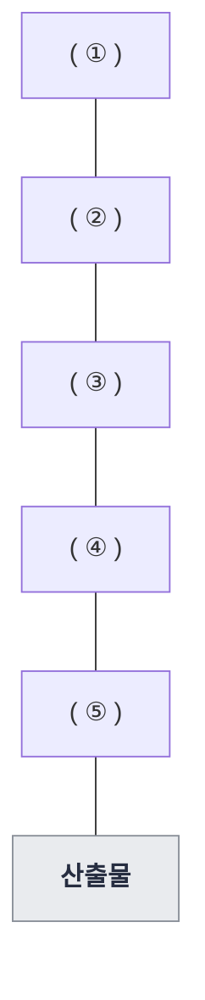

# DB

21개 회차 420문제 중 이론이 242문제이고, 그중 DB 영역은 매 회차 1~4문제가 나왔다. 형태는 "설명 3~4개를 보기와 짝짓기"(릴레이션 용어·스키마·키), "표를 보고 판별하기"(정규형·위반한 무결성·카디널리티와 차수), "연산 결과 표 채우기"(관계대수)가 대부분이다. 2024년 이후에는 23-1의 릴레이션 용어, 24-1의 정규형 표, 21-1의 카디널리티·차수처럼 2~4년 전 문제가 거의 그대로 다시 나오는 비율이 높다.

## 관계대수·관계해석
출제: 25-3, 25-2, 24-1, 23-3, 22-3, 22-2, 20-3
형태: 연산 결과 표 채우기 / 연산 이름 ↔ 기호 짝짓기 / 조인 종류 설명 → 이름

### 개념

관계 대수와 관계 해석은 둘 다 관계형 DB에서 원하는 데이터를 얻어 내는 방법을 적는 언어다. 다만 무엇을 적느냐가 다르다. 먼저 표로 한눈에 보면 이렇다.

| 구분 | 키워드 | 연산자·특징 |
|---|---|---|
| **관계 대수** | 절차적 언어, 어떻게(How) | 원하는 데이터를 얻는 처리 절차를 기술 |
| **관계 해석** | 비절차적 언어, Predicate Calculus, Codd | 원하는 데이터가 무엇(What)인지만 기술. 튜플·도메인 관계 해석 |
| 일반 집합 연산자 | ∪ ∩ - × | 합집합·교집합·차집합·카티션 프로덕트 |
| 순수 관계 연산자 | σ π ⋈ ÷ | 셀렉트·프로젝트·조인·디비전 |

### 관계 대수(Relational Algebra)란

**관계 대수**란 관계형 DB에서 원하는 데이터를 찾는 방법을 기술하는 절차적 정형 언어다. 릴레이션(테이블)을 하나 이상 입력으로 받아서 결과로 새 릴레이션을 만들어 내는 연산들의 모음이라고 보면 된다.

#### 절차적 언어와 비절차적 언어

관계 대수와 관계 해석을 가르는 기준이 바로 이것이다. DB 언어는 크게 절차적 언어와 비절차적(선언적) 언어로 나뉜다.

- **절차적 언어(Procedural Language)**: "어떻게(How)" 접근하고 가져올지를 명시. 결과를 얻는 구체적인 처리 절차와 순서를 단계별로 기술. 대표는 관계 대수(SELECT를 먼저 할지 JOIN을 먼저 할지 순서가 정해져 있음)
- **비절차적 언어(Non-procedural Language)**: "무엇(What)"을 원하는지만 명시. 얻는 방법과 절차는 DBMS에 위임. 대표는 관계 해석과 SQL(SELECT * FROM ... WHERE ...처럼 조건만 적으면 내부 처리 절차는 옵티마이저가 결정)

정리하자면 관계 대수는 '과정'을, 관계 해석은 '목표'를 중심으로 적는 언어다.

### 관계 대수 연산자

관계 대수 연산자는 크게 일반 집합 연산자와 순수 관계 연산자로 나뉜다.

#### 일반 집합 연산자

수학의 집합 이론에서 가져온 연산자다. 그래서 두 릴레이션이 **합병 가능(Union-compatible)**해야 한다는 전제 조건이 붙는데, 두 릴레이션의 속성 개수가 같고 대응하는 속성끼리 도메인도 같아야 한다는 뜻이다.

| 연산자 | 기호 | 설명 |
|---|---|---|
| **합집합** | ∪ | 두 릴레이션의 튜플을 모두 포함한 릴레이션 반환 (중복 제외) |
| **교집합** | ∩ | 두 릴레이션에 공통으로 있는 튜플만으로 구성된 릴레이션 반환 |
| **차집합** | - | 첫 번째 릴레이션에는 있고 두 번째 릴레이션에는 없는 튜플 반환 |
| **카티션 프로덕트** | × | 두 릴레이션의 튜플을 순서쌍으로 조합해 만들 수 있는 모든 튜플 반환 |

#### 카티션 프로덕트 (Cartesian Product) 예시

카티션 프로덕트는 표로 직접 보면 금방 감이 온다. 릴레이션 R과 S가 아래와 같다고 해보자.

릴레이션 R

| 이름 |
|---|
| 김감자 |
| 이고구마 |

릴레이션 S

| 과목 |
|---|
| DB |
| 네트워크 |
| 보안 |

R × S는 R의 튜플 하나하나를 S의 튜플 모두와 짝짓는다. 그래서 결과는 2 × 3 = 6행이다.

| 이름 | 과목 |
|---|---|
| 김감자 | DB |
| 김감자 | 네트워크 |
| 김감자 | 보안 |
| 이고구마 | DB |
| 이고구마 | 네트워크 |
| 이고구마 | 보안 |

조건 없이 모든 조합을 만들기 때문에 결과의 튜플 수는 R의 튜플 수 × S의 튜플 수가 된다. 그리고 합집합·교집합·차집합에는 합병 가능 조건이 필요했지만, 카티션 프로덕트는 위처럼 속성이 달라도 쓸 수 있다.

#### 순수 관계 연산자

관계형 데이터베이스 모델을 위해 따로 만든 연산자다.

| 연산자 | 기호 | 설명 |
|---|---|---|
| **셀렉트(Select)** | σ(Sigma) | 주어진 조건을 만족하는 튜플(행)만으로 구성된 수평적 부분집합 반환 |
| **프로젝트(Project)** | π(Pi) | 주어진 속성(열)만으로 구성된 수직적 부분집합 반환 (중복 제외) |
| **조인(Join)** | ⋈(Bowtie) | 공통 속성을 기준으로 두 릴레이션을 결합한 새 릴레이션 반환 |
| **디비전(Division)** | ÷ | A ÷ B: B의 모든 튜플과 관계를 맺고 있는 A의 튜플 반환 |

디비전 칸에는 깔린 조건이 두 가지 있다. A는 B와 공통된 속성(컬럼)을 가져야 하고, 반환되는 것은 A의 튜플 중 B의 튜플과 공통 속성 값이 일치하는 튜플이다.

#### 조인 (Join) 연산 예시

조인은 두 릴레이션에서 공통 속성 값이 같은 튜플끼리 결합해 하나의 릴레이션으로 만드는 연산이다. 학생 릴레이션과 수강 릴레이션을 조인해 보자.

릴레이션 R (학생)

| 학번 | 이름 |
|---|---|
| 100 | 김감자 |
| 200 | 이고구마 |
| 300 | 박옥수수 |

릴레이션 S (수강)

| 학번 | 과목 |
|---|---|
| 100 | DB |
| 100 | 네트워크 |
| 200 | DB |

공통 속성은 학번이다. R ⋈ S를 하면 학번이 같은 튜플끼리 결합된다.

| 학번 | 이름 | 과목 |
|---|---|---|
| 100 | 김감자 | DB |
| 100 | 김감자 | 네트워크 |
| 200 | 이고구마 | DB |

- 학번 100(김감자): 수강 테이블에 튜플 2개, 결과에 2행
- 학번 200(이고구마): 수강 테이블에 튜플 1개, 결과에 1행
- 학번 300(박옥수수): 수강 테이블에 일치하는 튜플 없음, 결과에서 제외

위 예시처럼 공통 속성 값이 같은 튜플만 결합하는 것을 **자연 조인(Natural Join)**이라고 한다. 이 밖에도 조건을 직접 지정하는 **세타 조인(Theta Join)**, 동등 조건을 쓰는 **동등 조인(Equi Join)** 등이 있다.

#### 디비전 (Division) 연산 예시

디비전은 다른 연산자에 비해 직관적이지 않아서 예시로 익히는 게 좋다. "B 릴레이션의 모든 값과 짝을 이루는 A의 값만 골라내라"라고 이해하면 된다. 수강 릴레이션을 필수 과목 릴레이션으로 나눠 보자.

릴레이션 R (수강)

| 학생 | 과목 |
|---|---|
| 김감자 | DB |
| 김감자 | 네트워크 |
| 김감자 | 보안 |
| 이고구마 | DB |
| 이고구마 | 보안 |
| 박옥수수 | DB |
| 박옥수수 | 네트워크 |

릴레이션 S (필수 과목)

| 과목 |
|---|
| DB |
| 네트워크 |

R ÷ S를 하면 S의 모든 과목(DB, 네트워크)을 둘 다 수강한 학생만 남는다.

| 학생 |
|---|
| 김감자 |
| 박옥수수 |

- 김감자: DB O, 네트워크 O, 포함
- 이고구마: DB O, 네트워크 X, 제외 (네트워크 미수강)
- 박옥수수: DB O, 네트워크 O, 포함

디비전에서 붙잡아야 할 말은 "모든(ALL)"이다. S의 튜플 중 하나라도 빠지면 결과에 들어가지 못한다.

그럼 디비전은 속성이 2개일 때만 될까? 그렇지 않다. A 릴레이션이 B 릴레이션의 속성을 모두 포함하기만 하면 속성이 몇 개든 디비전을 할 수 있고, 결과 릴레이션의 속성은 A의 속성에서 B의 속성을 뺀 나머지가 된다. 예를 들어 A가 (학생, 과목, 학기) 3개 속성이고 B가 (과목, 학기) 2개 속성이라고 해보자.

릴레이션 A

| 학생 | 과목 | 학기 |
|---|---|---|
| 김감자 | DB | 1학기 |
| 김감자 | 네트워크 | 2학기 |
| 이고구마 | DB | 1학기 |

릴레이션 B

| 과목 | 학기 |
|---|---|
| DB | 1학기 |
| 네트워크 | 2학기 |

A ÷ B는 B의 모든 (과목, 학기) 조합과 짝을 이루는 학생만 남긴다.

| 학생 |
|---|
| 김감자 |

- 김감자: (DB, 1학기) O, (네트워크, 2학기) O, 포함
- 이고구마: (DB, 1학기) O, (네트워크, 2학기) X, 제외

이처럼 결과에는 A에만 있고 B에는 없는 속성인 학생 하나만 남는다.

### 관계 해석(Relational Calculus)

**관계 해석(Relational Calculus)**은 원하는 데이터가 무엇(What)인지만 적고, 그것을 얻는 절차는 DBMS에 맡기는 비절차적 언어다. 수학의 술어 논리(Predicate Calculus)에 기반을 두고 있고, 관계형 데이터베이스를 제안한 E. F. Codd가 함께 제시했다.

관계 해석은 변수로 무엇을 쓰느냐에 따라 두 가지로 나뉜다.

| 종류 | 변수 | 설명 |
|---|---|---|
| **튜플 관계 해석** | 튜플 | 조건을 만족하는 튜플(행)을 변수로 두고 기술 |
| **도메인 관계 해석** | 도메인 원소 | 조건을 만족하는 속성 값을 변수로 두고 기술 |

관계 대수와 관계 해석은 표현할 수 있는 질의의 범위가 같다. 같은 결과를 얻는 서로 다른 기술 방식이라고 보면 된다.

#### 튜플 관계 해석과 도메인 관계 해석

두 방식은 변수에 무엇을 담느냐만 다르다. 아래 예시는 모두 학생(학번, 이름, 학년) 릴레이션에서 3학년 학생의 이름을 구하는 같은 질의다.

| 학번 | 이름 | 학년 |
|---|---|---|
| 1001 | 김감자 | 3 |
| 1002 | 이고구마 | 2 |
| 1003 | 박옥수수 | 3 |

**튜플 관계 해석(Tuple Relational Calculus)**에서는 변수 하나가 튜플(행) 전체를 가리킨다. 기본 형식은 `{ t | P(t) }`이고 "조건 P를 만족하는 튜플 t의 집합"으로 읽는다. 속성 값은 t.속성명으로 꺼낸다.

`{ t.이름 | 학생(t) ∧ t.학년 = 3 }`

"학생 릴레이션의 튜플 t 중 학년이 3인 것의 이름"이라는 뜻이고, 결과는 김감자, 박옥수수다.

**도메인 관계 해석(Domain Relational Calculus)**에서는 변수 하나가 튜플이 아니라 속성 하나의 값(도메인 원소)을 가리킨다. 기본 형식은 `{ <x1, x2, ...> | P(x1, x2, ...) }`이다.

`{ <이름> | ∃학번 ∃학년 ( 학생(학번, 이름, 학년) ∧ 학년 = 3 ) }`

속성마다 변수를 따로 두기 때문에, 결과로 내보내지 않는 변수(학번, 학년)는 존재 정량자 ∃로 묶어 "그런 값이 있기만 하면 된다"고 표현한다. 결과는 튜플 관계 해석과 같은 김감자, 박옥수수다.

여기서 쓰는 정량자는 아래 두 개다.

| 기호 | 이름 | 의미 |
|---|---|---|
| ∃ | 존재 정량자 | 조건을 만족하는 것이 적어도 하나 존재 |
| ∀ | 전칭 정량자 | 모든 대상에 대하여 성립 |

### 기출에서 이렇게 나왔다

- 25-3: R ÷ S 결과 표 채우기 → 속성명 **A**, 값 **a1**
- 25-2: π_TTL(EMPLOYEE) 결과 표 채우기 → 헤더 **TTL**, 값 **부장·과장·대리** (22-2와 같은 유형)
- 24-1: 조인 설명 3개 → **세타 조인 / 동등 조인 / 자연 조인**
- 23-3: Select / Project / Join / Division → 기호 **σ π ⋈ ÷**
- 22-3: 합집합·카티션 프로덕트·조인·차집합·프로젝트 → **∪ × ⋈ − π**
- 22-2: π_SPC 결과 표 채우기 → 헤더 **SPC**, 값 **알감자·왕감자·씨감자** (25-2가 같은 유형)
- 22-2: 비절차적, Predicate Calculus, Codd, 튜플·도메인 → **관계 해석**
- 20-3: 설명 → 기호 **÷** (보기에 섞여 나온 ρ(Rename)는 릴레이션·속성 이름을 바꾸는 연산)

### 답 쓸 때

결과 표를 채우는 문제는 값만 쓰고 끝내면 안 되고 헤더(속성명)까지 써야 한다. 프로젝션이라면 중복 행을 하나로 줄여서 적는다. 디비전이라면 "S의 모든 값과 짝지어진 것"만 남기고, S의 속성은 결과에서 뺀다. 자세한 풀이는 [계산] 페이지에 있다.

### 기출 문제

:::q 25-3 4번
다음 테이블에 대하여 R ÷ S 연산을 수행한 결과를 쓰시오.

[R] 테이블

| A | B |
|---|---|
| a1 | b1 |
| a2 | b2 |
| a1 | b3 |

[S] 테이블

| B |
|---|
| b1 |
| b3 |

결과 테이블

| ( ① ) |
|---|
| ( ② ) |
| ( ③ ) |
| ( ④ ) |

(만약 빈칸이라고 생각되는 경우 x로 채우세요.)

정답: ①: A ②: a1 ③: x ④: x
:::

:::q 25-2 3번
다음 EMPLOYEE 테이블에 대하여 π_TTL(EMPLOYEE) 연산을 수행한 결과는 무엇인가요?

EMPLOYEE 테이블

| EMPNO | NAME | DEPT | TTL |
|---|---|---|---|
| 1001 | 홍길동 | 총무 | 부장 |
| 1002 | 이순신 | 영업 | 과장 |
| 1003 | 강감찬 | 개발 | 대리 |

결과 테이블

| (①) |
|---|
| (②) |
| (③) |
| (④) |

①,②,③,④에 들어갈 값을 쓰시오.

정답: ①: TTL ②: 부장 ③: 과장 ④: 대리
:::

:::q 24-1 12번
조인은 두 릴레이션의 공통 속성을 기본으로 튜플을 결합한다. 다음에서 설명하는 조인의 종류를 보기에서 골라 쓰시오.

①: 조인에 참여하는 두 릴레이션의 속성값을 비교하여 조건을 만족하는 튜플만 반환하는 조인

②: ①에서 조건이 정확하게 (=) 등호로 일치하는 경우의 튜플만을 반환하는 조인

③: ②에서 조인에 참여한 속성이 두 번 나오지 않도록 중복된 속성(두 번째 속성)을 제거한 결과를 반환하는 조인

보기: 동등 조인 / 자연 조인 / 세타 조인 / 중첩 조인 / 외부 조인

정답: ①: 세타 조인 ②: 동등 조인 ③: 자연 조인
:::

:::q 23-3 10번
다음 괄호 ( ) 안에 들어갈 관계대수 연산자의 기호를 쓰시오.

| 연산자 | 기호 |
|---|---|
| Select | ( ① ) |
| Project | ( ② ) |
| Join | ( ③ ) |
| Division | ( ④ ) |

①, ②, ③, ④에 들어갈 값을 쓰시오.

보기: ⋈ / σ / ÷ / × / π / ∪ / ∩ / -

정답: ①: σ ②: π ③: ⋈ ④: ÷
:::

:::q 22-3 11번
올바른 관계대수 기호를 쓰시오.

- ( ① ): 합집합
- ( ② ): 카티션 프로덕트
- ( ③ ): 조인
- ( ④ ): 차집합
- ( ⑤ ): 프로젝트

①, ②, ③, ④, ⑤에 들어갈 기호를 쓰시오.

보기: π / × / ÷ / ∪ / σ / ⋈ / ∩ / -

정답: ①: ∪ ②: × ③: ⋈ ④: - ⑤: π
:::

:::q 22-2 1번
다음 GAMJA 테이블에 대하여 π_SPC(GAMJA) 연산을 수행한 결과는 무엇인가요?

GAMJA 테이블

| REGION | NO | SPC |
|---|---|---|
| 강원도 | 100 | 알감자 |
| 충청도 | 20 | 왕감자 |
| 전라도 | 30 | 씨감자 |

결과 테이블

| (①) |
|---|
| (②) |
| (③) |
| (④) |

①,②,③,④에 들어갈 값을 쓰시오.

정답: ①: SPC ②: 알감자 ③: 왕감자 ④: 씨감자
:::

:::q 22-2 9번
다음은 관계 데이터 모델과 관련된 설명이다. 괄호 ( ) 안에 공통적으로 들어갈 용어를 쓰시오.

( )은/는 관계 데이터베이스에 대한 비절차적 언어이며, 수학의 Predicate Calculus에 기반을 두고 있다. Codd 박사에 의하여 제시되었으며, 튜플 ( ), 도메인 ( )이/가 있다.

정답: 관계 해석
:::

:::q 20-3 18번
릴레이션 B 조건에 맞는 것들만 릴레이션 A에서 튜플을 꺼내 프로젝션하는 관계대수의 기호가 무엇인지 쓰시오.

보기: ⋈ / − / σ / ∪ / ∩ / π / ÷ / ρ / ×

정답: ÷ 또는 Division 또는 디비전
:::


## 릴레이션 용어
출제: 25-3, 25-2, 25-1, 24-2, 23-1, 21-1
형태: 설명 3~4개 → 보기(한글 또는 영문) / 표를 주고 개수 세기

### 개념

DB를 공부할 때 가장 먼저 만나는 개념이 **관계 데이터 모델(Relational Data Model)**이다. 데이터를 릴레이션(Relation)이라는 2차원 테이블 모양으로 표현하는, 가장 널리 쓰이는 데이터 모델이다. 쉽게 말해 엑셀 시트처럼 행(Row)과 열(Column)로 된 표에 데이터를 저장하고 관리한다고 생각하면 된다. 이런 구조 덕분에 데이터를 직관적으로 이해할 수 있고, 정형화된 방법(SQL)으로 쉽게 다룰 수 있다.

시험에는 릴레이션을 하나 주고 카디널리티와 차수를 묻는 간단한 문제가 많이 나왔다. 그래서 각 용어의 정의를 정확히 알고 있어야 한다. 핵심 키워드부터 표로 보면 이렇다.

| 용어 | 키워드 |
|---|---|
| Attribute | 데이터 항목, 데이터 필드 |
| Tuple | 릴레이션의 행, 레코드, (속성) 중복된 값 포함 가능 |
| Relation Instance | 특정 시점 실제 데이터, 릴레이션 외연 |
| 카디널리티(Cardinality) | 튜플의 개수 |
| 차수(Degree) | 속성의 개수 |
| Domain | 속성이 가질 수 있는 값의 범위 |

### 용어 하나씩 보기

#### 릴레이션 (Relation)
- 행과 열로 구성된 2차원 테이블 자체
- 예시: '학생' 테이블 전체

| 학번 | 이름 | 전공 |
|---|---|---|
| 1001 | 김철수 | 컴퓨터공학 |
| 1002 | 이영희 | 경영학 |
| 1003 | 박민수 | 수학 |

아래 용어들은 이 학생 테이블을 기준으로 본다.

#### 튜플 (Tuple)
- 릴레이션의 각 행(Row). 레코드(Record)라고도 함
- 한 학생의 전체 데이터처럼 연관된 데이터의 집합
- 예시: (1001, '김철수', '컴퓨터공학') 한 줄

같은 속성(열)의 값은 여러 튜플에 중복해서 나타날 수 있다. 예를 들어 이름이 '김철수'인 학생이 두 명 있어도 학번이 다르면 서로 다른 튜플이다. 아래 표처럼 값은 겹쳐도 튜플은 겹치지 않는다.

| 구분 | 학번 | 이름 (값 중복 가능) |
|---|---|---|
| 튜플 1 | 1001 | 김철수 |
| 튜플 2 | 1004 | 김철수 |

서로 다른 튜플 두 개이므로 이 표의 카디널리티는 2다.

다만 모든 속성 값이 완전히 똑같은 튜플이 두 번 들어 있을 수는 없다(튜플의 유일성). 그래서 "고유한 값의 개수"가 곧 튜플의 개수가 된다. 기출에서 "중복된 값이 포함될 수 있다"고 하는 것은 값(속성)의 중복을 말하는 것이고, 행을 하나하나 세는 카디널리티와는 가리키는 대상이 다르다.

#### 속성 (Attribute)
- 릴레이션의 각 열(Column)
- 파일 구조상 데이터 필드에 해당
- 예시: '학번', '이름', '전공' 각각의 열

#### 카디널리티 (Cardinality)
- 릴레이션에 포함된 튜플의 수
- 예시: 학생이 3명이면 카디널리티는 3

여기서 헷갈리기 쉬운 게 E-R 다이어그램의 카디널리티다. E-R 다이어그램에서 말하는 카디널리티(1:1, 1:N, N:M)는 두 개체 사이 관계의 대응 수를 뜻하는 다른 개념이다. 이 묶음의 카디널리티는 릴레이션의 튜플 수라는 점을 구분해 둔다.

#### 차수 (Degree)
- 릴레이션에 포함된 속성의 수 (Number of Columns)
- 예시: '학번', '이름', '전공' 3개 속성이므로 차수는 3

#### 스키마 (Schema)
- DB의 구조와 제약 조건에 대한 명세
- 릴레이션의 이름, 속성, 타입을 정의
- 예시: 학생(학번:정수, 이름:문자열, 전공:문자열)

#### 릴레이션 인스턴스 (Instance)
- 특정 시점의 릴레이션에 들어 있는 실제 데이터의 집합
- 릴레이션 외연(Relation Extension)이라고도 함
- 예시: 현재 '학생' 테이블에 저장된 모든 학생 데이터

#### 식별자 (Identifier)
- 각 튜플을 고유하게 식별하는 속성 또는 속성들의 집합 (예: 후보키, 기본키)
- 예시: '학번' 속성

#### 도메인 (Domain)
- 하나의 속성이 가질 수 있는 값들의 집합
- 예시: '학년' 속성의 도메인은 {1, 2, 3, 4}, '성별' 속성의 도메인은 {'남', '여'}

### 기출에서 이렇게 나왔다

- 25-3, 23-1: 설명 3개 → **튜플 / 릴레이션 인스턴스 / 카디널리티** (같은 문제 재출제)
- 25-2: "파일의 데이터 항목·필드에 해당" → 영문 **Attribute**
- 25-1: 설명 4개 → 영문 **degree / cardinality / foreign / domain**
- 24-2, 21-1: 표 → 카디널리티 **5**, 차수 **4** (같은 표)

### 답 쓸 때

보기가 영문으로 나오면 답도 영문 그대로 쓴다. 이 묶음에서 가장 흔한 실수는 차수와 카디널리티를 서로 바꿔 쓰는 것이다. 그러니 "차수 = 열, 카디널리티 = 행"으로 아예 고정해 둔다.

### 기출 문제

:::q 25-3 14번
다음은 데이터베이스에 관련된 내용이다. 각 괄호에 들어갈 답을 [보기]에서 골라 쓰시오.

- ( ① )은/는 릴레이션의 행(Row)을 나타내며, 레코드(Record)로도 불린다. 일반적인 집합과 다르게 중복된 값이 포함될 수 있다.
- ( ② )은/는 특정 시점에 릴레이션에 저장되어 있는 실제 데이터들의 모음을 뜻한다. 릴레이션 외연(Relation Extension)이라고도 표현한다.
- ( ③ )은/는 데이터 집합 내에서 고유한(Unique) 값들의 총 개수를 나타낸다. 튜플의 갯수를 나타낸다.

보기: 릴레이션 인스턴스 / 튜플 / 차수 / 카디널리티 / 릴레이션 스키마 / 속성

정답: ①: 튜플 또는 Tuple ②: 릴레이션 인스턴스 또는 Relation Instance ③: 카디널리티 또는 Cardinality
:::

:::q 25-2 19번
파일 구조상 데이터 항목 또는 데이터 필드에 해당하는 관계 데이터 모델 요소를 보기에서 골라 영어로 쓰시오

보기: Relation / Tuple / Domain / Degree / Identifier / Attribute / Cardinality

정답: Attribute 또는 속성
:::

:::q 25-1 15번
각 설명에 알맞은 용어를 보기에서 골라 쓰시오.

1. 릴레이션에서 속성의 개수를 의미 : ( 1 )
2. 릴레이션에서 튜플의 개수를 의미 : ( 2 )
3. 한 릴레이션의 속성이 다른 릴레이션의 기본 키를 참조할 때, 참조하는 속성을 의미 : ( 3 )
4. 특정 속성에 대해 입력될 수 있는 값의 유형이나 범위를 의미하고 무결성을 보장하는 기준 : ( 4 )

보기: candidate / cardinality / attribute / primary / degree / domain / foreign

정답: 1: degree 또는 차수 또는 디그리 2: cardinality 또는 카디널리티 3: foreign 또는 외래키 또는 Foreign Key 4: domain 또는 도메인
:::

:::q 24-2 3번
다음 릴레이션의 카디널리티와 차수를 구하시오.

| 학번 | 이름 | 나이 | 학과 |
|---|---|---|---|
| 2025201 | 박민수 | 22 | 소프트웨어 |
| 2025202 | 최지혜 | 23 | 정보보안 |
| 2025203 | 정수빈 | 21 | 데이터사이언스 |
| 2025204 | 강태민 | 24 | 인공지능 |
| 2025205 | 윤서아 | 22 | 컴퓨터공학 |

카디널리티: ( ① ), 차수: ( ② )

정답: ①: 5 ②: 4
:::

:::q 23-1 13번
다음은 데이터베이스에 관련된 내용이다. 각 괄호에 들어갈 답을 [보기]에서 골라 쓰시오.

- ( ① )은/는 어떤 요소의 집합 혹은 행을 나타내며, 특정 속성이 중복된 값을 포함될 수 있다.
- ( ② )은/는 특정 시점에 릴레이션의 내용, 저장된 데이터를 의미한다. 릴레이션 외연(Relation Extension)이라고도 표현한다.
- ( ③ )은/는 데이터 집합 내에서 고유한(Unique) 값들의 총 개수를 나타낸다.

보기: 카디널리티 / 속성 / 튜플 / 릴레이션 스키마 / 릴레이션 인스턴스 / 차수

정답: ①: 튜플 또는 Tuple ②: 릴레이션 인스턴스 또는 Relation Instance ③: 카디널리티 또는 Cardinality
:::

:::q 21-1 12번
주어진 테이블의 Cardinality와 Degree를 구하시오.

| 학번 | 이름 | 학년 | 학과 |
|---|---|---|---|
| 20211001 | 박지훈 | 2 | 컴퓨터과 |
| 20211002 | 김수민 | 4 | 경영학과 |
| 20211003 | 이도윤 | 1 | 화학과 |
| 20211004 | 정유진 | 3 | 물리학과 |
| 20211005 | 홍서윤 | 2 | 수학과 |

Cardinality: ( ① ), Degree: ( ② )

정답: ①: 5 ②: 4
:::


## 정규화·반정규화
출제: 26-2, 24-2, 24-1, 21-2, 21-1, 20-1
형태: 표와 기본키를 주고 현재 정규형 고르기 / 분해 전후 표 → 몇 정규형 / 정의 → 반정규화

### 개념

**정규화(Normalization)**란 관계형 DB에서 데이터 중복을 최소화하고 데이터 무결성을 보장하려고 테이블 구조를 체계적으로 분해하는 과정이다. 쉽게 말해 정리 정돈과 비슷하다. 정규화를 하면 이상 현상(Anomaly)을 막을 수 있고, 데이터 구조가 안정되며 유지보수도 쉬워진다.

정규화 단계를 표로 요약하면 이렇다.

| 정규형 | 핵심 조건 | 제거 대상 |
|---|---|---|
| **1NF** (제1정규형) | 모든 속성 값이 원자값(Atomic Value) | 다중값 속성 |
| **2NF** (제2정규형) | 1NF 만족 + 부분 함수 종속 제거 (완전 함수 종속) | 부분 함수 종속 |
| **3NF** (제3정규형) | 2NF 만족 + 이행 함수 종속 제거 | 이행 함수 종속 |
| **BCNF** (보이스-코드 정규형) | 3NF 만족 + 모든 결정자가 후보키 | 후보키가 아닌 결정자 |
| **4NF** (제4정규형) | BCNF 만족 + 다치 종속(Multi-valued Dependency) 제거 | 다치 종속 |
| **5NF** (제5정규형) | 4NF 만족 + 조인 종속(Join Dependency)이 후보키를 통해서만 성립 | 조인 종속 |

### 정규형 하나씩 보기

#### 1. 제1정규형 (1NF)
- 릴레이션의 모든 속성 값이 원자값(Atomic Value)으로만 구성된 상태
- 하나의 속성 값에 여러 개의 값이 들어갈 수 없음

예를 들어 학생이 수강하는 과목을 저장할 때 수강과목 속성에 '자료구조, 알고리즘'처럼 값을 여러 개 넣으면 1NF를 위반한다.

정규화 전

| 학번 | 이름 | 수강과목 |
|---|---|---|
| 1001 | 김철수 | 자료구조, 알고리즘 |
| 1002 | 이영희 | 운영체제 |

1NF 정규화 후

| 학번 | 이름 | 수강과목 |
|---|---|---|
| 1001 | 김철수 | 자료구조 |
| 1001 | 김철수 | 알고리즘 |
| 1002 | 이영희 | 운영체제 |

#### 2. 제2정규형 (2NF)
- 1NF를 만족하고 부분 함수 종속(Partial Functional Dependency)을 모두 제거한 상태
- 모든 속성이 기본키 전체에 완전 함수 종속
- 기본키가 단일 속성이면 항상 2NF 만족

(학번, 과목코드)를 기본키로 쓰는 수강 릴레이션을 보자. 성적은 (학번, 과목코드) 둘 다에 종속되지만, 교수명은 과목코드에만 종속된다. 이것이 부분 함수 종속이다.

정규화 전 (기본키: 학번, 과목코드)

| 학번 | 과목코드 | 교수명 | 성적 |
|---|---|---|---|
| 1001 | CS101 | 김교수 | A+ |
| 1001 | CS202 | 이교수 | A0 |
| 1002 | CS101 | 김교수 | B+ |

2NF 정규화 후. 교수명을 과목 테이블로 떼어 낸다.

| 학번 | 과목코드 | 성적 |
|---|---|---|
| 1001 | CS101 | A+ |
| 1001 | CS202 | A0 |
| 1002 | CS101 | B+ |

| 과목코드 | 교수명 |
|---|---|
| CS101 | 김교수 |
| CS202 | 이교수 |

#### 3. 제3정규형 (3NF)
- 2NF를 만족하고, 키가 아닌 컬럼끼리 이어서 값을 결정하는 구조(이행 함수 종속)를 제거한 상태

쉽게 말하면 기본키가 아닌 컬럼끼리 서로 답을 알려 주면 3NF에서 문제가 된다. 예를 들어 학번은 학생 한 명을 찾는 키다. 그런데 학과명을 알려고 학번에서 바로 찾는 게 아니라, 먼저 학과코드를 찾고 그 학과코드가 다시 학과명을 알려 준다면 아래 그림처럼 중간 단계가 생긴다.

```mermaid
제목: 학번이 학과코드를 거쳐 학과명을 결정한다. 중간 컬럼이 답을 대신 알려 주면 3NF 위반
flowchart LR
  A["학번"] --> B["학과코드"] --> C["학과명"]
  V(["3NF 위반"])
  C ~~~ V
  classDef bad fill:#fde8e8,stroke:#e06666,color:#262d40
  class V bad
```

이처럼 키가 아닌 학과코드가 또 다른 키가 아닌 학과명을 결정하면 이행 함수 종속이다. 3NF에서는 이런 중간 결정 구조를 테이블 분리로 없앤다. 아래 테이블에서 후보키는 학번이고, 학번만으로 각 행을 유일하게 식별할 수 있다.

- 학번 → 학과코드: 학번이 정해지면 학과코드가 결정됨
- 학과코드 → 학과명: 학과코드가 정해지면 학과명이 결정됨
- 학번 → 학과코드 → 학과명의 이행 함수 종속 존재. 학과코드와 학과명은 모두 어떤 후보키에도 포함되지 않는 속성이므로 3NF 위반

정규화 전 (후보키: 학번)

| 학번 | 이름 | 학과코드 | 학과명 |
|---|---|---|---|
| 1001 | 김철수 | CS | 컴퓨터과학 |
| 1002 | 이영희 | EE | 전자공학 |
| 1003 | 김철수 | CS | 컴퓨터과학 |
| 1004 | 김철수 | EE | 전자공학 |

3NF 정규화 후. 학과코드 → 학과명 부분을 학과 테이블로 떼어 낸다.

| 학번 | 이름 | 학과코드 |
|---|---|---|
| 1001 | 김철수 | CS |
| 1002 | 이영희 | EE |
| 1003 | 김철수 | CS |
| 1004 | 김철수 | EE |

| 학과코드 | 학과명 |
|---|---|
| CS | 컴퓨터과학 |
| EE | 전자공학 |

#### 이행 함수 종속처럼 보이지만 3NF를 만족하는 경우

A → B → C 모양이 있더라도 B나 C가 어떤 후보키의 구성원이면 이행 함수 종속이 아니다. 이행 함수 종속은 B와 C가 모두 후보키가 아닌 속성일 때만 성립하기 때문이다.

대학교 강의 시간표를 관리하는 테이블로 예를 들어 보자. 각 수업은 한 교수가 담당하고, 각 교수는 지정된 강의실에서만 수업하며, 같은 시간대에 같은 강의실에서 두 수업이 진행될 수 없다.

| 수업 | 교수 | 강의실 | 시간대 |
|---|---|---|---|
| 데이터베이스 | 김교수 | A101 | 월 1교시 |
| 데이터베이스 | 김교수 | A101 | 수 2교시 |
| 네트워크 | 이교수 | B202 | 월 1교시 |
| 알고리즘 | 김교수 | A101 | 화 3교시 |

- 후보키: {수업, 시간대}, {강의실, 시간대}, {교수, 시간대}
- 수업 → 교수: 수업이 정해지면 교수가 결정됨
- 교수 → 강의실: 교수가 정해지면 강의실이 결정됨

얼핏 보면 수업 → 교수 → 강의실의 이행 함수 종속 같다. 하지만 교수는 후보키 {교수, 시간대}의 구성원이고 강의실은 후보키 {강의실, 시간대}의 구성원이라, 둘 다 주요 속성(후보키를 구성하는 속성)이다. 그래서 이행 함수 종속이 아니고 3NF를 만족한다. 단, BCNF는 위반한다. 수업과 교수는 결정자인데 후보키가 아니기 때문이다.

#### 4. BCNF (Boyce-Codd Normal Form)
- 3NF보다 강한 정규형
- 릴레이션의 모든 결정자가 후보키여야 함

후보키(Candidate Key)란 각 튜플을 유일하게 식별할 수 있는 최소한의 속성들의 집합이다. 한 릴레이션에 후보키가 여러 개 있을 수 있고, 그중 하나를 골라 기본키로 쓰며 나머지는 대체키라고 부른다.

3NF만 적용해도 이상 현상은 대부분 사라지지만, 3NF를 만족하는 릴레이션에도 드물게 이상 현상이 남는다. 특히 후보키가 여러 개이면서 서로 속성을 공유하면 후보키가 아닌 결정자가 남아 이상 현상이 생기는데, 이걸 없애려고 BCNF가 필요하다.

위에서 본 강의 시간표 테이블이 바로 그런 경우다. 교수와 강의실이 모두 주요 속성이라 이행 함수 종속이 아니므로 3NF는 만족한다. 그런데 수업 → 교수, 교수 → 강의실에서 수업과 교수가 결정자이면서 후보키가 아니므로 BCNF는 위반한다.

그래서 이상 현상이 생긴다. 예를 들어 '김교수'의 강의실이 'A101'에서 'C303'으로 바뀌면 '김교수'가 들어 있는 모든 행을 찾아 고쳐야 하고, 하나라도 빠뜨리면 데이터 불일치가 생긴다(갱신 이상).

BCNF로 만들려면 문제가 되는 함수 종속(수업 → 교수, 교수 → 강의실)을 기준으로 테이블을 분해한다.

교수-강의실 테이블 (후보키: 교수). 교수 → 강의실에서 교수가 후보키이므로 BCNF 만족

| 교수 | 강의실 |
|---|---|
| 김교수 | A101 |
| 이교수 | B202 |

수업-교수 테이블 (후보키: 수업). 수업 → 교수에서 수업이 후보키이므로 BCNF 만족

| 수업 | 교수 |
|---|---|
| 데이터베이스 | 김교수 |
| 네트워크 | 이교수 |
| 알고리즘 | 김교수 |

수업-시간대 테이블 (후보키: {수업, 시간대}). 후보키가 아닌 결정자가 없으므로 BCNF 만족

| 수업 | 시간대 |
|---|---|
| 데이터베이스 | 월 1교시 |
| 데이터베이스 | 수 2교시 |
| 네트워크 | 월 1교시 |
| 알고리즘 | 화 3교시 |

이렇게 나누면 데이터 중복이 사라져 이상 현상이 해결된다. 각 테이블이 교수-강의실, 수업-교수, 수업-시간대처럼 하나의 분명한 주제를 갖게 되어 구조도 안정되고 관리하기 쉬워진다.

#### 5. 제4정규형 (4NF)와 제5정규형 (5NF)

4NF와 5NF는 실무에서 거의 다루지 않지만 개념은 알아 두는 게 좋다.

- **제4정규형(4NF)**: 다치 종속(Multi-valued Dependency, MVD)을 제거한 정규형. 1:N 관계에서 발생하는 종속성
- **제5정규형(5NF)**: 조인 종속(Join Dependency, JD)이 후보키를 통해서만 성립하는 정규형

### 반정규화 (Denormalization)

정리를 너무 하면 오히려 피곤해진다. 반정규화는 정리를 조금 풀어 준다고 생각하면 된다.

**반정규화(Denormalization)**는 정규화된 테이블 구조를 일부러 통합하거나 중복을 허용해서 DB 성능을 높이는 과정이다. Oracle과 IBM도 Denormalization을 성능 향상을 위해 테이블에 중복을 의도적으로 허용하는 과정으로 정의한다. 조인(JOIN)이 지나치게 많아서 생기는 성능 저하를 막으려고 쓰지만, 데이터 일관성이 깨질 위험이 있어서 신중하게 적용해야 한다.

- 주요 기법: 테이블 통합, 테이블 분할(수평/수직), 중복 속성 추가 등

#### 반정규화와 비정규화 용어 구분

대표 용어는 반정규화이고, 비정규화·역정규화는 자료에 따라 같은 뜻으로 쓰인다. 한국어 자료마다 Denormalization의 번역이 다르기 때문에, 용어보다는 "정규화된 구조에 의도적으로 중복을 허용한다"는 개념을 기준으로 판단해야 한다.

원어에서는 아래 두 가지를 구분한다.

| 원어 | 의미 | 예시 |
|---|---|---|
| Denormalization | 정규화된 구조를 성능 등의 목적으로 의도적으로 낮은 정규형으로 바꾸는 과정 | 분리된 주문·상품 테이블을 조회 성능 때문에 다시 합침 |
| Unnormalized 또는 Non-normalized | 정규형을 충족하지 않는 데이터 구조의 상태 | 처음부터 한 칸에 여러 값을 저장해 제1정규형을 충족하지 않음 |

그런데 한국어에서는 Denormalization을 반정규화, 비정규화, 역정규화로 옮기는 용례가 모두 있다. 국민대학교 강의자료는 반정규화·역정규화를 Denormalization으로 보고 비정규화를 별도 상태로 구분하지만, 가톨릭대학교 강의자료는 역정규화·비정규화·반정규화를 같은 번역어로 제시한다.

그래서 개념을 정확히 설명할 때는 반정규화(Denormalization)를 대표 용어로 쓰는 것이 명확하다. 기출 채점에서도 비정규화와 역정규화를 같은 답으로 인정했지만, 답안에는 가장 덜 헷갈리는 반정규화로 쓰는 것이 좋다.

### 자료 보고 맞히기
기출은 표 하나를 보여 주고 "지금 몇 정규형인가"를 묻는다. 자료 1·2는 실제 기출 표 그대로이고, 3·4는 연습용 표다. 정규형 요약 표의 제거 대상을 1NF부터 하나씩 대 보며 답을 떠올린 뒤 아래 줄을 확인하자.

**자료 1** (기본키: 고객아이디 + 과정명)

| 고객아이디 | 과정명 | 강사번호 |
|---|---|---|
| apple | 영어회화 | P001 |
| banana | 기초토익 | P002 |
| carrot | 영어회화 | P001 |
| carrot | 기초토익 | P004 |
| orange | 영어회화 | P003 |
| orange | 기초토익 | P004 |

→ 제3정규형. P001은 늘 영어회화, P004는 늘 기초토익이라 강사번호 → 과정명이 있다. 그런데 과정명은 기본키에 든 주속성이라 3NF가 금지하는 비주속성의 종속이 아니다. 결정자 강사번호가 후보키가 아니므로 BCNF는 아니다. 26-2와 24-1이 이 표였다.

**자료 2** (기본키: 학생번호 + 강좌이름, 연구실은 교수명에 의해 정해진다)

| 학생번호 | 강좌이름 | 강의실 | 성적 | 교수명 | 연구실 |
|---|---|---|---|---|---|
| 101 | 컴퓨터구조 | IT관 201 | 4.0 | 김교수 | IT관 301 |
| 102 | 컴퓨터구조 | IT관 201 | 3.5 | 김교수 | IT관 301 |
| 103 | 운영체제 | IT관 202 | 4.5 | 김교수 | IT관 301 |
| 201 | 네트워크 | 공학관 301 | 3.0 | 이교수 | 공학관 401 |
| 101 | 네트워크 | 공학관 301 | 3.5 | 이교수 | 공학관 401 |

이 표를 수강정보(학생번호, 강좌이름, 성적), 강의실정보(강좌이름, 강의실), 강좌정보(강좌이름, 교수명, 연구실) 세 표로 나눴다. 나눈 결과는 제 몇 정규형인가?

→ 제2정규형. 강의실·교수명·연구실은 키의 일부인 강좌이름만으로 정해지는 부분 종속이었고, 그것을 떼어 냈다. 하지만 강좌정보 표에는 강좌이름 → 교수명 → 연구실이라는 이행 종속이 남아 있어서 3NF까지는 아니다. 21-2가 이 표였다.

**자료 3**

| 학번 | 취미 |
|---|---|
| 1 | 축구, 독서 |
| 2 | 게임 |

→ 1NF도 아니다(비정규). 학번 1의 취미 칸에 값이 둘이다. 1NF 조건(원자값)에서 바로 걸린다.

**자료 4** (기본키: 학번)

| 학번 | 학과 | 학과장 |
|---|---|---|
| 1 | 컴공 | 홍 |
| 2 | 컴공 | 홍 |
| 3 | 경영 | 정 |

→ 제2정규형. 키가 학번 하나라 부분 종속은 없다. 그런데 학과가 컴공인 행은 학과장이 늘 홍이라 학번 → 학과 → 학과장의 이행 종속이 있어서 3NF는 아니다.

### 기출에서 이렇게 나왔다

- 26-2, 24-1: 표(24-1은 기본키 명시, 26-2는 표만) → 현재 정규형 보기에서 → **제3정규형(3NF)** (같은 표)
- 21-2: 정규화 전/후 표, 부분 함수 종속 제거 → **제2정규형**
- 24-2, 21-1, 20-1: "성능 향상을 위해 중복·통합을 허용" 한 줄 정의 → **반정규화**

### 답 쓸 때

빈칸이 "제 ( ) 정규형"처럼 나오면 숫자만 쓰면 되고, 보기에서 고르는 문제라면 보기에 적힌 표기 그대로 옮겨 적는다. 분해 전후 표를 주고 묻는 문제는 결국 "무엇을 없앴는가"를 묻는 것이다. 부분 종속을 없앴으면 2NF, 이행 종속을 없앴으면 3NF다.

### 기출 문제

:::q 26-2 18번
아래 표에서 나타나고 있는 정규형을 작성하시오.

| 고객아이디 | 과정명 | 강사번호 |
|---|---|---|
| apple | 영어회화 | P001 |
| banana | 기초토익 | P002 |
| carrot | 영어회화 | P001 |
| carrot | 기초토익 | P004 |
| orange | 영어회화 | P003 |
| orange | 기초토익 | P004 |

보기: 보이스코드 정규형 / 제1정규형 / 제5정규형 / 제2정규형 / 제4정규형 / 제3정규형

정답: 제3정규형
:::

:::q 24-2 14번
정규화된 테이블에서 시스템 성능 향상을 위해 의도적으로 데이터 중복을 허용하거나 테이블을 통합하는 작업을 무엇이라고 하는가?

보기: 반정규화 / 정규화 / 무결성 / 키 무결성 / 정보 은닉

정답: 반정규화 또는 비정규화 또는 Denormalization
:::

:::q 24-1 17번
아래 표에서 나타나고 있는 정규형을 작성하시오.

기본키: (고객아이디, 과정명)

| 고객아이디 | 과정명 | 강사번호 |
|---|---|---|
| apple | 영어회화 | P001 |
| banana | 기초토익 | P002 |
| carrot | 영어회화 | P001 |
| carrot | 기초토익 | P004 |
| orange | 영어회화 | P003 |
| orange | 기초토익 | P004 |

보기: BCNF / 1NF / 5NF / 4NF / 2NF / 3NF

정답: 3NF
:::

:::q 21-2 6번
다음은 부분 함수 종속성을 제거하여 완전 함수 종속을 만족하는 제 ( ) 정규형이다. 괄호 ( ) 안에 알맞은 정규형을 쓰시오.

(단, 연구실은 교수명에 의해 정해진다.)

[수강강좌] 테이블 (기본키: (학생번호, 강좌이름))

| 학생번호 | 강좌이름 | 강의실 | 성적 | 교수명 | 연구실 |
|---|---|---|---|---|---|
| 101 | 컴퓨터구조 | IT관 201 | 4.0 | 김교수 | IT관 301 |
| 102 | 컴퓨터구조 | IT관 201 | 3.5 | 김교수 | IT관 301 |
| 103 | 운영체제 | IT관 202 | 4.5 | 김교수 | IT관 301 |
| 201 | 네트워크 | 공학관 301 | 3.0 | 이교수 | 공학관 401 |
| 101 | 네트워크 | 공학관 301 | 3.5 | 이교수 | 공학관 401 |

(부분 함수 종속성 제거 후)

[수강정보] 테이블 (기본키: (학생번호, 강좌이름))

| 학생번호 | 강좌이름 | 성적 |
|---|---|---|
| 101 | 컴퓨터구조 | 4.0 |
| 102 | 컴퓨터구조 | 3.5 |
| 103 | 운영체제 | 4.5 |
| 201 | 네트워크 | 3.0 |
| 101 | 네트워크 | 3.5 |

[강의실정보] 테이블 (기본키: (강좌이름))

| 강좌이름 | 강의실 |
|---|---|
| 컴퓨터구조 | IT관 201 |
| 운영체제 | IT관 202 |
| 네트워크 | 공학관 301 |

[강좌정보] 테이블 (기본키: (강좌이름))

| 강좌이름 | 교수명 | 연구실 |
|---|---|---|
| 컴퓨터구조 | 김교수 | IT관 301 |
| 운영체제 | 김교수 | IT관 301 |
| 네트워크 | 이교수 | 공학관 401 |

정답: 2
:::

:::q 21-1 9번
정규화된 엔티티, 속성, 관계에 대해 성능 향상과 개발 운영의 단순화를 위해 중복, 통합, 분리 등을 수행하는 데이터 모델링의 기법을 무엇이라고 하는지 쓰시오.

정답: 반정규화 또는 비정규화 또는 Denormalization
:::

:::q 20-1 7번
다음 설명에 해당하는 데이터 모델링 기법을 쓰시오.

정규화된 엔티티·속성·관계에 대해 시스템의 운영 단순화와 성능 향상을 위해, 의도적으로 중복을 허용하거나 통합·분리를 수행하는 기법.

보기: 무결성 / 반정규화 / 키 무결성 / 정보 은닉 / 정규화

정답: 반정규화 또는 비정규화 또는 Denormalization
:::


## 트랜잭션
출제: 22-1, 21-2, 20-4, 20-2, 20-1
형태: 설명 → 특성 이름 / 회복 기법 이름 / 명령어

### 개념

**트랜잭션(Transaction)** 묶음에서 다루는 용어를 먼저 키워드로 정리하면 이렇다.

| 용어 | 키워드 |
|---|---|
| 원자성(Atomicity) | All or Nothing, 모두 실행되거나 하나도 실행되지 않음 |
| 일관성(Consistency) | DB 일관된 상태 유지, 실행 후에도 일관성 보장 |
| 고립성(Isolation) | 다른 트랜잭션 끼어들 수 없음, 동시 실행 제어 |
| 지속성(Durability) | 영구적 저장, 성공 완료된 결과 보장 |
| REDO | 재실행, 성공 완료된 트랜잭션의 변경 내용 다시 적용 |
| UNDO | 취소, 실패한 트랜잭션의 변경 내용 원래 상태로 복구 |
| Locking | 직렬화 기법, 데이터 항목 잠금, 동시 접근 제어 |

### 트랜잭션의 특성: ACID

트랜잭션은 DB의 무결성과 일관성을 보장하기 위해 아래 네 가지 특성을 만족해야 한다. 앞 글자를 따서 ACID라고 부른다.

| 특성 (Property) | 설명 (Description) |
|---|---|
| **원자성 (Atomicity)** | 트랜잭션의 연산은 모두 정상적으로 실행되거나 하나도 실행되지 않아야 함 (All or Nothing) |
| **일관성 (Consistency)** | 트랜잭션 실행 후에도 DB는 항상 일관된 상태를 유지해야 함 |
| **고립성 (Isolation)** | 하나의 트랜잭션이 실행 중일 때 다른 트랜잭션이 끼어들 수 없음 |
| **지속성 (Durability)** | 성공적으로 완료된 트랜잭션의 결과는 영구적으로 DB에 저장되어야 함 |

### 데이터베이스 회복 기법

회복 기법이란 DB에 장애가 났을 때 데이터를 이전의 일관된 상태로 되돌리는 기법들을 말한다.

#### 회복 기법의 핵심 요소

| 요소 (Component) | 설명 (Description) |
|---|---|
| **REDO (재실행)** | 트랜잭션이 완료(COMMIT)됐지만 변경 내용이 디스크에 반영되지 않은 경우 그 내용을 다시 적용. 로그에 시작(Start)과 완료(Commit) 기록이 모두 있는 경우 |
| **UNDO (취소)** | 트랜잭션이 실패(FAILED)했을 때 변경 이전의 원래 상태로 되돌림. 로그에 시작(Start)은 있지만 완료(Commit)가 없는 경우 |

여기서 많이들 헷갈리는 게 UNDO와 Rollback이다. 둘은 다른 개념이다.

- **UNDO**: 장애 발생 후 로그를 분석해 미완료 트랜잭션의 변경을 자동으로 취소하는 회복(Recovery) 기법
- **Rollback**: 정상 운영 중에 사용자가 ROLLBACK 명령어로 트랜잭션을 명시적으로 취소하는 트랜잭션 제어 명령어(TCL)

그래서 지문에 '장애 시 로그를 분석하여'라는 표현이 나오면 회복 기법인 UNDO가 답이다.

#### 로그 기반 회복 (Log-based Recovery)

DB의 변경 사항을 로그 파일에 차례로 기록해 두고, 장애가 나면 이 로그로 복구하는 기법이다. 변경을 DB에 언제 반영하느냐에 따라 두 가지로 나뉜다.

- **지연 갱신(Deferred Update)**: 트랜잭션이 성공적으로 완료될 때까지 DB 변경을 지연. UNDO 불필요, REDO만 사용
- **즉각 갱신(Immediate Update)**: 트랜잭션 수행 중 생기는 변경을 즉시 DB에 반영. REDO와 UNDO가 모두 필요할 수 있음

#### 체크포인트 회복 (Checkpoint Recovery)

특정 시점(체크포인트)에 DB의 일관된 상태를 저장해 두는 기법이다. 장애가 나면 가장 최근 체크포인트부터 회복을 시작하기 때문에 복구 시간이 줄어든다.

#### 그림자 페이징 (Shadow Paging)

그림자 페이징은 현재 페이지 테이블과 그림자 페이지 테이블, 두 개의 페이지 테이블을 쓰는 기법이다. 여기서 페이지란 DB가 데이터를 저장하는 일정 크기의 단위(데이터 묶음)이고, 페이지 테이블은 몇 번 페이지가 디스크 어디에 저장돼 있는지 적어 둔 표(주소록 같은 것)다.

트랜잭션을 시작하면 그림자 페이지 테이블을 현재 페이지 테이블의 복사본으로 만들어 둔다. 이 시점에는 두 테이블 모두 변경 전 원본 페이지를 가리킨다. 변경이 일어나면 원본 페이지를 직접 고치지 않고 새 페이지를 만들어 변경 내용을 기록한 뒤, 현재 페이지 테이블이 그 새 페이지를 가리키도록 바꾼다. 예를 들어 3번 페이지를 수정할 때 3번 페이지 자체는 건드리지 않고, 새 페이지에 수정값을 쓴 다음 현재 페이지 테이블만 새 페이지를 가리키게 하는 식이다. 아래 그림처럼 그림자 페이지 테이블은 트랜잭션 내내 변경 전 원본 페이지를 가리킨 채로 남는다. 원본을 그림자처럼 그대로 보존한다고 해서 '그림자' 페이지 테이블이라고 부른다.

```mermaid
제목: 변경 뒤에도 그림자 페이지 테이블은 원본(A)을 가리키고, 현재 페이지 테이블만 새 페이지(A′)로 옮겨 간다
%% 폰: TB / LR
flowchart LR
  subgraph S1["① 트랜잭션 시작 시"]
    direction LR
    C1["현재 페이지 테이블"] --> O1(["원본 페이지<br/>값 = A"])
    G1["그림자 페이지 테이블"] --> O1
  end
  subgraph S2["② 변경 발생 후"]
    direction LR
    C2["현재 페이지 테이블"] --> N2(["새 페이지<br/>값 = A′"])
    G2["그림자 페이지 테이블"] --> O2(["원본 페이지<br/>값 = A"])
  end
  S1 ~~~ S2
  classDef nw fill:#fde8e8,stroke:#e06666,color:#262d40
  class N2 nw
```

결과는 성공과 실패로 갈린다.

- 성공(commit): 현재 페이지 테이블을 확정 상태로 삼고 그림자 페이지 테이블은 버림. 새 페이지가 정식 데이터
- 실패: 새 페이지를 가리키던 현재 페이지 테이블을 버리고 그림자 페이지 테이블(원본)을 다시 정식 테이블로 사용

원본은 한 번도 수정되지 않았으니 실패해도 이미 복구가 끝난 상태다. 다시 말해 변경 내용을 하나하나 되돌리는 별도의 취소(UNDO) 작업 없이 변경 전 상태로 돌아간다.

### 트랜잭션 동시성 제어

동시성 제어란 여러 트랜잭션이 동시에 실행될 때 DB의 일관성을 유지하기 위한 기법이다.

#### 1. 로킹 (Locking)

| 개념 (Concept) | 설명 (Description) |
|---|---|
| **Locking (로킹)** | 트랜잭션이 데이터 항목에 접근할 때 그 항목을 잠그는 기법. 다른 트랜잭션의 동시 접근을 제어해 데이터 일관성 보장 |
| 공유 락 (Shared Lock, S-Lock) | 데이터를 읽을 때 쓰는 락. 여러 트랜잭션이 같은 데이터를 동시에 읽을 수 있지만 쓰기는 불가 |
| 배타 락 (Exclusive Lock, X-Lock) | 데이터를 쓸 때 쓰는 락. 해당 트랜잭션만 접근 가능, 다른 트랜잭션은 읽기·쓰기 모두 불가 |
| 2단계 락킹 (2-Phase Locking) | 락 획득과 해제를 두 단계로 나눠 직렬화를 보장하는 프로토콜. 확장 단계(락 획득만)와 수축 단계(락 해제만)로 구성 |

### 트랜잭션 제어 명령어 (TCL)

TCL(Transaction Control Language)은 트랜잭션의 시작·종료·취소를 사용자가 명시적으로 제어하는 SQL 명령어다.

| 명령어 | 역할 |
|---|---|
| **COMMIT** | 트랜잭션의 변경 내용을 영구적으로 DB에 저장 |
| **ROLLBACK** | 트랜잭션의 변경 내용을 취소하고 트랜잭션이 시작되기 이전 상태로 DB를 복구 |
| **SAVEPOINT** | 트랜잭션 안의 특정 지점을 저장해 그 지점까지만 부분적으로 ROLLBACK 가능 |

위에서 본 UNDO와 다시 한번 구별해 두자. ROLLBACK은 정상 운영 중에 사용자가 직접 실행하는 TCL 명령어이고, UNDO는 장애가 난 뒤 시스템이 자동으로 미완료 트랜잭션을 취소하는 회복 기법이다. 문제에 '명령어'가 나오면 ROLLBACK, '장애 시 로그를 분석하여'가 나오면 UNDO다.

### 기출에서 이렇게 나왔다

- 22-1: Commit 기록 있는 트랜잭션 재실행 / 없는 것 취소 → **Redo / Undo**
- 21-2: 모두 실행되거나 하나도 실행되지 않음 → **원자성**
- 21-2: 상호 배제로 직렬화하는 병행 제어 기법 → **로킹**
- 20-4: 즉시 반영, REDO·UNDO 모두 사용 → **즉각 갱신**
- 20-2: 트랜잭션 시작 이전 상태로 복구하는 명령 → **ROLLBACK**
- 20-1: 일관성·지속성 외의 두 특성 → **원자성 / 고립성**

### 답 쓸 때

ACID는 한글(원자성·일관성·고립성·지속성)로도, 영문(Atomicity·Consistency·Isolation·Durability)으로도 쓸 수 있게 둔다. 그중 헷갈리는 게 Isolation인데, 교재에 따라 고립성·독립성·격리성으로 옮기기 때문이다. 실제로 색인의 20-1 정답 표기는 고립성이고, 키워드 문제집은 독립성(Isolation)으로 쓴다. 그러니 헷갈리면 영문을 함께 적는다.

### 기출 문제

:::q 22-1 3번
다음에 해당하는 DB 트랜잭션 연산을 [보기]에서 찾아 적으시오.

① 장애 발생 전 DB로 복구하는 기법으로 디스크에 저장된 로그를 분석하여 트랜잭션의 시작(Start)과 완료(Commit)에 대한 기록이 있는 트랜잭션들의 작업을 재실행하는 기법

② 장애 시 디스크에 저장된 로그를 분석하여 트랜잭션의 시작(Start)은 있지만, 완료(Commit) 기록이 없는 트랜잭션들이 작업한 변경 내용을 모두 취소하는 기법

보기: Rollback / Redo / Shadow Paging Recovery / Undo / Checkpoint Recovery

정답: ①: Redo ②: Undo
:::

:::q 21-2 4번
다음 설명에 맞는 트랜잭션의 특성을 쓰시오.

트랜잭션의 연산은 모두 정상적으로 실행되거나 하나도 실행되지 않아야 합니다.

보기: 고립성 / 지속성 / 원자성 / 일관성

정답: 원자성 또는 Atomicity
:::

:::q 21-2 5번
병행제어 기법 중, 같은 자원을 액세스하는 다중 트랜잭션 환경에서 DB의 일관성과 무결성을 유지하기 위해 트랜잭션이 접근한 데이터에 대한 연산을 모두 마칠 때까지 상호 배제하는 직렬화 기법을 쓰시오.

정답: 로킹 또는 Locking
:::

:::q 20-4 11번
다음 설명에 해당하는 데이터베이스 회복 기법을 쓰시오.

트랜잭션 수행 중 변경된 데이터를 즉시 데이터베이스에 반영하며, 장애 발생 시 로그를 이용해 REDO와 UNDO 연산을 모두 수행할 수 있어야 하는 회복 기법.

정답: 즉각 갱신 또는 즉시 갱신 또는 Immediate Update
:::

:::q 20-2 15번
다음 설명에 해당하는 트랜잭션 명령어를 쓰시오.

트랜잭션이 비정상적으로 종료되거나 데이터의 무결성을 잃었을 때, 트랜잭션이 시작되기 이전 상태로 데이터베이스를 복구하는 명령.

보기: GRANT / REVOKE / ROLLBACK / COMMIT / SAVEPOINT

정답: ROLLBACK 또는 롤백
:::

:::q 20-1 13번
트랜잭션의 특징 중, 일관성·지속성 외 2개의 특성을 쓰시오.

정답: ①: 원자성 또는 Atomicity ②: 고립성 또는 독립성 또는 격리성 또는 Isolation
:::


## 무결성
출제: 26-2, 25-1, 24-3, 23-3
형태: 표에서 위반한 무결성 찾기 / 3종 비교표 → 이름 / CREATE DOMAIN 빈칸

### 개념

**무결성(Integrity)**이란 DB에 든 데이터의 정확성, 일관성, 유효성을 유지하는 것을 말한다. DB의 신뢰도를 높이려고 여러 가지 제약조건을 쓰는데, 시험에서는 설명을 보고 어떤 무결성인지 판단하는 게 중요하다. 종류를 먼저 표로 보면 이렇다.

| 구분 | SQL 구현 | 설명 |
|---|---|---|
| 개체 무결성 | PRIMARY KEY | 기본키는 NULL 값을 가질 수 없고 릴레이션 안에서 유일해야 함 |
| 참조 무결성 | FOREIGN KEY | 외래키 값은 참조 릴레이션의 기본키 값이거나 NULL이어야 함 |
| 도메인(속성) 무결성 | DOMAIN, CHECK, DEFAULT | 속성 값은 정의된 도메인(데이터 타입, 범위 등)에 속해야 함 |
| 사용자 무결성 | TRIGGER | 사용자가 비즈니스 규칙에 맞게 직접 정의하는 무결성 조건 |
| 키 무결성 | UNIQUE | 하나의 릴레이션에는 적어도 하나의 키가 존재해야 함 |

### 무결성 하나씩 보기

#### 1. 개체 무결성 (Entity Integrity)
- 릴레이션의 모든 튜플(행)이 서로 구별될 수 있도록 보장하는 제약조건
- 기본키(Primary Key)로 구현
- 기본키 조건: NULL 값을 가질 수 없음 (Not Null), 릴레이션 안에서 유일한 값 (Unique)

예를 들어 학생 테이블에서 학번을 기본키로 정하면, 모든 학생은 고유한 학번을 가져야 하고 학번이 없는 학생 데이터는 존재할 수 없다.

```sql
CREATE TABLE 학생 (
    학번 INT PRIMARY KEY,
    이름 VARCHAR(50) NOT NULL,
    전공 VARCHAR(50)
);
```

#### 2. 참조 무결성 (Referential Integrity)
- 두 릴레이션 사이의 관계가 항상 유효하도록 보장하는 제약조건
- 외래키(Foreign Key)로 구현
- 외래키 값은 참조하는 릴레이션의 기본키 값 중 하나이거나 NULL

예를 들어 수강 테이블의 학번이 학생 테이블의 학번을 참조하는 외래키라면, 수강 테이블에 들어가는 학번은 반드시 학생 테이블에 있는 학번이어야 한다. 존재하지 않는 학생의 수강 정보는 넣을 수 없다.

```sql
CREATE TABLE 수강 (
    수강ID INT PRIMARY KEY,
    학번 INT,
    과목코드 VARCHAR(10),
    FOREIGN KEY (학번) REFERENCES 학생(학번)
);
```

#### 3. 도메인(속성) 무결성 (Domain (Attribute) Integrity)
- 릴레이션의 각 속성(열) 값이 유효한 값의 범위(도메인)에 속하도록 보장하는 제약조건
- 데이터 타입, NULL 허용 여부, 기본값, **CHECK** 제약조건 등으로 설정

예를 들어 학생 테이블에서 성적 속성은 0에서 4.5 사이의 숫자만 허용하고, 성별은 '남' 또는 '여'만 들어가도록 강제할 수 있다.

```sql
CREATE TABLE 학생 (
    학번 INT PRIMARY KEY,
    이름 VARCHAR(50) NOT NULL,
    성별 VARCHAR(2) CHECK(성별 IN ('남', '여')),
    성적 DECIMAL(2, 1) CHECK(성적 BETWEEN 0.0 AND 4.5),
    등록일 DATE DEFAULT CURRENT_DATE
);
```

#### 4. 사용자 무결성 (User-Defined Integrity)
- 특정 비즈니스 규칙이나 조직의 정책을 DB에 적용하려고 사용자가 직접 정의하는 제약조건
- 주로 트리거(Trigger)로 구현

예를 들어 상품 테이블에서 상품 재고가 10개 미만으로 떨어지면 자동으로 재주문 테이블에 그 상품 정보를 추가하는 규칙을 만들 수 있다.

```sql
CREATE TRIGGER 재고부족_알림
AFTER UPDATE ON 상품
FOR EACH ROW
BEGIN
    IF NEW.재고 < 10 THEN
        INSERT INTO 재주문 (상품코드, 주문요청일) VALUES (NEW.상품코드, NOW());
    END IF;
END;
```

#### 5. 키 무결성 (Key Integrity)
- 하나의 릴레이션에 적어도 하나의 키가 존재해야 한다는 제약조건
- 모든 튜플을 유일하게 식별할 수 있는 속성(또는 속성의 조합)이 반드시 있어야 함
- UNIQUE 제약조건으로 기본키가 아닌 속성에도 유일성 강제 가능

예를 들어 회원 테이블에서 이메일은 기본키가 아니지만, 모든 회원이 서로 다른 이메일 주소를 갖도록 UNIQUE 제약조건을 걸 수 있다.

```sql
CREATE TABLE 회원 (
    회원ID INT PRIMARY KEY,
    이름 VARCHAR(50) NOT NULL,
    이메일 VARCHAR(100) UNIQUE NOT NULL
);
```

### 자료 보고 맞히기
기출은 표를 주고 어떤 무결성인지 묻는다. 자료 1~3은 실제 기출 표 그대로이고, 4는 연습용 표다. 표 개수와 걸린 키(기본키·외래키)부터 보고 답을 떠올린 뒤 아래 줄을 확인하자.

**자료 1** [학생] 테이블 (기본키: 학번)

| 학번 | 이름 | 전공 |
|---|---|---|
| 1001 | 김철수 | 컴퓨터공학 |
| 1002 | 이영희 | 소프트웨어공학 |
| NULL | 박민준 | 정보통신 |

→ 개체 무결성 위반. 표가 하나이고 기본키 학번 칸이 NULL이다. 24-3이 이 표였다.

**자료 2** [학생] 테이블 (기본키: 학번), [수강] 테이블 (기본키: 과목코드). 학생의 수강과목코드는 수강의 과목코드를 참조하는 외래키다.

| 학번 | 이름 | 전공 | 수강과목코드 |
|---|---|---|---|
| 2501 | 알감자 | 경영학 | 100 |
| 2802 | 찐감자 | 경제학 | 200 |
| 2701 | 왕감자 | 회계학 | 300 |

| 과목코드 | 과목명 | 담당교수 |
|---|---|---|
| 100 | 자료구조 | 김교수 |
| 200 | 운영체제 | 박교수 |
| 400 | 데이터베이스 | 최교수 |

→ 참조 무결성. 표가 둘이고 외래키가 있다. 수강과목코드 300은 수강 표의 과목코드(100, 200, 400)에 없어서 이 규칙을 어긴 상태다. 23-3이 이 두 표를 주고 외래키가 지켜야 할 무결성을 물었다.

**자료 3**

| 구분 | ( 1 ) 무결성 | ( 2 ) 무결성 | ( 3 ) 무결성 |
|---|---|---|---|
| 제약 대상 | 속성 | 튜플 | 속성과 튜플 |
| 관련 키 | - | 기본키 | 외래키 |
| 릴레이션 내 제약조건 개수 | 속성의 개수와 동일 | 1개 | 0개 ~ 여러 개 |

→ (1) 도메인, (2) 개체, (3) 참조. 제약 대상이 속성이면 도메인, 튜플이면 개체, 둘 다면 참조다. 관련 키로도 갈린다. 기본키면 개체, 외래키면 참조다. 25-1이 이 표였다.

**자료 4** (성별은 '남'·'여', 점수는 0 이상으로 제한)

| 학번 | 성별 | 점수 |
|---|---|---|
| 101 | 남 | 90 |
| 102 | 중 | 80 |
| 103 | 여 | -5 |

→ 도메인 무결성 위반. 기본키나 외래키 문제가 아니라, 성별 '중'과 점수 -5가 정해 둔 값의 범위를 벗어났다.

### 기출에서 이렇게 나왔다

- 26-2: `CREATE DOMAIN ... ( ) (VALUE IN ...)` 빈칸 → **CHECK**
- 25-1: 제약 대상·관련 키·개수를 적은 비교표 3행 → **도메인 / 개체 / 참조**
- 24-3: 기본키(학번)에 NULL이 있는 표 → **개체 무결성**
- 23-3: 두 테이블, 외래키 값이 참조 테이블에 없음 → **참조 무결성**

### 답 쓸 때

빈칸이 "( ) 무결성" 형식이면 종류 이름(개체·참조·도메인)만 쓴다. 영문으로 물을 때를 대비해 개체 무결성은 Entity Integrity, 참조 무결성은 Referential Integrity라는 것도 알아 둔다.

### 기출 문제

:::q 26-2 15번
다음 SQL 문은 SEASON 도메인의 값이 지정된 계절 중 하나가 되도록 도메인 무결성을 보장한다. 빈칸에 들어갈 SQL 키워드를 쓰시오.

```sql
CREATE DOMAIN SEASON AS VARCHAR(6)
( ① ) (VALUE IN ('spring', 'summer', 'autumn', 'winter'));
```

정답: CHECK
:::

:::q 25-1 11번
| 구분 | ( 1 ) 무결성 제약조건 | ( 2 ) 무결성 제약조건 | ( 3 ) 무결성 제약조건 |
|---|---|---|---|
| 제약 대상 | 속성 | 튜플 | 속성과 튜플 |
| 관련 키 | - | 기본키 | 외래키 |
| 릴레이션 내 제약조건의 개수 | 속성의 개수와 동일 | 1개 | 0 개~여러 개 |

위 표의 1, 2, 3 무결성 제약조건은 각각 무엇인가?

정답: 1: 도메인 또는 속성 또는 Domain 또는 Attribute 2: 개체 또는 Entity 3: 참조 또는 Referential
:::

:::q 24-3 8번
[학생]테이블 (기본키: 학번)

| 학번 | 이름 | 전공 |
|---|---|---|
| 1001 | 김철수 | 컴퓨터공학 |
| 1002 | 이영희 | 소프트웨어공학 |
| NULL | 박민준 | 정보통신 |

위 '학생' 테이블은 ( ) 무결성 제약조건을 위반했다. 괄호에 들어갈 단어를 쓰시오.

정답: 개체 또는 Entity 또는 개체 무결성 또는 Entity Integrity
:::

:::q 23-3 6번
다음 테이블을 보고 괄호 안에 들어갈 알맞은 답을 쓰시오.

[학생]테이블 (기본키: 학번)

| 학번 | 이름 | 전공 | 수강과목코드 |
|---|---|---|---|
| 2501 | 알감자 | 경영학 | 100 |
| 2802 | 찐감자 | 경제학 | 200 |
| 2701 | 왕감자 | 회계학 | 300 |

[수강]테이블 (기본키: 과목코드)

| 과목코드 | 과목명 | 담당교수 |
|---|---|---|
| 100 | 자료구조 | 김교수 |
| 200 | 운영체제 | 박교수 |
| 400 | 데이터베이스 | 최교수 |

위 릴레이션에서 [학생]테이블의 '수강과목코드'는 [수강]테이블의 '과목코드'를 참조하는 외래키이므로 ( )무결성 제약조건이 준수되어야 한다.

정답: 참조
:::


## DB 설계 절차
출제: 26-1, 23-2, 21-1, 20-2
형태: 단계 순서 채우기·나열 / 단계 설명 → 이름

### 개념

DB 설계는 요구조건 분석부터 물리적 구현까지 체계적인 4단계를 거친다. 순서는 앞 글자를 따서 "요개논물"로 외운다.

요구사항 분석 → 개념적 설계 → 논리적 설계 → 물리적 설계

5단계로 묻는 변형도 있다(26-1 출제). 마지막에 **구현(Implementation)** 단계가 붙어서 요구사항 분석 → 개념적 → 논리적 → 물리적 → 구현의 5단계로 나오는 경우다. 구현 단계에서는 DDL로 스키마를 생성하고 데이터를 적재한다.

4단계를 표로 요약하면 이렇다.

| 단계 | 핵심 활동 | 주요 산출물 |
|---|---|---|
| 요구사항 분석 | 사용자의 요구사항 수집 및 분석 | 요구사항 명세서 |
| 개념적 설계 | 현실 세계의 추상적 모델링 | 개념적 스키마, E-R 다이어그램 |
| 논리적 설계 | DBMS에 맞는 논리적 모델로 변환 | 논리적 스키마, 테이블 명세서 |
| 물리적 설계 | 실제 저장장치에 맞는 물리적 구조 설계 | 물리적 스키마, 테이블 정의서 |

### 단계 하나씩 보기

#### 1. 요구사항 분석 (Requirements Analysis)
- 핵심 활동: 사용자의 요구사항을 수집·분석해 명세서 작성
- 산출물: 요구사항 명세서

DB를 쓸 사람들의 요구사항을 파악하고, 어떤 데이터를 저장해 어떻게 활용할지 정하는 단계다. 이 단계가 잘되느냐가 전체 프로젝트의 방향을 결정한다.

#### 2. 개념적 설계 (Conceptual Design)
- 핵심 활동: 현실 세계를 추상적인 개념 모델로 표현
- 산출물: 개념적 스키마, E-R 다이어그램

특정 DBMS에 종속되지 않는 단계다. 시스템의 핵심 개체(Entity)와 그들 사이의 관계(Relationship)를 정의하고, 주로 개체-관계 다이어그램(E-R Diagram)으로 표현한다.

#### 3. 논리적 설계 (Logical Design)
- 핵심 활동: 개념적 모델을 특정 DBMS가 지원하는 논리적 모델로 변환
- 산출물: 논리적 스키마, 테이블 명세서, 논리적 데이터 모델 명세서

개념적 설계에서 만든 E-R 다이어그램을 실제 데이터베이스 모델(예: 관계형 모델)에 맞춰 테이블(릴레이션) 스키마로 바꾼다. 정규화도 이 단계에서 한다.

#### 4. 물리적 설계 (Physical Design)
- 핵심 활동: 논리적 모델을 실제 저장장치에 저장하기 위한 물리적 구조 정의
- 산출물: 물리적 스키마, 테이블 정의서(물리적 스키마 정의서), 인덱스 정의서

DB의 성능과 저장 공간 효율 등을 고려해 파일 구조, 인덱스, 접근 경로 등을 정하는 단계다. 특정 DBMS의 특성을 고려해 최적의 성능이 나오도록 설계한다.

#### 테이블 명세서와 테이블 정의서

이름이 비슷한 테이블 명세서(논리적 설계 산출물)와 테이블 정의서(물리적 설계 산출물)는 자주 헷갈리는 짝이다. 같은 회원 테이블을 예로 들면, 명세서는 "어떤 속성이 필요한가"를 문자·숫자·날짜 수준으로만 정리하고, 정의서는 그 속성을 실제 DBMS에 만들 수 있도록 데이터 타입·길이·키·기본값까지 구체화한다.

| 속성 | 테이블 명세서 (논리적 설계) | 테이블 정의서 (물리적 설계) |
|---|---|---|
| 회원ID | 식별자 | VARCHAR(20) PK |
| 이름 | 문자 | VARCHAR(50) |
| 이메일 | 문자 | VARCHAR(100) |
| 가입일 | 날짜 | DATE |

명세서는 논리적(무엇이 필요한가), 정의서는 물리적(어떻게 만드는가)으로 기억하면 된다.

### 설계 단계 산출물과 3단계 스키마 구조의 관계

설계 4단계에서 나오는 "개념적 스키마, 논리적 스키마, 물리적 스키마"와 데이터베이스 3단계 스키마 구조의 "외부 스키마, 개념 스키마, 내부 스키마"는 서로 다른 개념이다. 요리에 비유하면 이해가 쉽다.

- **설계 4단계**: DB를 만드는 과정(프로세스). 요리를 어떻게 만들지 궁리하면 요리법(레시피)이 나오듯이, DB를 어떻게 만들지 설계하면 개념적·논리적·물리적 스키마가 산출물로 나옴
- **3단계 스키마 구조**: 완성된 DB를 바라보는 관점(아키텍처). 같은 요리를 손님(외부 스키마), 평론가(개념 스키마), 셰프(내부 스키마)가 각각 다르게 바라보는 것과 같음

이름은 비슷하지만 완전히 다른 개념이니 혼동하지 않도록 조심한다.

### 자료 보고 맞히기
26-1은 설계 절차를 아래 같은 세로 다이어그램으로 그리고 다섯 칸을 모두 비워 냈다.

**자료 1**

```mermaid
제목: 26-1 다이어그램. 위에서 아래로 다섯 단계가 이어지고 맨 끝에 산출물 칸이 있다
flowchart TB
  A["( ① )"] --- B["( ② )"] --- C["( ③ )"] --- D["( ④ )"] --- E["( ⑤ )"] --- F["산출물"]
  classDef out fill:#e9ebee,stroke:#8a9099,color:#262d40,font-weight:bold
  class F out
```

보기: 유지보수 / 물리적 설계 / 논리적 설계 / 운영 / 구현 / 개념적 설계 / 요구사항 분석

→ ① 요구사항 분석, ② 개념적 설계, ③ 논리적 설계, ④ 물리적 설계, ⑤ 구현. 요구를 모으고, DBMS와 상관없는 E-R 그림을 그리고, 테이블로 바꾸고, 저장 구조를 정하고, 실제로 만든다. 보기의 유지보수와 운영은 설계 절차 다섯 칸에 들어가지 않는 함정이다.

### 기출에서 이렇게 나왔다

- 26-1: 다이어그램 5칸 → **요구사항 분석 → 개념적 설계 → 논리적 설계 → 물리적 설계 → 구현**
- 23-2: 보기 5개 순서 나열 → 같은 답
- 21-1: 특정 DBMS 특성·성능 고려, 저장 구조, 테이블 정의서 / E-R 다이어그램 / 목표 DBMS 스키마, 정규화 → **물리적 / 개념적 / 논리적 설계**
- 20-2: 요구사항 분석 > ( ) > ( ) > ( ) → **개념적 / 논리적 / 물리적**

### 답 쓸 때

"DBMS"라는 말만으로는 논리와 물리를 가를 수 없다. 21-1 지문은 논리적 설계를 "목표 DBMS에 맞는 스키마 설계, 테이블 정의와 정규화"로, 물리적 설계를 "특정 DBMS의 특성 및 성능을 고려해 저장 구조로 변환, 산출물 테이블 정의서"로 냈다. 두 문장 모두 DBMS가 들어 있으니 정규화·스키마면 논리, 저장 구조·성능·테이블 정의서면 물리로 가른다.

### 기출 문제

:::q 26-1 2번
다음은 데이터베이스 설계 절차를 단계별로 나타낸 다이어그램이다. ( ① ) ~ ( ⑤ )에 들어갈 알맞은 단계를 보기에서 골라 쓰시오.



보기: 유지보수 / 물리적 설계 / 논리적 설계 / 운영 / 구현 / 개념적 설계 / 요구사항 분석

정답: ① 요구사항 분석 ② 개념적 설계 ③ 논리적 설계 ④ 물리적 설계 ⑤ 구현

그림은 원문을 보고 다시 그렸다.
:::

:::q 23-2 16번
Database 구축 프로세스를 순서대로 나열하시오.

보기: 구현 / 개념적 설계 / 논리적 설계 / 물리적 설계 / 요구사항 분석

정답: 요구사항 분석 → 개념적 설계 → 논리적 설계 → 물리적 설계 → 구현
:::

:::q 21-1 10번
다음은 DB 설계 절차에 관한 설명이다. 다음 빈칸에 들어갈 알맞은 용어를 쓰시오.

- ( ① )은/는 특정 DBMS의 특성 및 성능을 고려하여 데이터베이스 저장 구조로 변환하는 과정으로 결과로 나오는 명세서는 테이블 정의서 등이 있다.
- ( ② )은/는 현실 세계에 대한 인식을 추상적, 개념적으로 표현하여 개념적 구조를 도출하는 과정으로 주요 산출물에는 E-R 다이어그램이 있다.
- ( ③ )은/는 목표 DBMS에 맞는 스키마 설계와 트랜잭션 인터페이스를 설계하며, 테이블 정의와 정규화 과정을 수행한다.

보기: 물리적 설계 / 요구사항 분석 / 개념적 설계 / 구현 / 논리적 설계

정답: ①: 물리적 설계 ②: 개념적 설계 ③: 논리적 설계
:::

:::q 20-2 6번
다음은 데이터베이스 설계 단계이다. 빈칸 ( ① ), ( ② ), ( ③ )에 들어갈 단계를 순서대로 쓰시오.

요구사항 분석 > ( ① ) > ( ② ) > ( ③ )

정답: ①: 개념적 데이터 모델링 또는 개념적 설계 또는 개념적 ②: 논리적 데이터 모델링 또는 논리적 설계 또는 논리적 ③: 물리적 데이터 모델링 또는 물리적 설계 또는 물리적
:::


## 스키마 3단계·데이터 독립성
출제: 23-1, 20-3
형태: 설명 3개 → 외부/개념/내부 구분

### 개념

**스키마(Schema)**란 DB의 구조와 제약조건에 대한 전반적인 명세다. DB에 어떤 데이터가, 어떤 형태로, 어떤 규칙에 따라 저장되는지를 정의한다. 스키마의 3단계 구조는 실기에서 빈칸 채우기로 나왔는데, 외부·개념·내부 스키마 각각의 정의와 특징을 정확히 구분하는 게 중요하다.

### 3단계 스키마 구조

3단계 스키마 구조는 DB를 세 가지 관점에서 바라보는 구조다. 단계를 나눠 두기 때문에 데이터의 독립성이 보장된다. 먼저 표로 정리하면 이렇다.

| 구분 | 관점 | 핵심 | 개수 |
|---|---|---|---|
| 외부 스키마 | 사용자/개발자 | 사용자별 뷰, 서브 스키마 | 여러 개 |
| 개념 스키마 | DB 전체 | 전체 논리적 구조, 무결성/보안 | 1개 |
| 내부 스키마 | 물리적 저장 장치 | 레코드 형식, 저장 구조 | 1개 |

#### 1. 외부 스키마 (External Schema)
- 사용자나 개발자의 관점에서 필요로 하는 DB의 논리적 구조
- 사용자 뷰를 나타냄
- 서브 스키마(Sub Schema)라고도 함
- 하나의 DB에 여러 개 존재 가능. 같은 DB라도 사용자마다 다른 외부 스키마를 가질 수 있음

교수는 "강의 목록과 수강생" 뷰만, 학생은 "수강 신청과 성적" 뷰만 보는 것처럼, 각 사용자가 필요한 데이터만 볼 수 있게 정의한 구조라고 보면 된다.

#### 2. 개념 스키마 (Conceptual Schema)
- DB의 전체적인 논리적 구조
- 전체적인 뷰를 나타냄
- 개체 간의 관계, 제약조건, 접근 권한, 무결성, 보안을 정의
- 하나의 DB에 하나만 존재. DBA(데이터베이스 관리자)가 정의

"학생 테이블에는 학번, 이름, 전공이 있고, 수강 테이블과 학번으로 연결된다"처럼 DB 전체의 논리적 설계를 말한다.

#### 3. 내부 스키마 (Internal Schema)
- 물리적 저장 장치의 관점에서 보는 DB 구조
- 실제로 DB에 저장될 레코드의 형식을 정의
- 데이터 항목의 표현 방법, 내부 레코드의 물리적 순서 등을 표현
- 하나의 DB에 하나만 존재

"학생 테이블은 B-트리 인덱스로 학번 기준 정렬 저장한다"처럼 데이터가 디스크에 실제로 어떻게 저장되는지를 나타낸다.

### 데이터 독립성

3단계 스키마 구조를 두는 핵심 목적이 바로 데이터 독립성이다. 한 단계의 스키마가 바뀌어도 다른 단계에 영향을 주지 않게 하는 것을 말한다.

| 구분 | 의미 | 사상(Mapping) |
|---|---|---|
| **논리적 독립성** | 개념 스키마가 변경되어도 외부 스키마에 영향 없음 | 외부/개념 사상 |
| **물리적 독립성** | 내부 스키마가 변경되어도 개념 스키마에 영향 없음 | 개념/내부 사상 |

- 논리적 독립성: 테이블 구조(개념 스키마)가 바뀌어도 기존 사용자의 뷰(외부 스키마)는 그대로 유지
- 물리적 독립성: 저장 방식(내부 스키마)이 바뀌어도 논리적 구조(개념 스키마)는 영향받지 않음

여기서 조심할 것이 하나 있다. 설계 4단계(요개논물)에서 나오는 '개념적·논리적·물리적 스키마'와 여기서 다루는 '외부·개념·내부 스키마'는 이름이 비슷하지만 서로 다른 개념이다. 자세한 비교는 DB 설계 절차 묶음에 있다.

### 기출에서 이렇게 나왔다

- 23-1, 20-3: 설명 3개 → **외부 / 개념 / 내부** 스키마

### 기출 문제

:::q 23-1 4번
다음은 스키마와 관련된 내용이다. 각 괄호 안에 알맞은 답을 보기에서 찾아 작성하시오.

( ① ) 스키마는 사용자나 개발자의 관점에서 필요로 하는 데이터베이스의 논리적 구조이고, 사용자 뷰를 나타내며, 서브 스키마로 불린다.

( ② ) 스키마는 데이터베이스의 전체적인 논리적 구조이다. 전체적인 뷰를 나타내고, 개체 간의 관계, 제약조건, 접근 권한, 무결성, 보안에 대해 정의한다.

( ③ ) 스키마는 물리적 저장 장치의 관점에서 보는 데이터베이스 구조이고, 실제로 데이터베이스에 저장될 레코드의 형식을 정의한다. 데이터 항목의 표현 방법, 내부 레코드의 물리적 순서 등을 표현한다.

보기: 내부 / 개념 / 외부

정답: ①: 외부 ②: 개념 ③: 내부
:::

:::q 20-3 2번
데이터베이스 3계층 스키마 중 다음 설명에 해당하는 스키마를 각각 쓰시오.

- ( ① ): 사용자나 응용 프로그램 개발자 입장에서 필요로 하는 데이터베이스의 논리적 구조를 정의한다(서브 스키마).
- ( ② ): 데이터베이스의 전체적인 논리 구조를 정의하며, 모든 응용 시스템과 사용자가 사용하는 데이터베이스를 통합한 조직 전체의 데이터베이스를 기술한다.
- ( ③ ): 데이터베이스가 저장 장치에 실제로 어떻게 저장되는지를 정의하는 물리적 저장 구조에 대한 스키마이다.

정답: ①: 외부 스키마 또는 External Schema ②: 개념 스키마 또는 Conceptual Schema ③: 내부 스키마 또는 Internal Schema
:::


## 키
출제: 24-3, 22-1
형태: 설명 4개 → 보기 / 특성 빈칸

### 개념

**키(Key)**란 DB에서 조건을 만족하는 튜플(행)을 찾거나 순서대로 정렬할 때, 다른 튜플과 구별할 수 있는 유일한 기준이 되는 속성(Attribute) 또는 속성의 집합을 말한다. 키는 데이터의 무결성을 보장하고 효율적인 데이터 관리를 가능하게 한다.

키 종류를 먼저 표로 요약하면 이렇다.

| 키 종류 | 특징 | 설명 |
|---|---|---|
| 기본키 (Primary Key) | 후보키 중 선택, Not Null | 후보키 중에서 선택된 테이블 대표 키 |
| 대체키 (Alternate Key) | 후보키 중 나머지 | 기본키로 선택되지 않은 후보키 |
| 후보키 (Candidate Key) | 유일성 O, 최소성 O | 유일하게 식별하며 어느 속성도 뺄 수 없는 집합 |
| 슈퍼키 (Super Key) | 유일성 O, 최소성 요건 없음 | 튜플을 유일하게 식별할 수 있는 속성 또는 속성들의 집합 |
| 외래키 (Foreign Key) | 다른 테이블의 기본키 참조 | 테이블 간의 관계를 정의하고 참조 무결성을 보장 |

표에서 슈퍼키의 최소성이 "요건 없음"으로 되어 있는 데 주의한다. 슈퍼키에 최소성은 필수 조건이 아니고, 최소성까지 만족하는 슈퍼키는 후보키이기도 하다. 기출에서 '유일성은 만족하지만 최소성은 만족하지 않는 키'를 물으면 답은 슈퍼키다.

### 키의 주요 특성

모든 키가 이 두 특성을 늘 만족하는 것은 아니지만, 특히 후보키를 정의할 때 핵심이 되는 성질이다.

- **유일성(Uniqueness)**: 하나의 키 값으로 하나의 튜플만을 유일하게 식별할 수 있어야 함. 예: '학생' 테이블의 '학번'은 각 학생을 유일하게 구분하므로 유일성 만족
- **최소성(Minimality)**: 유일성을 만족하는 그 속성 조합에서 어느 속성도 뺄 수 없어야 함. 속성을 하나라도 제거하면 유일성이 깨지는지로 확인하며, 다른 후보키의 속성 개수와는 비교하지 않음

### 키의 종류와 관계

DB에는 여러 종류의 키가 있고, 서로 포함 관계를 가진다. 이 관계는 "기대(후)슈"로 외운다. '아빠 어디가'의 윤후가 "기대슈"라고 말하던 장면을 떠올리면 된다.

[기본키 + 대체키 = 후보키] ⊂ 슈퍼키

키를 하나씩 볼 때는 아래 학생 테이블을 계속 쓴다.

| 학번 | 이메일 | 이름 | 전공 |
|---|---|---|---|
| 20241001 | kim@example.com | 김철수 | 컴퓨터공학 |
| 20241002 | lee@example.com | 이영희 | 수학 |
| 20241003 | cheolsoo@example.com | 김철수 | 수학 |
| 20241004 | choi@example.com | 최지연 | 물리학 |

#### 1. 기본키 (Primary Key, PK)
- 정의: 후보키 중에서 선택된 단 하나의 키. 테이블을 대표하는 키
- 특성: NULL 값 불가, 중복 값 불가, 테이블당 오직 하나
- 선정 기준: 보통 길이가 짧고, 값이 자주 바뀌지 않으며, NULL 값을 갖지 않는 후보키

예를 들어 {학번}, {이메일} 같은 후보키 중에서 값이 자주 바뀌지 않는 학번을 기본키로 고른다.

#### 2. 대체키 (Alternate Key)
- 정의: 기본키로 선택되지 못한 나머지 후보키들
- 특성: 후보키의 성질(유일성, 최소성)을 그대로 가짐

{학번}이 기본키로 선택되었다면 {이메일}은 대체키가 된다.

#### 3. 후보키 (Candidate Key)
- 정의: 테이블의 각 행을 유일하게 식별하고, 그 조합에서 어느 속성도 빼면 유일성이 깨지는 키
- 특성: 유일성과 최소성을 모두 만족

이 예시에서는 학번과 이메일이 각각 중복되지 않고, (이름, 전공) 조합도 학생마다 다르게 유지된다고 가정한다. 실제 후보키는 지금 표의 네 행에서 우연히 유일한 조합이 아니라, 앞으로 추가될 행에도 유일성을 보장하는 제약으로 정해야 한다. 이 가정으로 위 학생 테이블을 보면 이렇다.

- {학번}: 후보키 (유일성 O, 최소성 O). 각 학생을 유일하게 식별
- {이메일}: 후보키 (유일성 O, 최소성 O). 각 학생을 유일하게 식별
- {이름, 전공}: 후보키 (유일성 O, 최소성 O). 가정한 제약에 따라 조합이 중복되지 않고, 이름만 남기면 '김철수'가, 전공만 남기면 '수학'이 중복되므로 어느 쪽도 뺄 수 없음
- {이름}: 후보키 아님 (유일성 X). '김철수'가 중복
- {학번, 이름}: 후보키 아님 (최소성 X). 이름을 빼도 학번만으로 유일성 만족

여기서 많이들 헷갈리는 게 최소성이다. 최소성은 그 조합에서 속성을 뺐을 때 유일성이 깨지는지로 판단한다. 그래서 {학번}처럼 속성이 더 적은 후보키가 따로 있다고 해서 {이름, 전공}이 후보키에서 탈락하지는 않는다. 한 테이블에 후보키가 여러 개 있을 수 있고, 후보키마다 속성 개수가 달라도 된다.

#### 4. 슈퍼키 (Super Key)
- 정의: 테이블의 각 행을 유일하게 식별할 수 있는 하나의 속성 또는 속성의 집합
- 특성: 유일성만 만족하면 되고 최소성은 요구하지 않음. 최소성까지 만족하는 슈퍼키는 후보키이기도 하므로 모든 후보키는 슈퍼키

이름 때문에 슈퍼맨을 떠올릴 수 있지만 관계없다. 위 학생 테이블에서 보면 이렇다.

- {학번}: 슈퍼키 (유일성 O, 최소성 O). 최소성까지 만족하므로 후보키이기도 함
- {이메일}: 슈퍼키 (유일성 O, 최소성 O). 최소성까지 만족하므로 후보키이기도 함
- {이름}: 슈퍼키 아님 (유일성 X). '김철수'가 중복
- {학번, 이름}: 슈퍼키 (유일성 O, 최소성 X). 불필요한 이름 속성 포함
- {학번, 이메일}: 슈퍼키 (유일성 O, 최소성 X). 둘 다 각각 유일성을 만족하므로 하나만 있어도 됨
- {이메일, 전공}: 슈퍼키 (유일성 O, 최소성 X). 전공이 불필요

#### 5. 외래키 (Foreign Key, FK)
- 정의: 한 테이블의 속성 중 다른 테이블의 기본키(PK)를 참조하는 속성
- 목적: 테이블 간의 관계(Relationship)를 맺고 데이터의 참조 무결성 보장
- 특성: 참조하는 테이블의 기본키에 있는 값이나 NULL 값만 가질 수 있음. 참조하는 테이블의 기본키와 같은 도메인

다음과 같은 '수강' 테이블이 있다고 해보자.

| 수강ID | 학번 | 과목코드 | 학점 |
|---|---|---|---|
| 1 | 20241001 | CS101 | 3 |
| 2 | 20241002 | MATH201 | 3 |
| 3 | 20241001 | PHYS301 | 2 |

여기서 학번 속성은 위 학생 테이블의 기본키인 학번을 참조하는 외래키다. 이 외래키 덕분에 어떤 학생이 어떤 과목을 수강하는지 관계를 정의할 수 있다.

### 기출에서 이렇게 나왔다

- 24-3: 설명 4개 → **외래키 / 슈퍼키 / 대체키 / 후보키**
- 22-1: 슈퍼키는 ( ), 후보키는 ( )과 ( ) → **유일성 / 최소성** (슈퍼키는 유일성만, 후보키는 유일성과 최소성)

### 기출 문제

:::q 24-3 20번
키(key)에 대한 설명을 보고 괄호 안에 들어갈 키를 한글로 쓰시오. 한 개의 보기가 중복으로 답이 될 수 없습니다.(예시: 1번 답 - 기본키, 2번 답 - 기본키 불가능)

- ( 1 ) : 한 릴레이션의 컬럼이 다른 릴레이션의 기본키로 이용되는 키.
- ( 2 ) : 유일성은 만족하지만 최소성은 만족하지 않는 키.
- ( 3 ) : 기본키로 선택되지 않은 나머지 후보키.
- ( 4 ) : 튜플을 구별하는데 기준이 되는 키로 유일성과 최소성을 만족하는 키.

보기: 후보키 / 슈퍼키 / 대체키 / 외래키

정답: 1: 외래키 또는 Foreign Key 2: 슈퍼키 또는 Super Key 3: 대체키 또는 Alternate Key 4: 후보키 또는 Candidate Key
:::

:::q 22-1 9번
다음 괄호를 채우시오

슈퍼키는 ( 1 )의 속성을 가진다.
후보키는 ( 1 )과 ( 2 ) 의 속성을 가진다.

정답: 1: 유일성 2: 최소성
:::


## 이상 현상
출제: 22-1, 20-4
형태: 설명 → 종류 이름 / 3가지 쓰기

### 개념

데이터 중복 때문에 생길 수 있는 문제들을 **이상(Anomaly)** 현상이라고 한다. 유형과 정의를 표로 정리하면 이렇다.

| 이상 현상 유형 | 정의 |
|---|---|
| **삽입 이상(Insertion Anomaly)** | 불필요한 데이터 없이는 원하는 데이터를 삽입할 수 없는 현상 |
| **삭제 이상(Deletion Anomaly)** | 특정 정보를 삭제하면 원치 않는 다른 정보까지 함께 삭제되는 현상 |
| **갱신 이상(Update Anomaly)** | 중복된 데이터 중 일부만 수정되어 데이터 불일치가 발생하는 현상 |

### 이상 현상 예로 보기

정규화되지 않은 테이블 하나로 각 이상 현상이 어떻게 생기는지 보자.

수강 관리 테이블 (정규화 전)

| 학번 | 학생명 | 과목코드 | 과목명 | 교수명 | 교수연락처 |
|---|---|---|---|---|---|
| 1001 | 김철수 | CS101 | 자료구조 | 김교수 | 010-1111-1111 |
| 1001 | 김철수 | CS202 | 알고리즘 | 이교수 | 010-2222-2222 |
| 1002 | 이영희 | CS101 | 자료구조 | 김교수 | 010-1111-1111 |

- 삽입 이상: 새 과목 'CS303 데이터베이스'를 개설했지만 아직 수강생이 없어서, 학번과 학생명 없이는 과목 정보를 저장할 수 없음
- 삭제 이상: 학번 1001 김철수가 CS202 수강을 취소하면, CS202를 수강하는 학생이 김철수뿐이라 CS202 과목 정보(과목명, 교수명, 교수연락처)도 함께 사라질 위험
- 갱신 이상: 김교수의 연락처가 바뀌면 관련 레코드를 모두 찾아 수정해야 하고, 일부만 수정하면 데이터 불일치 발생

### 정규화로 해결하기

이런 이상 현상은 정규화로 테이블을 나누면 해결된다. 위 테이블을 아래 네 개로 나눠 보자.

1. 학생 테이블

| 학번 | 학생명 |
|---|---|
| 1001 | 김철수 |
| 1002 | 이영희 |

2. 교수 테이블

| 교수명 | 교수연락처 |
|---|---|
| 김교수 | 010-1111-1111 |
| 이교수 | 010-2222-2222 |
| 박교수 | 010-3333-3333 |

3. 과목 테이블

| 과목코드 | 과목명 | 교수명 |
|---|---|---|
| CS101 | 자료구조 | 김교수 |
| CS202 | 알고리즘 | 이교수 |
| CS303 | 데이터베이스 | 박교수 |

4. 수강 테이블

| 학번 | 과목코드 |
|---|---|
| 1001 | CS101 |
| 1001 | CS202 |
| 1002 | CS101 |

이렇게 나눈 것은 제2정규형(2NF)과 제3정규형(3NF)을 적용한 결과다.

| 정규화 단계 | 제거 대상 | 분리된 테이블 |
|---|---|---|
| 2NF | 부분 함수 종속 (학번→학생명, 과목코드→과목명, 과목코드→교수명) | 학생 테이블, 과목 테이블 |
| 3NF | 이행 함수 종속 (교수명→교수연락처) | 교수 테이블 |

#### 2NF 적용 (부분 함수 종속 제거)

기본키 (학번, 과목코드)에서 부분 함수 종속을 없앤다.

- 과목코드 → 과목명 (부분 함수 종속): 과목 테이블로 분리
- 과목코드 → 교수명 (부분 함수 종속): 과목 테이블로 분리
- 학번 → 학생명 (부분 함수 종속): 학생 테이블로 분리

#### 3NF 적용 (이행 함수 종속 제거)

- 교수명 → 교수연락처 (이행 함수 종속): 교수 테이블로 분리

정규화를 거치면 세 이상 현상이 이렇게 해결된다.

- 삽입 이상 해결: 새 과목 'CS303 데이터베이스'를 과목 테이블에 따로 저장 가능 (수강생이 없어도 과목 정보 저장 가능)
- 삭제 이상 해결: 김철수가 CS202 수강을 취소해도 과목 테이블의 CS202 정보는 그대로 유지
- 갱신 이상 해결: 김교수의 연락처가 바뀌면 교수 테이블에서 한 번만 수정

### 기출에서 이렇게 나왔다

- 22-1: 튜플 삭제 시 의도치 않은 정보 손실 → **삭제** 이상
- 20-4: 이상 현상 3가지 쓰기 → **삽입 / 삭제 / 갱신**

### 기출 문제

:::q 22-1 13번
다음은 데이터베이스 이상(Anomaly) 현상 중 하나에 대한 설명이다. 빈칸에 들어갈 용어를 쓰시오.

릴레이션의 한 튜플을 삭제할 때 의도하지 않은 다른 데이터까지 함께 삭제되어 정보가 손실되는 현상을 ( ① ) 이상이라고 한다.

정답: ①: 삭제 또는 Deletion
:::

:::q 20-4 7번
데이터베이스 설계 시 발생할 수 있는 이상(Anomaly) 현상 3가지를 쓰시오.

정답: ①: 삽입 이상 또는 삽입 또는 Insertion Anomaly ②: 삭제 이상 또는 삭제 또는 Deletion Anomaly ③: 갱신 이상 또는 갱신 또는 Update Anomaly
:::


## 파일 접근 방법
출제: 25-2, 21-3
형태: 순차 / ( ) / 해싱 빈칸

### 개념

DB가 디스크에 데이터를 저장하고 검색하는 방식, 즉 파일 구조는 DB 시스템 전체 성능에 큰 영향을 준다. 사용자가 원하는 데이터를 얼마나 빠르고 효율적으로 찾을 수 있는지가 파일 구조에 따라 정해지기 때문이다. 세 가지 접근 방식을 먼저 표로 비교하면 이렇다.

| 구분 | 순차 접근 | 인덱스 접근 | 해싱 접근 |
|---|---|---|---|
| 주요 접근 방식 | 순차 | 순차 + 임의 | 임의 |
| 검색 속도 | 느림 | 보통 ~ 빠름 | 매우 빠름 |
| 데이터 변경 | 비효율적 | 오버헤드 발생 | 효율적 (충돌 시 성능 저하) |
| 저장 공간 | 효율적 | 추가 공간 필요 | 낭비 가능성 있음 |
| 적합한 업무 | 배치 처리 | 순차/임의 처리 혼합 | 실시간 조회 |

### 접근 방법 하나씩 보기

#### 1. 순차 접근 (Sequential Access)
- 가장 간단한 파일 구조. 레코드가 파일에 저장된 순서대로 차례차례 접근
- 저장 방식: 보통 입력된 순서나 특정 필드(예: 학번, 입사일)를 기준으로 정렬해 물리적으로 연속된 공간에 저장
- 탐색 방식: 특정 레코드를 찾으려면 파일의 처음부터 끝까지 모든 레코드를 차례로 읽어 비교

카세트테이프에서 원하는 노래를 찾으려고 처음부터 순서대로 들어 보는 것과 같다고 보면 된다.

장점은 아래와 같다.

- 단순성: 구조가 매우 간단하고 구현하기 쉬움
- 순차 처리 효율성: 전체 데이터를 차례로 처리하는 작업(예: 전체 직원의 급여 총합 계산)에 매우 효율적
- 저장 공간 효율성: 레코드를 연속으로 저장해 인덱스 같은 추가 공간이 필요 없음

단점은 아래와 같다.

- 느린 검색 속도: 특정 레코드를 바로 찾아야 하는 임의 접근(Random Access)에서는 평균적으로 파일의 절반을 읽어야 해 매우 비효율적. 파일이 클수록 검색 시간이 급격히 늘어남
- 수정 및 삭제의 어려움: 중간에 레코드를 삽입하거나 삭제하려면 그 위치 이후의 모든 레코드를 옮겨야 하는 큰 오버헤드 발생

그래서 급여 일괄 처리나 월말 결산처럼 전체 데이터를 차례로 읽어 처리하는 배치 처리(Batch Processing)에 알맞고, 시간 순서대로 생기는 이벤트를 기록하고 분석하는 로그 파일에도 유용하다.

#### 2. 인덱스(색인) 접근 (Indexed Access)
- 순차 접근의 느린 검색 속도를 해결하려고 인덱스(Index, 색인)를 쓰는 방식
- 데이터와 별도로 키 값과 그 데이터의 위치(주소)를 담은 인덱스 테이블을 만들어 사용
- 크기가 작은 인덱스 테이블을 먼저 탐색해 원하는 데이터의 위치를 빠르게 알아냄

책 맨 뒤의 '찾아보기' 페이지를 떠올리면 된다. 탐색은 아래 순서로 한다.

1. 인덱스 파일에서 찾고자 하는 키 값을 탐색
2. 인덱스에서 그 키 값에 연결된 포인터(주소)를 얻음
3. 포인터를 이용해 데이터 파일에서 원하는 레코드가 저장된 위치로 직접 접근

인덱스를 구현하는 방식은 여러 가지인데, 대표가 ISAM과 B-트리다.

- **ISAM(Indexed Sequential Access Method, 인덱스 순차 접근 방식)**: 인덱스로 빠른 임의 접근과 순차 접근을 모두 지원하는 초기 파일 구조. 데이터는 기본 키 순서로 정렬되어 있고 별도의 인덱스 파일로 특정 데이터의 위치를 빠르게 찾음. 데이터 추가·삭제 시 구조 변경이 비효율적이고 주기적인 재구성이 필요해 지금은 B-트리에 밀려 잘 쓰이지 않음
- **B-트리(B-Tree)**: 현대 DB 시스템에서 가장 널리 쓰이는 인덱스 자료구조. ISAM의 단점을 개선해 데이터 추가·삭제 시 오버헤드를 최소화하고 스스로 균형을 맞춤(self-balancing). 어떤 키 값으로 검색해도 항상 일정한 속도 보장, 대용량 데이터 저장과 검색에 매우 효율적

#### 3. 해싱 접근 (Hashing)
- 키 값을 해시 함수(Hash Function)에 넣어 나온 결과값(해시 주소)을 레코드의 물리적 주소로 쓰는 매우 빠른 임의 접근 방식
- 키 값만 알면 계산으로 바로 레코드 위치를 알 수 있어 검색 과정이 거의 필요 없음

저장은 아래 순서로 한다.

1. 레코드의 키 값을 해시 함수에 적용
2. 해시 함수가 특정 계산을 거쳐 고정된 길이의 해시 주소(버킷 주소)를 반환
3. 이 해시 주소를 레코드가 저장될 디스크 상의 위치로 사용

여기서 반드시 해결해야 하는 문제가 **해시 충돌(Hash Collision)**이다. 서로 다른 키 값이 해시 함수를 거쳐 같은 해시 주소를 반환하는 경우를 말하는데, 해결 방법은 두 가지다.

- **체이닝(Chaining)**: 같은 해시 주소를 갖는 레코드들을 연결 리스트(Linked List)로 묶어 관리
- **개방 주소법(Open Addressing)**: 충돌이 나면 미리 정한 규칙에 따라 다른 빈 공간을 찾아 저장

장점은 아래와 같다.

- 매우 빠른 임의 접근 속도: 키 값으로 레코드 위치를 직접 계산하므로 파일 크기와 상관없이 거의 즉각적인 검색 가능. 평균 탐색 복잡도는 O(1)에 가까움

단점은 아래와 같다.

- 순차 접근의 어려움: 데이터가 해시 결과에 따라 흩어져 저장되어 차례로 접근하기가 매우 비효율적
- 해시 함수 의존성: 해시 함수가 충돌을 얼마나 잘 피하고 데이터를 고르게 분산하느냐에 따라 전체 성능이 좌우
- 저장 공간 낭비: 충돌을 줄이려고 실제 데이터 양보다 많은 저장 공간(버킷)을 할당해야 할 수 있음

그래서 빠른 조회가 꼭 필요한 온라인 트랜잭션 처리(OLTP) 시스템이나 DB 내부의 인덱싱 구조(해시 인덱스) 등에 쓰인다.

### 어떤 방식을 선택해야 할까

세 파일 구조는 장단점이 분명하기 때문에, 무엇을 고를지는 애플리케이션의 요구사항에 따라 달라진다.

- 전체 데이터를 차례로 처리하는 작업이 대부분: 순차 접근
- 순차 처리와 임의 조회가 모두 필요: 인덱스 순차 접근
- 무엇보다 빠른 임의 접근 속도가 중요: 해싱 접근

### 기출에서 이렇게 나왔다

- 25-2, 21-3: "순차 / ( ) / 해싱" 중 빈칸, 키 값과 주소 포인터의 쌍 → **인덱스(색인)**

### 기출 문제

:::q 25-2 7번
데이터베이스 물리 설계 시 레코드 접근 방법에는 순차 접근, [ ① ] 접근, 해싱 접근 방법 등이 있다. 이 중 [ ① ] 접근 방법은 레코드의 키 값과 주소 포인터를 쌍으로 구성한 별도의 자료 구조를 사용하여 검색 속도를 향상시킨다. 이 자료 구조를 통해 키 값을 기준으로 원하는 레코드를 빠르게 찾을 수 있을 때, 빈칸 ①에 들어갈 용어는 무엇인가?

정답: 인덱스 또는 색인
:::

:::q 21-3 11번
파일구조는 파일을 구성하는 레코드들이 보조기억장치에 편성되는 방식으로 접근 방식에 따라 방식이 달라진다. 파일 구조에는 순차 접근, ( ) 접근, 해싱 접근 방법 등이 있다. 레코드의 키 값과 주소를 쌍으로 구성하여 <키값, 주소> 형태의 자료구조를 ( )이라 한다. 빈칸 괄호에 공통으로 들어갈 용어는 무엇인가?

정답: 인덱스 또는 색인
:::


## 데이터 모델 3요소·E-R 표기
출제: 22-3, 21-1
형태: 3요소 설명 → 빈칸 / E-R 기호 설명 5개 → 보기

### 개념

**데이터 모델(Data Model)**이란 현실 세계의 정보를 컴퓨터 세계로 표현하기 위한 개념적인 도구다. DB에 데이터가 어떻게 구조화되고, 어떤 연산이 가능하며, 어떤 제약조건을 따라야 하는지를 명시한다. 실기에서 데이터 모델의 구성요소를 묻는 문제는 빈출 유형이다.

### 데이터 모델의 3가지 구성 요소

데이터 모델은 아래 세 가지 핵심 요소로 이뤄진다.

| 구분 | 핵심 개념 | 설명 |
|---|---|---|
| 구조 | 데이터의 논리적 구조 | DB에 표현될 객체 타입, 데이터 타입, 객체들 간의 관계 정의 |
| 연산 | 데이터 처리 방법 | 데이터를 조작하고 검색하는 방법에 대한 명세 (예: SELECT, INSERT, UPDATE, DELETE) |
| 제약조건 | 데이터의 유효성 | DB가 유지해야 할 유효하고 일관성 있는 데이터에 대한 논리적인 제약사항 |

### E-R 다이어그램 표기법

E-R 다이어그램은 DB 설계 절차 묶음에서 본 개념적 설계 단계의 핵심 산출물이다. 도형의 모양과 선의 종류로 의미를 나타낸다.

| 도형 | 의미 |
|---|---|
| 사각형 (▭) | **개체 집합 (Entity Set)** |
| 마름모 (◇) | **관계 집합 (Relationship Set)** |
| 타원 (◯) | 속성 (Attribute) |
| 이중 타원 | 다중값 속성 |
| 밑줄 친 타원 | 기본키 속성 |
| **실선** (──) | 개체 ↔ 관계, 개체 ↔ 속성 연결 |
| **점선** (┄┄) | 관계 집합 ↔ 그 관계의 속성 연결 |

점선은 그 속성이 개체의 속성이 아니라 관계의 속성, 즉 **관계 집합의 속성**임을 표시할 때만 쓴다. 일반적인 개체 속성(예: 학생 ── 학번)은 실선으로 그린다.

### 기출에서 이렇게 나왔다

- 22-3: 설명 5개. 개체·관계 집합을 잇는 선 / 다이아몬드 도형 / 관계 집합과 속성을 잇는 선 / 관계에서 생기는 값을 저장하는 속성 / 같은 속성을 공유하는 개체들의 모임 → **실선 / 관계 집합 / 점선 / 관계 집합의 속성 / 개체 집합**
- 21-1: 설명 3칸. 처리 작업 명세 / 논리 모델에서 어떻게 나타낼지 / 무결성 유지를 위한 칼럼 제약 → **연산 / 구조 / 제약조건**

### 답 쓸 때

22-3 유형에서 헷갈리는 건 선이다. "관계 집합과 속성을 연결"이면 **점선**이고, "개체 집합과 관계 집합을 연결"이면 **실선**이다. 21-1처럼 셋째 문장에 "무결성"이라는 말이 나와도 무결성 종류가 아니라 **제약조건**을 쓰는 자리다.

### 기출 문제

:::q 22-3 8번
다음은 E-R 다이어그램의 표기법에 대한 설명이다. 괄호 ( ) 안에 들어갈 알맞은 용어를 보기에서 골라 쓰시오.

- ( ① ): 개체 집합과 관계 집합을 연결하는 선이다.
- ( ② ): 개체 집합과 연결되는 다이아몬드 모양의 도형이다.
- ( ③ ): 관계 집합과 그 속성을 연결하는 선이다.
- ( ④ ): 두 개체 집합 간의 관계에서 생성되는 값을 저장하는 속성이다.
- ( ⑤ ): 같은 속성을 공유하는 개체들의 모임이다.

보기: 기본키 속성 / 개체 집합의 속성 / 다중값 속성 / 관계 집합의 속성 / 이중선 / 개체 집합 / 점선 / 유도 속성 / 실선 / 관계 집합

정답: ①: 실선 ②: 관계 집합 ③: 점선 ④: 관계 집합의 속성 ⑤: 개체 집합
:::

:::q 21-1 18번
데이터 모델 구성요소 3가지를 쓰시오.

- 개체 데이터 모델에서는 ( ① )을/를 이용하여 실제 데이터를 처리하는 작업에 대한 명세를 나타낸다.
- 논리 데이터 모델에서는 ( ② )을/를 어떻게 나타낼 것인지 표현한다.
- ( ③ )은/는 데이터 무결성 유지를 위한 db의 보편적 방법으로 릴레이션의 특정 칼럼에 설정하는 제약을 의미하며, 개체무결성과 참조 무결성 등이 있다.

정답: ①: 연산 ②: 구조 ③: 제약조건
:::


## 함수 종속
출제: 22-2
형태: 표와 설명 3칸 → 영문 보기

### 개념

정규화를 이해하려면 함수 종속성 개념부터 알아야 한다.

어떤 릴레이션에서 속성 A의 값이 속성 B의 값을 유일하게 결정할 때 "속성 B는 속성 A에 함수적으로 종속된다"고 말하고, A → B로 쓴다. 이때 A를 **결정자(Determinant)**, B를 **종속자(Dependent)**라고 한다.

### 함수 종속성의 유형

함수 종속성은 영어와 한글 이름을 둘 다 알아 둬야 한다. 완전은 **Full**, 부분은 **Partial**, 이행은 **Transitive**다.

#### 1. 완전 함수 종속 (Full Functional Dependency)
- 기본키 전체에 대해서만 종속되는 경우. 기본키의 일부에만 종속되면 안 됨
- 제2정규형(2NF)의 핵심 개념

누가 어디에 사는지 알고 싶은 경우가 완전 함수 종속이다. 기본키가 아파트 단지, 동, 호수라면, 김철수가 사는 곳을 알려면 아래 그림처럼 단지, 동, 호수가 전부 필요하다.

```mermaid
제목: 단지·동·호수를 모두 알아야 거주자(김철수)가 정해진다
%% 폰: TB
flowchart LR
  subgraph K["기본키"]
    direction TB
    A["래미안 강남단지"]
    B["101동"]
    C["1205호"]
  end
  K -->|"완전 함수 종속"| P(["김철수"])
```

#### 2. 부분 함수 종속 (Partial Functional Dependency)
- 기본키(복합 기본키)의 일부 속성에 종속되는 경우
- 2NF에서 제거해야 하는 종속성

아파트 관리인이 어느 단지를 맡고 있는지 알고 싶은 경우가 부분 함수 종속이다. 기본키가 아파트 단지, 동, 호수라도 관리인을 알려면 아래 그림처럼 단지만 알면 된다.

```mermaid
제목: 기본키 중 단지 하나만으로 관리인이 정해진다
flowchart LR
  subgraph K["기본키"]
    direction TB
    A["래미안 강남단지"]
    B["101동"]
    C["1205호"]
  end
  A -->|"부분 함수 종속"| M(["관리인"])
```

몇 가지 짚어 둘 게 있다.

- 복합 기본키: 두 개 이상의 속성으로 구성된 기본키. (학번, 과목코드)가 기본키면 학번이나 과목코드 하나만으로는 튜플을 유일하게 식별할 수 없음
- 기본키가 단일 속성이면 일부 속성에 종속될 수가 없으므로 부분 함수 종속이 생기지 않음
- 학술적으로는 후보키의 일부 속성에 종속되면 모두 부분 함수 종속(위키피디아 Second Normal Form 참고)
- 실무에서는 선택된 후보키(기본키)를 중심으로 정규화를 설명하는 경우가 많으므로, 기본키의 일부 속성에 종속되는 경우를 부분 함수 종속으로 알아 두면 됨

#### 3. 이행 함수 종속 (Transitive Functional Dependency)
- A → B이고 B → C일 때 A → C가 성립하는 관계
- 제3정규형(3NF)에서 제거해야 하는 종속성

쉽게 말하면 키가 아닌 컬럼이 또 다른 키가 아닌 컬럼의 값을 알려 주는 구조다. 예를 들어 아래 그림처럼 학번 → 학과코드 → 학과명이면, 학과코드가 학과명을 결정하면서 중간 단계가 생긴다. 엄밀히는 중간에서 값을 알려 주는 학과코드와 그 값인 학과명이 모두 어떤 후보키에도 포함되지 않는 속성일 때 이행 함수 종속이 된다.

```mermaid
제목: 학번이 학과코드를 거쳐 학과명을 결정한다. 중간 컬럼이 답을 대신 알려 주면 3NF 위반
flowchart LR
  A["학번"] --> B["학과코드"] --> C["학과명"]
  V(["3NF 위반"])
  C ~~~ V
  classDef bad fill:#fde8e8,stroke:#e06666,color:#262d40
  class V bad
```

### 함수 종속성 예시

#### 1. 기본적인 함수 종속성

| 학번 | 이름 | 입학년도 |
|---|---|---|
| 13-1001 | 김철수 | 2013 |
| 14-1002 | 이영희 | 2014 |
| 12-1003 | 박민준 | 2012 |

- 학번 → 이름: 학번이 결정되면 이름이 유일하게 결정됨 (학번 = 결정자, 이름 = 종속자)
- 학번 → 입학년도: 학번 앞 2자리가 입학년도(20xx년의 뒤 2자리)를 나타내므로 유일하게 결정됨 (학번 = 결정자, 입학년도 = 종속자)

#### 2. 완전 함수 종속과 부분 함수 종속

수강 테이블 (기본키: 학번, 과목코드)

| 학번 | 과목코드 | 과목명 | 교수명 | 성적 |
|---|---|---|---|---|
| 13-1001 | CS101 | 자료구조 | 김교수 | A+ |
| 13-1001 | CS202 | 알고리즘 | 이교수 | A0 |
| 14-1002 | CS101 | 자료구조 | 김교수 | B+ |

- 완전 함수 종속: (학번, 과목코드) → 성적. 기본키 전체에 종속
- 부분 함수 종속: 과목코드 → 과목명, 과목코드 → 교수명. 기본키 일부(과목코드)에만 종속

이렇게 부분 함수 종속이 있으면 이상 현상이 생길 수 있다.

#### 3. 이행 함수 종속

학생 테이블

| 학번 | 이름 | 학과코드 | 학과명 |
|---|---|---|---|
| 13-1001 | 김철수 | CS | 컴퓨터과학 |
| 14-1002 | 이영희 | EE | 전자공학 |
| 12-1003 | 박민준 | CS | 컴퓨터과학 |
| 13-1004 | 김철수 | EE | 전자공학 |

- 학번 → 학과코드: 학번이 정해지면 학과코드가 결정됨
- 학과코드 → 학과명: 학과코드가 정해지면 학과명이 결정됨 (후보키가 아닌 속성 → 후보키가 아닌 속성)
- 이행 함수 종속: 학번 → 학과코드 → 학과명

이렇게 이행 함수 종속이 있으면 데이터 중복과 이상 현상이 생길 수 있다.

### 함수 종속성과 정규화

함수 종속성은 정규형마다 아래처럼 쓰인다.

- 2NF: 부분 함수 종속을 제거해 완전 함수 종속만 남김
- 3NF: 이행 함수 종속을 제거
- BCNF: 모든 결정자가 후보키가 되도록 함

### 자료 보고 맞히기
자료 1은 22-2 기출 표 그대로이고, 2는 연습용 표다. 결정자 값이 같은 행끼리 모아 종속자 값을 비교해 보자.

**자료 1** [수강 테이블] (기본키: 학생 + 학과)

| 학생 | 학과 | 성적 | 학년 | 학과교수 |
|---|---|---|---|---|
| 김정보 | 무역학과 | 35 | 1 | 이교수 |
| 김정보 | 경영학과 | 60 | 1 | 박교수 |
| 이실기 | 경영학과 | 85 | 3 | 박교수 |
| 강저리 | 컴퓨터학과 | 94 | 4 | 최교수 |
| 강저리 | 영문학과 | 75 | 4 | 김교수 |

성적과 학과교수는 기본키에 어떻게 종속되는가?

→ 성적은 완전(Full), 학과교수는 부분(Partial) 함수 종속이다. 김정보 한 사람의 성적도 35와 60으로 갈리고 경영학과의 성적도 60과 85로 갈리니, 학생과 학과를 둘 다 알아야 성적이 정해진다. 반면 경영학과 두 행은 학생이 달라도 학과교수가 박교수로 같아서, 키의 일부인 학과만으로 정해진다. 22-2가 이 표였고, 세 번째 빈칸(Transitive)은 표 없이 X→Y, Y→Z 정의로 물었다.

**자료 2** (기본키: 학번)

| 학번 | 학과 | 학과장 |
|---|---|---|
| 1 | 컴공 | 홍 |
| 2 | 컴공 | 홍 |
| 3 | 경영 | 정 |

학번과 학과장은 어떤 종속 관계인가?

→ 이행 함수 종속이다. 학번 → 학과이고, 학과가 컴공인 행은 학번이 달라도 학과장이 늘 홍이라 학과 → 학과장이다. 학번에서 학과장까지 학과를 거쳐 이어진다.

### 기출에서 이렇게 나왔다

- 22-2: 표와 설명 3칸 → **Full / Partial / Transitive**

### 기출 문제

:::q 22-2 10번
다음 테이블을 보고 빈칸을 영어로 채우시오.

[수강 테이블 - 기본키: (학생, 학과)]

| 학생 | 학과 | 성적 | 학년 | 학과교수 |
|---|---|---|---|---|
| 김정보 | 무역학과 | 35 | 1 | 이교수 |
| 김정보 | 경영학과 | 60 | 1 | 박교수 |
| 이실기 | 경영학과 | 85 | 3 | 박교수 |
| 강저리 | 컴퓨터학과 | 94 | 4 | 최교수 |
| 강저리 | 영문학과 | 75 | 4 | 김교수 |

성적은 (학생,학과)에 대해서 ( 1 ) Functional Dependency이다.

학과교수는 학과만 알아도 식별이 가능하므로, 이 경우에는 학과교수 속성은 기본키에 ( 2 ) Functional Dependency이다.

테이블에 X, Y, Z라는 3 개의 속성이 있을 때 X→Y, Y→Z 이란 종속 관계가 성립되고, X→Z가 성립되면 ( 3 ) Functional Dependency라고 한다.

보기: Constraint / Dependent / Transitive / Determinant / Partial / Full / Consistency

정답: 1: Full 2: Partial 3: Transitive
:::


## 스토리지 RAID
출제: 22-1
형태: 설명 → RAID ( ) 숫자

### 개념

**RAID(Redundant Array of Independent Disks)**는 여러 개의 물리적인 디스크를 하나의 논리적인 디스크처럼 쓰는 기술이다. 목적에 따라 성능 향상, 데이터 안정성 확보, 또는 둘 다를 얻을 수 있다. 쉽게 말해 여러 디스크를 하나처럼 묶어서 성능이나 안정성, 혹은 둘 다를 챙기는 것이다.

키워드부터 표로 보면 이렇다.

| 용어 | 키워드 |
|---|---|
| RAID 0 | 스트라이핑, 패리티 없음, 중복 없음, 성능 향상, 장애 시 데이터 손실 |
| RAID 1 | 미러링, 데이터 복제, 높은 안정성, 저장 공간 50% 사용 |
| RAID 5 | 스트라이핑 + 분산 패리티, 1개 디스크 장애 복구 가능 |
| RAID 6 | 스트라이핑 + 이중 패리티, 2개 디스크 장애 복구 가능 |
| RAID 10 (1+0) | 미러링 + 스트라이핑, 높은 성능과 안정성 |
| 스트라이핑 | 데이터 분산 저장, 여러 디스크에 나눠 저장 |
| 미러링 | 데이터 복제 저장, 같은 데이터를 여러 디스크에 저장 |
| 패리티 | 오류 검출 및 복구용 데이터, XOR 연산으로 생성 |

RAID를 이해하려면 세 가지 핵심 개념을 먼저 알아야 한다.

| 개념 | 설명 |
|---|---|
| **스트라이핑(Striping)** | 데이터를 여러 디스크에 분산 저장해 동시에 읽고 쓸 수 있게 함. 성능 향상 |
| **미러링(Mirroring)** | 같은 데이터를 두 개 이상의 디스크에 복제 저장. 안정성 향상 |
| **패리티(Parity)** | 데이터 오류를 검출하고 복구하기 위한 추가 정보. XOR 연산으로 생성 |

### RAID 레벨별 특징

#### 1. RAID 0 (스트라이핑)

RAID 0은 스트라이핑만 쓰는 가장 단순한 레벨이다.

| 특징 | 설명 |
|---|---|
| 구성 | **패리티 없음**, 중복 없음, 스트라이핑만 적용 |
| 장점 | 높은 성능 (여러 디스크에 동시 쓰기 가능), 전체 용량 100% 활용 |
| 단점 | 장애 시 데이터 안전 보장 불가 (디스크 하나만 고장 나도 모든 데이터 손실) |
| 최소 디스크 | 2개 |
| 용도 | 임시 데이터, 캐시, 빠른 읽기/쓰기가 필요하고 데이터 손실이 허용되는 환경 |

정리하면 RAID 0은 패리티도 중복도 없어서 디스크 하나만 고장 나도 전체 데이터를 잃는다. 동작 원리는 데이터를 여러 디스크에 번갈아 저장하는 것이다. 예를 들어 "ABCD"라는 데이터가 있으면 A는 디스크1에, B는 디스크2에, C는 디스크1에, D는 디스크2에 저장된다.

#### 2. RAID 1 (미러링)

RAID 1은 미러링만 써서 같은 데이터를 두 디스크에 복제 저장한다.

| 특징 | 설명 |
|---|---|
| 구성 | 데이터 복제 저장 (미러링) |
| 장점 | 높은 데이터 안정성, 디스크 하나가 고장 나도 다른 디스크에서 복구 가능 |
| 단점 | 저장 공간의 50%만 사용 가능 (나머지는 복제용) |
| 최소 디스크 | 2개 |
| 용도 | 중요한 데이터 보관, 운영체제 설치 디스크 |

#### 3. RAID 5 (분산 패리티)

RAID 5는 스트라이핑과 분산 패리티를 함께 쓴다. 패리티 정보가 모든 디스크에 나뉘어 저장된다.

| 특징 | 설명 |
|---|---|
| 구성 | 스트라이핑 + 패리티 (패리티가 모든 디스크에 분산) |
| 장점 | 1개 디스크 장애 시 복구 가능, 저장 공간 효율적 (전체 - 1개 디스크 용량) |
| 단점 | 쓰기 성능 낮음 (패리티 계산 필요), 2개 이상 동시 장애 시 복구 불가 |
| 최소 디스크 | 3개 |
| 용도 | 일반적인 서버, 파일 서버, 데이터베이스 서버 |

#### 4. RAID 6 (이중 패리티)

RAID 6은 RAID 5와 비슷하지만 패리티를 2개 써서 안정성을 더 높였다.

| 특징 | 설명 |
|---|---|
| 구성 | 스트라이핑 + 이중 패리티 |
| 장점 | 2개 디스크 동시 장애 시에도 복구 가능 |
| 단점 | RAID 5보다 쓰기 성능 더 낮음, 저장 공간 효율 감소 (전체 - 2개 디스크 용량) |
| 최소 디스크 | 4개 |
| 용도 | 대용량 스토리지, 미션 크리티컬 시스템 |

#### 5. RAID 10 (1+0, 미러링 + 스트라이핑)

RAID 10은 RAID 1과 RAID 0을 결합한 방식이다. 먼저 미러링으로 복제한 뒤 스트라이핑으로 분산 저장한다.

| 특징 | 설명 |
|---|---|
| 구성 | 미러링(RAID 1) + 스트라이핑(RAID 0) |
| 장점 | 높은 성능과 높은 안정성을 동시에 제공 |
| 단점 | 저장 공간의 50%만 사용 가능, 비용이 높음 |
| 최소 디스크 | 4개 |
| 용도 | 데이터베이스 서버, 고성능 + 고가용성이 필요한 환경 |

### RAID 레벨 비교 요약

| RAID 레벨 | 기술 | 패리티 | 최소 디스크 | 장애 허용 | 저장 효율 |
|---|---|---|---|---|---|
| 0 | 스트라이핑 | 없음 | 2개 | 불가 | 100% |
| 1 | 미러링 | 없음 | 2개 | 1개 | 50% |
| 5 | 스트라이핑 + 분산 패리티 | 단일 | 3개 | 1개 | (N-1)/N |
| 6 | 스트라이핑 + 이중 패리티 | 이중 | 4개 | 2개 | (N-2)/N |
| 10 | 미러링 + 스트라이핑 | 없음 | 4개 | 쌍당 1개 | 50% |

### 기출에서 이렇게 나왔다

- 22-1: 패리티 없음, 스트라이핑, 장애 시 복구 불가 → RAID **0**

### 기출 문제

:::q 22-1 15번
다음 설명에 맞도록 괄호를 채우시오.

- 패리티(오류 검출 기능)가 없는 중복 없는 스트라이핑 된 세트로 구성되어 있다.
- 개선된 성능에 추가적인 기억 장치를 제공하는 장점이 있지만, 장애 시 데이터의 안전을 보장할 수 없다.

RAID ( )

정답: 0
:::


## 옵티마이저·분산 DB·OLAP
출제: 없음

### 개념

**옵티마이저(Optimizer)**란 SQL을 가장 효율적으로 실행할 방법, 즉 실행 계획을 고르는 DBMS 모듈이다. 무엇을 기준으로 고르느냐에 따라 두 가지로 나뉜다.

- **규칙 기반(RBO, Rule-Based Optimizer)**: 미리 정한 우선순위 규칙에 따라 고름
- **비용 기반(CBO, Cost-Based Optimizer)**: 통계 정보를 보고 예상 비용이 가장 적은 계획을 고름

**분산 데이터베이스**는 물리적으로 여러 곳에 흩어진 DB를 하나처럼 쓰게 해 주는 것이다. 목표는 사용자가 분산되어 있다는 사실을 의식하지 않게 하는 것인데, 이를 **투명성(Transparency)**이라고 한다. 아래 투명성들은 모두 "사용자가 몰라도 되는 것"이 무엇이냐로 구분된다.

| 투명성 | 사용자가 몰라도 되는 것 |
|---|---|
| **위치 투명성(Location)** | 데이터가 어느 사이트에 있는지 |
| **분할 투명성(Fragmentation)** | 테이블이 여러 조각으로 나뉘어 있는지 |
| **중복 투명성(Replication)** | 같은 데이터가 여러 곳에 복제되어 있는지 |
| **병행 투명성(Concurrency)** | 여러 트랜잭션이 동시에 실행되는지 (그래도 결과는 일관) |
| **장애 투명성(Failure)** | 일부 사이트·통신에 장애가 났는지 (그래도 트랜잭션은 정확히 처리) |

OLTP와 OLAP는 이름이 한 글자 차이라 헷갈리기 쉬운데, 하는 일은 꽤 다르다.

- **OLTP(OnLine Transaction Processing)**: 주문·이체처럼 짧은 INSERT·UPDATE·DELETE를 실시간으로 많이 처리. 현재·상세·정규화된 데이터
- **OLAP(OnLine Analytical Processing)**: 의사결정을 위해 대량의 요약·이력 데이터를 다차원으로 분석하는 처리. 조회 위주

OLAP에서 쓰는 연산은 아래와 같다.

| OLAP 연산 | 뜻 |
|---|---|
| **롤업(Roll-up)** | 상세 → 요약. 일별 → 월별 → 연별로 묶어 올라간다 |
| **드릴다운(Drill-down)** | 롤업의 반대. 요약 → 상세로 파고든다 |
| **슬라이스(Slice)** | 큐브를 한 차원 값으로 잘라 2차원 단면을 본다 |
| **다이스(Dice)** | 여러 차원에 조건을 걸어 작은 부분 큐브를 뽑는다 |
| **피벗(Pivot)** | 행과 열의 축을 돌려 보는 관점을 바꾼다 |
