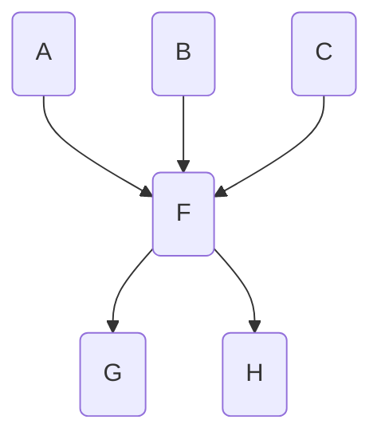
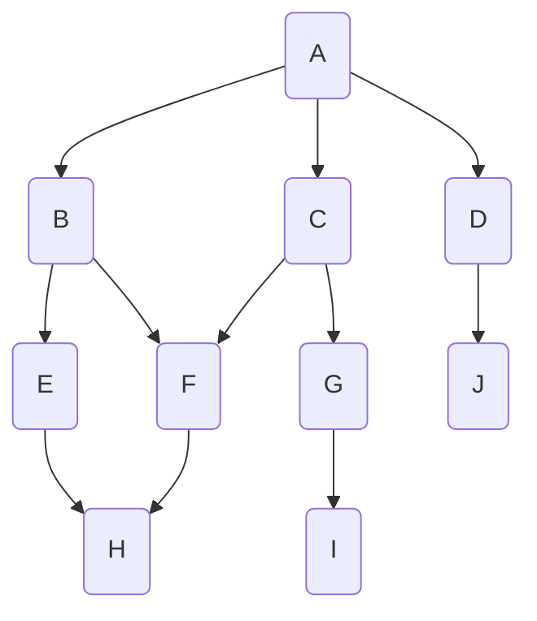

# SW 설계

21개 회차 420문제 가운데 이론이 242문제인데, 그중 SW 설계에서 가장 자주 나온 묶음은 디자인 패턴(14회차), 응집도·결합도(9회차), UML(6회차) 세 가지다. 문제 형태는 거의 "설명 1~4줄을 주고 보기에서 고르기"이고, 디자인 패턴과 결합도는 영문 표기를 요구하는 경우가 많다. 그리고 2024년 이후로는 2~5년 전 문제가 지문째 다시 나오는 일이 잦다. 26-1 Bridge·Observer, 26-2 Abstract Factory, 25-1 결합도 세트, 26-1 응집도 세트가 모두 그렇게 다시 나온 문제다.

## 디자인 패턴 총론 (생성·구조·행위 분류)
출제: 24-3, 21-2, 20-4
형태: 분류를 설명하고 예시 패턴 몇 개를 보여 준 뒤 분류 이름 쓰기. "생성·구조·( )" 빈칸형도 있음

### 개념
정보처리기사 실기에 나오는 디자인 패턴은 모두 23가지다. 생성 패턴 5가지, 구조 패턴 7가지, 행위 패턴 11가지로 나뉘는데, 표로 정리하면 이렇다.

| 분류 | 개수 | 두음 | 패턴 |
|---|---|---|---|
| **생성(Creational)** | 5 | 싱팩빌프앱 | 싱글톤, 팩토리 메서드, 빌더, 프로토타입, 추상 팩토리 |
| **구조(Structural)** | 7 | 어데퍼프브플컴 | 어댑터, 데코레이터, 퍼사드, 프록시, 브리지, 플라이웨이트, 컴포지트 |
| **행위(Behavioral)** | 11 | 전옵 중방이상인 메커책템 | 전략, 옵저버, 중재자, 방문자, 이터레이터, 상태, 인터프리터, 메멘토, 커맨드, 책임 연쇄, 템플릿 메서드 |

외우는 방법은 사실 본인이 편한 방식에 관심 있는 주제를 엮는 게 가장 좋다. 아래 두음은 참고용으로 보면 된다. 다만 두음만으로는 잘 외워지지 않아서, 두음에 장면 하나를 붙여 기억하는 쪽을 권한다. 그리고 패턴 이름만 알고 끝내면 안 된다. 각 패턴이 어떤 패턴인지는 생성·구조·행위 묶음에서 하나씩 이해하고 넘어가야 한다.

### 23가지를 다 외워야 할까
결론부터 말하면 23가지를 전부 외울 필요는 없다. 최근 실기에서는 보기에 디자인 패턴 이름을 주는 경우가 많기 때문이다. 26-2(Abstract Factory), 26-1(Bridge, Observer), 24-1(Abstract Factory)이 보기에서 골라 쓰는 형태로 나왔다.

그렇다고 보기가 늘 주어지는 것은 아니다. 25-1(Adapter)과 25-2(Proxy)는 지문이 "영어로 쓰시오"였다. 그래서 자주 나오는 패턴만큼은 영문 철자까지 쓸 수 있게 해 두는 편이 안전하다.

> 기출 원문 기준: 감자는 25-1·25-2를 보기 없이 설명만 준 문제로 소개하지만, 이 사이트가 옮긴 기출 원문에는 두 문제 모두 보기가 붙어 있다.

필기에서는 사정이 다르다. 패턴에 맞는 키워드를 아는 것도 중요하지만, 그 패턴이 생성인지 구조인지 행위인지를 알아야 맞힐 수 있는 문제가 종종 나온다. 실기에서도 전체 그림을 알고 있으면 헷갈리는 디자인 패턴 문제를 확실하게 푸는 데 큰 도움이 된다.

### 분류별 두음

#### 1. 생성 패턴 (Creational Pattern)
- 두음: **싱팩빌프앱**
- 장면: "싱글 팩토리 빌드 프로토스 앱"

| 두음 | 패턴 |
|---|---|
| 싱 | 싱글톤(Singleton) |
| 팩 | 팩토리 메서드(Factory Method) |
| 빌 | 빌더(Builder) |
| 프 | 프로토타입(Prototype) |
| 앱 | 앱스트랙트 팩토리(Abstract Factory), 곧 추상 팩토리 |

#### 2. 구조 패턴 (Structural Pattern)
- 두음: **어데퍼프브플컴**
- 장면: "브플어오르는 퍼프 어데있나?"

| 두음 | 패턴 |
|---|---|
| 어 | 어댑터(Adapter) |
| 데 | 데코레이터(Decorator) |
| 퍼 | 퍼사드(Facade) |
| 프 | 프록시(Proxy) |
| 브 | 브리지(Bridge) |
| 플 | 플라이웨이트(Flyweight) |
| 컴 | 컴포지트(Composite) |

#### 3. 행위 패턴 (Behavioral Pattern)
- 두음: **전옵 중방이상인 메커책템**
- 장면: "전체 옵션 중간 방어력 이상인 메커닉 책 아이템"

| 두음 | 패턴 |
|---|---|
| 전 | 전략(Strategy) |
| 옵 | 옵저버(Observer) |
| 중 | 중재자(Mediator) |
| 방 | 방문자(Visitor) |
| 이 | 이터레이터(Iterator) |
| 상 | 상태(State) |
| 인 | 인터프리터(Interpreter) |
| 메 | 메멘토(Memento) |
| 커 | 커맨드(Command) |
| 책 | 책임 연쇄(Chain of Responsibility) |
| 템 | 템플릿 메서드(Template Method) |

분류마다 기출 키워드와 패턴별 설명은 바로 아래 생성·구조·행위 패턴 묶음에 정리했다.

### 기출에서 이렇게 나왔다
- 24-3: "객체 간 상호작용과 책임 분담" 설명, 예시로 Mediator·Interpreter·Iterator → **행위**
- 21-2: "상호작용·책임 분산" 설명, 예시로 Observer 등 → **행위**
- 20-4: 생성·구조·( ) 빈칸 → **행위**

### 답 쓸 때
"행위 패턴"과 "행동 패턴"은 둘 다 Behavioral을 옮긴 말로 쓰인다. 개별 패턴 이름은 대부분 영문 보기에서 고르지만, 26-1·25-2·25-1·24-2처럼 "영어로 쓰시오"라고 못 박은 회차도 있었기 때문에 철자까지 외워 둬야 한다.

### 기출 문제

:::q 24-3 3번
다음은 디자인 패턴에 관한 설명이다. 괄호 안에 들어갈 단어를 쓰시오.

( ) 패턴은 클래스나 객체들이 상호 작용하는 방법과 책임 분담을 다루는 패턴이다. 이 패턴은 객체들 간 통신 방법을 정의하고 알고리즘을 캡슐화하여 객체간 결합도를 낮춘다. 이 패턴은 Mediator, Interpreter, Iterator 등의 패턴을 포함한다.

정답: 행위 또는 행위패턴 또는 behavioral pattern 또는 behavioral 또는 behavior
:::

:::q 21-2 8번
다음 설명에 해당하는 디자인 패턴 분류를 쓰시오.

반복적으로 사용되는 객체들의 상호작용을 패턴화한 것으로, 클래스나 객체들이 상호작용하는 방법과 책임을 분산하는 방법을 정의한다. Observer, Template Method, Iterator, Command 등이 이에 속한다.

정답: 행위 또는 Behavioral 또는 행위 패턴 또는 Behavioral Pattern
:::

:::q 20-4 13번
디자인 패턴은 목적(Purpose)에 따라 세 가지 유형으로 분류된다. 다음 빈칸에 들어갈 알맞은 용어를 쓰시오.

목적에 따른 디자인 패턴의 유형에는 생성(Creational), 구조(Structural), ( ① ) 패턴이 있다.

정답: ①: 행위 또는 Behavioral 또는 행위 패턴 또는 Behavioral Pattern
:::

## 생성 패턴
출제: 26-2, 24-1, 23-2, 21-3
형태: 1~3줄 설명 → 보기에서 영어로. Singleton은 Java 코드 출력 문제로도 나옴(24-1, 21-3)

### 개념

| 생성 패턴 | 기출 키워드 |
|---|---|
| 싱글톤 패턴(Singleton) | 객체 하나만 생성, 어디서든 참조, 특정 클래스의 인스턴스가 오직 하나임을 보장 |
| 팩토리 메서드 패턴(Factory Method) | 상위 클래스는 인터페이스만 정의, 서브 클래스가 실제 생성 담당 |
| 빌더 패턴(Builder) | 조립 + 분리 |
| 프로토타입 패턴(Prototype) | 인스턴스를 복제 |
| 앱스트랙트 팩토리 패턴(Abstract Factory) | 조합을 만드는 인터페이스(API) 제공, Kit이라고 불림 |

### 패턴 하나씩 보기

#### 1. 싱글톤 (Singleton)
- 한 클래스에 **단 하나의 객체**만 존재하도록 강제
- 이름의 single처럼 인스턴스가 유일하다는 점이 핵심
- 쓰는 곳: 애플리케이션 전역에서 공유해야 하는 자원. 대표 예는 로그 수집기(Logger)

클래스 기반 언어에서는 보통 생성자 안에서 이미 만들어 둔 인스턴스가 있는지 먼저 확인하고, 있으면 그것을 돌려주는 구조로 구현한다. 그래서 생성자를 두 번 불러도 정확히 같은 인스턴스를 얻는다.

그럼 이게 언제 필요할까? Logger를 예로 들어 보자. Logger 인스턴스가 여러 개라면 로그가 인스턴스마다 흩어져 기록된다.

여기에 싱글톤을 적용하면 여러 곳에서 인스턴스를 만들어도 실제로는 하나만 쓰게 되어, 로그를 한곳에서 관리할 수 있다.

#### 2. 팩토리 메서드 (Factory Method)
- 객체 생성 인터페이스는 **상위 클래스**에서 정의
- 어떤 클래스의 인스턴스를 만들지는 **하위 클래스가 결정**
- 인터페이스와 실제 객체를 생성하는 클래스를 분리

이 패턴을 쓰면 두 가지 구조가 나타난다.

- **Product**: 생성될 객체의 공통 인터페이스
- **Creator**: Product를 만드는 `factoryMethod()`를 정의. 실제 생성 로직은 하위 Creator가 담당

결제 시스템을 예로 들어 보자. 카드, 페이팔처럼 결제 수단은 여러 가지지만 "결제 처리"라는 큰 흐름은 같다.

팩토리 메서드의 가장 큰 장점은 확장성이다. 새 결제 수단 카카오페이를 붙여야 할 때 기존 코드를 하나도 고치지 않아도 된다.

만약 팩토리 메서드 없이 단순한 `if`/`switch` 분기로 처리했다면 어땠을까? 결제 수단이 늘 때마다 분기 함수를 고쳐야 한다.

이 차이가 객체지향 설계 5원칙(SOLID) 중 하나인 OCP(Open-Closed Principle, 개방-폐쇄 원칙)다. 팩토리 메서드는 이 원칙을 잘 보여 준다.

- **확장에 열려 있음(Open)**: 새 결제 수단(KakaoPay)을 쉽게 추가
- **수정에 닫혀 있음(Closed)**: 기능을 추가해도 기존 결제 처리 클래스나 다른 결제 클래스는 수정 불필요

#### 3. 빌더 (Builder)
- 복잡한 객체를 생성하는 과정을 **단계별로 분리**
- 같은 생성 절차에서 서로 다른 표현 결과를 만듦
- 객체를 생성하는 방법(과정)과 객체를 구현(표현)하는 방법을 분리
- 생성자의 매개변수가 많거나 생성 과정이 여러 단계로 나뉘어 복잡할 때 유용

생성자의 매개변수가 너무 많아지는 경우가 있는데, 이를 텔레스코핑 생성자 패턴(Telescoping Constructor Pattern)이라고 부르기도 한다.

이런 생성자의 문제는 세 가지다.

- **가독성 저하**: 각 매개변수의 역할 파악이 어려움
- **실수 유발**: 매개변수 순서를 잘못 넣기 쉬움
- **유연성 부족**: 일부만 설정하고 싶어도 `null`이나 `undefined`를 계속 전달해야 함

빌더 패턴을 쓰면 이 문제가 깔끔하게 풀린다.

정리하자면 속성이 많고 구조가 중첩된 복합 객체를 만들 때, 객체를 생성하는 방법(빌더 클래스)과 객체를 구현하는 방법(만들어질 객체의 클래스)을 나눠 두는 것이 빌더 패턴이다.

#### 4. 프로토타입 (Prototype)
- 기존 객체를 **복제**해 새 객체를 생성
- `new`로 클래스에서 객체를 만드는 대신 원본(prototype)을 복사해 필요한 부분만 수정
- 객체 생성 비용이 비싸거나 클래스로 객체를 만드는 과정이 복잡할 때 효과적

자바스크립트는 프로토타입 기반 언어라서 이 패턴을 아주 자연스럽게 쓸 수 있다. 게임 캐릭터를 예로 들면, 모든 캐릭터는 기본 능력치(체력, 공격력)를 공유하지만 이름과 직업은 각자 다르다.

`Object.create()`는 지정한 프로토타입 객체를 바탕으로 새 객체를 만든다. 이렇게 만든 객체는 원본의 속성과 메서드를 물려받으면서도 자기만의 상태를 가질 수 있다. 자바스크립트에서는 `Object.create()`나 전개 구문(`{...original, ...overrides}`)으로 프로토타입 패턴을 간단히 구현한다.

언제 쓰는지는 두 경우로 나뉜다.

- **객체 생성 비용이 클 때**: DB에서 무거운 데이터를 조회해 만드는 객체라면, 매번 새로 만들지 않고 한 번 만든 객체를 복제해 성능상 이점
- **다양한 종류의 객체가 필요할 때**: 팩토리 메서드처럼 하위 클래스를 많이 만들지 않고 프로토타입 몇 개로 여러 변형 객체 생성

#### 5. 추상 팩토리 (Abstract Factory)
- 서로 관련 있거나 의존적인 객체들의 집합을 생성하는 인터페이스 제공, 구체 클래스는 지정하지 않음
- **제품군(Family of Products)** 생성
- 사용자에게 API를 제공하고, 구체적인 구현은 Concrete Product 클래스에서 이루어짐
- 별칭: Kit

팩토리 메서드가 단일 객체 생성에 초점을 둔다면, 추상 팩토리는 제품군을 만드는 데 쓴다. 가장 흔한 예가 UI 테마 관리다. 라이트 모드와 다크 모드에 따라 버튼, 체크박스, 창 같은 여러 UI 요소가 일관된 스타일을 가져야 하기 때문이다.

여기서 많이들 헷갈리는 게 "사용자에게 API를 제공한다"는 말이다. 이때 사용자는 사람이 아니라 팩토리를 가져다 쓰는 코드(클라이언트 코드)를 가리킨다.

- **API 제공(추상 클래스)**: 팩토리와 버튼·체크박스 같은 제품의 추상 클래스. 일종의 계약서·설명서 역할. 클라이언트 코드는 이 설명서만 보고 버튼 만들기, 그리기 같은 메서드를 호출하고 라이트 버튼·다크 버튼의 실제 구현은 모름
- **구체적 구현(Concrete 클래스)**: 라이트 테마 팩토리, 다크 버튼 같은 구체 클래스. 계약서 내용을 실제로 이행하는 실무자. 버튼을 만들라는 요청이 오면 실제 테마 버튼을 만들고, 그리라는 요청이 오면 테마에 맞는 스타일을 그림

결국 클라이언트 코드는 라이트 버튼 같은 구체 클래스 이름을 직접 쓰지 않고 추상적인 설명서(API)에만 의존한다. 덕분에 팩토리만 바꾸면 테마 전체가 한 번에 바뀐다.

### 한눈에 구분
감자는 팩토리 메서드와 추상 팩토리를 이렇게 나눈다.

| 패턴 | 차이 |
|---|---|
| 팩토리 메서드 | Creator 클래스 하나가 상속을 통해 제품 하나를 만드는 방법을 바꿈 |
| 추상 팩토리 | 여러 제품군을 만드는 인터페이스 제공. 클라이언트는 구체 제품 클래스를 모른 채 팩토리만 바꿔 제품군 전체를 교체 |

### 기출에서 이렇게 나왔다
- 26-2: "제품군을 생성하는 인터페이스, Kit" → **Abstract Factory** (24-1 재출제)
- 24-1: "연관된 객체를 조합해 생성하는 인터페이스, Kit" → **Abstract Factory**
- 23-2: 설명 2개 → **Singleton / Visitor**
- 21-3: "상위 클래스는 생성 인터페이스만 정의, 서브클래스가 생성할 클래스를 결정" → **Factory Method**

### 답 쓸 때
Abstract Factory와 Factory Method는 띄어 쓰는 두 단어라는 점을 기억해 두자. Singleton도 Singletone처럼 끝에 e를 붙여 쓰지 않도록 조심한다.

### 기출 문제

:::q 26-2 8번
다음 설명에 해당하는 디자인 패턴을 보기에서 골라 쓰시오.

인스턴스를 생성하는 절차를 추상화하여 구체적인 구현 클래스로부터 독립적으로 객체를 생성한다. 서로 연관되거나 의존적인 객체들의 제품군을 생성하기 위한 인터페이스를 제공하며, 팩토리를 교체하면 제품군 전체를 한 번에 변경할 수 있다. Kit이라고도 불리는 이 디자인 패턴은 무엇인가?

보기: Composite / Abstract Factory / Bridge / Adapter / Decorator

정답: Abstract Factory
:::

:::q 24-1 2번
다음 설명에 해당하는 디자인 패턴을 보기에서 골라 쓰시오.

구체적인 클래스에 의존하지 않고 서로 연관되거나 의존적인 객체들의 조합을 만드는 인터페이스(API)를 제공하며, Kit이라고도 불리는 패턴이다.

보기: Composite / Adapter / Abstract Factory / Bridge / Decorator

정답: Abstract Factory 또는 추상 팩토리
:::

:::q 23-2 8번
다음은 디자인 패턴에 대한 설명이다. 괄호 안에 알맞은 답을 작성하시오.

( ① )은/는 객체 하나만 생성하도록 하고 어디서든 참조할 수 있도록 하는 디자인 패턴이다. 클래스 내에서 인스턴스가 하나뿐임을 보장하며, 불필요한 메모리 낭비를 최소화할 수 있다.

( ② )은/는 객체의 내부 상태에 접근할 수 있는 방법을 제공하여 호스트 객체에 새로운 연산을 추가할 수 있도록 하는 디자인 패턴이다. 객체 구조와 처리 기능을 분리하여, 데이터 구조 안의 요소들에 대해 처리 기능을 각 요소에서 분리하여 별도의 클래스로 정의해 사용한다.

보기: Observer / Facade / Strategy / Adapter / Visitor / Composite / Decorator / Proxy / Singleton / Template Method

정답: ①: Singleton ②: Visitor
:::

:::q 21-3 7번
상위 클래스에서는 객체를 생성하는 인터페이스만 정의하고, 어떤 객체를 생성할지에 대한 결정은 서브 클래스에서 내리도록 하는 디자인 패턴을 영문으로 쓰시오.

정답: Factory Method 또는 팩토리 메소드 또는 팩토리 메서드
:::

## 구조 패턴
출제: 26-1, 25-2, 25-1, 23-1, 22-3
형태: 한 줄 설명 → 보기에서 영어로. Bridge는 Observer와 한 문제에 묶여 두 번 나옴

### 개념

| 구조 패턴 | 기출 키워드 |
|---|---|
| 어댑터 패턴(Adapter) | 서로 다른 인터페이스 연결, 기존 클래스를 재사용할 수 있도록 중간에서 맞춰 주는 역할 |
| 데코레이터 패턴(Decorator) | 기능 추가 + 확장 |
| 퍼사드 패턴(Facade) | 단순 인터페이스, 오류 단위 확인 |
| 프록시 패턴(Proxy) | 객체의 대리자가 대신 처리 |
| 브리지 패턴(Bridge) | 기능 클래스-구현 클래스 연결, 추상 계층 분리 |
| 플라이웨이트 패턴(Flyweight) | 가상 인스턴스, 가상화 |
| 컴포지트 패턴(Composite) | 트리 구조, 복합 객체 = 단일 객체 |

### 패턴 하나씩 보기

#### 1. 어댑터 (Adapter)
- **호환되지 않는 인터페이스**를 가진 클래스들을 함께 동작하도록 변환
- 기존 코드를 수정하지 않고 재사용
- 별칭: Wrapper 클래스
- 상속을 이용하는 클래스 패턴과 위임을 이용하는 인스턴스 패턴이 있음

현실의 "돼지코" 어댑터(110V를 220V로)를 떠올리면 쉽다. 기존 코드는 그대로 두고 새 클래스나 외부 라이브러리를 시스템에 끼워 넣고 싶을 때 쓴다. 구성 요소는 세 가지다.

- **Target**: 클라이언트가 쓰려는 목표 인터페이스
- **Adaptee**: 호환되지 않는 인터페이스를 가진 기존 클래스. 우리가 쓰고 싶은 기능
- **Adapter**: Adaptee의 인터페이스를 Target 인터페이스에 맞게 변환

웹 스토리지 API로 예를 들어 보자. 브라우저에는 `localStorage`와 `sessionStorage`가 있고, 둘 다 `setItem(key, value)`, `getItem(key)`처럼 비슷한 인터페이스를 가진다. 그런데 `sessionStorage` 쪽에만 데이터를 JSON으로 자동 변환해 저장하는 기능이 필요하다고 해 보자. 우리 애플리케이션은 `Storage`라는 표준 인터페이스(Target)로 데이터를 저장하도록 설계되어 있다.

`localStorage`는 이 `Storage` 인터페이스를 그대로 쓸 수 있다.

이제 `sessionStorage`를 쓰고 싶은데, 이 클래스는 저장할 때 `JSON.stringify`를 하는 `saveObject`, 꺼낼 때 `JSON.parse`를 하는 `loadObject`라는 다른 메서드를 가지고 있다고 하자. 이것이 Adaptee다.

그래서 이 클래스를 우리 시스템의 `Storage` 인터페이스에 맞추는 어댑터를 둔다. 클라이언트는 같은 `Storage` 인터페이스를 쓰기 때문에, 데이터가 `localStorage`에 저장되는지 `sessionStorage`에 JSON으로 저장되는지 알 필요가 없다.

어댑터는 구현 방식에 따라 두 가지로 나뉜다.

- **클래스 어댑터(Class Adapter)**: 상속 사용. 어댑터가 Target 클래스를 상속하고 Adaptee의 기능을 구현.
- **인스턴스 어댑터(Instance Adapter)**: 위임(Delegation) 사용. 어댑터가 Adaptee 인스턴스를 안에 품고, Target 요청이 오면 Adaptee에게 작업을 맡김. 더 유연해서 일반적으로 더 많이 씀

인스턴스 어댑터 예로 새 로깅 라이브러리를 붙이는 경우를 보자. 우리 시스템은 메시지만 받는 `log(message)` 인터페이스를 쓰는데, 새 라이브러리는 타임스탬프까지 받는 `logMessage(timestamp, message)`를 쓴다.

이때 어댑터는 어떤 클래스도 상속하지 않는다. 대신 새 라이브러리의 인스턴스를 안에 저장(구성)해 두고, 클라이언트가 `log()`를 부르면 실제 로깅은 그 인스턴스에게 위임한다. 구성을 쓰기 때문에 더 유연한 구조가 된다.

#### 2. 브리지 (Bridge)
- **추상화**와 **구현**을 두 개의 독립된 클래스 계층으로 분리
- 두 계층이 서로 영향 없이 독립적으로 확장
- 상속 대신 **합성(Composition)** 사용
- 클래스 폭발 문제 방지, 유연성 향상
- 기능과 구현이 서로 다른 속도로 바뀌거나 여러 플랫폼을 지원해야 할 때 유용

이름처럼 두 영역을 잇는 다리 역할을 한다. 상속을 쓰면 기능과 구현이 강하게 묶여서, 새 기능이나 새 구현 방식을 지원할 때마다 클래스가 기하급수적으로 늘어나는 문제가 생긴다. 브리지는 이 문제를 합성으로 푼다. 구성 요소는 네 가지다.

- **Abstraction(추상화)**: 클라이언트가 쓸 상위 수준 인터페이스. 내부에 Implementor 참조를 가짐
- **RefinedAbstraction(구체화된 추상화)**: Abstraction을 상속해 더 구체적인 기능으로 확장
- **Implementor(구현자)**: 실제 기능을 구현할 하위 수준 인터페이스. Abstraction은 이 인터페이스에만 의존
- **ConcreteImplementor(구체적인 구현자)**: Implementor 인터페이스를 실제로 구현

버튼, 토글 스위치 같은 여러 UI 요소가 라이트 모드, 다크 모드 같은 여러 테마를 지원해야 한다고 해 보자. 테마는 `Theme` 인터페이스와 구체 테마 클래스로, UI 요소는 `UIComponent` 추상 클래스와 이를 상속한 구체 UI 요소로 나누고, `UIComponent`가 `Theme` 객체를 안에 가진다(합성).

새 "블루 테마"를 추가하고 싶다면 `BlueTheme` 클래스만 만들면 되고 `Button`, `Toggle` 코드는 건드리지 않는다. 반대로 새 UI 요소 "드롭다운 메뉴"가 필요하면 `Dropdown` 클래스만 만들면 되고 테마 코드는 그대로다. 이렇게 기능 계층(UI 요소)과 구현 계층(테마)을 나눠 각각 독립적으로 확장하는 것이 브리지 패턴이다.

#### 3. 컴포지트 (Composite)
- 객체들을 **트리 구조**로 구성해 부분-전체 계층 표현
- 단일 객체(Leaf)와 복합 객체(Composite)를 **동일하게** 취급
- 재귀 구조로 클라이언트 코드 단순화
- UI 툴킷, 파일 시스템처럼 계층 구조를 다룰 때 유용

쉽게 말해 하나짜리 객체든 여러 객체를 모은 집합이든 똑같은 인터페이스로 다룰 수 있게 해 준다. 대표 예가 컴퓨터 파일 시스템이다. 폴더(복합 객체) 안에는 다른 폴더나 파일(개별 객체)이 들어가고, 사용자는 폴더와 파일을 가리지 않고 이름 변경, 삭제 같은 같은 작업을 한다. 구성 요소는 세 가지다.

- **Component**: Leaf와 Composite가 모두 구현하는 공통 인터페이스. 트리의 모든 객체에 대한 일관된 작업 정의
- **Leaf**: 트리 맨 끝의 개별 객체. 자식 없음. 예: 파일
- **Composite**: 자식(Leaf나 다른 Composite)을 가질 수 있는 복합 객체. add, remove 같은 자식 관리 메서드를 구현하고 Component 메서드를 자식들에게 재귀적으로 전달. 예: 폴더

파일 시스템에 컴포지트 패턴을 쓰면, 클라이언트는 최상위 폴더 하나에 출력을 요청하는 것만으로 전체 트리를 재귀적으로 출력할 수 있다. 파일과 폴더의 내부 차이는 신경 쓰지 않고 공통 인터페이스 하나로 똑같이 다루는 것이다.

#### 4. 데코레이터 (Decorator)
- 기존 코드를 수정하지 않고 **동적으로** 새 기능이나 책임 추가
- 객체를 감싸서(wrap) 새 책임을 덧붙임
- 객체의 결합(SimpleCoffee, WithMilk, WithSugar)으로 기능 확장
- 상속의 유연한 대안. 동적으로 기능을 추가하거나 제거 가능
- 핵심 기능과 추가 기능이 같은 인터페이스를 따름
- 데코레이터 순서가 결과에 영향을 줄 수 있음

이름처럼 객체를 장식(decorate)해서 기능을 넓힌다. 상속으로도 기능을 확장할 수 있지만, 상속은 정적인 방식이라 모든 조합마다 서브클래스를 만들어야 하는 클래스 폭발(class explosion) 문제가 생긴다. 데코레이터는 이 문제를 푸는 유연한 대안이다.

커피 주문을 생각하면 된다. 아메리카노에 우유를 넣으면 카페라떼, 거기에 시럽을 넣으면 바닐라 라떼, 휘핑 크림을 올리면 아인슈페너가 되듯, 기본 객체에 장식(옵션)을 동적으로 붙여 새 객체를 만든다. 구성 요소는 네 가지다.

- **Component**: 장식될 객체와 장식하는 객체(데코레이터)가 모두 구현할 공통 인터페이스(또는 추상 클래스)
- **ConcreteComponent**: 장식 대상이 되는 핵심 기능을 가진 구체 클래스. 예: 기본 커피
- **Decorator**: Component 인터페이스를 구현하면서 내부에 Component 객체 참조를 가짐. 이 참조로 장식할 객체와 연결
- **ConcreteDecorator**: Decorator를 상속해 실제로 새 기능이나 책임을 추가. 예: 우유 추가, 시럽 추가

이렇게 하면 기본 커피 클래스를 한 줄도 고치지 않고 우유 추가, 설탕 추가 같은 기능을 계속 덧붙일 수 있다. 휘핑 크림 추가나 샷 추가가 필요하면 데코레이터 클래스만 새로 만들면 된다.

#### 5. 퍼사드 (Facade)
- 복잡한 서브시스템(subsystem)에 대한 **간단한 통합 인터페이스** 제공
- 복잡한 서브시스템에 대한 단순한 창구
- 클라이언트와 서브시스템 사이의 결합도를 낮춤
- 서브시스템의 내부 구현을 캡슐화
- 퍼사드는 요청을 위임할 뿐, 스스로 새 기능을 만들지 않음
- 오류를 단위별로 확인할 수 있음

퍼사드(Facade)는 "건물의 정면"이라는 뜻이다. 클라이언트는 서브시스템의 복잡한 내부를 몰라도 퍼사드 객체의 단순한 메서드만 불러서 원하는 기능을 쓴다. 컴퓨터 전원 버튼이 좋은 예다. 우리는 버튼 하나만 누르지만, 안에서는 CPU, 메모리, 하드디스크, 운영체제가 복잡하게 맞물려 돌아간다. 이때 전원 버튼이 퍼사드다. 구성 요소는 두 가지다.

- **Facade**: 서브시스템 기능을 묶어 간단한 인터페이스 제공. 클라이언트 요청을 받으면 자신이 아는 여러 서브시스템 객체에 작업 위임
- **Subsystem Classes**: 실제 기능을 수행하는 클래스들의 집합. 퍼사드가 호출하고, 클라이언트는 보통 직접 알지 못함

DVD 플레이어, 앰프, 프로젝터, 조명으로 된 홈시어터가 있다고 해 보자. 영화를 보려면 아래 단계를 거쳐야 한다.

1. 프로젝터를 켠다.
2. DVD 플레이어를 켠다.
3. 앰프를 켠다.
4. 앰프 볼륨을 조절한다.
5. 조명을 어둡게 한다.

이걸 매번 하나하나 조작하기는 번거롭다. 퍼사드를 쓰면 "영화 보기" 명령 하나로 끝낼 수 있다. 장치마다 서브시스템 클래스를 두고, 이를 모두 제어하는 홈시어터 퍼사드를 만들면 클라이언트는 "영화 보기"와 "영화 끝내기"만 부른다. 프로젝터를 먼저 켜야 하는지, 앰프 볼륨은 언제 맞추는지 같은 내부 순서와 의존성은 전혀 몰라도 된다. 그래서 서브시스템과 클라이언트 사이의 결합도가 낮아지고 코드가 단순해진다.

#### 6. 플라이웨이트 (Flyweight)
- 많은 수의 객체를 **공유**해서 메모리 사용량을 줄임
- 객체 공유와 가상 인스턴스 제공
- 객체 상태를 내재적 상태(공유 가능)와 외재적 상태(공유 불가)로 분리
- 팩토리로 공유 객체를 관리
- 게임, 문서 편집기처럼 대량의 객체를 다룰 때 유용

플라이웨이트는 권투의 경량급이라는 뜻이다. 이름처럼 객체를 가볍게 만들어 메모리 부담을 줄이는 것이 목적이다. 이 패턴은 객체 상태를 둘로 나눈다.

- **내재적 상태(Intrinsic State)**: 객체 안에서 관리, 여러 곳에서 공유하는 불변(immutable) 상태. 플라이웨이트 객체 안에 저장. 예: 나무의 모델, 텍스처, 색상
- **외재적 상태(Extrinsic State)**: 객체마다 달라지는 상태. 클라이언트가 관리하다가 필요할 때 플라이웨이트 객체에 전달. 예: 나무의 위치(x, y 좌표), 크기

구성 요소는 네 가지다.

- **Flyweight**: 공유될 객체들의 인터페이스
- **ConcreteFlyweight**: Flyweight 인터페이스를 구현하고 내재적 상태를 저장. 공유되어 재사용
- **FlyweightFactory**: 플라이웨이트 객체를 만들고 관리. 요청한 객체가 이미 있으면 기존 것을 돌려주고, 없으면 새로 만들어 풀(pool)에 저장
- **Client**: 외재적 상태를 관리하고, FlyweightFactory에서 플라이웨이트 객체를 받아 작업 수행

수천, 수만 그루의 나무로 숲을 그리는 게임을 생각해 보자. 나무마다 모델, 텍스처 같은 무거운 데이터를 가진 객체를 만들면 메모리가 엄청나게 든다. 플라이웨이트를 쓰면 클라이언트(게임 엔진)는 팩토리를 거쳐 나무를 심고, 메모리를 많이 차지하는 나무 모델 객체는 소나무, 참나무처럼 종류마다 하나만 만들어 계속 재사용한다. 나무마다 다른 위치와 크기는 외재적 상태로 클라이언트가 직접 관리한다.

여기서 "여러 개의 가상 인스턴스를 제공해 메모리를 절감한다"는 말이 헷갈릴 수 있다. 고무 도장에 비유하면 쉽다. 수천 쪽짜리 문서에 소나무 그림을 계속 찍어야 한다고 해 보자.

- **패턴 미적용**: 나무 1,000그루를 찍으려면 소나무 도장 1,000개가 필요. 도장을 보관할 큰 공간(메모리) 필요
- **패턴 적용**: 소나무 모양 고무 도장을 딱 하나만 만들어 계속 재사용. 이 도장이 플라이웨이트 객체이고, 소나무라는 본질적인 모양이 내재적 상태. 어디에(x, y 좌표), 어떤 크기로 찍을지는 찍는 순간 밖에서 알려 줌. 이것이 외재적 상태

가상 인스턴스란 우리 눈에 보이는 소나무 그림 하나하나를 말한다. 실제 메모리에는 소나무 모양 객체(도장)가 하나뿐이지만, "공유되는 실제 객체 1개 + 서로 다른 외부 상태(좌표, 크기)"의 조합으로 독립된 객체가 여러 개 있는 것처럼 보여 준다.

#### 7. 프록시 (Proxy)
- 다른 객체에 대한 **접근을 제어**하려고 그 객체의 **대리자** 역할을 하는 객체를 둠
- 실제 객체를 대신해 제어 흐름을 조정
- 실제 객체와 프록시는 같은 인터페이스 사용
- 접근 제어, 비용 절감, 복잡도 감소 등 여러 목적으로 사용
- 클라이언트는 자신이 프록시를 쓰는지 실제 객체를 쓰는지 모를 수 있음

프록시(Proxy)는 "대리인"이라는 뜻이다. 실제 객체에 직접 접근하지 않고 프록시를 거쳐 간접적으로 접근하는데, 그 과정에서 접근을 제어하거나 부가 작업을 할 수 있다. 회사 CEO와 직접 통화하기는 어렵고 비서를 거쳐 약속을 잡는 것을 떠올리면 된다. 비서가 프록시가 되어 CEO(실제 객체)에게 오는 불필요한 요청을 걸러 낸다. 구성 요소는 세 가지다.

- **Subject**: RealSubject와 Proxy가 모두 구현하는 공통 인터페이스
- **RealSubject**: 프록시가 대변하는 실제 객체. 핵심 비즈니스 로직 보유
- **Proxy**: RealSubject와 같은 인터페이스. 내부에 RealSubject 참조를 가지고, 클라이언트 요청을 RealSubject에 전달하거나 때로는 직접 처리

웹 페이지에서 아주 큰 이미지를 불러온다고 해 보자. 이미지가 다 불러와질 때까지 화면이 멈춰 있으면 사용자 경험이 나쁘다. 이때 가상 프록시(Virtual Proxy)로 실제 이미지 객체의 생성을 필요한 시점까지 미룰 수 있다. 클라이언트는 프록시 이미지를 실제 이미지 객체와 똑같이 쓰지만, 무거운 이미지 로딩은 화면에 보여 주는 메서드(`display()`)가 처음 불릴 때까지 미뤄진다. `display()`가 한 번도 불리지 않으면 로딩 자체를 하지 않는다.

그럼 왜 굳이 프록시를 둘까? 가장 큰 이유는 애플리케이션의 초기 반응성이다.

- **프록시가 없으면**: 고화질 이미지 100개가 있는 페이지를 열 때 실제 이미지 객체 100개가 바로 만들어지면서 이미지를 한꺼번에 불러옴. 사용자는 로딩이 끝날 때까지 몇 초 동안 흰 화면만 봄
- **프록시가 있으면**: 페이지를 열 때는 가벼운 프록시 객체 100개만 생성. 페이지는 바로 뜨고, 스크롤해서 이미지가 보여야 할 때(`display()` 호출 시) 그 이미지만 로딩

이렇게 당장 필요 없는 무거운 작업(객체 생성, 데이터 로딩)을 뒤로 미루는 기법을 지연 초기화(Lazy Initialization)라고 한다. 초기 구동 시간이 줄고 메모리, 네트워크 같은 자원을 효율적으로 쓰게 된다. 프록시는 목적에 따라 여러 종류로 나뉜다.

| 종류 | 하는 일 |
|---|---|
| 가상 프록시(Virtual Proxy) | 생성 비용이 큰 객체의 생성을 필요한 시점까지 연기 |
| 보호 프록시(Protection Proxy) | 특정 클라이언트만 실제 객체에 접근하도록 접근 제어, 권한 검사 |
| 원격 프록시(Remote Proxy) | 다른 주소 공간(예: 원격 서버)의 객체를 로컬에 있는 것처럼 사용 |
| 로깅/캐싱 프록시 | 실제 객체 요청 전후에 로그를 남기거나 요청 결과를 캐싱해 성능 향상 |

### 기출에서 이렇게 나왔다
- 26-1: 설명 2개 → **Bridge / Observer** (22-3과 같은 조합)
- 25-2: "대리 객체로 접근 제어" → **Proxy** (23-1 재출제)
- 25-1: "서로 다른 인터페이스를 연결" → **Adapter**
- 23-1: "객체의 대리자" → **Proxy**
- 22-3: 설명 2개 → **Bridge / Observer**

### 답 쓸 때
구조 패턴에서 헷갈리기 쉬운 쌍이 Bridge와 Adapter다. Bridge 지문에 나오는 "구현부"라는 말이 Adapter의 "인터페이스 변환"과 섞여 보이기 쉽기 때문이다. 이때는 낱말 하나에 끌려가지 말고, "분리·독립 확장"이 보이면 Bridge, "변환·호환"이 보이면 Adapter로 가른다.

22-3 Bridge 지문은 한 번 더 함정이 있다. "부수적인 새로운 기능을 지속적으로 추가", "기존 프로그램 변경 없이 기능 확장"처럼 Decorator로 읽히는 문장이 함께 나온다. 그래도 답은 Bridge다. 왜냐하면 첫 문장의 "기능 클래스와 구현 추상 클래스를 구별", "구현뿐 아니라 추상화도 독립적으로 변경"이 결정적 단서이기 때문이다.

### 기출 문제

:::q 26-1 17번
다음이 설명하는 디자인 패턴을 보기에서 골라 영어로 쓰시오.

- (1) 추상부와 구현부를 분리하여 두 계층이 서로 영향을 받지 않고 독립적으로 확장될 수 있도록 다리 역할을 하는 구조 패턴은 무엇인가?
- (2) 한 객체의 상태가 변경되었을 때, 그 객체에 의존하는 다른 객체들에게 변경 사실을 자동으로 통지(알림)하는 행위 패턴은 무엇인가?

보기: Composite / Decorator / Mediator / Adapter / Facade / Visitor / Bridge / Proxy / Interpreter / Observer

정답: (1): Bridge (2): Observer
:::

:::q 25-2 16번
어떤 객체에 대한 접근을 제어하거나 추가적인 기능을 부여하기 위해 해당 객체의 대리 객체를 사용하는 방식을 영어로 쓰시오

보기: Proxy / Decorator / Adapter / Facade

정답: Proxy 또는 프록시
:::

:::q 25-1 3번
서로 다른 인터페이스를 가진 클래스들을 연결해 사용 가능하게 하는 디자인 패턴을 영어로 쓰시오

보기: Decorator / Proxy / Adapter / Facade / Bridge

정답: Adapter 또는 어댑터
:::

:::q 23-1 18번
( ) 은/는 복잡한 시스템의 개발을 쉽게 할 수 있도록 객체의 대리자를 이용하는 디자인 패턴이다. 객체의 대리자는 원래 객체의 작업을 대신 처리한다.

보기: Facade / Decorator / Adapter / Proxy

정답: Proxy 또는 프록시
:::

:::q 22-3 13번
다음은 디자인 패턴에 대한 설명이다. 괄호 안에 알맞은 답을 작성하시오.

( ① )은/는 기능을 처리하는 클래스와 구현을 담당하는 추상 클래스로 구별한다. 구현뿐 아니라 추상화도 독립적 변경이 필요할 때 ( ① ) 패턴을 사용한다. 기존 시스템에 부수적인 새로운 기능들을 지속적으로 추가할 때 사용하면 유용하며, 새로운 인터페이스를 정의하여 기존 프로그램의 변경 없이 기능을 확장할 수 있다.

( ② )은/는 한 객체의 상태가 변화하면 객체에 상속되어 있는 다른 객체들에게 변화된 상태를 전달해주는 패턴이다. 일대다 관계를 가지며, 주로 분산된 시스템 간에 이벤트를 생성·발행(Publish)하고, 이를 수신(Subscribe)해야 할 때 이용한다.

보기: Abstract Factory / Decorator / Facade / Observer / Strategy / Singleton / Mediator / Composite / Template Method / Bridge / Adapter

정답: ①: Bridge ②: Observer
:::

## 행위 패턴
출제: 26-1, 24-2, 23-2, 22-3, 20-2
형태: 1~2줄 설명 → 보기에서 영어로. Observer가 3번으로 가장 많음

### 개념

| 행위 패턴 | 키워드 |
|---|---|
| 전략 패턴(Strategy) | 알고리즘군 |
| 옵저버 패턴(Observer) | 한 객체가 바뀌면 의존하는 다른 객체에 연락이 가고 자동 갱신 |
| 중재자 패턴(Mediator) | 객체 간 중재자, 객체지향 목표를 달성하게 해 줌 |
| 방문자 패턴(Visitor) | 메서드가 각 클래스를 돌아다님, 새 기능(연산)만 따로 추가할 때 사용 |
| 이터레이터 패턴(Iterator) | 컬렉션 내 모든 요소 순차 탐색, Cursor |
| 상태 패턴(State) | 원시 코드 수정 취소, 상태 캡슐화 |
| 인터프리터 패턴(Interpreter) | 특정 언어 문법 정의, 그 문법으로 작성된 문장을 해석 |
| 메멘토 패턴(Memento) | 복구, Undo 기능, 객체 정보 저장 |
| 커맨드 패턴(Command) | 재사용성, 기능 캡슐화 |
| 책임 연쇄 패턴(Chain of Responsibility) | 하드코딩(기능 처리 연결 변경 불가)을 연결 변경이 가능하게 디자인 |
| 템플릿 메서드 패턴(Template Method) | 상위 클래스는 추상 메서드(기능의 골격), 하위 클래스는 세부 처리 구체화 |

### 패턴 하나씩 보기

#### 1. 전략 (Strategy)
- **알고리즘군**(a family of algorithms)을 정의하고 각 알고리즘을 캡슐화해 필요에 따라 **교체**
- 무엇을(What)은 Context에 두고, 어떻게(How)는 Strategy 객체에 위임
- 위임(Delegation)으로 문제 해결
- `if-else`나 `switch`로 가득 찬 코드를 리팩토링하는 좋은 방법
- 개방-폐쇄 원칙(OCP) 만족

서울에서 부산까지 가는 길 찾기를 떠올려 보자. KTX, 버스, 비행기 중 무엇을 고르든 "서울에서 부산으로 간다"는 목표(Context)는 같고 이동 방식(Strategy)만 달라진다. 전략 패턴은 이런 방법(알고리즘)들을 부품처럼 갈아 끼우게 해 준다. 구성 요소는 세 가지다.

- **Context**: 전략을 쓰는 주체. 내부에 Strategy 인터페이스 참조를 가지고, 요청이 오면 자신의 전략 객체에 작업 위임
- **Strategy**: 모든 구체 전략이 구현하는 공통 인터페이스. 보통 알고리즘을 실행하는 메서드 하나(예: `execute()`) 정의
- **ConcreteStrategy**: Strategy 인터페이스를 구현해 실제 알고리즘을 정의. 예: `BusStrategy`, `TrainStrategy`

온라인 쇼핑몰이 신용카드, 카카오페이, 네이버페이 같은 여러 결제 방법을 지원해야 한다고 해 보자. 결제 방법마다 ConcreteStrategy를 두고, 결제를 맡은 장바구니를 Context로 두면 장바구니는 어떤 결제 방법이 골라졌는지 모른다. 자신이 가진 전략 객체에 결제를 맡길 뿐이다. 네이버페이가 새로 생겨도 네이버페이 전략 클래스만 만들면 되고 장바구니는 그대로다. 새 기능(전략) 추가에는 열려 있고 기존 코드 수정에는 닫혀 있으니 OCP를 잘 따르는 설계다.

#### 2. 옵저버 (Observer)
- 한 객체의 상태가 바뀌면 그 객체에 의존하는 다른 객체들에게 **자동으로 알림**(notification)을 보내 갱신
- **일대다**(one-to-many) 의존 관계
- 느슨한 결합(Loose Coupling): Subject는 Observer의 구체 클래스를 몰라도 됨
- 상태 변경이 의존 객체에 자동 전파(broadcast)
- 이벤트 기반 시스템, MVC(Model-View-Controller) 아키텍처에서 널리 사용
- 발행/구독(Publish/Subscribe) 모델이라고도 함

상태를 가진 객체를 `Subject`(주제), 상태 변화를 통지받는 객체를 `Observer`(관찰자)라고 부른다. 유튜브 채널 구독이 딱 이 구조다. 유튜버(Subject)가 새 영상을 올리면 구독(`register`)한 모든 구독자(Observer)에게 알림이 가고, 구독을 취소(`unregister`)하면 더는 알림을 받지 않는다. 구성 요소는 네 가지다.

- **Subject**: 관찰 대상. 내부에 옵저버 목록을 두고 등록(`register`)·제거(`unregister`) 메서드 제공. 상태가 바뀌면 `notify()`로 모든 옵저버에게 알림
- **Observer**: Subject의 상태 변화를 통지받는 객체들이 구현할 인터페이스. 보통 `update()` 같은 메서드를 정의하고, 알림이 오면 이 메서드가 호출됨
- **ConcreteSubject**: Subject를 구현한 구체 클래스. 상태를 저장하고 바뀌면 옵저버에게 알림
- **ConcreteObserver**: Observer를 구현한 구체 클래스. `update()`가 호출되면 특정 동작 수행

새 기사가 나올 때마다 구독자에게 이메일로 알리는 뉴스레터 시스템을 생각해 보자. 뉴스 발행사가 Subject, 이메일 구독자가 ConcreteObserver다. 발행사는 구독자가 어떤 종류인지, 이메일을 받는지 앱 푸시를 받는지 모른다. 구독자 목록에 있는 객체마다 `update()`를 부를 뿐이다. 앱 푸시 알림이 필요하면 앱 푸시용 옵저버 클래스를 만들어 등록하기만 하면 된다. Subject와 Observer 사이의 결합도가 낮아서 시스템이 유연하게 확장된다.

#### 3. 중재자 (Mediator)
- 여러 객체(Colleague) 사이의 복잡한 상호작용과 의존성을 **중재자(Mediator)** 객체 하나에 캡슐화
- 객체끼리 직접 통신하지 않고 중재자를 통해서만 소통
- 객체 간 통신과 제어를 중앙에서 관리
- M:N의 복잡한 의존 관계를 M:1 관계로 단순화해 결합도를 낮춤
- 동료 객체는 재사용하기 쉬워지고, 중재자 로직만 바꾸면 전체 행동을 쉽게 변경
- 단점: 모든 로직이 중재자에 몰려 중재자 자체가 너무 복잡해질 수 있음

대표적인 비유가 항공 관제탑이다. 공항의 모든 비행기가 서로 직접 통신해 착륙 순서와 항로를 정한다면 큰 혼란이 생긴다. 그래서 모든 비행기(Colleague)는 관제탑(Mediator)하고만 통신하고, 관제탑이 각 비행기에 언제 어디로 가라고 지시하며 상호작용을 중앙에서 통제한다. 구성 요소는 네 가지다.

- **Mediator**: 동료(Colleague) 객체 사이의 통신을 위한 인터페이스
- **ConcreteMediator**: Mediator를 구현해 실제로 동료 객체들을 조정. 각 동료 객체를 알고 통신을 중재
- **Colleague**: 중재자를 통해 다른 동료와 통신하는 객체들의 공통 인터페이스
- **ConcreteColleague**: Colleague를 구현한 구체 클래스. 다른 동료와 통신할 때 직접 호출하지 않고 자신의 Mediator에게 요청

여러 사용자가 참여하는 채팅방을 만들어 보자. 사용자(Colleague)는 다른 사용자를 몰라도 채팅방(Mediator)에 메시지를 보내면 채팅방이 전달해 준다. 채팅방은 사용자 목록을 가지고 있다가, 한 사용자가 메시지를 보내면 다른 모든 사용자에게 전달한다. 사용자는 다른 사용자의 존재를 알 필요가 없고 채팅방만 알면 된다. 새 사용자가 들어오거나 욕설 필터링 같은 채팅방 규칙이 바뀌어도 사용자 클래스는 고치지 않는다. 모든 로직이 채팅방에 모여 있기 때문이다.

#### 4. 방문자 (Visitor)
- 데이터 구조(객체)와 그 구조에서 수행할 처리(기능)를 **분리**
- 데이터 구조를 바꾸지 않고 새 기능을 쉽게 추가
- 객체의 내부 상태에 접근할 수 있는 방법 제공, 메서드가 각 클래스를 돌아다님
- 개방-폐쇄 원칙(OCP): 기존 데이터 구조(Element)는 그대로, 새 기능(Visitor)만 추가
- 더블 디스패치(Double Dispatch): `accept()`와 `visit()` 두 번의 호출로, 실행 시점에 어떤 Element의 메서드와 어떤 Visitor의 메서드를 부를지 결정
- 데이터 구조가 자주 바뀌면 모든 Visitor를 고쳐야 하므로 구조가 안정적일 때 사용

세무사를 예로 들어 보자. 자산에는 집, 자동차, 주식처럼 여러 종류(데이터 구조)가 있다. 세금 계산 기능이 필요하다고 집 클래스와 자동차 클래스에 `calculateTax()`를 하나씩 넣으면, 자산 종류가 늘 때마다 모든 클래스를 고쳐야 한다. 대신 세무사라는 방문자(Visitor)를 만든다. 세무사는 집, 자동차, 주식을 방문하며 세금을 계산하는 법을 모두 알고 있고, 자산 객체는 세무사를 받아들이기(`accept`)만 하면 된다. 나중에 자산 감정 평가가 필요하면 감정평가사라는 방문자를 새로 만들면 되고, 자산 클래스는 건드리지 않는다. 구성 요소는 다섯 가지다.

- **Visitor**: 각 ConcreteElement를 방문하는 `visit()` 메서드 선언. 예: `visitHouse(h)`, `visitCar(c)`
- **ConcreteVisitor**: Visitor를 구현하고 각 `visit()` 메서드에 실제 처리 로직을 담음
- **Element**: 방문자를 받아들이는 `accept(visitor)` 메서드 정의
- **ConcreteElement**: Element를 구현하고 `accept()` 안에서 `visitor.visit(this)`를 불러 방문자가 자신을 처리하게 함
- **ObjectStructure**: Element들의 컬렉션. 방문자가 모든 요소를 차례로 방문하게 함

동물원의 동물(Element)에게 소리내기와 먹이주기라는 행동(Visitor)을 적용한다고 해 보자. 사자, 돌고래 같은 동물 클래스는 전혀 고치지 않고 소리내기 방문자, 먹이주기 방문자 같은 기능을 계속 더할 수 있다. 이것이 방문자 패턴의 가장 큰 장점이다.

#### 5. 이터레이터 (Iterator)
- 배열, 리스트, 트리 같은 컬렉션(Collection)의 **내부 구조를 노출하지 않고** 요소에 **순차적으로 접근**하는 방법 제공
- 접근 방식과 컬렉션 구현을 분리해 결합도를 낮춤
- 한 컬렉션에 정방향, 역방향 같은 여러 순회 방식 제공 가능
- `for...of`, `map`, `filter` 등 현대 언어의 많은 기능이 이 패턴을 바탕으로 함

TV 리모컨의 채널 버튼을 생각하면 쉽다. "다음" 버튼만 누르면 다음 채널로 넘어가고, 방송국 주파수 목록이 어떤 자료구조로 저장되어 있는지는 알 필요가 없다. 이터레이터도 컬렉션 내부를 숨기고 "다음 것(next)", "끝났는가(done)" 같은 단순한 인터페이스로만 데이터에 접근하게 한다. 사실 자바스크립트의 `for...of`, 배열의 `map`·`filter`, 자바의 `Iterator` 인터페이스가 모두 이 패턴의 구현체다. 구성 요소는 네 가지다.

- **Iterator**: 공통 인터페이스. 다음 요소를 가져오는 `next()`와 순회가 끝났는지 확인하는 `hasNext()`(또는 `next()` 반환값의 `done` 속성) 정의
- **ConcreteIterator**: Iterator를 구현한 구체 클래스. 특정 컬렉션에 맞춰 순회 로직을 구현하고 현재 위치 추적
- **Aggregate**: 이터레이터를 만드는 `createIterator()` 메서드를 가진 컬렉션 공통 인터페이스
- **ConcreteAggregate**: Aggregate를 구현한 구체 컬렉션. `createIterator()` 안에서 자신에 맞는 ConcreteIterator를 만들어 돌려줌

자바스크립트/타입스크립트에서는 `for...of`를 쓰려고 이터레이터 패턴을 직접 구현할 수 있다. `[Symbol.iterator]`라는 특별한 메서드를 가진 객체를 이터러블(iterable)이라고 부른다. 단어를 알파벳 순서로 순회하는 단어장을 이터러블로 만들면, 클라이언트는 단어가 내부 배열에 어떻게 저장되는지, 정렬이 어떻게 일어나는지 모른다. `for...of`라는 표준 방법으로 요소에 하나씩 접근할 뿐이다. 이것이 이터레이터 패턴이 주는 "접근"과 "구현"의 분리다.

#### 6. 상태 (State)
- 객체의 **내부 상태가 바뀌면 행동 방식도 함께** 바뀌게 함
- 객체는 마치 자기 클래스가 바뀌는 것처럼 보임
- 상태에 따른 행동을 별도 클래스로 캡슐화
- 복잡한 `if/else`나 `switch`로 된 상태 머신 코드를 정리하는 데 효과적
- 상태 전환 책임이 Context가 아니라 개별 State 클래스에 있어 규칙이 명확

신호등을 떠올려 보자. 초록불, 주황불, 빨간불이라는 상태가 있고, 상태마다 다음 상태로 바뀌는 행동이 다르다. 초록불이면 주황불로, 주황불이면 빨간불로, 빨간불이면 초록불로 바뀐다. 상태 패턴은 이렇게 상태별 행동을 클래스로 따로 담고, 상태가 바뀌면 행동을 맡는 클래스 자체를 갈아 끼운다. 구성 요소는 세 가지다.

- **Context**: 상태를 가지는 주체. 현재 State 객체 참조를 가지고, 요청이 오면 현재 State에 행동 위임. 상태 객체가 Context 상태를 바꿀 수 있도록 `setState()` 같은 메서드 제공
- **State**: 모든 구체 상태 클래스가 구현할 공통 인터페이스. Context가 위임할 행동을 메서드로 정의. 예: `handle()`
- **ConcreteState**: State를 구현한 구체 클래스. 특정 상태일 때의 행동을 구현하고, 필요하면 Context의 다음 상태를 정해 바꿈

초안(Draft), 검토 중(Moderation), 게시됨(Published) 상태를 거치는 온라인 문서 객체를 생각해 보자. 문서가 Context이고, 상태마다 행동을 정의한 ConcreteState 클래스를 둔다. 클라이언트는 문서의 `publish()`만 부르면 된다. 문서 안에는 `if (state === 'draft') { ... } else if (state === 'moderation') { ... }` 같은 조건문이 하나도 없다. 상태 관련 로직은 모두 각 State 클래스로 넘어갔다. 반려됨(Rejected) 상태가 새로 필요하면 반려 상태 클래스만 추가하면 되니 개방-폐쇄 원칙(OCP)도 잘 따른다.

#### 7. 인터프리터 (Interpreter)
- 특정 언어의 **문법을 정의**하고 그 문법으로 작성된 문장을 **해석**하는 해석기(Interpreter)를 만듦
- 간단한 언어(DSL, Domain-Specific Language)를 만들고 구문을 해석해야 할 때 사용
- 간단한 언어의 문법을 클래스 계층으로 표현
- 문장을 AST(추상 구문 트리, Abstract Syntax Tree)로 구성해 해석
- 문법이 단순하고 자주 바뀌지 않을 때 유용
- 단점: 문법이 복잡해지면 클래스 계층이 방대해지고 관리가 어려움

대표 예는 계산기와 정규표현식이다. `3 + 5 - 2`라는 텍스트를 숫자(Terminal Expression)와 연산자(Non-terminal Expression)로 나누고, 정해진 문법 규칙(우선순위 등)에 따라 해석하면 결과 `6`이 나온다. 인터프리터 패턴은 이런 문법 규칙을 클래스로 표현해 문장을 해석하는 구조를 준다. 구성 요소는 다섯 가지다.

- **AbstractExpression**: 모든 표현식(터미널, 논터미널)이 구현할 공통 인터페이스. 보통 `interpret()` 정의
- **TerminalExpression**: 문법의 최소 단위(종단 표현식). 예: 변수, 숫자
- **NonterminalExpression**: 문법 규칙. 다른 표현식을 자식으로 가지고 조합해 새 결과를 만듦. 예: 덧셈 표현식, 뺄셈 표현식
- **Context**: 해석에 필요한 전역 정보. 예: 변수의 값
- **Client**: 해석할 문장을 만들고 파싱해 인터프리터에 전달

`x + y - z` 같은 간단한 수식을 해석하는 계산기라면, 이 수식은 뺄셈 표현식 아래에 덧셈 표현식(x + y)과 숫자 표현식(z)이 달린 트리가 된다. `interpret()`를 부르면 이 트리를 후위 순회(post-order traversal)하면서 최종 결과를 계산한다.

#### 8. 메멘토 (Memento)
- 객체의 **내부 상태를 외부에 노출하지 않으면서** 특정 시점 상태를 스냅샷처럼 **저장**했다가 필요할 때 **복원**
- 가장 중요한 목표는 캡슐화(Encapsulation) 유지
- 실행 취소(Undo/Redo), 트랜잭션, 상태 저장/불러오기 기능에 유용
- 역할 분리: 상태를 만드는 Originator, 상태를 저장하는 Memento, 상태를 관리하는 Caretaker

게임 저장(Save Game) 기능을 생각하면 정확하다. 플레이어는 지금 상태(주인공 위치, 레벨, 아이템)를 저장했다가 나중에 그 시점부터 다시 시작할 수 있다. 이때 게임의 복잡한 내부 데이터가 밖으로 드러나지 않고, 세이브 파일이라는 불투명한 객체(메멘토)를 거쳐 안전하게 저장되고 복원된다. 구성 요소는 세 가지다.

- **Originator**: 자기 상태를 저장하고 복원해야 하는 원본 객체. `save()`로 현재 상태를 담은 Memento를 만들고, `restore()`로 Memento에서 상태를 복원
- **Memento**: Originator의 내부 상태를 저장하는 객체. Originator만 메멘토의 모든 데이터에 접근 가능하고, 다른 객체(특히 Caretaker)는 메멘토 안을 볼 수 없음
- **Caretaker**: Memento를 보관하고 관리. 메멘토 내용은 검사하거나 수정하지 않고, Originator에게서 받아 두었다가 나중에 돌려줄 뿐. 예: 실행 취소 내역을 관리하는 `History` 객체

글을 쓰다가 특정 시점의 내용을 저장(스냅샷)하고 되돌리는(undo) 간단한 텍스트 편집기를 생각해 보자. 편집기가 Originator, 실행 취소 내역을 관리하는 `History`가 Caretaker다. `History`는 메멘토 안에 무엇이 들어 있는지조차 모르고, 메멘토 객체를 스택에 넣고 빼는 일만 한다. 덕분에 편집기의 내부 상태(글 내용)는 밖에서 보호되면서(캡슐화) 실행 취소 같은 상태 관리 기능을 구현할 수 있다.

#### 9. 커맨드 (Command)
- **요청(request) 자체를 객체로 캡슐화**
- 요청을 보내는 객체(Invoker)와 요청을 실제로 처리하는 객체(Receiver)를 분리해 결합도를 낮춤
- 높은 재사용성: Invoker는 Command 인터페이스에만 의존하므로 어떤 기능(Command)이든 실행하는 재사용 가능한 클래스가 됨
- 실행 취소(Undo/Redo) 기능 구현에 유용
- 작업 큐, 트랜잭션, 로깅 등 여러 곳에 활용

가장 흔한 비유가 TV 리모컨이다. 리모컨(Invoker)의 버튼마다 전원 켜기, 볼륨 높이기 같은 기능(Command)이 들어 있고, 버튼을 누르면 리모컨이 그 신호를 TV(Receiver)에 보낸다. 리모컨은 TV 내부가 어떻게 돌아가는지 모르고 정해진 신호만 보낸다. TV도 리모컨이 어떻게 생겼는지, 버튼이 몇 개인지 신경 쓰지 않고 들어온 신호만 처리한다. 이렇게 "무엇을 할 것인가"를 "누가, 어떻게 할 것인가"에서 떼어 내 시스템을 유연하게 만든다. 구성 요소는 네 가지다.

- **Command**: 모든 구체 커맨드가 구현하는 공통 인터페이스. 보통 `execute()` 메서드 하나
- **ConcreteCommand**: Command를 구현하고 Receiver 참조를 가짐. `execute()`가 불리면 Receiver의 특정 메서드를 호출해 요청 실행
- **Invoker**: 클라이언트 요청을 받아 Command 객체를 실행. 예: 리모컨, 버튼. ConcreteCommand가 아니라 Command 인터페이스에만 의존하므로 어떤 커맨드든 실행 가능
- **Receiver**: 요청을 실제로 수행하는 객체. 비즈니스 로직 보유. 예: TV, 전등

전등을 켜고 끄는 스마트홈 리모컨을 생각해 보자. 여기에 커맨드 패턴의 꽃이라 불리는 실행 취소(Undo)까지 붙일 수 있다. 전등이 Receiver이고, 실행 취소를 지원하려고 Command 인터페이스에 `undo()` 메서드를 넣는다. 전등 켜기·끄기가 구체 커맨드이고, 커맨드를 받아 실행하고 실행 내역을 기록해 Undo를 처리하는 리모컨이 Invoker다.

리모컨은 전등 객체가 있는지도 모른다. Command 인터페이스의 `execute()`와 `undo()`를 부를 뿐이다. 오디오 제어 기능을 붙이고 싶으면 오디오 클래스와 오디오 켜기 커맨드 등을 만들어 리모컨에 설정하면 되고, 리모컨 코드는 그대로다. 리모컨이 전등뿐 아니라 오디오, 히터 등 어떤 Receiver의 커맨드든 받아 실행할 수 있다는 점이 위에서 말한 재사용성이다.

#### 10. 책임 연쇄 (Chain of Responsibility)
- 요청을 처리할 수 있는 객체들을 **체인(사슬)으로 연결**하고, 요청이 들어오면 체인을 따라 **순서대로 처리 기회를 넘김**
- 요청자와 수신자를 분리하고 수신자들을 사슬처럼 연결
- 결합도를 낮춤: 요청자는 어떤 수신자가 처리하는지 모름
- 하나의 요청을 여러 객체가 처리할 수 있음(미들웨어 방식)
- 처리기 추가, 순서 변경이 유연

요청을 보내는 클라이언트는 체인의 시작점에만 요청을 넘기고, 실제로 어떤 객체가 처리하는지는 알 필요가 없다. 이 패턴은 두 가지 방식으로 쓰인다.

- **독점적 처리**: 체인을 따라가다 처리기 하나가 요청을 처리하면 거기서 종료. 예: 승인/결재 시스템
- **포괄적 처리**: 하나의 요청을 여러 처리기가 모두 차례로 처리. 예: 웹 프레임워크 미들웨어

구성 요소는 세 가지다.

- **Handler**: 모든 처리기(ConcreteHandler)가 구현하는 공통 인터페이스. 다음 처리기를 잇는 `setNext()`와 요청을 처리하는 `handle()` 정의
- **ConcreteHandler**: Handler를 구현한 구체 처리기. `handle()` 안에서 자기 역할을 하고 다음 처리기로 넘길지 결정
- **Client**: 요청을 만들어 체인의 첫 Handler에게 전달

독점적 처리의 예는 고객센터 문의 시스템이다. 클라이언트가 처리기들을 체인으로 엮고 요청을 보내면, 요청은 자신을 처리할 수 있는 핸들러 하나를 만날 때까지 체인을 따라 이동한다.

포괄적 처리의 예는 웹 서버 미들웨어다. 각 처리기는 자기 역할을 한 뒤 요청을 끝내지 않고 무조건 다음 처리기로 넘겨서 작업이 쌓이게 한다. 요청 하나가 체인을 따라가며 인증, 로깅 같은 작업을 차례로 적용받는 구조다.

#### 11. 템플릿 메서드 (Template Method)
- 알고리즘의 **골격(뼈대)은 상위 클래스**에서 정의하고, 특정 단계는 **하위 클래스에서 재정의(override)**
- 변하지 않는 부분은 상위 클래스, 변하는 부분은 하위 클래스
- 상속으로 동작 확장(전략 패턴은 위임을 사용)
- 코드 중복을 없애고 일관된 구조를 강제
- 상위 작업의 구조를 바꾸지 않으면서 서브 클래스로 작업 일부를 수행

전체 로직의 흐름(템플릿)은 부모가 통제하고 세부 내용은 자식에게 맡기는 방식이다. 라면 끓이기가 완벽한 예다. 과정은 대체로 정해져 있다.

1. 물을 끓인다.
2. 면과 스프를 넣는다.
3. (선택) 계란, 치즈, 만두 같은 추가 재료를 넣는다.
4. 그릇에 담아낸다.

이 전체 과정이 템플릿 메서드다. 물 끓이기, 면과 스프 넣기는 어느 라면이든 같지만, 추가 재료 넣기는 어떤 라면이냐에 따라 달라진다. 그래서 바뀌지 않는 부분은 상위 클래스에 두고 바뀌는 부분만 하위 클래스에서 구현해 중복을 줄인다. 구성 요소는 두 가지다.

- **AbstractClass**: 템플릿 메서드를 정의하는 추상 클래스. 템플릿 메서드는 알고리즘 각 단계를 나타내는 메서드를 순서대로 호출. 그중 일부는 하위 클래스가 꼭 구현할 추상 메서드(`abstract method`)이거나 골라서 재정의하는 `hook` 메서드
- **ConcreteClass**: AbstractClass를 상속해 알고리즘의 특정 단계를 실제로 구현하는 하위 클래스

여러 라면을 만드는 과정에 적용하면, 전체 흐름을 정의한 라면 레시피가 AbstractClass이고 치즈 라면, 만두 라면이 ConcreteClass다. 레시피의 템플릿 메서드 덕분에 어떤 라면이든 같은 순서로 만들어지고, 개발자는 추가 재료 넣기처럼 달라지는 부분에만 집중하면 된다. 계란 라면을 추가하고 싶으면 추가 재료 넣기 단계에서 계란을 넣는 하위 클래스만 만들면 된다.

### 기출에서 이렇게 나왔다
- 26-1: 설명 2개 → **Bridge / Observer**
- 24-2: "내부 구조를 노출하지 않고 순차 접근" → **Iterator**
- 23-2: 설명 2개 → **Singleton / Visitor**
- 22-3: 설명 2개 → **Bridge / Observer**
- 20-2: "상태 변화 시 의존 객체에 자동 통지, 일대다" → **Observer**

### 답 쓸 때
행위 패턴에서 정답으로 나온 건 Observer가 3회, Iterator와 Visitor가 각 1회였다. 그러니 Observer부터 확실히 잡아 두는 게 좋다. 참고로 24-3·21-2 분류 문제에서는 Mediator·Interpreter·Iterator·Observer가 행위 패턴의 예시로 지문에 등장했었다.

### 기출 문제

:::q 24-2 15번
컬렉션의 내부 구조를 노출하지 않고 요소에 순차적으로 접근하는 방법을 제공하는 패턴을 영어로 쓰시오

보기: Iterator / Template Method / Observer / Strategy / Composite

정답: Iterator 또는 반복자 또는 이터레이터
:::

:::q 20-2 5번
다음 설명에 해당하는 디자인 패턴을 쓰시오.

한 객체의 상태가 바뀌면 그 객체에 의존하는 다른 객체들에 연락이 가고 자동으로 내용이 갱신되는 방법으로 일대 다의 의존성을 가지며 상호작용하는 객체 사이에서는 가능하면 느슨하게 결합하는 디자인을 사용해야 한다.

정답: Observer Pattern 또는 옵저버 패턴
:::

## 모듈 응집도·결합도
출제: 26-2, 26-1, 25-1, 24-2, 24-1, 21-3, 21-2, 21-1, 20-1
형태: 설명 3개 → 보기에서 3개 고르기가 기본. 한 줄 설명 → 하나, 높은 순 나열, 응집도·결합도 정의 자체. 보기에 응집도와 결합도가 섞여 있기도 함

### 개념
소프트웨어 품질을 가르는 중요한 척도 두 가지가 응집도와 결합도다. 시험에서는 유형별 특징과 순서를 외우고 있는지를 묻는다.

- **응집도(Cohesion)**: 모듈 내부 요소들의 밀접 정도. 높을수록 좋음
- **결합도(Coupling)**: 모듈과 모듈 사이의 상호 의존 정도. 낮을수록 좋음

20-1에는 이 두 정의 자체가 나왔다. 아래 표는 응집도와 결합도 모두 높은 것부터 낮은 것 순서로 놓았다.

| 응집도(Cohesion) - 높을수록 좋음 | 결합도(Coupling) - 낮을수록 좋음 |
|---|---|
| 기능적(Functional) | 내용(Content) |
| 순차적(Sequential) | 공통(Common) |
| 통신적(교환적)(Communicational) | 외부(External) |
| 절차적(Procedural) | 제어(Control) |
| 시간적(Temporal) | 스탬프(Stamp) |
| 논리적(Logical) | 자료(Data) |
| 우연적(Accidental) | |

> 기출 원문 기준: 감자는 우연적 응집도를 Accidental로 적지만, 24-1 기출 정답의 영문 표기는 Coincidental이다.

순서는 두음으로 외운다. 응집도는 낮은 것부터 높은 것 순서로 "우연적, 논리적, 시간적, 절차적, 통신적, 순차적, 기능적"이고, 첫 글자를 따면 **우논시절통순기**다. "우리 논산 시절 통통한 순대 기억나?" 또는 "우리가 논 시절 통 순수한 기억뿐"으로 외우면 된다.

결합도는 높은 것부터 낮은 것 순서로 "내용, 공통, 외부, 제어, 스탬프, 자료"이고, 첫 글자를 따면 **내공외제스자**다. "내공 외제차 안맞게 스있자."로 외운다.

### 응집도 하나씩 보기
응집도란 모듈 하나가 단일 기능을 수행하려고 그 구성요소들이 얼마나 긴밀하게 협력하는지를 재는 척도다. 여기서 구성요소는 모듈 안의 함수, 변수, 클래스 같은 요소를 말한다. 응집도가 높을수록 모듈의 독립성이 높아져서 재사용과 유지보수가 쉬워진다. 유형별 핵심 키워드는 아래와 같다.

| 응집도 유형 | 핵심 키워드 |
|---|---|
| 기능적 | 단일 목적 |
| 순차적 | 이전 기능의 출력을 다음 기능의 입력으로 사용, 기능 간의 의존성 |
| 통신적(교환적) | 동일한 입력 및 출력 데이터 |
| 절차적 | 입출력 간 연관성은 없으나 순서에 따라 실행 |
| 시간적 | 특정 시간에 함께 실행 |
| 논리적 | 유사한 성격, 특정 분류 |
| 우연적 | 아무런 관련이 없음 |

#### 1. 기능적(Functional) 응집도
- 모듈 내부의 모든 기능이 **단일 목적**을 수행하려고 구성된 경우
- 가장 이상적인 응집도
- 예시: `원의_넓이_계산` 모듈이 반지름을 받아 원의 넓이를 계산하는 기능 하나만 수행

#### 2. 순차적(Sequential) 응집도
- 한 기능의 **출력이 다른 기능의 입력**으로 쓰이는 순차적 관계의 기능들을 묶은 경우
- 그래서 기능 간 의존성이 존재
- 예시: `파일_처리` 모듈에서 `파일_읽기()`의 출력(파일 내용)이 `데이터_압축()`의 입력으로 쓰이는 경우

#### 3. 통신적(교환적) 응집도
- 영문: Communicational Cohesion
- **동일한 입력 데이터**를 쓰거나 **동일한 출력 데이터**를 만드는 기능들을 묶은 경우
- 예시: `학생_정보_출력` 모듈이 학번을 받아 그 학생의 `이름_조회()`, `성적_조회()`, `주소_조회()`를 수행하고 출력하는 경우

#### 4. 절차적(Procedural) 응집도
- 모듈 안 기능들이 **정해진 순서**에 따라 실행되어야 할 때 이를 하나로 묶은 경우
- 예시: `사용자_데이터_처리` 모듈이 `데이터_읽기()`, `데이터_유효성_검사()`, `데이터_저장()`을 순서대로 호출하는 경우

#### 5. 시간적(Temporal) 응집도
- **특정 시간에 함께 실행**되어야 하는 기능들을 묶은 경우
- 예시: 프로그램 시작 때 함께 실행되는 초기화 코드(변수 초기화, 환경 설정, 로그 파일 열기)를 모은 `initialize` 모듈

#### 6. 논리적(Logical) 응집도
- **유사한 성격**을 갖거나 **특정 분류**에 속하는 기능들을 하나의 모듈로 묶은 경우
- 예시: 모든 종류의 입력 작업을 처리하는 모듈. 마우스, 키보드, 터치스크린 입력을 한 함수 안에서 case 문으로 분기

#### 7. 우연적(Accidental) 응집도
- 모듈 내부 구성요소들이 **아무런 관련이 없는** 경우
- 가장 낮은 응집도
- 예시: `Utils` 모듈에 서로 관련 없는 함수(`sendEmail`, `calculateSum`, `printReport`)를 모아 둔 경우

### 결합도 하나씩 보기
결합도는 모듈끼리 서로 얼마나 의존하는지를 재는 척도다. 결합도가 낮을수록 한 모듈을 바꿔도 다른 모듈에 미치는 영향이 적어서 유지보수성과 확장성이 좋아진다. 유형별 핵심 키워드는 아래와 같다.

| 결합도 유형 | 핵심 키워드 |
|---|---|
| 내용 결합도 | 다른 모듈 내부 변수나 기능 직접 사용 |
| 공통 결합도 | 전역 변수 참조 및 갱신 |
| 외부 결합도 | 외부 데이터 형식, 통신 프로토콜 공유 |
| 제어 결합도 | 제어 요소 전달 |
| 스탬프 결합도 | 자료 구조 전달 |
| 자료 결합도 | 최소한의 데이터만 파라미터로 주고받음 |

#### 1. 내용(Content) 결합도
- 한 모듈이 다른 모듈의 **내부 기능이나 데이터를 직접 참조하거나 수정**하는 경우
- 가장 높은 결합도
- 예시: A 모듈이 B 모듈 코드 중간으로 분기하거나, B 모듈 내부의 지역 변수를 직접 쓰는 경우

#### 2. 공통(Common) 결합도
- 여러 모듈이 하나의 **전역 변수나 공통 데이터 영역**을 공유하는 경우
- 예시: 여러 모듈이 `GlobalConfig`라는 전역 객체의 설정 값을 읽고 수정하는 경우

#### 3. 외부(External) 결합도
- 두 모듈이 외부에서 정의된 **데이터 형식, 통신 프로토콜, 특정 하드웨어**를 공유하는 경우
- 예시: 두 모듈이 외부 파일의 특정 포맷을 공유해 데이터를 읽고 쓰는 경우

#### 4. 제어(Control) 결합도
- 한 모듈이 다른 모듈의 동작을 제어하는 **제어 신호(Flag, Switch)**를 전달하는 경우
- 예시: A 모듈이 B 모듈을 부르면서 `정렬_방식` 플래그를 넘겨, B가 오름차순으로 돌지 내림차순으로 돌지 정하게 하는 경우

#### 5. 스탬프(Stamp) 결합도
- 두 모듈이 **자료 구조**(객체, 레코드 등)를 주고받지만 그중 일부 데이터만 쓰는 경우
- 예시: `학생` 객체(학번, 이름, 주소, 연락처)를 `주소_출력` 모듈에 넘기지만 모듈은 `주소` 필드만 쓰는 경우

#### 6. 자료(Data) 결합도
- 두 모듈이 필요한 **최소한의 데이터(단순 파라미터)**만 주고받는 경우
- 가장 이상적인 결합도
- 예시: `덧셈` 모듈이 숫자 `a`와 `b`를 파라미터로 받아 합을 돌려주는 경우

### 기출에서 이렇게 나왔다
- 26-2: "다른 모듈 내부를 직접 참조, 가장 높은 결합도" → **내용 결합도** (보기에 응집도·결합도 섞임)
- 26-1: 설명 3개 → **절차적 / 교환적(통신적) / 기능적** (21-2와 거의 같은 지문)
- 25-1: 설명 3개 → **내용 / 스탬프 / 공통** (21-1과 같은 조합)
- 24-2: "제어 요소 전달" → **Control** Coupling, "이전 출력이 다음 입력" → **순차적** 응집도 (2문제)
- 24-1: 기능·교환·우연·시간을 높은 순으로 → **기능 → 교환 → 시간 → 우연**
- 21-3: "제어 신호로 다른 모듈의 내부 논리를 제어" → **Control**
- 21-2: 설명 3개 → **절차적 / 교환적 / 기능적**
- 21-1: 설명 3개 → **내용 / 스탬프 / 공통**
- 20-1: 정의 2개 → **결합도 / 응집도**

### 답 쓸 때
빈칸이 "( ) Coupling"처럼 나오면 영문 한 단어(Control)를 쓴다. 교환적과 통신적은 둘 다 Communicational을 옮긴 같은 말이라서 어느 쪽을 써도 된다. 우연적 응집도를 Accidental로 적은 요약 자료도 있지만, 24-1 기출 정답과 NCS 표기는 Coincidental이다. 보기에 응집도와 결합도가 섞여 나오면 실수하기 쉬운데, 이럴 때는 지문이 "모듈 사이"를 말하는지 "모듈 안"을 말하는지부터 본다. 위에서 결합도는 모듈 사이의 의존, 응집도는 모듈 안의 집중이라고 했었다. 그래서 "모듈 사이"면 결합도, "모듈 안"이면 응집도로 먼저 가르고 시작한다.

### 기출 문제

:::q 26-2 17번
한 모듈이 다른 모듈의 내부 기능이나 내부 자료를 직접 참조하거나 수정하는 경우로, 결합도가 가장 높아 사용하지 않는 것이 바람직한 결합도는 무엇인가?

보기: 우연적 응집도 / 시간적 응집도 / 순차적 응집도 / 공통 결합도 / 자료 결합도 / 스탬프 결합도 / 기능적 응집도 / 교환적 응집도 / 내용 결합도 / 제어 결합도 / 논리적 응집도 / 절차적 응집도 / 외부 결합도

정답: 내용 결합도
:::

:::q 26-1 12번
다음은 모듈의 응집도(Cohesion)에 관한 설명이다. 괄호 ( ① ), ( ② ), ( ③ )에 들어갈 가장 알맞은 응집도 유형을 보기에서 골라 쓰시오.

- 한 활동이 출력을 만들면 그 다음 활동이 또 다른 작업을 수행하는 식으로 정해진 순서대로 실행되지만, 활동 간 출력값(데이터) 자체가 직접 전달·공유되지는 않는 경우의 응집도를 ( ① ) 응집도라고 한다.
- 동일한 입력 데이터를 사용하거나 동일한 출력 데이터를 생성하는 기능들을 묶은 경우의 응집도를 ( ② ) 응집도라고 한다.
- 모듈 내 모든 기능이 단일 목적을 수행하기 위해 구성된 응집도를 ( ③ ) 응집도라고 한다.

보기: 우연적 / 시간적 / 절차적 / 순차적 / 기능적 / 논리적 / 교환적

정답: ①: 절차적 또는 Procedural ②: 교환적 또는 통신적 또는 Communicational ③: 기능적 또는 Functional
:::

:::q 25-1 5번
다음 결합도에 대한 설명을 보고 빈칸에 들어갈 알맞은 용어를 보기에서 골라 쓰시오.

( ① )은/는 다른 모듈 내부에 있는 변수나 기능을 또 다른 모듈에서 사용하는 경우의 결합도이다.

( ② )은/는 모듈 간의 인터페이스로 배열이나 객체, 구조 등 자료구조가 전달되는 경우의 결합도이다.

( ③ )은/는 파라미터가 아닌 모듈 밖에 선언된 전역 변수를 참조하고 전역 변수를 갱신하는 식으로 모듈 간 데이터를 주고받는 경우의 결합도이다.

보기: 공통 / 내용 / 자료 / 제어 / 스탬프 / 외부

정답: ①: 내용 ②: 스탬프 ③: 공통
:::

:::q 24-2 13번
결합도 중 제어 요소가 전달되는 경우의 결합도를 영어로 ( ) Coupling이라고 한다.

보기: Common / Control / External / Data / Stamp

정답: Control 또는 제어
:::

:::q 24-2 20번
다음 괄호 안에 공통으로 들어갈 응집도 유형을 적으시오.

( ) 응집도는 이전 기능의 출력을 다음 기능의 입력으로 사용하는 경우의 응집도이다.

( ) 응집도는 한 기능이 작업을 수행한 결과가 다음 기능의 입력으로 연결되는 형태의 응집도로 기능간의 의존성이 존재한다.

정답: 순차적
:::

:::q 24-1 14번
다음 보기의 응집도를 높은 것부터 낮은 순으로 나열하시오.

- ㄱ. 기능
- ㄴ. 교환
- ㄷ. 우연
- ㄹ. 시간

정답: 기능 또는 기능적 또는 Functional 또는 ㄱ → 교환 또는 통신적 또는 Communicational 또는 ㄴ → 시간 또는 시간적 또는 Temporal 또는 ㄹ → 우연 또는 우연적 또는 Coincidental 또는 ㄷ
:::

:::q 21-3 17번
모듈이 다른 모듈의 내부를 제어하기 위한 목적으로 제어 신호를 이용하여 통신하는 경우의 결합을 영어로 ( ) Coupling이라고 한다.

보기: Control / Stamp / Data / Common / External

정답: Control 또는 제어
:::

:::q 21-2 9번
다음은 응집도(Cohesion)에 대한 설명이다. 빈칸 ①, ②, ③에 들어갈 응집도 유형을 보기에서 찾아 쓰시오.

- ( ① ) 응집도는 입출력 간 연관성은 없으나 순서에 따라 실행되어야 하는 경우의 응집도이다.
- ( ② ) 응집도는 동일한 입력 데이터를 사용하거나 동일한 출력 데이터를 생성하는 기능들을 묶은 경우의 응집도이다.
- ( ③ ) 응집도는 모듈 내 모든 기능이 단일 목적을 수행하기 위해 구성된 응집도이다.

보기: 순차적 / 기능적 / 절차적 / 교환적 / 시간적 / 논리적 / 우연적

정답: ①: 절차적 ②: 교환적 ③: 기능적
:::

:::q 21-1 15번
다음은 결합도에 대한 설명이다. 빈칸에 들어갈 알맞은 용어를 보기에서 찾아 쓰시오.

- ( ① )은/는 다른 모듈 내부에 있는 변수나 기능을 다른 모듈에서 사용하는 경우의 결합도
- ( ② )은/는 모듈 간의 인터페이스로 배열이나 객체, 구조 등이 전달되는 경우의 결합도
- ( ③ )은/는 파라미터가 아닌 모듈 밖에 선언된 전역 변수를 참조하고 전역 변수를 갱신하는 식으로 상호작용하는 경우의 결합도

보기: 제어 결합도 / 내용 결합도 / 스탬프 결합도 / 자료 결합도 / 공통 결합도 / 외부 결합도

정답: ①: 내용 결합도 ②: 스탬프 결합도 ③: 공통 결합도
:::

:::q 20-1 1번
다음은 모듈의 독립성을 평가하는 두 척도이다. 각 빈칸에 알맞은 용어를 쓰시오.

- ( ① ): 한 모듈이 다른 모듈에 얼마나 의존적인지를 나타내는 척도로, 낮을수록 좋은 모듈로 평가된다.
- ( ② ): 한 모듈 내부의 구성 요소들이 하나의 목적을 위해 얼마나 긴밀하게 연관되어 있는지를 나타내는 척도로, 높을수록 좋은 모듈로 평가된다.

정답: ①: 결합도 또는 Coupling ②: 응집도 또는 Cohesion
:::

## Fan-in / Fan-out
출제: 22-2, 20-1
형태: 모듈 호출 구조도 → 특정 모듈의 Fan-in·Fan-out 값, 또는 Fan-in이 n 이상인 모듈 모두 고르기

### 개념
응집도와 결합도가 모듈 내부와 모듈 사이의 의존성을 재는 척도라면, Fan-in과 Fan-out은 모듈 호출 관계의 방향과 개수를 세는 척도다. 모듈 관계 다이어그램에서 화살표가 호출 방향(상위에서 하위로)을 나타낼 때 아래처럼 정의한다.

| 용어 | 의미 | 다이어그램에서 세는 법 |
|---|---|---|
| **Fan-in** | 어떤 모듈을 호출(사용)하는 상위 모듈 수 | 모듈로 들어오는 화살표 개수 |
| **Fan-out** | 어떤 모듈이 호출(사용)하는 하위 모듈 수 | 모듈에서 나가는 화살표 개수 |

값이 높을 때 무슨 뜻인지는 둘이 다르다.

- **Fan-in이 높은 모듈**: 여러 상위 모듈이 재사용한다는 뜻이라 재사용성이 높음. 대신 바뀌면 영향 범위가 넓어 관리 비용 증가
- **Fan-out이 높은 모듈**: 하위 모듈을 너무 많이 호출한다는 뜻. 책임이 나뉘지 않고 한 모듈에 몰려 있을 가능성이 큼. 지나치게 높으면 단순화나 모듈 분리를 검토

### 계산 예시
아래 다이어그램에서 모듈 F의 Fan-in과 Fan-out을 세어 보자.

```mermaid
제목: 모듈 F를 기준으로 Fan-in과 Fan-out을 센다
flowchart TB
  A("A") --> F("F")
  B("B") --> F
  C("C") --> F
  F --> G("G")
  F --> H("H")
```

- Fan-in(F로 들어오는 화살표): A → F, B → F, C → F, 그래서 3
- Fan-out(F에서 나가는 화살표): F → G, F → H, 그래서 2

### 기출에서 이렇게 나왔다
- 22-2: 모듈 다이어그램 → 모듈 F의 Fan-in **3**, Fan-out **2**
- 20-1: Fan-in이 2 이상인 모듈 → **F, H**

### 기출 문제

:::q 22-2 17번
다음 모듈 F에 대한 Fan-in과 Fan-out을 작성하시오.

모듈 관계 다이어그램 (화살표는 호출 방향)



정답: Fan-in: 3 Fan-out: 2

그림은 원문을 보고 다시 그렸다.
:::

:::q 20-1 12번
다음은 모듈의 관계를 나타낸 다이어그램이다. fan-in 개수가 2 이상인 모듈 명칭을 모두 쓰시오.

모듈 관계 다이어그램 (화살표는 호출 방향)



정답: ①: F ②: H

그림은 원문을 보고 다시 그렸다.
:::

## UML 다이어그램
출제: 25-3, 23-3, 22-3, 21-3, 20-4
형태: 그림 또는 설명 → 다이어그램 이름. 구성요소 3개 중 빈칸 채우기

### 개념
UML 다이어그램은 정적 모델인 구조 다이어그램 6종과 동적 모델인 행위 다이어그램 6종으로 나뉜다. 먼저 키워드부터 표로 보고, 다이어그램마다 예시 그림은 아래에서 하나씩 본다.

구조 다이어그램(정적 모델)은 아래 여섯 가지다.

| 다이어그램 | 키워드 |
|---|---|
| **클래스** | 속성, 메서드, 클래스 관계 |
| 객체 | 특정 시점의 인스턴스, 실제 예시 |
| 컴포넌트 | 물리적 컴포넌트, 의존성 |
| 배치(배포) | 컴포넌트 종속성, 물리적 요소 위치 |
| 복합체 구조 | 클래스 내부 구조, 협력 관계 |
| 패키지 | 유스케이스·클래스 요소들의 그룹화, 폴더 모양 |

행위 다이어그램(동적 모델)도 여섯 가지다.

| 다이어그램 | 키워드 |
|---|---|
| 유스케이스 | 사용자 관점, 시스템 기능, 상호작용 |
| 시퀀스 | 시간 흐름, 메시지 흐름 |
| 커뮤니케이션 | 객체 간의 관계와 메시지 교환에 집중 |
| 상태 | 하나의 객체가 겪는 상태 변화 |
| 활동 | 작업의 흐름, 처리 로직, 처리 흐름 |
| 타이밍 | 시간 제약에 따른 객체 상태 변화 |

외울 때는 두음에 장면을 붙이면 오래 남는다. 감자가 쓰는 장면은 닥터 스트레인지 역의 배우 베네딕트 컴버배치가 젤다의 전설에 나오는 아이템 시커스톤을 손에 올리고 있는 모습이다.

- 구조 다이어그램(정적 모델) = 컴배비치 → **클객컴배복패**: 클래스, 객체, 컴포넌트, 배치, 복합체, 패키지
- 행위 다이어그램(동적 모델) = 시커스톤 → **유시커상활타**: 유스케이스, 시퀀스, 커뮤니케이션, 상태, 활동, 타이밍

### UML이란
소프트웨어를 개발하는 과정은 건물을 짓는 것과 비슷하다. 고객의 요구사항을 듣고(도출), 정말 가능한지 분석하고(분석), 설계도를 그리고(명세화), 설계도대로 지어졌는지 확인하는(검증) 단계를 거친다. 이 가운데 요구사항을 분석하고 설계도를 그리는 단계에서 쓰는 핵심 도구가 **UML(Unified Modeling Language)**이다.

UML은 이름 그대로 통합 모델링 언어다. 복잡한 시스템을 이해하기 쉬운 그림(다이어그램)으로 나타내는 표준 약속이라고 보면 된다. 코드를 쓰기 전에 시스템의 구조와 동작을 그림으로 설계하고, 개발자끼리 "이렇게 만들자"고 분명하게 소통하게 해 주는 청사진 역할을 한다. 개발자뿐 아니라 사용자, 설계자, 시스템 통합자 같은 모든 이해관계자가 이 그림으로 소통한다. UML 다이어그램을 아키텍처 관점별로 어떻게 쓰는지는 「4+1 뷰」 묶음에서 다룬다.

> 기출 원문 기준(22-3): 감자 본문에는 없지만 22-3은 UML 구성 요소와 인터페이스를 물었다. 원문 내용만 옮긴다.

- UML 구성 요소: 사물, **관계**, 다이어그램
- **인터페이스**: 클래스와 같은 기타 모델 요소가 구현해야 하는 오퍼레이션 세트를 정의하는 모델 요소

### 구조 다이어그램 (정적 모델)
구조 다이어그램은 시스템의 뼈대, 곧 정적인 구조를 보여 준다.

#### 1. 클래스 다이어그램 (Class Diagram)
- 시스템을 이루는 클래스와 그 사이의 관계(상속, 연관 등)를 보여 주는 가장 대표적인 다이어그램
- **속성(attribute)과 메서드(method)**를 포함해 클래스 구조 표현
- 도메인 구조를 나타내 보이지 않는 도메인 안의 추상적 개념을 표현. 도메인은 소프트웨어가 해결하려는 업무 영역(예: 은행 시스템, 쇼핑몰, 학사관리 시스템)

```mermaid
제목: 클래스 다이어그램 예시. 상자마다 이름, 속성, 메서드가 있고 Duck·Fish·Zebra가 Animal을 상속한다
classDiagram
  Animal <|-- Duck
  Animal <|-- Fish
  Animal <|-- Zebra
  Animal : +int age
  Animal : +String gender
  Animal: +isMammal()
  Animal: +mate()
  class Duck{
      +String beakColor
      +swim()
      +quack()
  }
  class Fish{
      -int sizeInFeet
      -canEat()
  }
  class Zebra{
      +bool is_wild
      +run()
  }
```

클래스 다이어그램의 6가지 관계는 예전 시험의 빈출 유형이라 바로 다음 「UML 클래스 다이어그램 관계」 묶음에 따로 정리했다.

#### 2. 객체 다이어그램 (Object Diagram)
- **특정 시점**의 객체와 그 관계
- 클래스 다이어그램의 실제 예시(인스턴스)

```mermaid
제목: 객체 다이어그램 예시. 학생1과 학생2 객체가 친구 관계로 이어진다
%% 폰: TB
flowchart LR
  S1["학생1 : Student<br>이름 = 김철수<br>나이 = 20"] ---|"친구"| S2["학생2 : Student<br>이름 = 이영희<br>나이 = 22"]
```

#### 3. 컴포넌트 다이어그램 (Component Diagram)
- 시스템을 이루는 **물리적인 컴포넌트**(모듈, 파일)와 그 의존성

```mermaid
제목: 컴포넌트 다이어그램 예시. 웹 브라우저가 웹 서버에, 웹 서버가 데이터베이스에 의존한다
flowchart TB
  B["«component»<br>웹 브라우저"] -.-> W["«component»<br>웹 서버"] -.-> D["«component»<br>데이터베이스"]
```

#### 4. 배치(배포) 다이어그램 (Deployment Diagram)
- 컴포넌트 사이의 종속성 표현
- 소프트웨어가 어떤 **하드웨어**(서버, 장비)에 어떻게 배치되는지

```mermaid
제목: 배치 다이어그램 예시. 사용자 PC, 웹 서버, DB 서버 장비 안에 각각 소프트웨어가 놓인다. 실제 그림에서 장비는 입체 상자다
%% 폰: TB
flowchart LR
  subgraph U["«device» 사용자 PC"]
    B["웹 브라우저"]
  end
  subgraph W["«device» 웹 서버"]
    A["웹 애플리케이션"]
  end
  subgraph D["«device» DB 서버"]
    M["MySQL"]
  end
  U ---|"HTTP"| W
  W ---|"TCP/IP"| D
```

#### 5. 복합체 구조 다이어그램 (Composite Structure Diagram)
- 클래스의 **내부 구조**와 그 클래스가 다른 클래스들과 협력하는 방식
- 클래스 다이어그램이 "무엇이 있는가?"라면, 복합체 구조 다이어그램은 "그것들이 어떻게 함께 작동하는가?"

```mermaid
제목: 복합체 구조 다이어그램 예시. 자동차 클래스 안에 엔진, 바퀴, 핸들 부품이 들어 있고 서로 이어진다. 실제 그림에는 바깥 테두리에 작은 네모(포트)가 붙는다
%% 폰: TB / TB
flowchart LR
  subgraph C["자동차 (Car)"]
    direction LR
    E["엔진 : Engine"] --- W["바퀴[4] : Wheel"] --- S["핸들 : Steering"]
    E --- S
  end
```

#### 6. 패키지 다이어그램 (Package Diagram)
- 유스케이스, 클래스 같은 모델 요소들을 **그룹화한 패키지**들의 관계
- 폴더와 비슷하게 생김
- 패키지 사이의 의존 관계는 점선 화살표. 문제에서는 `<<import>>` 같은 의존 표시가 판별 단서

```mermaid
제목: 패키지 다이어그램 예시. UI가 비즈니스 로직에, 비즈니스 로직이 데이터 접근에 의존한다. 실제 그림에서 상자는 탭이 달린 폴더 모양이다
flowchart TB
  U["UI"] -.-> B["비즈니스 로직"] -.-> D["데이터 접근"]
  classDef pkg fill:#fff4e5,stroke:#ffb45c,color:#7a4a00
  class U,B,D pkg
```

### 행위 다이어그램 (동적 모델)
행위 다이어그램은 시스템이 실제로 어떻게 동작하는지, 시간 흐름에 따라 무엇이 바뀌는지를 보여 준다.

#### 7. 유스케이스 다이어그램 (Use Case Diagram)
- **사용자 관점**에서 시스템이 제공하는 기능과 상호작용

```mermaid
제목: 유스케이스 다이어그램 예시. 온라인 쇼핑몰 경계 안의 기능을 고객과 관리자가 사용한다. 실제 그림에서 사용자는 막대 인간, 기능은 타원이다
%% 폰: TB
flowchart LR
  C["고객"]
  subgraph SYS["온라인 쇼핑몰"]
    U1(["상품 검색"])
    U2(["주문하기"])
    U3(["결제하기"])
    U4(["상품 관리"])
  end
  M["관리자"]
  C --- U1
  C --- U2
  C --- U3
  U4 --- M
```

#### 8. 시퀀스 다이어그램 (Sequence Diagram)
- 객체들이 메시지를 주고받으며 상호작용하는 순서를 **시간의 흐름**에 따라 표현

```mermaid
제목: 시퀀스 다이어그램 예시. 로그인 과정의 메시지가 위에서 아래로 시간 순서대로 오간다
sequenceDiagram
  participant U as 사용자
  participant S as 서버
  participant D as DB
  U->>+S: 로그인 요청
  S->>+D: 사용자 조회
  D-->>-S: 조회 결과
  S-->>-U: 로그인 성공
```

#### 9. 커뮤니케이션 다이어그램 (Communication Diagram)
- 통신 다이어그램이라고도 함
- 시퀀스 다이어그램과 비슷하지만 시간 순서보다 **객체들 간의 관계와 메시지 교환**에 중점
- 객체들이 어떻게 연결되어 있고 어떤 메시지를 주고받는지

```mermaid
제목: 커뮤니케이션 다이어그램 예시. 시간축 대신 번호로 메시지 순서를 적는다
flowchart LR
  U["사용자"] -->|"1: 로그인 요청"| S["서버"]
  S -->|"2: 사용자 조회"| D["DB"]
  D -->|"3: 조회 결과"| S
  S -->|"4: 로그인 성공"| U
```

#### 10. 상태 다이어그램 (State Diagram)
- **하나의 객체**가 특정 이벤트에 따라 상태가 어떻게 변하는지

```mermaid
제목: 상태 다이어그램 예시. 전원 상태가 이벤트에 따라 꺼짐, 켜짐, 절전으로 바뀐다
stateDiagram-v2
  [*] --> 꺼짐
  꺼짐 --> 켜짐: 전원 버튼 누름
  켜짐 --> 꺼짐: 전원 버튼 누름
  켜짐 --> 절전: 일정 시간 미사용
  절전 --> 켜짐: 마우스/키보드 입력
```

#### 11. 활동 다이어그램 (Activity Diagram)
- 작업의 흐름이나 프로세스를 **순서도**로 표현

```mermaid
제목: 활동 다이어그램 예시. 온라인 쇼핑 주문 프로세스가 시작점에서 분기를 지나 끝점으로 간다
flowchart TB
  S(("시작")) --> A("상품 선택") --> D{"재고 있음?"}
  D -->|"예"| P("결제 진행") --> O("주문 완료") --> E(("끝"))
  D -->|"아니오"| N("품절 안내") --> E
```

#### 12. 타이밍 다이어그램 (Timing Diagram)
- 시간의 흐름에 따른 객체의 상태 변화와 상호작용을 **타임라인**으로 표현
- 실시간 시스템, 임베디드 시스템의 시간 제약 사항을 모델링할 때 유용

```mermaid
제목: 타이밍 다이어그램 예시. 신호등 상태가 시간축(초) 위에서 빨강, 초록, 노랑으로 바뀐다
gantt
  dateFormat s
  axisFormat %-S초
  tickInterval 1second
  section 신호등
  빨강 :0, 2s
  초록 :2, 2s
  노랑 :4, 1s
```

### 자료 보고 맞히기
기출은 그림 한 장을 보여 주고 "어떤 다이어그램인가"를 묻는다. 아래 자료는 쇼핑몰 예(Member, Order, Payment)로 그렸고, 자료 1만 20-4 기출 그림을 옮긴 것이다. 그림을 먼저 보고 답을 떠올린 뒤 아래 줄을 확인하자.

**자료 1**

```mermaid
제목: 20-4 기출 그림을 옮긴 것. 실제 시험 그림에서는 세 상자 모두 왼쪽 위에 탭이 달린 폴더 모양이다
flowchart LR
  O["ordering"] -.-> P["potato-pricing"]
  O -.->|"«import»"| Q["potatoes"]
  classDef pkg fill:#fff4e5,stroke:#ffb45c,color:#7a4a00
  class O,P,Q pkg
```

→ 패키지 다이어그램(20-4). 폴더 모양 상자 사이를 «import» 점선 화살표가 잇는다. 23-3·25-3도 이런 그림을 주고 같은 답을 물었다.

**자료 2**

```mermaid
제목: 상자 하나가 이름, 속성, 메서드 세 칸으로 나뉘어 있다
classDiagram
  direction LR
  class Member {
    -String id
    +order() void
  }
  class Order {
    -String id
    +pay() void
  }
  Member "1" --> "*" Order
```

→ 클래스 다이어그램. 세 칸 상자(이름·속성·메서드)와 그 사이의 관계선이다. 21-3·22-3은 그림 대신 "속성·오퍼레이션을 포함"이라는 설명으로 물었다.

**자료 3**

```mermaid
제목: 위에 객체, 아래로 내려가는 세로선, 그 사이를 가로지르는 화살표
sequenceDiagram
  participant M as Member
  participant O as Order
  participant P as Payment
  M->>O: order()
  O->>P: pay()
  P-->>O: 결과
  O-->>M: 결과
```

→ 시퀀스 다이어그램. 객체 아래로 내려가는 생명선이 있고, 위에서 아래로 갈수록 나중에 오간 메시지다.

**자료 4**

```mermaid
제목: 객체 상자를 잇는 선 위에 번호가 붙은 메시지
flowchart LR
  M["Member"] -->|"1: order()"| O["Order"]
  O -->|"2: pay()"| P["Payment"]
```

→ 커뮤니케이션 다이어그램. 자료 3과 같은 메시지인데 시간축이 없어서 순서를 1, 2 번호로 적었다.

**자료 5**

```mermaid
제목: 바깥 사각형 안에 기능이 있고, 그 밖의 사용자가 기능과 선으로 이어진다. 실제 그림에서 사용자는 막대 인간, 기능은 타원이다
flowchart LR
  subgraph SYS["쇼핑몰 시스템"]
    U1(["주문하기"]) -.->|"«include»"| U2(["로그인"])
    U3(["쿠폰 적용"]) -.->|"«extend»"| U1
  end
  C["고객"] --- U1
```

→ 유스케이스 다이어그램. 액터(고객), 기능 타원, 시스템 경계 사각형이 있고, «include»·«extend» 점선이 붙는다.

**자료 6**

```mermaid
제목: 둥근 상자 사이 화살표 위에 사건 이름이 적혀 있다
stateDiagram-v2
  direction LR
  state "주문됨" as s1
  state "결제완료" as s2
  state "배송중" as s3
  state "배송완료" as s4
  [*] --> s1
  s1 --> s2: 결제
  s2 --> s3: 발송
  s3 --> s4: 도착
```

→ 상태 다이어그램. 주문 객체 하나의 상태가 이벤트(결제, 발송, 도착)에 따라 바뀐다.

**자료 7**

```mermaid
제목: 시작점에서 처리 상자와 마름모 분기를 지나 끝점으로 간다
flowchart LR
  S(("시작")) --> A("장바구니 확인") --> D{"재고 있음?"}
  D -->|"예"| B("결제") --> E(("끝"))
  D -->|"아니오"| C("품절 안내") --> E
```

→ 활동 다이어그램. 순서도처럼 일이 처리되는 순서를 그린다. 자료 6은 한 객체의 "상태"를, 자료 7은 일의 "순서"를 그린다는 점으로 가른다.

### 기출에서 이렇게 나왔다
- 25-3: 설명 + 그림 → **패키지 다이어그램** (23-3 재출제)
- 23-3: 그림 → **패키지 다이어그램**
- 22-3: "사물·( )·다이어그램" / "속성·오퍼레이션을 포함하는 ( ) 다이어그램" / "오퍼레이션 집합을 정의하는 것" → **관계 / 클래스 / 인터페이스**
- 21-3: "속성·메서드를 포함, 도메인 구조 표현" → **클래스 다이어그램**
- 20-4: 패키지 import 그림 → **패키지 다이어그램**

### 답 쓸 때
답은 "패키지"만 쓰지 말고 "패키지 다이어그램"까지 쓰는 편이 안전하다. 그림을 보고 고르는 문제라면 상자 모양부터 본다. 폴더 탭 모양 상자와 <<import>> 점선 화살표가 있으면 패키지이고, 상자가 세 칸(이름·속성·메서드)으로 나뉘어 있으면 클래스다.

### 기출 문제

:::q 25-3 10번
다음은 UML 다이어그램의 설명입니다. 괄호 안에 들어갈 다이어그램의 이름을 작성하세요.

1. 유스케이스나 클래스 등의 모델 요소들을 그룹화한 다이어그램

2. ( )간 의존 관계를 표현하는 다이어그램

3. 해당 다이어그램은 아래와 같이 그린다.

```mermaid
flowchart LR
  C["Customer"] -.->|"«export»"| O["Order"]
  O -.->|"«import»"| C
  P["Payment"] -.->|"«access»"| O
  classDef pkg fill:#fff4e5,stroke:#ffb45c,color:#7a4a00
  class C,O,P pkg
```

( ) 다이어그램

정답: 패키지 또는 패키지 다이어그램 또는 Package Diagram 또는 Package

그림은 원문을 보고 다시 그렸다.
:::

:::q 23-3 2번
다음 다이어그램의 이름을 작성하세요.

```mermaid
flowchart LR
  D["DeploymentModel"] -.->|"«use»"| A["Artifacts"]
  A -.->|"«use»"| T["Topology"]
  classDef pkg fill:#fff4e5,stroke:#ffb45c,color:#7a4a00
  class D,A,T pkg
```

( ) 다이어그램

정답: 패키지

그림은 원문을 보고 다시 그렸다.
:::

:::q 22-3 17번
다음은 UML(Unified Modeling Language)에 대한 설명이다. 괄호 ( ) 안에 들어갈 알맞은 용어를 쓰시오.

UML은 통합 모델링 언어로 구성 요소로는 사물, ( ① ), 다이어그램으로 이루어져 있으며, 구조 다이어그램 중 ( ② ) 다이어그램은 시스템에서 사용되는 객체 타입을 정의하고 속성과 연산을 표현한다. ( ③ )은/는 클래스와 같은 기타 모델 요소가 구현해야 하는 오퍼레이션 세트를 정의하는 모델 요소이다.

정답: ①: 관계 ②: 클래스 ③: 인터페이스
:::

:::q 21-3 13번
다음 괄호 안에 들어갈 답을 작성하세요.

UML 중 ( ) 다이어그램은 속성, 메서드를 포함한다.

( ) 다이어그램은 도메인 구조를 나타내어 보이지 않는 도메인 내 추상적인 개념을 표현한다.

정답: 클래스
:::

:::q 20-4 6번
다음 UML 다이어그램의 종류를 쓰시오.

ordering 패키지가 potato-pricing과 potatoes 패키지를 <<import>>하는 다이어그램

```mermaid
flowchart LR
  O["ordering"] -.-> P["potato-pricing"]
  O -.->|"«import»"| Q["potatoes"]
  classDef pkg fill:#fff4e5,stroke:#ffb45c,color:#7a4a00
  class O,P,Q pkg
```

정답: 패키지 다이어그램 또는 Package Diagram

그림은 원문을 보고 다시 그렸다.
:::

## UML 클래스 다이어그램 관계
출제: 24-3, 21-3
형태: 관계 설명 2~3개 → 보기(한글 또는 영문)

### 개념
UML 클래스 다이어그램의 관계 6가지는 설계를 이해하는 데 중요하지만, 처음에는 용어가 비슷해서 헷갈리기 쉽다. 그래서 비슷한 것끼리 둘씩 묶어서 외우면 편하다. 강약 마름모 2개(포집), 강약 화살표 2개(연의), 강약 속 빈 화살표 2개(일실)로 이루어져 있으니 **포집 연의 일실**로 기억하자. 그다음 모양을 붙인다. 포집은 마름모, 연의는 화살표, 일실은 속 빈 화살표다.

| 관계 | 모양 | 키워드 |
|---|---|---|
| 포함(복합) | 강한 마름모◆ (속 찬) | 영구적, 강한, 속 찬 |
| 집합 | 약한 마름모◇ (속 빈) | 포함, 독립적, 속 빈 |
| 연관 | 강한 화살표→ (실선) | 서로 관련, 지속적 |
| 의존 | 약한 화살표⇢ (점선) | 짧은 시간, 잠깐 |
| 일반화 | 강한 속 빈 화살표─▷ (실선) | 일반적, 상속 |
| 실체화 | 약한 속 빈 화살표- -▷ (점선) | 인터페이스, 약속 |

관계 이름은 영어로 외우는 편이 낫다. 한국어 번역이 여러 가지라 혼동되기 쉽기 때문이다. 예를 들어 Aggregation은 집합, 집약 둘 다 번역어로 쓰인다. 시험에서 영어로 나올 가능성도 높으니 Composition, Aggregation, Association, Dependency, Generalization, Realization으로 외워 두자.

### 관계 하나씩 보기
클래스(class)는 보통 사물(thing)을 본뜬 것이라서, 사물이 곧 클래스라고 생각하면 된다. 현실에서 사물끼리 관계가 있듯이 클래스끼리도 관계를 정할 수 있다.

먼저 포집(마름모)은 얽힘에 관한 관계다. 포함은 강하게 얽힌 운명 공동체이고, 집합은 독립적인 느슨한 공동체다. 얽힌 정도를 기준으로 대조해서 기억하자.

#### 1. 포함 (Composition)
- 다른 이름: 복합
- 모양: 강한 마름모◆ (속 찬)
- 키워드: 영구적, 강한, 속 찬
- 예시: 집과 방. 집이 없어지면 방도 없어짐

집과 방은 강하게 얽힌 운명 공동체다.

```mermaid
제목: 포함 관계. 집 쪽에 속 찬 마름모가 붙는다
classDiagram
  direction LR
  class House["집"]
  class Room["방"]
  House *--> Room : 포함
```

#### 2. 집합 (Aggregation)
- 모양: 약한 마름모◇ (속 빈)
- 키워드: 포함, 독립적, 속 빈
- 예시: 학과와 학생. 학과가 없어져도 학생은 없어지지 않음

여기서 조심할 점이 있다. 문제에 "포함"이라는 말이 나왔다고 무조건 포함(Composition)으로 보면 안 된다. 포함이라는 말이 나와도 집합 관계일 수 있다. 학과가 없어져도 학생은 다른 학과로 가면 되니, 학과와 학생은 독립적인 느슨한 공동체다.

```mermaid
제목: 집합 관계. 학과 쪽에 속 빈 마름모가 붙는다
classDiagram
  direction LR
  class Department["학과"]
  class Student["학생"]
  Department o--> Student : 집합
```

연의(화살표)는 연결에 관한 관계다. 연관은 계속 이어지고(지속적), 의존은 짧은 시간만 이어진다. 연결되는 시간을 기준으로 대조해서 기억하자.

#### 3. 연관 (Association)
- 모양: 강한 화살표→ (실선)
- 키워드: 서로 관련, 지속적
- 예시: 야구팀과 투수 역할. 경기를 하려면 투수 역할이 항상 필요

여기서 투수는 팀에 소속된 특정 선수 한 명이 아니라, 야구팀이 경기를 하려면 언제나 필요한 투수 역할을 뜻한다. 팀 선수 명단을 전체와 부분으로 나타내는 집합 관계와는 보는 관점이 다르다. 야구팀과 투수 역할은 계속 이어져 있으니 연관으로 나타낸다.

```mermaid
제목: 연관 관계. 실선 화살표로 잇는다
classDiagram
  direction LR
  class BaseballTeam["야구팀"]
  class Pitcher["투수 역할"]
  BaseballTeam --> Pitcher : 연관
```

반대로 설명에 "연관"이라는 말이 있다고 무조건 연관(Association)으로 보면 안 된다. 연관이라는 말이 나와도 의존 관계를 설명하는 것일 수 있으니, 연관되는 시간까지 따져서 판단한다.

#### 4. 의존 (Dependency)
- 모양: 약한 화살표⇢ (점선)
- 키워드: 짧은 시간, 잠깐
- 예시: 개발자와 책. 개발자는 책을 잠깐 사용

개발자는 공부할 때 책을 잠깐씩 쓴다. 책이 없다고 개발자가 아무것도 못 하는 것은 아니다.

```mermaid
제목: 의존 관계. 점선 화살표로 잇는다
classDiagram
  direction LR
  class Developer["개발자"]
  class Book["책"]
  Developer ..> Book : 의존
```

일실(속 빈 화살표)은 그룹화에 관한 관계다. 일반화는 상위와 하위로 나누고, 실체화는 기능으로 묶는다. 이렇게 대조해서 기억하자.

#### 5. 일반화 (Generalization)
- 모양: 강한 속 빈 화살표─▷ (실선)
- 키워드: 일반적, 상속
- 예시: 고양이는 동물이다. 동물이 고양이보다 더 일반적. 상위(동물)와 하위(고양이)로 나뉘고 화살표는 고양이에서 동물로

고양이는 동물의 한 종이고, 동물은 고양이보다 일반적인 개념이다. 그래서 고양이는 동물의 하위 클래스가 된다.

```mermaid
제목: 일반화 관계. 하위(고양이)에서 상위(동물)로 실선 속 빈 화살표
classDiagram
  direction LR
  class Animal["동물"]
  class Cat["고양이"]
  Cat --|> Animal : 일반화
```

#### 6. 실체화 (Realization)
- 모양: 약한 속 빈 화살표- -▷ (점선)
- 키워드: 인터페이스, 약속
- 예시: 로봇청소기는 청소할 수 있다. "청소할 수 있는" 기능으로 그룹화하고 화살표는 로봇청소기에서 청소할 수 있는 쪽으로

로봇청소기는 청소할 수 있는 기능을 가지고 있다. 청소할 수 있는 것은 여러 가지다. 진공청소기, 빗자루, 걸레, 그리고 로봇청소기도 있다.

```mermaid
제목: 실체화 관계. 로봇청소기에서 인터페이스(청소할 수 있는)로 점선 속 빈 화살표
classDiagram
  direction LR
  class Flyable["청소할 수 있는"] {
    <<interface>>
  }
  class Robot["로봇청소기"]
  Robot ..|> Flyable : 실체화
```

### 기출에서 이렇게 나왔다
- 24-3: 설명 3개 → **연관 / 일반화 / 의존**
- 21-3: 설명 2개 → **Aggregation / Generalization** (영문)

### 답 쓸 때
같은 관계를 다른 이름으로 부르기도 한다. 집합은 집약, 포함은 복합·합성이라고도 한다. 보기에 이 이름으로 나와도 같은 관계다. 영문을 요구하는 문제라면 Aggregation, Composition, Generalization, Realization의 철자를 그대로 쓴다.

지문 속 낱말 하나에 끌려가지 않는 것도 중요하다. 21-3 지문은 "다른 사물에 포함되어 있는 관계"라고 시작했지만 뒤에 "클래스 간 서로 독립적"이 붙어서 답은 포함이 아니라 집합(Aggregation)이었다. 24-3의 세 번째 설명도 "연관은 있으나 … 짧은 시간 동안만 연관을 유지"였는데, 답은 연관이 아니라 의존이었다. 부분이 따로 살 수 있는지, 관계가 얼마나 오래 이어지는지까지 읽고 고른다.

### 기출 문제

:::q 24-3 1번
괄호 안에 설명에 맞는 UML 클래스 다이어그램 관계를 보기에서 골라 작성하시오.

- 2개 이상의 사물이 서로 관련되어있는 상태를 표현하는 관계는 ( ① ) 관계입니다.
- 하나의 사물이 다른 사물에 비해 일반적인지 구체적인지를 표현하는 관계는 ( ② ) 관계입니다.
- 사물 사이에 연관은 있으나 필요에 따라 영향을 미치고 짧은 시간 동안만 연관을 유지하는 관계를 표현하는 관계는 ( ③ ) 관계입니다.

보기: 의존 / 포함 / 실체화 / 집합 / 연관 / 일반화

정답: ①: 연관 ②: 일반화 ③: 의존
:::

:::q 21-3 18번
괄호 안에 설명에 맞는 UML 클래스 다이어그램 관계를 보기에서 골라 작성하시오.

- 하나의 사물이 다른 사물에 포함되어 있는 관계이며, 전체와 부분으로 구분되어지고 클래스간 서로 독립적인 관계는 ( ① ) 관계입니다.
- 하나의 사물이 다른 사물에 비해 일반적인지 구체적인지를 표현하는 관계는 ( ② ) 관계입니다.

보기: Dependency / Classification / Generalization / Realization / Composition / Aggregation

정답: ①: Aggregation ②: Generalization
:::

## 요구사항 분류
출제: 26-1, 21-1
형태: 사례 3개 → 비기능 요구사항 유형 보기 / 설명 2개 → 기능·비기능 구분

### 개념
요구사항(Requirement)이란 시스템이 무엇을 해야 하고 어떤 조건을 만족해야 하는지 정리한 것을 말한다. 요구사항은 크게 기능 요구사항과 비기능 요구사항으로 나뉜다.

| 구분 | 의미 | 예시 |
|---|---|---|
| 기능(Functional) 요구사항 | 시스템이 제공해야 하는 기능·서비스 | "로그인 기능 제공", "장바구니 담기·결제 기능" |
| 비기능(Non-functional) 요구사항 | 기능 이외에 시스템이 갖춰야 할 품질·환경·제약 조건 | "응답 속도 1초 이내", "리눅스에서도 동작" |

비기능 요구사항은 다시 6가지 유형으로 나누는 것이 일반적이다.

| 유형 | 핵심 키워드 |
|---|---|
| 품질(Quality) | 신뢰성·가용성·유지보수성 등 품질 속성 |
| 운영(Operational) | 사용 환경(OS·플랫폼·언어 등) |
| 자원(Resource) | 메모리·디스크·하드웨어 자원 |
| 성능(Performance) | 응답 시간·처리량·동시 사용자 수 |
| 보안(Security) | 인증·인가·암호화 |
| 문화/정책(Cultural/Political) | 법규·관습·정책 준수 |

### 비기능 요구사항 하나씩 보기

#### 1. 운영 (Operational) 요구사항
- 시스템이 **어떤 환경에서 동작**해야 하는지에 대한 제약
- 운영체제·플랫폼·언어 같은 사용 환경 조건
- 예: "유닉스, 윈도우, 리눅스 등 여러 운영체제에서 사용할 수 있어야 한다."
- 예: "모바일 환경(iOS, Android)에서 모두 동작해야 한다."

#### 2. 자원 (Resource) 요구사항
- 시스템 동작에 필요한 **하드웨어·자원** 조건
- 메모리, 디스크, 그래픽 카드, 네트워크 대역폭 등
- 예: "최소 8GB 이상의 메모리를 확보해야 한다."
- 예: "그래픽 카드 등 다양한 입출력 장치를 지원해야 한다."

#### 3. 성능 (Performance) 요구사항
- 시스템의 **처리 속도·응답성·처리량**에 대한 조건
- 예: "모든 요청은 1초 이내에 응답해야 한다."
- 예: "트랜잭션이 즉시 반영되어 자유로운 쿼리가 가능해야 한다."
- 예: "동시 접속 사용자 1만 명을 처리할 수 있어야 한다."

#### 4. 보안 (Security) 요구사항
- 시스템이 갖춰야 할 **인증·인가·기밀성**에 대한 조건
- 예: "비밀번호는 단방향 해시로 저장되어야 한다."
- 예: "관리자 페이지는 2단계 인증을 거쳐야 한다."

#### 5. 품질 (Quality) 요구사항
- ISO/IEC 25010 등에서 정의하는 **품질 속성**에 대한 조건
- 신뢰성·가용성·유지보수성·이식성 등
- 예: "시스템 가용성은 99.9% 이상이어야 한다."
- 예: "한 번의 장애로 데이터가 유실되지 않아야 한다."

#### 6. 문화/정책 (Cultural/Political) 요구사항
- **법규·관습·정책** 같은 사회·문화적 제약
- 예: "개인정보보호법을 준수해야 한다."
- 예: "통화는 국가별 표기 규칙에 맞게 출력되어야 한다."

### 자료 보고 맞히기
기출은 요구사항 문장 몇 개를 주고 유형을 고르게 한다. 자료 1은 26-1 지문의 표현이고, 나머지는 헷갈리는 유형을 짝지어 묶은 것이다. 문장을 먼저 보고 답을 떠올린 뒤 아래 줄을 확인하자.

**자료 1**

> ① 유닉스·윈도우·리눅스 등 여러 운영체제에서 사용
> ② 일정 메모리 확보, 그래픽 카드 등 다양한 입력·출력 장치 지원
> ③ 1초 이내 응답, 트랜잭션 즉시 반영

→ ① 운영, ② 자원, ③ 성능(26-1). ①은 이식성(품질)처럼 보이지만 "어떤 환경에서 돌리나"라서 운영이다. ②는 하드웨어 조건, ③은 시간으로 잰 속도다.

**자료 2**

> ① 시스템은 Linux 서버에서 24시간 무중단으로 운영되어야 한다.
> ② 시스템 가용성은 99.9% 이상이어야 하고, 장애가 나면 자동으로 복구되어야 한다.

→ ① 운영, ② 품질. 둘 다 "멈추지 않는다"는 말 같지만, ②에는 "가용성"이라는 품질 특성 이름이 직접 나온다.

**자료 3**

> ① 서버는 메모리 16GB 이상, 디스크 1TB 이상을 갖춰야 한다.
> ② 상품 검색 결과는 3초 이내에 보여야 하고, 동시 접속 1,000명을 처리해야 한다.

→ ① 자원, ② 성능. 둘 다 숫자가 있지만 ①은 장비의 크기, ②는 시간과 처리 건수다.

**자료 4**

> ① 비밀번호는 암호화해 저장하고, 관리자 권한이 없는 사용자는 관리 화면에 접근할 수 없어야 한다.
> ② 회원 정보 처리는 개인정보보호법을 따라야 하고, 화면은 한국어와 영어를 지원해야 한다.

→ ① 보안, ② 문화·정책. ②도 개인정보 이야기라 보안처럼 보이지만, "법을 따른다"는 법·규정 제약이다.

**자료 5**

> ① 회원은 상품을 장바구니에 담을 수 있어야 한다.
> ② 장바구니 화면은 2초 이내에 떠야 한다.

→ ① 기능 요구사항, ② 비기능 요구사항(성능). ①은 시스템이 하는 일 자체, ②는 그 일을 얼마나 빨리 하느냐는 조건이다.

### 기출에서 이렇게 나왔다
- 26-1: 여러 운영체제에서 사용 / 일정 메모리·입출력 장치 지원 / 1초 이내 응답·트랜잭션 즉시 반영 → **운영 / 자원 / 성능**
- 21-1: 설명 2개 → **기능적 / 비기능적**

### 답 쓸 때
사례를 주고 유형을 고르는 문제라면 사례에 무엇이 적혀 있는지부터 본다. "시간·환경"이 보이면 운영, "하드웨어 수치"가 보이면 자원, "응답·처리 속도"가 보이면 성능으로 먼저 가른다.

### 기출 문제

:::q 26-1 3번
다음은 비기능적 요구사항의 유형에 대한 설명이다. 각 설명에 해당하는 비기능적 요구사항 유형을 보기에서 골라 쓰시오.

- (1) 유닉스, 윈도우, 리눅스 등 여러 운영체제에서 프로그램을 사용할 수 있어야 한다.
- (2) 일정 메모리 이상을 확보해야 하며, 그래픽 카드 등 다양한 입력·출력 장치를 지원해야 한다.
- (3) 모든 요청은 1초 이내에 응답해야 하며, 트랜잭션이 즉시 반영되어 자유로운 쿼리가 가능해야 한다.

보기: 운영 / 품질 / 성능 / 자원 / 문화/정책적 요구사항 / 보안

정답: (1): 운영 (2): 자원 (3): 성능
:::

:::q 21-1 2번
다음은 요구사항의 분류에 대한 설명이다. 괄호 ( ) 안에 들어갈 요구사항의 유형에 대해서 쓰시오.

- ( ① ) 요구사항은 시스템이 제공하는 기능, 서비스에 대한 요구사항이다.
- ( ② ) 요구사항은 시스템이 수행하는 기능 이외의 사항, 시스템 구축에 대한 제약사항에 관한 요구사항이다.

정답: ①: 기능적 ②: 비기능적
:::

## UI 설계 원칙
출제: 21-2, 20-3, 20-2
형태: 한 줄 설명 → 원칙 이름 또는 영문 약어

### 개념
UI 설계 원칙을 보기 전에 UI와 UX부터 구분하고 가자. 21-2에서 이 둘을 영문 약어로 묻는 문제가 나왔다.

| 구분 | 의미 |
|---|---|
| UI(User Interface) | 사용자가 컴퓨터·시스템과 정보·명령을 주고받게 해 주는 매개체 (예: CLI, GUI) |
| UX(User Experience) | 사용자가 시스템을 사용하면서 느끼는 감정·경험 전반 |

쉽게 말해 UI는 "어떻게 보이고 어떻게 조작하는가"라는 겉모습과 상호작용 수단이고, UX는 "써 보니 어떤 느낌인가"라는 총체적 경험이다. 누르는 버튼이 UI라면, 마시고 느끼는 기분이 UX다. 그래서 좋은 UI가 늘 좋은 UX로 이어지지는 않는다. UX는 UI 말고도 콘텐츠, 서비스 흐름, 브랜드 신뢰도 같은 여러 요소가 합쳐져 만들어지기 때문이다.

UI를 설계할 때 지켜야 하는 핵심 원칙은 직관성, 유효성, 학습성, 유연성 네 가지다. 보자마자 알고, 정확히 해내고, 쉽게 배우고, 실수해도 되돌릴 수 있어야 한다는 뜻이다.

| 원칙 | 핵심 키워드 |
|---|---|
| 직관성(Intuitiveness) | 누구나 쉽게 이해·사용 (검색·사용성·일관성) |
| 유효성(Validity) | 정확하고 완벽하게 사용자 목표 달성 |
| 학습성(Learnability) | 누구나 쉽게 배우고 익힘 |
| 유연성(Flexibility) | 사용자 요구·실수를 너그럽게 수용 |

네 원칙을 묻는 단답형이 20-2, 20-3에 연달아 나왔다. 키워드 하나만 보고 원칙 이름을 떠올릴 수 있어야 한다.

### 원칙 하나씩 보기

#### 1. 직관성 (Intuitiveness)
- 누구나 **쉽게 이해하고 사용**할 수 있어야 함
- 화면을 보자마자 쓰는 법을 알고, 같은 기능은 어디서나 같은 모양·같은 방식(일관성)으로 동작
- 키워드: 쉬운 검색, 사용성, 일관성
- 예시: 휴지통 아이콘은 어디에서나 "삭제" 동작과 연결됨

#### 2. 유효성 (Validity)
- **정확하고 완벽하게** 사용자 목표가 달성될 수 있어야 함
- UI로 한 작업이 의도한 결과를 그대로 만들어 냄
- 키워드: 정확함, 완벽한 목표 달성
- 예시: 결제 버튼을 눌렀을 때 정확한 금액·수량으로 주문이 처리됨

#### 3. 학습성 (Learnability)
- 누구나 **쉽게 배우고 익힐** 수 있어야 함
- 처음 쓰는 사람도 짧은 시간 안에 주요 기능을 배움
- 키워드: 쉬운 학습, 짧은 학습 시간
- 예시: 앱을 처음 실행할 때 핵심 기능을 차례로 안내하는 소개(온보딩) 화면

#### 4. 유연성 (Flexibility)
- 사용자의 다양한 **요구와 실수를 너그럽게 수용**해야 함
- 다른 방식의 조작을 허용하고 실수를 되돌릴 수 있음
- 키워드: 다양한 사용자 요구, 실수 허용, 되돌리기
- 예시: 단축키와 마우스 양쪽으로 같은 기능 제공, Ctrl+Z로 작업 되돌리기

### 기출에서 이렇게 나왔다
- 21-2: 설명 2개 → **UX / UI** (영문 약어)
- 20-3: "누구나 쉽게 이해하고 사용" → **직관성**
- 20-2: "정확하고 완벽하게 목표 달성" → **유효성**

### 답 쓸 때
직관성과 학습성은 둘 다 "누구나 쉽게"로 시작해서 헷갈리기 쉬운데, 지문에 "이해"가 있으면 직관성, "배움"이 있으면 학습성으로 가른다. 유효성과 효율성도 혼동하기 쉬운데, 효율성(Efficiency)은 ISO 9126의 품질 특성으로, 유효성과는 다른 말이니 바꿔 쓰지 않는다. 유효성을 영문으로 쓸 때는 Validity다.

### 기출 문제

:::q 21-2 14번
다음 빈칸 ①, ②에 해당하는 용어를 영문 약어로 쓰시오.

① 사용자가 시스템을 사용하면서 느끼는 감정이나 경험을 말한다.

② 사용자가 컴퓨터, 시스템 등과 정보 또는 명령을 주고받을 수 있도록 하는 매개체이다. 예시로는 CLI 등이 있다.

정답: ①: UX ②: UI
:::

:::q 20-3 19번
다음 설명에 해당하는 UI 설계 원칙을 쓰시오.

누구나 쉽게 이해하고 사용할 수 있어야 하며, 쉬운 검색과 사용성, 일관성의 특성을 가진다.

정답: 직관성 또는 Intuitiveness
:::

:::q 20-2 9번
UI 설계 원칙 중, 정확하고 완벽하게 사용자의 목표가 달성될 수 있도록 제작할 수 있어야 하는 특징은 무엇인지 쓰시오.

정답: 유효성 또는 Validity
:::

## UI 종류
출제: 22-1, 21-3
형태: 한 줄 설명 → 영문 약어

### 개념
UI(User Interface)는 사용자가 시스템과 상호작용하는 방식에 따라 아래처럼 나뉜다. 치고(CLI), 클릭하고(GUI), 움직이고(NUI), 만지고(OUI), 말하는(VUI) 방식이라고 묶어 두면 기억하기 쉽다.

| 약자 | 풀네임 | 핵심 키워드 |
|---|---|---|
| CLI | Command Line Interface | 명령어 텍스트 입력 |
| GUI | Graphical User Interface | 그래픽 요소(아이콘·창)를 마우스로 조작 |
| NUI | Natural User Interface | 신체 동작·터치·제스처 |
| OUI | Organic User Interface | 사물·환경 자체가 인터페이스 |
| VUI | Voice User Interface | 음성으로 상호작용 |

21-3에는 GUI가 영문 약어 단답형으로 나왔다. NUI(Natural), OUI(Organic), VUI(Voice)도 풀네임과 함께 구분해 두면 좋다.

### 종류 하나씩 보기

#### 1. CLI (Command Line Interface)
- 명령어를 **텍스트로 입력**해 시스템을 조작
- 예시: 리눅스 터미널, Windows PowerShell, macOS Terminal
- 특징: 빠르고 자동화에 유리하나, 명령어를 외워야 해서 익숙해지기까지 오래 걸림

#### 2. GUI (Graphical User Interface)
- **그래픽 요소(메뉴·아이콘·창)**를 마우스로 클릭해 조작
- 예시: Windows 탐색기, macOS Finder, 웹 브라우저
- 특징: 직관적이고 배우기 쉬움. 일반 사용자에게 가장 익숙한 형태

#### 3. NUI (Natural User Interface)
- **신체 동작·터치·제스처** 같은 자연스러운 동작으로 조작
- 예시: 스마트폰 멀티 터치, Xbox Kinect, VR 컨트롤러
- 특징: 따로 입력 장치를 배우지 않아도 직관적으로 조작

#### 4. OUI (Organic User Interface)
- **사물·환경 자체**가 인터페이스가 되는 형태
- 모니터·키보드 같은 전용 기기가 아니라 거울·가전·휘어지는 화면 같은 일상 사물이 화면(출력)과 입력을 함께 맡음
- 예시: 스마트 미러, 폴더블 디스플레이, IoT 가전(인터넷에 연결되어 스스로 정보를 주고받는 가전)
- 특징: 입력 장치와 출력 장치가 따로 나뉘지 않고 사물 하나에 합쳐짐

#### 5. VUI (Voice User Interface)
- **음성**을 입력·출력으로 사용
- 예시: Siri, Google Assistant, 빅스비, AI 스피커
- 특징: 손을 쓰지 못하는 상황(운전·요리)에서 유용

### 기출에서 이렇게 나왔다
- 22-1: "말·행동 등 자연스러운 표현으로 상호작용" → **NUI**
- 21-3: "그래픽, 메뉴·아이콘" → **GUI**

### 기출 문제

:::q 21-3 20번
다음 설명에 해당하는 사용자 인터페이스(UI) 종류를 영문 약어로 쓰시오.

사용자가 컴퓨터와 정보를 교환할 때, 그래픽을 통해 작업할 수 있는 환경을 말한다. 메뉴, 아이콘, 창과 같은 그래픽 요소를 마우스로 클릭하는 방식으로 컴퓨터를 조작한다.

정답: GUI
:::

## 객체지향 SOLID
출제: 22-2
형태: 한 원칙 설명 2줄 + 예시 → 보기

### 개념
SOLID란 객체 지향 프로그래밍과 설계에서 중요한 5가지 원칙의 앞글자를 모은 약어다. 소프트웨어의 유지보수성, 확장성, 재사용성을 높이려고 만든 원칙들이다. 키워드부터 표로 보면 이렇다.

| 용어 | 키워드 |
|---|---|
| SOLID | 객체 지향 설계 원칙, 유지보수성, 확장성, 재사용성 |
| 단일 책임 원칙(SRP) | 하나의 책임, 클래스 분리, 기능 분리 |
| 개방-폐쇄 원칙(OCP) | 확장에 대해 열려 있고, 변경에 대해 닫혀 있어야 함 |
| 리스코프 치환 원칙(LSP) | 서브타입, 기반 타입, 교체 가능 |
| 인터페이스 분리 원칙(ISP) | 특정 기능, 인터페이스, 사용하지 않는 메소드, 의존 관계 |
| 의존성 역전 원칙(DIP) | 고수준 모듈, 저수준 모듈, 추상화 |

### 원칙 하나씩 보기

#### 1. 단일 책임 원칙(SRP) - Single Responsibility Principle
- "하나의 클래스는 **하나의 책임**만 가져야 한다"
- 핵심 키워드: 하나의 책임, 클래스 분리, 기능 분리

클래스가 책임을 여러 개 가지면 변경할 이유가 많아지고, 한 기능을 바꾼 것이 다른 기능에 영향을 줄 수 있다. 그래서 책임이 너무 많은 클래스는 여러 개로 나눠 클래스마다 책임을 하나씩만 준다. 한 책임을 위해 여러 기능을 수행하고 있다면 그 기능을 다른 클래스로 떼어 내는 편이 좋다.

#### 2. 개방-폐쇄 원칙(OCP) - Open-Closed Principle
- "소프트웨어 개체는 **확장에 대해 열려** 있어야 하고, **수정에 대해서는 닫혀** 있어야 한다"
- 핵심 키워드: 확장에 대해 열려 있고, 변경에 대해 닫혀 있어야 함

새 기능을 추가할 때 기존 코드를 고치지 않고 확장할 수 있어야 한다는 뜻이다. 이 원칙을 지키면 기존 코드의 안정성을 유지하면서도 새 기능을 붙일 수 있다.

#### 3. 리스코프 치환 원칙(LSP) - Liskov Substitution Principle
- "**서브타입은 언제나 기반 타입으로 교체**할 수 있어야 한다"
- 핵심 키워드: 서브타입, 기반 타입, 교체 가능

부모 클래스의 인스턴스를 자식 클래스의 인스턴스로 바꿔 넣어도 프로그램이 정상적으로 동작해야 한다는 뜻이다.

#### 4. 인터페이스 분리 원칙(ISP) - Interface Segregation Principle
- "클라이언트는 **자신이 사용하지 않는 메소드**와 의존 관계를 맺으면 안 된다"
- 핵심 키워드: 특정 기능, 인터페이스, 사용하지 않는 메소드, 의존 관계

클라이언트가 쓰지도 않는 인터페이스 때문에 영향을 받아서는 안 된다. 그래서 객체를 설계할 때 특정 기능을 위한 인터페이스는 그 기능과 관련 없는 부분이 바뀌어도 영향을 받지 않아야 한다. 예를 들어 프린터, 복사기, 스캐너 기능을 가진 복합기 객체가 있고 각 기능을 따로 쓰는 사용자가 있다면, 프린터 기능의 인터페이스는 복사기나 스캐너 기능이 바뀌어도 문제가 없어야 한다.

#### 5. 의존성 역전 원칙(DIP) - Dependency Inversion Principle
- "**고수준 모듈은 저수준 모듈에 의존하면 안 되고**, 둘 다 추상화에 의존해야 한다"
- 핵심 키워드: 고수준 모듈, 저수준 모듈, 추상화
- 고수준 모듈: 비즈니스 로직을 담당하는 모듈. 예: 음식 종류와 상관없이 주문을 처리하는 주문 서비스
- 저수준 모듈: 구체적인 구현을 담당하는 모듈. 예: 햄버거 주문 클래스, 피자 주문 클래스

쉽게 말해 구체적인 클래스보다는 추상화(인터페이스나 추상 클래스)에 의존하라는 원칙이다.

### SOLID 원칙의 장점
- **유지보수성 향상**: 코드 변경 시 영향 범위 최소화
- **확장성 증대**: 새 기능 추가가 쉬움
- **재사용성 증대**: 모듈화된 코드로 재사용 가능
- **테스트 용이성**: 각 원칙이 독립적으로 테스트 가능

### 기출에서 이렇게 나왔다
- 22-2: "관련 없는 인터페이스 변경에 영향을 받지 않음, 복합기 예" → **ISP**

### 답 쓸 때
SOLID에서 많이들 헷갈리는 게 ISP와 SRP인데, 무엇을 두고 하는 말인지를 보면 갈린다. "인터페이스를 쪼갠다"면 ISP이고, "클래스의 책임 하나"면 SRP다.

### 기출 문제

:::q 22-2 16번
다음은 객체 지향 설계 원칙에 대한 설명이다. 설명에 해당하는 원칙을 보기에서 찾아 답하시오.

- 객체를 설계할 때 특정 기능을 위한 인터페이스는 그 기능과 관련 없는 부분이 변경되어도 영향을 받지 않아야 한다.
- 예를 들어, 복합기 객체가 있고 프린터, 복사기, 스캐너 기능을 각각 사용하는 사용자가 있다면, 프린터 기능의 인터페이스는 복사기나 스캐너 기능이 변경되어도 문제가 없어야 한다.

보기: DIP / LSP / SRP / ISP / OCP

정답: ISP
:::

## 럼바우 객체 모델링(OMT)
출제: 21-2
형태: 산출물 설명 3개 → 모델링 이름 영문

### 개념
럼바우(Rumbaugh) 객체 모델링은 OMT(Object Modeling Technique)라고도 부르는 객체 지향 분석·설계 방법론으로, 시스템을 세 가지 관점에서 모델링한다. 키워드부터 표로 보면 이렇다.

| 용어 | 키워드 |
|---|---|
| 객체(정보) 모델링(Object Modeling) | 객체, 관계, ER 다이어그램, 객체 다이어그램 |
| 동적 모델링(Dynamic Modeling) | 시간 흐름, 제어 흐름, 동작 순서, 상태 다이어그램 |
| 기능 모델링(Functional Modeling) | 프로세스, 자료 흐름, 처리 과정, 자료 흐름도(DFD) |

럼바우 방법의 특징은 세 가지로 정리된다.

- **3가지 모델 생성**: 객체 모형, 동적 모형, 기능 모형
- **객체지향 분석 기법**: 시스템의 구조와 행위를 객체 중심으로 분석
- **다이어그램 활용**: 모델링 유형마다 특화된 다이어그램 사용

### 모델링 하나씩 보기

#### 1. 객체 모델링 (Object Modeling)
시스템에서 요구하는 객체를 찾고, 객체의 속성과 연산, 객체 간의 관계를 정의해 다이어그램으로 나타내는 모델링이다.

- 목적: 시스템의 **정적 구조** 표현
- 다른 이름: 정보 모델링(Information Modeling)
- 표현 방법: 객체 다이어그램, ER 다이어그램
- 핵심 요소: 객체, 속성, 관계, 클래스

진행 과정은 아래 순서다.

1. 객체 식별: 시스템에서 요구하는 객체 찾기
2. 속성 정의: 객체의 속성과 연산 정의
3. 관계 설정: 객체 간의 관계 정의
4. 다이어그램 작성: ER 다이어그램, 객체 다이어그램으로 표현

#### 2. 동적 모델링 (Dynamic Modeling)
시간의 흐름에 따라 객체들 사이의 제어 흐름, 동작 순서 같은 동적인 행위를 나타내는 모델링이다.

- 목적: 시스템의 **동적 행위** 표현
- 표현 방법: 상태 다이어그램, 시퀀스 다이어그램
- 핵심 요소: 상태, 전이, 이벤트, 동작
- 시간 개념: 시간 흐름에 따른 변화 중심으로 분석

진행 과정은 아래 순서다.

1. 상태 분석: 객체의 상태 변화 파악
2. 이벤트 정의: 상태 변화를 일으키는 이벤트 식별
3. 전이 관계: 상태 간의 전이 관계 정의
4. 다이어그램 작성: 상태 다이어그램으로 표현

#### 3. 기능 모델링 (Functional Modeling)
프로세스들의 자료 흐름을 중심으로 처리 과정을 나타내는 모델링이다.

- 목적: 시스템의 **기능과 데이터 흐름** 표현
- 표현 방법: 자료 흐름도(DFD), 기능 분해도
- 핵심 요소: 프로세스, 데이터 저장소, 데이터 흐름, 외부 엔티티
- 자료 흐름 중심: 프로세스의 자료 흐름을 중심으로 분석

진행 과정은 아래 순서다.

1. 프로세스 식별: 시스템의 주요 프로세스 파악
2. 데이터 흐름 분석: 프로세스 간의 데이터 흐름 정의
3. 데이터 저장소: 데이터가 저장되는 위치 정의
4. 다이어그램 작성: 자료 흐름도(DFD)로 표현

### 기출에서 이렇게 나왔다
- 21-2: DFD / 상태 다이어그램 / 객체 다이어그램 설명 → **Functional / Dynamic / Object**

### 답 쓸 때
21-2처럼 산출물 설명이 나오면 산출물을 보고 거꾸로 모델링을 맞춘다. DFD이면 기능, 상태도이면 동적, 객체 다이어그램이면 객체다.

### 기출 문제

:::q 21-2 2번
럼바우 데이터 모델링 중에서 다음이 설명하는 모델링 유형을 보기에서 골라서 쓰시오.

① 프로세스들의 자료 흐름을 중심으로 처리 과정을 표현하는 모델링으로 자료 흐름도(DFD)를 활용하여 표현

② 시간의 흐름에 따라 객체들 사이의 제어 흐름, 동작 순서 등의 동적인 행위를 표현하는 모델링으로 상태 다이어그램을 활용하여 표현

③ 시스템에서 요구하는 객체를 찾고 객체 간의 관계를 정의하여 ER 다이어그램을 만드는 과정까지의 모델링으로 객체 다이어그램을 활용하여 표현

보기: Architecture / Operation / Rebuilding / Duration / Transaction / Functional / Constraint / Sequence / Object / Cause-Effect / Dynamic

정답: ①: Functional ②: Dynamic ③: Object
:::

## 애자일
출제: 20-2
형태: 특징 설명 → 용어

### 개념
**애자일(Agile)**이란 절차보다 사람이 중심이 되어, 변화에 유연하고 신속하게 적응하면서 효율적으로 시스템을 개발하는 신속 적응적 경량 개발 방법론을 말한다. 짧은 주기(이터레이션)로 동작하는 소프트웨어를 빠르게 만들고, 고객 피드백을 받아 다음 주기에 반영한다. 요리로 치면 한 솥을 다 끓이기 전에 한 그릇씩 맛보고 고치는 방식이다. 핵심 특징은 아래와 같다.

- 사람과 상호작용 중심 (절차·문서보다 우선)
- 변화에 유연·신속 (요구사항 변경을 환영)
- 짧은 개발 주기 (이터레이션 1 ~ 4주)
- 동작하는 소프트웨어를 자주 릴리스. 릴리스는 만든 소프트웨어를 사용자가 쓸 수 있게 내놓는 것

시험에서는 "신속 적응적 경량", "워터폴 대비"라는 키워드가 나오면 정답은 애자일이다.

### 워터폴과 비교
워터폴은 끝까지 기다려야 완성품을 써 볼 수 있고, 애자일은 주기마다 써 볼 수 있다. 차이를 표로 보면 이렇다.

| 구분 | 워터폴(Waterfall) | 애자일(Agile) |
|---|---|---|
| 진행 방식 | 단계별 순차 진행 | 짧은 반복(이터레이션) |
| 변경 대응 | 후반부 변경 어려움 | 매 주기 요구사항 반영 가능 |
| 산출물 | 단계별 문서 중심 | 동작하는 소프트웨어 중심 |
| 적합한 프로젝트 | 요구사항이 명확하고 변동이 적음 | 요구사항 변경이 잦고 불확실성 큼 |

### 대표 애자일 프레임워크

| 프레임워크 | 핵심 |
|---|---|
| 스크럼(Scrum) | 스프린트, 데일리 스크럼, 백로그 |
| XP(eXtreme Programming) | 페어 프로그래밍, TDD, 지속적 통합 |
| 칸반(Kanban) | 작업 흐름 시각화, WIP(Work in Progress) 제한 |
| 린(Lean) | 낭비 제거, 빠른 가치 전달 |

표에 나온 용어는 아래 뜻이다.

- **스프린트**: 1 ~ 4주 단위로 끊어 개발하는 반복 주기
- **데일리 스크럼**: 매일 15분 정도 모여 진행 상황을 공유하는 짧은 회의
- **백로그**: 앞으로 만들 기능·할 일을 우선순위대로 적은 목록
- **페어 프로그래밍**: 두 명이 한 컴퓨터에서 함께 코드를 작성하는 방식
- **TDD**(Test Driven Development, 테스트 주도 개발): 테스트 코드를 먼저 쓰고 그 테스트를 통과하도록 기능을 구현하는 방식
- **지속적 통합**: 각자 고친 코드를 자주 합치고 자동으로 빌드해 테스트하는 방식
- **작업 흐름 시각화**: 할 일·진행 중·완료 칸이 있는 보드에 작업 카드를 붙여 관리
- **WIP 제한**: 동시에 진행 중인 작업 수에 상한을 두는 것
- **낭비 제거**: 고객에게 가치를 주지 않는 대기·불필요한 기능·재작업을 줄이는 것

### 기출에서 이렇게 나왔다
- 20-2: "절차보다 사람 중심, 변화에 유연, 신속 적응적 경량 개발 방법론, 워터폴에 대비" → **애자일**

### 기출 문제

:::q 20-2 11번
절차보다는 사람이 중심이 되어 변화에 유연하고 신속하게 적응하면서 효율적으로 시스템을 개발할 수 있는 신속 적응적 경량 개발 방법론으로, 개발 기간이 짧고 신속하며, 워터폴(Waterfall)에 대비되는 방법론은 무엇인지 쓰시오.

정답: 애자일 방법론 또는 애자일 또는 Agile
:::

## 코딩 컨벤션(표기법)
출제: 20-3
형태: 표기 규칙 설명 → 표기법 이름

### 개념
코딩 컨벤션(Coding Convention)이란 팀이나 조직이 따르는 코드 작성 규칙 모음을 말한다. 식별자(변수·함수·클래스 등) 이름 짓는 방식, 들여쓰기, 주석 양식, 파일 구조 등이 여기 든다. 규칙이 없으면 읽는 사람이 헷갈리기 때문에, 일관된 컨벤션은 가독성과 유지보수성을 크게 높인다.

식별자 표기법은 다섯 가지를 알아 두면 된다. 혹 있는 낙타(camel), 꼬리 긴 뱀(snake), 꼬치에 꿴 케밥(kebab)을 떠올리면 모양이 기억난다.

| 표기법 | 형태 | 예시 |
|---|---|---|
| 헝가리안 표기법(Hungarian Notation) | 자료형 약어 접두어 + 이름 | `nCount`, `szName`, `bFlag` |
| 카멜 케이스(camelCase) | 첫 글자 소문자, 이후 단어 첫 글자 대문자 | `userName`, `getUserById` |
| 파스칼 케이스(PascalCase) | 모든 단어 첫 글자 대문자 | `UserName`, `OrderService` |
| 스네이크 케이스(snake_case) | 단어 사이를 `_`로 연결 | `user_name`, `get_user_by_id` |
| 케밥 케이스(kebab-case) | 단어 사이를 `-`로 연결 | `user-name`, `order-list` |

### 헝가리안 표기법 (Hungarian Notation)
헝가리안 표기법이란 변수 이름 앞에 그 변수의 자료형을 나타내는 짧은 약어를 접두어(prefix)로 붙여 표기하는 방식이다. 접두어는 이름 앞에 붙이는 글자를 말한다. 마이크로소프트의 개발자 찰스 시모니(Charles Simonyi)가 고안했다. 이름표 첫 글자만 봐도 자료형이 보이는 셈이다.

| 접두어 | 자료형 | 예시 |
|---|---|---|
| `n` | int (정수) | `nCount`, `nIndex` |
| `sz` | null-terminated string (끝에 `\0`을 붙여 문자열 끝을 표시하는 C 문자열) | `szName`, `szPath` |
| `b` | boolean (참·거짓) | `bFlag`, `bEnabled` |
| `p` | pointer (포인터) | `pNode`, `pBuffer` |
| `f` | float (실수) | `fRatio` |

장점은 이름만 보고 자료형을 바로 안다는 것이다. 그런데 요즘 IDE(통합 개발 환경, 예: VS Code, IntelliJ)는 변수에 마우스만 올려도 자료형을 보여 준다. 그래서 이름이 길어지고 자료형이 바뀌면 이름도 바꿔야 하는 단점이 더 크게 느껴져 예전보다 덜 쓴다.

시험에서는 "변수명 앞에 자료형 약어 접두어(prefix)", "마이크로소프트 개발자 고안"이라는 키워드가 나오면 정답은 헝가리안 표기법이다.

### 언어별 표기법
언어마다 단골 표기법이 다르다.

| 언어/플랫폼 | 주로 사용하는 표기법 |
|---|---|
| Java | 카멜 케이스(변수·메서드), 파스칼 케이스(클래스) |
| C# | 파스칼 케이스(public 멤버), 카멜 케이스(지역 변수) |
| Python | 스네이크 케이스(변수·함수), 파스칼 케이스(클래스) |
| URL·CSS 클래스 | 케밥 케이스 |

표의 메서드는 클래스 안에 정의된 함수, public 멤버는 클래스 밖에서도 쓸 수 있는 변수·메서드, 지역 변수는 함수 안에서만 쓰는 변수를 말한다. CSS 클래스는 웹 페이지 디자인을 지정하는 CSS에서 화면 요소에 붙이는 이름이다.

### 기출에서 이렇게 나왔다
- 20-3: "변수명 앞에 자료형 접두어, 마이크로소프트의 한 개발자가 고안" → **헝가리안 표기법**

### 기출 문제

:::q 20-3 12번
다음 설명에 해당하는 용어를 쓰시오.

변수의 이름 앞에 그 변수의 자료형을 나타내는 짧은 약어를 prefix로 붙여 표기하는 방식으로, 마이크로소프트의 한 개발자에 의해 고안되었다.

정답: 헝가리안 표기법 또는 Hungarian Notation
:::

## 비용 산정
출제: 20-1
형태: LoC·인원·생산성 수치 → 개발 기간 계산

### 개념
비용 산정(Cost Estimation)이란 소프트웨어를 만드는 데 필요한 노력, 개발 기간, 비용을 미리 추정하는 작업을 말한다. 견적, 일정, 인력 배정의 기초가 된다. 건물을 짓기 전에 계산기부터 두드리는 것과 같다.

여기서 노력은 일의 양을 Man-Month(MM) 단위로 나타낸 값이다. 우리말로는 인월(人月)이라고도 한다. 1 Man-Month는 1명이 1달 동안 하는 일의 양이다. 예를 들어 120 Man-Month는 1명이면 120개월, 6명이면 20개월이 걸리는 일의 양이다.

비용 산정 기법은 크게 하향식(전문가 판단·델파이)과 상향식(LoC·기능 점수·COCOMO·Putnam)으로 나뉜다. 실기에서는 LoC 계산만 확실히 익히면 된다. 전문가 판단, 델파이, 기능 점수(FP), COCOMO, Putnam은 실기에 나온 적이 없으니 하향식과 상향식 중 어디에 속하는지만 훑어보고, LoC 공식과 계산 연습에 집중하자.

### 하향식 산정 기법
전체 시스템 비용을 먼저 추정한 뒤 세부 모듈에 나눠 주는 방식이다. 큰 케이크부터 자르는 쪽이라고 보면 된다.

| 기법 | 핵심 |
|---|---|
| 전문가 판단(Expert Judgement) | 경험 많은 전문가의 직관에 의존 |
| 델파이(Delphi) | 여러 전문가의 의견을 익명 설문으로 수렴 |

### 상향식 산정 기법
세부 모듈 단위 비용을 합산해 전체 비용을 추정하는 방식이다. 작은 블록부터 쌓아 올리는 쪽이다.

| 기법 | 입력 자료 |
|---|---|
| LoC(Lines of Code) | 예상 코드 라인 수 |
| 기능 점수(FP, Function Point) | 입력·출력·질의·파일·인터페이스 수 |
| COCOMO | LoC + 프로젝트 유형 |
| Putnam | 개발 기간에 따른 인력 분포 |

- **COCOMO**(Constructive Cost Model): 프로젝트 유형(조직형 Organic·반분리형 Semidetached·내장형 Embedded)마다 정해진 공식에 LoC를 넣어 노력을 계산하는 기법
- **Putnam**: 개발 기간 동안 투입 인력이 처음엔 적다가 늘어 정점을 찍고 다시 줄어드는 곡선(Rayleigh 곡선)을 이룬다고 보고 노력을 추정하는 기법

### LoC (Lines of Code) 기법
LoC 기법은 산정된 총 라인 수를 인력과 1인당 생산성으로 나눠 노력과 개발 기간을 추정하는 가장 단순한 방법이다. 줄 수를 세고, 사람 수로 나눈다고 기억하면 된다. 공식은 세 개다.

- 노력(Man-Month) = `총 라인 수 / 1인당 월 생산 라인`
- 개발 기간(월) = `노력(Man-Month) / 투입 인력`
- 개발 비용 = `노력(Man-Month) × 1인당 월 평균 인건비`

예를 들어 총 라인 수 36,000, 개발자 6명, 1인당 월 평균 300 라인, 1인당 월 평균 인건비 500만 원이라고 하자. 노력, 개발 기간, 개발 비용은 이렇게 나온다.

```steps
제목: LoC 기법으로 노력·개발 기간·개발 비용 구하기
노력 | 36,000 / 300 = 120 Man-Month
개발 기간 | 120 / 6 = 20개월
개발 비용 | 120 × 500만 원 = 6억 원
```

여기서 헷갈리기 쉬운 게 개발 비용이다. 개발 비용은 투입 인력(6명)이 아니라 노력(120 Man-Month)에 인건비를 곱한다. 6명 × 20개월도 120 Man-Month이니 결과는 같다. 비용 산정 계산 문제는 결국 이 LoC 공식 세 개(노력·개발 기간·개발 비용)로 푼다.

### 기출에서 이렇게 나왔다
- 20-1: 36,000라인, 6명, 1인 월 300라인 → 개발 기간 **20개월** (36,000 / 300 = 120인월, 120 / 6 = 20)

### 기출 문제

:::q 20-1 11번
총 라인 수가 36,000 라인이고, 개발자가 6명이며 1인당 월 평균 300 라인을 개발한다고 가정할 때, 이 프로젝트의 개발 기간은 몇 개월인가? (LoC 기법 기준, 숫자만 입력하세요.)

정답: 20 또는 20개월
:::

## 리팩토링
출제: 20-3
형태: 정의 설명 → 용어

### 개념
**리팩토링(Refactoring)**이란 소프트웨어의 외부 동작은 바꾸지 않으면서 내부 구조를 개선해 가독성, 유지보수성, 확장성을 높이는 작업을 말한다. 전구 불빛(외부 동작)은 그대로 둔 채 상자 속 엉킨 전선(내부 구조)만 정리하는 것과 같다.

- 결과(외부 동작)는 그대로
- 내부 코드 구조만 다듬음
- 동작이 바뀌면 리팩토링이 아니라 기능 변경

시험에서는 "외부 동작은 변경하지 않고 내부 구조 개선"이라는 키워드만 보이면 정답은 리팩토링이다.

### 리팩토링 목적
리팩토링을 하는 목적은 네 가지로 정리된다.

| 목적 | 설명 |
|---|---|
| 가독성 향상 | 다른 사람이(또는 미래의 내가) 코드를 더 빨리 이해 |
| 유지보수성 향상 | 변경·확장이 쉬워짐 |
| 버그 발견 | 구조를 정리하다 숨은 버그를 발견 |
| 설계 개선 | 시간이 흘러 어색해진 설계를 다듬음 |

### 기출에서 이렇게 나왔다
- 20-3: "외부 동작은 그대로, 내부 구조 개선" → **리팩토링**

### 기출 문제

:::q 20-3 8번
다음 설명에 해당하는 용어를 쓰시오.

소프트웨어의 외부 동작은 변경하지 않으면서 내부 구조를 개선하여 가독성·유지보수성·확장성을 높이는 작업.

정답: 리팩토링 또는 Refactoring
:::

## 릴리스 노트
출제: 20-1
형태: 항목 내용 설명 → 항목 이름 보기

### 개념
**릴리스 노트(Release Note)**란 소프트웨어 제품의 변경 사항을 사용자에게 공식적으로 전달하는 문서를 말한다. 소프트웨어를 사용자에게 배포(릴리스)할 때 이번 버전에서 무엇이 어떻게 바뀌었는지를 정리해 함께 보낸다. 제품 소프트웨어 패키징 단계의 대표 산출물이고, 게임이나 앱을 업데이트할 때 뜨는 "이번 업데이트 내용" 안내가 친숙한 예다. 여기서 패키징이란 개발이 끝난 소프트웨어를 사용자가 설치·실행할 수 있도록 묶어 배포 가능한 형태로 만드는 과정을 말한다.

릴리스 노트가 필요한 이유는 세 가지다.

- 사용자가 새 기능과 변경점을 미리 파악
- 어떤 버그가 수정됐는지, 알려진 문제가 무엇인지 투명하게 공유
- 버전·날짜 같은 식별 정보를 남겨 이력 추적의 근거가 됨

### 릴리스 노트 작성 항목
릴리스 노트는 보통 아래 항목들로 구성된다. 모든 릴리스 노트가 11개 항목을 전부 갖추는 것은 아니고, 제품과 상황에 맞게 필요한 항목을 골라 쓴다.

| 항목 | 들어가는 내용 |
|---|---|
| 헤더(Header) | 문서 이름, 제품 이름, 버전 번호, 릴리스 날짜, 참고 날짜, 노트 버전 |
| 개요(Overview) | 제품·변경에 대한 간략한 요약 |
| 목적(Purpose) | 릴리스의 목적과 새 기능·개선·버그 수정 강조 |
| 이슈 요약(Issue Summary) | 수정된 버그·변경 기능 등 주요 이슈의 짧은 요약 |
| 재현 항목(Reproduction) | 버그 발생 환경과 재현 절차 |
| 수정·개선(Fixes) | 실제 수정·개선 내역 |
| 사용자 영향도 | 변경이 사용자에게 주는 영향 |
| SW 지원 영향도 | 기술 지원·인프라에 주는 영향 |
| 노트(Notes) | 사용자·기술 측면의 추가 안내 |
| 면책 조항(Disclaimer) | 사용 조건·법적 면책 안내 |
| 연락처(Contact) | 지원·문의 채널 |

#### 헤더 (Header)
헤더는 릴리스 노트 자체를 식별할 수 있는 정보가 모이는 항목이다.

- 문서 이름(Document Name)
- 제품 이름(Product Name)
- 버전 번호(Version Number)
- 릴리스 날짜(Release Date)
- 참고 날짜(Note Date)
- 노트 버전(Note Version)

정리하자면 "이 릴리스 노트가 어떤 제품의, 어떤 버전을, 언제 낸 것인지"를 한눈에 알려 주는 메타데이터가 헤더에 담긴다. 책의 표지와 판권 정보가 그 책을 식별하는 것과 같은 역할이다. 문제에 "릴리스 노트 자체를 식별", "문서 이름·제품 이름·버전 번호·날짜·노트 버전"이라는 표현이 보이면 정답은 헤더(Header)다.

#### 본문 항목들
헤더가 식별 정보라면, 나머지 항목은 변경 내용 그 자체를 설명한다.

- **개요·목적**: 이번 릴리스가 무엇이고 왜 냈는지 큰 그림
- **이슈 요약·재현 항목·수정·개선**: 어떤 버그·기능이 어떻게 처리됐는지, 재현 절차는 무엇인지
- **사용자 영향도·SW 지원 영향도**: 변경이 사용자와 기술 지원에 미치는 영향
- **노트·면책 조항·연락처**: 추가 안내, 사용 조건·면책, 문의 채널

### 기출에서 이렇게 나왔다
- 20-1: "문서 이름·제품 이름, 버전, 날짜" → **헤더**

### 답 쓸 때
항목이 많아 보여도 지문에 적힌 내용으로 가른다. "이름·버전·날짜"는 헤더, "변경 전반 설명"은 개요, "새 기능 목록"은 목적이다.

### 기출 문제

:::q 20-1 5번
다음 설명에 해당하는 릴리스 노트 작성 항목을 보기에서 고르시오.

릴리스 노트 자체를 식별할 수 있는 정보로, 문서 이름, 제품 이름, 버전 번호, 릴리스 날짜, 참고 날짜, 노트 버전 등의 정보가 포함된다.

보기: 개요 / 노트 / 이슈 요약 / 재현 항목 / 목적 / 헤더 / 면책 조항 / 연락처

정답: 헤더 또는 Header
:::

## 4+1 뷰
출제: 없음

### 개념
"이렇게 많은 UML 다이어그램을 언제 다 쓰지?"라는 생각이 들 수 있다. 그래서 나온 것이 4+1 뷰 모델이다. 복잡한 시스템을 다섯 가지 관점(View)으로 나눠 체계적으로 바라보는 방법론이고, 각 뷰는 개발자, 설계자, 사용자 같은 특정 이해관계자에게 필요한 정보만 보여 준다. 다이어그램 종류는 「UML 다이어그램」 묶음을 먼저 보고 오면 좋다. 키워드부터 표로 보면 이렇다.

| 뷰 | 핵심 키워드 |
|---|---|
| 유스케이스 뷰 | 사용자 기능, 시나리오, 유스케이스 다이어그램 |
| 논리 뷰 | 기능적 요구사항, 정적 구조, 클래스 다이어그램 |
| 프로세스 뷰 | 비기능적 요구사항, 동적 동작, 시퀀스 다이어그램 |
| 구현 뷰 | 소프트웨어 모듈, 컴포넌트 구조, 컴포넌트 다이어그램 |
| 배포 뷰 | 물리적 아키텍처, 하드웨어 배포, 배포 다이어그램 |

### 뷰 하나씩 보기

#### 1. 유스케이스 뷰 (Use Case View)
- 관점: 모든 이해관계자
- 시스템의 핵심 기능(사용자가 인식하는 기능)을 정의하고 다른 뷰들을 이끌어 가는 시나리오
- 답하는 질문: "사용자가 시스템으로 무엇을 할 수 있는가?"
- 관련 UML: 유스케이스 다이어그램, 활동 다이어그램, 시퀀스 다이어그램

#### 2. 논리 뷰 (Logical View)
- 관점: 설계자, 개발자
- 시스템의 기능적 요구사항과 정적인 구조
- 답하는 질문: "시스템이 기능적으로 어떻게 구성되는가?"
- 관련 UML: 클래스 다이어그램, 객체 다이어그램

#### 3. 프로세스 뷰 (Process View)
- 관점: 시스템 통합자
- 시스템의 동적인 동작, 프로세스 간의 통신과 동시성(시스템의 비기능적 요구사항)
- 답하는 질문: "시스템이 어떻게 살아 움직이는가?"
- 관련 UML: 시퀀스 다이어그램, 커뮤니케이션(통신) 다이어그램, 활동 다이어그램

#### 4. 구현 뷰 (Implementation View)
- 관점: 프로그래머
- 실제 개발 환경 관점에서 소프트웨어 모듈, 컴포넌트 구조
- 답하는 질문: "소프트웨어는 어떻게 구현되고 관리되는가?"
- 관련 UML: 컴포넌트 다이어그램, 패키지 다이어그램

#### 5. 배포 뷰 (Deployment View)
- 관점: 시스템 엔지니어
- 소프트웨어가 어떤 하드웨어(물리적인 아키텍처)에 어떻게 배포되는지
- 답하는 질문: "시스템은 어떤 물리적 환경에 놓이는가?"
- 관련 UML: 배치(배포) 다이어그램

이렇게 4+1 뷰 모델을 쓰면 복잡한 시스템의 아키텍처를 여러 관점에서 분명하게 이해하고, 모든 이해관계자가 효과적으로 소통할 수 있다.

## 소프트웨어 생명주기 모델
출제: 없음

### 개념
| 모델 | 특징 |
|---|---|
| **폭포수(Waterfall)** | 앞 단계를 끝내야 다음 단계로 가는 순차·단방향 모델. 고전적 생명주기. 되돌아가기 어렵다 |
| **프로토타입(Prototype)** | 시제품을 먼저 만들어 사용자에게 보여 주고 요구사항을 확인·보완한다 |
| **나선형(Spiral)** | 계획 수립 → 위험 분석 → 개발·검증 → 고객 평가를 반복. 위험 분석이 핵심이고 대규모 시스템에 맞다 |
| **반복적·점진적(Iterative/Incremental)** | 여러 번 반복하며 기능을 조금씩 더해 완성한다 |
| **진화적(Evolutionary)** | 핵심 기능부터 만들고 사용자 피드백으로 점점 발전시킨다 |
| **V 모델** | 폭포수를 확장해 개발 단계마다 대응하는 테스트 단계를 V자로 짝지었다. 검증·확인 강조 |
| **RAD(Rapid Application Development)** | CASE 도구와 재사용으로 매우 짧은 기간에 개발한다 |
| **4GT(4세대 기법)** | 4세대 언어(4GL)와 자동 생성 도구로 코드를 만든다 |
| **애자일(Agile)** | 짧은 반복, 고객 협력, 변화 수용. 위 "애자일" 묶음 참고 |

### 모델 하나씩 보기
표의 아홉 개 가운데 단서가 뚜렷하고 서로 헷갈리기 쉬운 여섯 개만 장면으로 풀어 본다. RAD, 4GT, 애자일은 표의 한 줄로 충분하다.

#### 1. 폭포수 모델 (Waterfall Model)
- 앞 단계를 끝내야 다음 단계로 가는 순차·단방향 모델
- 단계 순서: 요구 분석 → 설계 → 구현 → 시험 → 유지보수
- 고전적 생명주기
- 이전 단계로 되돌아가기 어려움

> 요구 분석서가 확정돼야 설계를 시작하고, 설계서가 끝나야 코딩을 시작한다

물이 위에서 아래로만 떨어지듯 한 방향으로만 흐른다는 데서 이름이 왔다. 지문에 "순차", "단계 완료"가 보이면 폭포수다.

#### 2. 프로토타입 모델 (Prototype Model)
- 시제품을 먼저 만들어 사용자에게 보여 줌
- 사용자 반응으로 요구사항을 확인·보완

> 화면만 대충 움직이는 시제품을 보여 주자 고객이 "검색 버튼은 위에 있어야 한다"고 말하고, 그 의견을 요구사항에 반영한다

요구사항이 처음부터 분명하지 않을 때, 말로 묻는 대신 눈으로 보여 주고 확인하는 방식이다.

#### 3. 나선형 모델 (Spiral Model)
- 계획 수립, 위험 분석, 개발·검증, 고객 평가를 반복
- 위험 분석이 핵심
- 대규모 시스템에 적합

> 한 바퀴를 돌 때마다 "이번 단계에서 가장 큰 위험이 무엇인가"부터 따지고, 위험을 줄인 뒤 개발해서 고객 평가를 받는다

아래 그림처럼 네 단계가 한 바퀴를 이루고, 고객 평가가 끝나면 다시 계획 수립으로 돌아가 다음 바퀴를 돈다.

```mermaid
제목: 네 단계를 한 바퀴로 계속 돌고, 바퀴마다 위험 분석(강조)을 거친다
flowchart LR
  P("계획 수립") --> R("위험 분석") --> D("개발·검증") --> E("고객 평가")
  E -->|"다음 바퀴"| P
  classDef hub fill:#e9f8fb,stroke:#3bb6c9,stroke-width:2px,color:#262d40
  class R hub
```

반복한다는 점은 다른 반복형 모델과 같지만, 매 바퀴 위험 분석을 한다는 점이 나선형만의 단서다.

#### 4. 반복적·점진적 모델 (Iterative/Incremental Model)
- 여러 번 반복하며 기능을 조금씩 더해 완성

> 1차에 회원 가입, 2차에 장바구니, 3차에 결제를 붙여서 완성한다

#### 5. 진화적 모델 (Evolutionary Model)
- 핵심 기능부터 만들고 사용자 피드백으로 점점 발전

> 상품 검색만 되는 첫 버전을 내놓고, 사용자 의견을 받아 다음 버전을 다듬는다

반복적·점진적 모델과 비슷하게 보인다. 위 예에서 반복적·점진적 모델은 회원 가입, 장바구니, 결제를 차례로 붙여서 완성하고, 진화적 모델은 첫 버전을 내놓은 뒤 사용자 의견을 받아 다음 버전을 다듬는다. 지문에 "사용자 피드백으로 발전"이 보이면 진화적, "기능을 조금씩 더해 완성"이 보이면 반복적·점진적이다.

#### 6. V 모델 (V Model)
- 폭포수의 확장
- 개발 단계마다 대응하는 테스트 단계를 V자로 짝지음
- 검증·확인 강조

> 요구사항 분석은 인수 테스트와, 기능 명세 분석은 시스템 테스트와, 설계는 통합 테스트와, 개발(구현)은 단위 테스트와 짝을 이룬다

V자의 왼쪽 획은 위에서 아래로 요구사항 분석, 기능 명세 분석, 설계, 개발(구현) 순서로 개발 단계를 적는다. 오른쪽 획은 아래에서 위로 단위, 통합, 시스템, 인수 테스트 순서로 테스트 단계를 적는다. 같은 높이에 놓인 두 단계가 위에서 말한 짝이다.

### 한눈에 구분
모델마다 알아볼 단서가 하나씩 있다. "순차·단계 완료"는 폭포수, "시제품"은 프로토타입, "위험 분석"은 나선형, "개발 단계와 테스트 단계 대응"은 V 모델이다. 참고로 V 모델의 테스트 쪽은 [SW 개발] 페이지에서 다루는 테스트 레벨과 같다.

## 요구사항 도출·명세 기법과 구조적 분석 도구
출제: 없음

### 개념
요구사항을 끌어내는 도출 기법으로는 **인터뷰**, **브레인스토밍**, **JAD(Joint Application Development)** 워크숍, 설문, **델파이**, 프로토타이핑, 관찰, 유스케이스가 있다. 이 중 JAD 워크숍은 개발자와 사용자가 함께 모여 집중 회의를 하는 것이고, 델파이는 전문가에게 익명 설문을 반복해 합의에 이르는 방식이다.

도출한 요구사항은 명세서로 적는데, 명세 기법은 정형과 비정형 두 가지로 나뉜다.

| 명세 기법 | 내용 | 예 |
|---|---|---|
| **정형(Formal) 명세** | 수학·논리 기반 표기. 모호성이 적고 검증이 쉽지만 작성·이해가 어렵다 | VDM, Z, Petri-net, CSP |
| **비정형(Informal) 명세** | 자연어·다이어그램으로 기술. 쓰고 읽기 쉽지만 모호할 수 있다 | 자연어 서술, FSM, 결정 테이블, 상태도 |

어떤 기법으로 쓰든 명세서는 명확성, 완전성, 검증 가능성, 추적 가능성을 갖춰야 한다.

구조적 분석에 쓰는 도구로는 **DFD(자료 흐름도)**, **DD(자료 사전)**, **소단위 명세서(Mini-Spec)**, ERD, STD(상태 전이도)가 있다. 이 중 DFD는 네 가지 요소로 그린다.

| DFD 요소 | 기호 | 의미 |
|---|---|---|
| 프로세스(Process) | 원 | 입력 자료를 처리·변환 |
| 자료 흐름(Data Flow) | 화살표 | 자료의 이동 |
| 자료 저장소(Data Store) | 평행선 | 파일·DB |
| 단말(Terminator) | 사각형 | 시스템 밖의 자료 발생지·도착지 |

자료 사전(DD)은 기호로 자료를 정의한다. `=` 는 정의, `+` 는 연결, `( )` 는 생략 가능, `[ | ]` 는 선택, `{ }` 는 반복, `* *` 는 주석이다.

기호만 따로 외우면 금방 섞이니, 주문 자료 하나를 이 기호로 정의하면 아래와 같다.

```text
주문     = 주문번호 + 고객명 + {상품} + (메모)
결제수단 = [카드 | 계좌이체 | 포인트]
*주문번호는 주문 날짜와 일련번호를 이어 붙인 값*
```

첫 줄은 "주문은 주문번호, 고객명, 여러 개의 상품, 생략할 수 있는 메모를 연결해 이루어진다"로 읽는다. 둘째 줄의 결제수단은 카드, 계좌이체, 포인트 셋 중 하나를 고르고, 마지막 줄은 `* *`로 감싼 주석이다.

## 구조적 설계 도구 (HIPO·N-S 차트)
출제: 없음

### 개념
**HIPO(Hierarchy Input Process Output)** 란 이름 그대로 시스템의 입력·처리·출력 기능을 계층적으로 그리는 하향식 설계·문서화 도구를 말한다. 기능과 자료의 관계를 한눈에 보여 주고, 유지보수가 쉽다는 장점도 있다. HIPO는 세 가지 도표로 이루어진다.

| HIPO 도표 | 내용 |
|---|---|
| **가시적 도표**(도식 목차, Visual Table of Contents) | 전체 기능을 트리 구조로 보여 줌 |
| **총체적 도표**(총괄·개요 도표) | 기능별 입력·처리·출력을 개괄적으로 표현 |
| **세부적 도표**(상세 도표) | 총체적 도표의 각 기능을 자세히 기술 |

성적 관리 시스템으로 예를 들면, 가시적 도표는 아래처럼 기능을 트리로 펼친 그림이다.

```text
성적 관리 시스템
├─ 성적 입력
├─ 성적 계산
│   ├─ 총점 계산
│   └─ 평균 계산
└─ 성적 출력
```

총체적 도표는 여기서 "성적 계산"의 입력(과목별 점수), 처리(총점·평균 계산), 출력(성적표 자료)을 한 장에 개괄하고, 세부적 도표는 그 처리 내용을 더 자세히 적는다.

**N-S 차트(Nassi-Schneiderman Chart)** 는 논리 흐름을 박스로만 표현하는 구조적 설계 도구다. 순차·선택(IF, CASE)·반복 구조만 쓰고 화살표와 GOTO가 없는데, 바로 이 점 때문에 구조적 프로그래밍에 맞다. 대신 순서도와 달리 임의의 제어 이동은 표현하기 어렵다.

## 코드 설계 (코드 종류)
출제: 없음

### 개념
여기서 말하는 코드란 프로그램 코드가 아니라, 자료를 식별·분류하려고 붙이는 기호를 말한다. 시험에서는 예시를 보여 주고 어떤 종류인지 고르게 하므로, 표의 예까지 같이 봐 둔다.

| 코드 | 방식 | 예 |
|---|---|---|
| **순차 코드(Sequence)** | 일련번호를 차례로 부여 | 1, 2, 3, 4 |
| **블록 코드(Block)** | 공통 특성별로 구간을 정하고 그 안에서 번호 부여 | 총무부 100~199, 영업부 200~299 |
| **그룹 분류 코드(Group)** | 대·중·소 분류 자릿수마다 의미를 부여 | 1-01-001 |
| **10진 코드(Decimal)** | 10진 분할로 대·중·소 분류를 세분화 | 도서 분류(KDC·DDC) |
| **표의 숫자 코드(Significant Digit)** | 길이·무게 등 실제 수치를 그대로 코드로 | 지름 100, 길이 200 → 100-200 |
| **연상 코드(Mnemonic)** | 대상을 떠올리게 하는 문자·기호 | TV-40, KR |
| **합성 코드(Combined)** | 두 가지 이상 코드를 조합 | 연상 + 순차 |

## 소프트웨어 아키텍처 패턴과 품질 속성
출제: 없음

### 개념
| 패턴 | 내용 |
|---|---|
| **계층화(Layered)** | 기능을 계층으로 나누고 하위 계층이 바로 위 계층에 서비스를 제공. OSI 7계층이 예 |
| **클라이언트-서버(Client-Server)** | 클라이언트가 요청하고 서버가 응답 |
| **MVC(Model-View-Controller)** | 데이터·로직(Model), 화면(View), 입력 처리·제어(Controller)를 분리 |
| **파이프-필터(Pipe-Filter)** | 데이터 스트림을 필터가 차례로 처리하고 파이프로 넘김. 필터 재사용이 쉽다 |
| **브로커(Broker)** | 분산된 컴포넌트 사이의 요청을 중개자가 연결 |
| **마스터-슬레이브(Master-Slave)** | 마스터가 작업을 슬레이브에 나눠 주고 결과를 모음 |

### 패턴 하나씩 보기
여섯 패턴은 이름이 곧 구조를 말해 준다. 장면 하나씩만 붙여 두면 지문에서 고르기 쉽다.

#### 1. 계층화 패턴 (Layered)
- 기능을 계층으로 나눈 구조
- 하위 계층이 바로 위 계층에 서비스 제공
- 예: OSI 7계층

> 웹 애플리케이션을 화면 계층, 업무 처리 계층, 데이터 접근 계층으로 나누고, 화면 계층은 업무 처리 계층만 부른다

#### 2. 클라이언트-서버 패턴 (Client-Server)
- 클라이언트의 요청, 서버의 응답

> 브라우저가 상품 목록을 요청하면 웹 서버가 목록을 보내 준다

#### 3. MVC 패턴 (Model-View-Controller)
- Model: 데이터·로직
- View: 화면
- Controller: 입력 처리·제어

> 사용자가 "상품 목록" 버튼을 누르면 Controller가 요청을 받아 Model에서 목록을 가져오고, View가 그 목록을 화면에 그린다

위 장면의 흐름을 그리면 아래 그림처럼 사용자의 입력이 Controller로 들어가고, 화면은 View가 맡는다.

```mermaid
제목: 입력은 Controller, 데이터는 Model, 화면은 View가 따로 맡는다
flowchart LR
  U("사용자") -->|"버튼 클릭"| C("Controller")
  C -->|"목록 가져오기"| M("Model")
  C -->|"목록 그리기"| V("View")
  V -->|"화면"| U
```

화면을 바꿔도 데이터·로직 코드는 그대로 둘 수 있다는 점이 MVC로 나누는 이유다.

#### 4. 파이프-필터 패턴 (Pipe-Filter)
- 데이터 스트림을 필터가 차례로 처리
- 필터 사이 전달은 파이프
- 필터 재사용이 쉬움

```text
cat access.log | grep ERROR | sort | uniq -c
```

`grep`, `sort`, `uniq` 하나하나가 필터이고 그 사이의 `|`가 파이프다. 필터를 빼거나 순서를 바꿔 다른 처리에 다시 쓸 수 있다.

#### 5. 브로커 패턴 (Broker)
- 분산된 컴포넌트 사이 요청을 중개자가 연결

> 클라이언트는 결제 서비스가 어느 서버에 있는지 모른 채 브로커에게 요청하고, 브로커가 해당 서버를 찾아 이어 준다

#### 6. 마스터-슬레이브 패턴 (Master-Slave)
- 마스터의 작업 분배와 결과 수집
- 실제 처리는 슬레이브

> 큰 이미지 하나를 마스터가 네 조각으로 나눠 슬레이브 네 대에 맡기고, 처리된 조각을 모아 다시 합친다

브로커는 요청을 이어 주기만 하고, 마스터는 일을 직접 나눠 주고 결과까지 모은다. 아래 그림에서 두 패턴의 화살표 모양을 비교하면 이 차이가 보인다.

```mermaid
제목: 브로커는 요청을 한 방향으로 이어 주고, 마스터는 슬레이브 넷에 조각을 나눠 준 뒤 결과를 돌려받는다
%% 폰: TB
flowchart LR
  subgraph BK["브로커"]
    direction LR
    CL("클라이언트") --> BR("브로커") --> SV("결제 서버")
  end
  subgraph MS["마스터-슬레이브"]
    direction LR
    MA("마스터") <-->|"조각 / 결과"| S1("슬레이브")
    MA <--> S2("슬레이브")
    MA <--> S3("슬레이브")
    MA <--> S4("슬레이브")
  end
  BK ~~~ MS
  classDef hub fill:#e9f8fb,stroke:#3bb6c9,stroke-width:2px,color:#262d40
  class BR,MA hub
```

### 품질 속성·프레임워크·영속 계층 객체

아키텍처가 갖춰야 할 품질 속성으로는 **가용성**, **변경 용이성**, **성능**, **보안성**, **사용성**, **시험 용이성**이 있다. 이 중 가용성은 장애 없이 서비스를 유지하는 것을 말한다. MSA·SOA는 [신기술] 페이지에서 다룬다.

**소프트웨어 프레임워크**란 소프트웨어를 구성하는 기본 뼈대, 곧 코드 라이브러리·인터페이스·설정 정보를 재사용할 수 있게 제공하는 집합이다. 스프링이나 전자정부 표준 프레임워크가 그 예다. 특징은 네 가지다.

- **모듈화**: 인터페이스 캡슐화로 변경 영향 최소화
- **재사용성**: 제공된 뼈대를 여러 프로그램에서 다시 사용
- **확장성**: 다형성으로 인터페이스 확장
- **제어의 역흐름(IoC)**: 실행 흐름을 애플리케이션이 아니라 프레임워크가 정함

제어의 역흐름은 이름이 낯선데, 애플리케이션은 프레임워크가 정해 둔 메서드를 확장(재정의)해 두기만 하고, 그 메서드를 언제 호출할지는 프레임워크가 정한다는 뜻이다.

영속 계층에서 쓰는 객체도 세 가지가 있다.

- **DAO**(Data Access Object): DB 세부를 감추고 데이터 조작 기능 제공
- **DTO**(Data Transfer Object): 계층·프로세스 사이 데이터 전달용. 값이 바뀔 수 있음
- **VO**(Value Object): getter만 있는 불변 값 객체

```java
interface MemberDAO {                 // DAO: DB 세부(SQL, 연결)를 감추고 조작 기능만 내놓는다
    MemberDTO findById(String id);
}
class MemberDTO {                     // DTO: 계층 사이 전달용, setter가 있어 값이 바뀔 수 있다
    private String name;
    public String getName() { return name; }
    public void setName(String n) { name = n; }
}
final class Money {                   // VO: getter만 있는 불변 값 객체
    private final int amount;
    Money(int amount) { this.amount = amount; }
    public int getAmount() { return amount; }
}
```

DTO와 VO가 헷갈린다면 setter가 있는지를 본다. MemberDTO처럼 setName()으로 값을 바꿀 수 있으면 DTO, Money처럼 한 번 만들면 못 바꾸면 VO다.

## 일정 관리 (PERT·CPM·간트 차트)
출제: 없음

### 개념
| 기법 | 내용 |
|---|---|
| **PERT** | 작업마다 낙관·보통(기대)·비관 시간을 추정해 불확실성을 반영. 기대 시간 = `(낙관 + 4 × 보통 + 비관) / 6` |
| **CPM(Critical Path Method)** | 작업 간 선후 관계로 네트워크를 그리고, 시작부터 끝까지 가장 긴 경로(임계 경로)를 찾는다. 임계 경로 길이가 프로젝트 최소 완료 기간이다 |
| **간트 차트(Gantt Chart)** | 작업별 시작·종료 시점을 막대로 그려 일정과 진척을 보여 준다. 막대 길이는 작업 기간이다(인원수가 아니다). CPM 네트워크로 만들 수 있고 자원 배치 계획에 쓰지만, 작업 간 의존 관계는 잘 드러나지 않는다 |

### 기법 하나씩 보기
세 기법을 작업 네 개(A, B, C, D)짜리 작은 프로젝트 하나로 이어서 설명한다.

#### 1. PERT (Program Evaluation and Review Technique)
- 작업마다 낙관·보통(기대)·비관 시간 추정
- 불확실성 반영
- 기대 시간 = `(낙관 + 4 × 보통 + 비관) / 6`

작업 C는 낙관적으로 2일, 보통 4일, 비관적으로 12일이 걸린다.

```steps
제목: 작업 C의 PERT 기대 시간
식에 넣기 | (2 + 4 × 4 + 12) / 6
계산 | 30 / 6 = 5일
```

보통 시간은 4일인데 비관치가 크게 벌어져 있어서 기대 시간이 5일로 늘었다. 불확실성이 숫자에 반영된다는 게 이런 뜻이다.

#### 2. CPM (Critical Path Method)
- 작업 간 선후 관계로 그린 네트워크
- 시작부터 끝까지 가장 긴 경로가 임계 경로
- 임계 경로 길이 = 프로젝트 최소 완료 기간

A(3일)가 끝나야 D(2일)를 하고, B(4일)가 끝나야 C(5일)를 한다고 하자.

```text
시작 - A(3일) - D(2일) - 끝     경로 길이 3 + 2 = 5일
시작 - B(4일) - C(5일) - 끝     경로 길이 4 + 5 = 9일   <- 임계 경로
```

두 경로를 동시에 진행해도 B-C 쪽이 끝나야 프로젝트가 끝나니, 최소 완료 기간은 9일이다. 임계 경로에 있는 B나 C가 하루 늦으면 프로젝트 전체가 하루 늦어진다.

#### 3. 간트 차트 (Gantt Chart)
- 작업별 시작·종료 시점을 막대로 표시
- 막대 길이는 작업 기간(인원수 아님)
- CPM 네트워크로 작성 가능, 자원 배치 계획에 사용
- 작업 간 의존 관계는 잘 드러나지 않음

위 CPM 예를 그대로 막대로 옮기면 이렇다.

```text
Day  123456789
A    ###
D       ##
B    ####
C        #####
```

D가 4일째, C가 5일째에 시작한다는 건 보이지만, D가 A를 기다린 것인지는 막대만 봐서는 알 수 없다. 의존 관계가 잘 드러나지 않는다는 말이 이 뜻이다.

### 한눈에 구분
"불확실성·세 가지 추정치"가 보이면 PERT, "최장 경로·임계 경로"면 CPM, "막대그래프"면 간트 차트다. 그리고 PERT 기대 시간식은 앞의 "비용 산정" 묶음에서 본 예측 LoC 식 `(낙관치 + 4 × 기대치 + 비관치) / 6`과 모양이 같다. 둘은 따로 외우지 말고 식 하나로 기억해 둔다.

## 소프트웨어 개발 프로세스·품질 표준
출제: 없음

### 개념
**CMMI(Capability Maturity Model Integration)** 란 미국 SEI가 만든 성숙도 모델로, 조직의 개발 프로세스가 얼마나 성숙했는지를 1~5의 5단계로 평가한다.

| 단계 | 이름 | 상태 |
|---|---|---|
| 1 | **초기(Initial)** | 정해진 프로세스 없이 개인 역량에 의존 |
| 2 | **관리(Managed)** | 프로젝트 단위로 계획·관리. 비슷한 프로젝트를 반복할 수 있음 |
| 3 | **정의(Defined)** | 조직 표준 프로세스를 정하고 문서화 |
| 4 | **정량적 관리(Quantitatively Managed)** | 수치 데이터로 프로세스를 관리 |
| 5 | **최적화(Optimizing)** | 프로세스를 지속적으로 개선 |

비슷한 것으로 **SPICE(ISO/IEC 15504)** 가 있다. 프로세스 평가·개선 국제 표준인데, CMMI와 달리 0부터 시작해서 프로세스 능력을 0~5의 6수준으로 평가한다. 순서대로 0 **불완전(Incomplete)**, 1 **수행(Performed)**, 2 **관리(Managed)**, 3 **확립(Established)**, 4 **예측(Predictable)**, 5 **최적화(Optimizing)** 다.

| 표준·용어 | 내용 |
|---|---|
| **ISO/IEC 12207** | 소프트웨어 생명주기 프로세스 표준. 개발·운영·유지보수에 필요한 프로세스를 정의 |
| **ISO/IEC 25000(SQuaRE)** | 소프트웨어 품질 요구와 평가를 통합한 표준군. 예전의 ISO/IEC 9126(품질 모델)과 14598(품질 평가)을 묶었다. 품질 특성은 그 안의 25010이 정한다 |
| **재사용(공통 모듈)** | 공통 모듈은 자주 쓰는 기능을 재사용할 수 있게 패키지로 제공하는 독립 모듈이다. NCS는 재사용을 범위에 따라 함수와 객체 재사용 → 컴포넌트 재사용(인터페이스로 통신) → 애플리케이션 재사용(공통 기능을 제공하는 애플리케이션과 통신해 기능 공유)으로 나눈다 |
| **CBD(Component Based Development)** | 이미 만든 컴포넌트를 조립해 개발하는 방식. 재사용 범위는 함수와 객체 → 컴포넌트 → 애플리케이션 순으로 커진다 |

재사용 방법은 두 가지로 나눈다.

- **합성 중심**(Composition-Based): 블록 구성 방법. 모듈을 만들어 두고 끼워 맞추는 방식
- **생성 중심**(Generation-Based): 패턴 구성 방법. 추상화한 형태를 구체화해서 생성하는 방식

ISO/IEC 25010(2011판)은 제품 품질 특성을 8가지로 정한다. **기능 적합성**, **성능 효율성**, **호환성**, **사용성**, **신뢰성**, **보안성**, **유지보수성**, **이식성**이다. 이 중 호환성은 다른 시스템과 상호 운용·공존할 수 있는가이고, 이식성은 다른 환경으로 옮기기 쉬운가를 말한다.

25010 이전 품질 모델인 ISO/IEC 9126은 품질 특성이 6가지였다.

- **기능성**: 적절성·정밀성·상호 운용성·보안성·호환성
- **신뢰성**: 성숙성·고장 허용성·회복성
- **사용성**: 이해성·학습성·운용성
- **효율성**: 시간 효율성·자원 활용성
- **유지보수성**: 분석성·변경성·안정성·시험성
- **이식성**: 적응성·설치성·대체성

NCS 화면설계는 UI 품질 요구사항을 이 표로 정리한다. 그럼 6개가 어떻게 8개가 됐을까? 25010이 9126의 기능성 안에 있던 보안성·호환성을 독립 특성으로 떼어 냈기 때문이다.

### 한눈에 구분
CMMI와 SPICE는 섞이기 쉬운데, 둘 다 마지막 이름이 "최적화"이고 2번이 "관리"이기 때문이다. 먼저 개수와 시작점으로 가른다. 0수준(불완전)이 있고 6개면 SPICE, 1단계부터 5개면 CMMI다. 그다음으로 4번 이름이 다르다. CMMI 4단계는 "정량적 관리", SPICE 4수준은 "예측"이다.

## 배치 프로그램
출제: 없음

### 개념
**배치 프로그램**이란 사용자와 상호작용 없이 작업들을 묶어서, 정기적으로 반복하거나 정해진 규칙에 따라 일괄 처리하는 프로그램을 말한다.

배치 프로그램이 갖춰야 할 필수 요소는 다섯 가지다.

- **대용량 데이터**: 대량의 데이터 처리 가능
- **자동화**: 심각한 오류가 아니면 사용자 개입 없이 동작
- **견고함**: 잘못된 데이터가 들어와도 처리해서 비정상 중단 없음
- **안정성**: 언제 무슨 문제가 생겼는지 추적 가능
- **성능**: 정해진 시간 안에 끝나고 다른 애플리케이션을 방해하지 않음

언제 돌리느냐에 따라서도 나눈다.

- **정기 배치**: 정해진 날짜·시간에 수행
- **이벤트성 배치**: 설정한 조건이 충족될 때만 수행
- **On-Demand 배치**: 사용자가 요청할 때 수행

배치를 돌리는 스케줄러로는 **스프링 배치**, **Quartz**, **Cron**이 있다. 스프링 배치는 Spring Source와 Accenture가 2007년에 함께 만든 것이고, Quartz는 스프링에 플러그인되는 Job 스케줄러다. Cron은 유닉스 계열에서 작업을 주기적으로 실행하는 도구로, 크론 표현식으로 주기를 적는다.

예를 들어 매일 새벽 2시에 정산 배치를 돌리는 정기 배치라면 유닉스 crontab에 이렇게 적는다. 앞의 다섯 칸이 차례로 분, 시, 일, 월, 요일이다.

```text
0 2 * * * /batch/settle.sh
```
