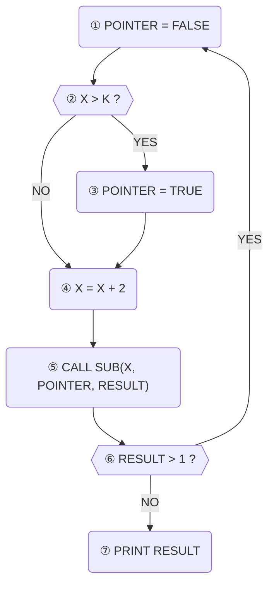
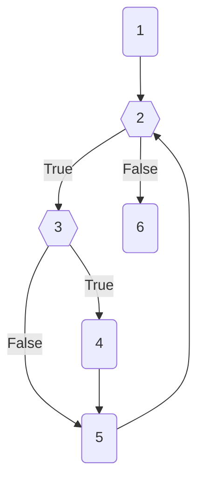
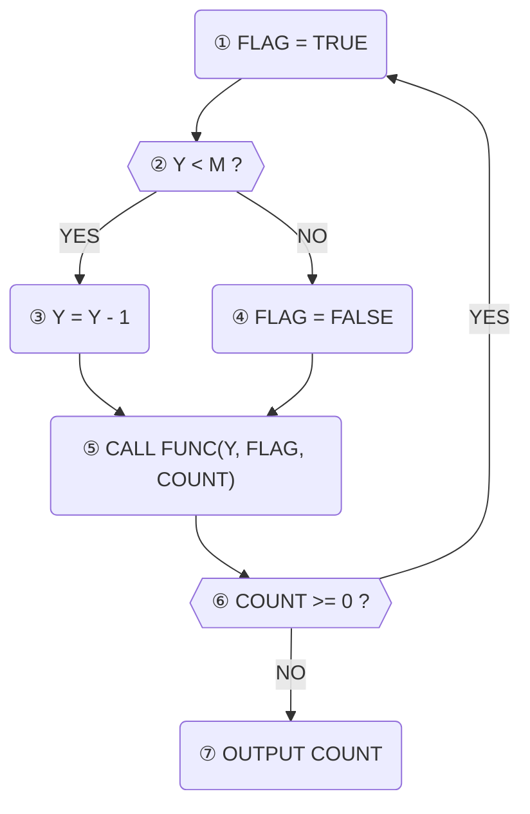

# SW 개발

SW 개발 영역은 테스트, 형상 관리, 인터페이스를 다룬다. 이 중에서 가장 크게 봐야 할 주제는 두 개다. 21개 회차 중 테스트 커버리지가 9회차, 블랙박스 테스트가 8회차에 나왔는데, 이 둘이 이 영역 문제의 3분의 1 남짓을 차지한다. 문제 형태는 "설명 2~3줄을 주고 이름을 고르기"가 기본이고, 커버리지만 제어흐름도에서 경로 번호를 채우는 형태가 더해진다. 2023년 이후에도 커버리지·블랙박스·스텁/드라이버·AJAX·URL 구조는 계속 나오고 있는데, 그중 상당수는 2~3년 전 문제를 다시 낸 재출제다.

## 테스트 커버리지 (화이트박스)
출제: 25-3, 25-2, 25-1, 24-3, 24-1, 23-2, 23-1, 21-2, 20-3
형태: 설명 1~3줄 → 커버리지 이름 / 설명 3개 → 문장·분기·조건 구분 / 제어흐름도 → 커버리지를 만족하는 경로 번호 채우기

### 개념
**테스트 커버리지**란 테스트가 소스 코드를 얼마나 충분히 검증했는지를 나타내는 지표를 말한다. 커버리지가 높다고 해서 품질이 높다는 보장은 없지만, 테스트가 덜 된 부분을 찾아내고 테스트의 신뢰성을 높이는 데 쓰인다. 특히 화이트박스 테스트에서 쓰는 커버리지 기준들이 시험에 자주 나온다.

종류는 다섯 가지이고, 강도는 **구문 < 결정 < 조건 < 조건/결정 < 변경 조건/결정(MC/DC)** 순서로 세진다. 이름마다 붙는 핵심 키워드를 표로 정리하면 이렇다.

| 커버리지 종류 | 핵심 키워드 |
|---|---|
| **구문(문장) 커버리지** | 모든 명령문, 한 번 이상 실행 |
| **결정(분기) 커버리지** | 각 결정문, 참/거짓, 한 번 이상 |
| **조건 커버리지** | 결정문 내 각 조건식, 참/거짓 |
| **조건/결정 커버리지** | 조건 + 결정 커버리지 모두 만족 |
| **변경 조건/결정 커버리지** | 개별 조건식, 독립적 영향 |

키워드에 나오는 명령문·결정문·조건식부터 구분해 두자. 지문이 "결정문 내 각 조건식"처럼 이 말들을 섞어 쓰기 때문에, 셋이 헷갈리면 결정 커버리지와 조건 커버리지도 같이 헷갈린다.

| 용어 | 정의 | 예시 |
|---|---|---|
| **명령문** | 실행 가능한 코드 한 줄 (실행문) | `System.out.println("Hello");`, `x = 5;` |
| **결정문** | 참/거짓을 판단하는 조건부 문장의 전체 조건 | `if (x > 0 && y < 10)`, `while (a < b)` |
| **조건식** | 결정문 내부의 개별 비교 연산 | 위 결정문 예시의 `x > 0`, `y < 10`, `a < b` |

조건식은 결정문 안에 들어 있다. 그래서 둘은 항상 나눠서 봐야 한다.

### 커버리지 하나씩 보기
위 표를 강도가 약한 것부터 한 줄씩 푼다.

#### 1. 구문(문장) 커버리지 (Statement Coverage)
- 소스 코드의 **모든 실행 가능한 문장(명령문)이 적어도 한 번 이상 실행**되었는지 측정
- 가장 기본적인 커버리지 기준
- 장점: 이해하기 쉽고 테스트 케이스 만들기 간편
- 단점: 코드의 논리적인 분기(branch)를 모두 테스트하지 못할 수 있음

```java
public void example(int x) {
    if (x > 0) { // 결정문
        System.out.println("Positive"); // 문장 1 (명령문1)
    }
    System.out.println("End"); // 문장 2 (명령문2)
}
```

`x = 5` 하나만 넣으면 구문 커버리지 100%다. 이 케이스는 `if`문의 참(true) 경로만 지나가지만, `문장 1`과 `문장 2`를 모두 실행하기 때문이다. 반대로 `x`가 0 이하(예를 들어 `x=-1`)라면 `if`문의 참 경로인 `System.out.println("Positive");`가 실행되지 않으니 구문 커버리지 100%를 채우지 못한다.

#### 2. 결정(분기) 커버리지 (Decision / Branch Coverage)
- **각 결정문의 결과가 참(True)과 거짓(False)을 각각 한 번 이상** 갖도록 테스트
- 구문 커버리지보다 강력한 기준
- 장점: 구문 커버리지가 놓치는 분기 경로까지 테스트 가능

```java
public void example(int x, int y) {
    if (x > 0 && y > 0) { // 결정문
        System.out.println("Both Positive");
    }
}
```

100%를 채우는 테스트 케이스는 아래 두 개다.
- `x = 5, y = 5`: 결정문 결과 참
- `x = -1, y = 5`: 결정문 결과 거짓

두 케이스가 결정문의 참과 거짓을 모두 포함하니 결정 커버리지 100%를 만족한다.

#### 3. 조건 커버리지 (Condition Coverage)
- 결정문 안에 있는 **각각의 개별 조건식**이 참(True)과 거짓(False)을 각각 한 번 이상 갖도록 테스트
- 결정문 전체의 결과(참/거짓)는 고려하지 않음
- 그래서 결정 커버리지를 100% 만족하지 못하는 경우가 생길 수 있음

```java
public void example(int x, int y) {
    // 결정문: (x > 0 && y > 0)
    // 조건식 1: x > 0
    // 조건식 2: y > 0
    if (x > 0 && y > 0) {
        System.out.println("Both Positive");
    }
}
```

100%를 채우는 테스트 케이스는 아래 두 개다.
- `x = 5, y = -5`: 조건식1 참, 조건식2 거짓
- `x = -5, y = 5`: 조건식1 거짓, 조건식2 참

각 조건식이 참과 거짓을 모두 가졌으니 조건 커버리지는 100%다. 그런데 결정문 전체의 결과는 두 번 다 거짓이다. 그래서 같은 케이스로 결정 커버리지를 재면 50%밖에 되지 않는다. 여기가 결정 커버리지와 조건 커버리지가 갈리는 지점이다.

#### 4. 조건/결정 커버리지 (Condition/Decision Coverage)
- **결정 커버리지와 조건 커버리지를 모두 100%** 만족하는 기준
- 각 결정문의 결과가 참/거짓을 한 번 이상 가지면서, 동시에 모든 개별 조건식도 참/거짓을 한 번 이상 갖도록 설계
- 장점: 결정과 조건 수준을 모두 만족해 테스트 신뢰도가 높아짐
- 단점: 조건식의 모든 조합을 테스트하지는 않으므로 MC/DC보다 약함

코드는 3번과 같은 `if (x > 0 && y > 0)`이다. 이번에는 아래 두 케이스를 넣는다.

| 테스트 케이스 | 조건식1 (`x>0`) | 조건식2 (`y>0`) | 결정문 결과 |
|---|---|---|---|
| `x = 5, y = 5` | 참 | 참 | 참 |
| `x = -5, y = -5` | 거짓 | 거짓 | 거짓 |

결정문의 결과가 참과 거짓을 모두 가지니 결정 커버리지가 100%이고, 조건1(`x>0`)과 조건2(`y>0`)도 각각 참과 거짓을 모두 가지니 조건 커버리지도 100%다.

#### 5. 변경 조건/결정 커버리지 (MC/DC)
- Modified Condition/Decision Coverage
- 조건 커버리지와 결정 커버리지를 모두 만족하면서, **각 개별 조건식이 다른 조건식의 값과 관계없이 전체 결정문의 결과에 독립적으로 영향을 미치는** 경우를 테스트
- 핵심: 각 조건이 '독립적으로' 결과에 영향을 준다는 것을 증명
- 쓰이는 곳: 항공, 원자력, 의료 등 높은 신뢰성이 요구되는 시스템

MC/DC와 비슷한 이름으로 **다중 조건 커버리지(Multiple Condition Coverage)** 가 있다. 다중 조건 커버리지는 가능한 모든 참·거짓 조합을 검사한다. 조건이 `n`개면 `2ⁿ`개 조합을 모두 테스트해야 해서, 조건이 3개만 되어도 `2³ = 8개` 조합이 필요하다. 조건이 늘수록 조합이 급격히 많아지는 셈이다. MC/DC는 모든 조합 대신 각 조건의 독립적인 영향을 보여 주는 조합만 고른다는 점이 다르다.

```java
public void example(boolean A, boolean B, boolean C) {
    // 결정문: (A || B) && C
    if ((A || B) && C) {
        System.out.println("Success");
    }
}
```

조건 하나씩 나머지를 고정하고 그 조건만 바꿔 본다. 결과가 바뀌면 그 조건의 독립적 영향이 증명된 것이다. 아래는 100%를 채우는 케이스의 일부다.

| 증명할 조건 | 고정한 값 | 케이스 | 결과 |
|---|---|---|---|
| A | B=F, C=T | `A=T, B=F, C=T` / `A=F, B=F, C=T` | True / False |
| B | A=F, C=T | `A=F, B=T, C=T` / `A=F, B=F, C=T` | True / False |
| C | A 또는 B가 True (예: A=T, B=F) | `A=T, B=F, C=T` / `A=T, B=F, C=F` | True / False |

세 조건 모두 자기 값만 바꿨을 때 결과가 True와 False로 갈렸으니, A·B·C 각각의 독립적 영향이 존재한다.

### 제어흐름도에서 경로 읽기
기출은 번호가 붙은 흐름도를 주고 "TC1: 1-2-3-...", "TC2: ..." 처럼 경로를 채우게 한다. 아래 그림(25-2)을 옆에 두고 이 순서로 적는다.

1. 먼저 마름모(결정 노드)를 찾는다. 결정 노드마다 "예" 화살표와 "아니오" 화살표가 하나씩 있다. 아래 그림에서는 ②와 ⑥이 결정 노드다.
2. **분기 커버리지**는 결정 노드마다 "예" 화살표와 "아니오" 화살표가 경로들 속에 각각 한 번 이상 들어 있어야 한다. 결정 노드가 ②, ⑥ 두 개인 아래 그림은 경로 두 개로 충분하다. 요령은 첫 경로에서 고르지 않은 화살표를 둘째 경로에서 고르는 것이다. TC1이 ② 예·⑥ 아니오를 골랐다면 TC2는 ② 아니오·⑥ 예를 고른다. "예"가 어느 화살표인지는 그림마다 다르다(아래 그림에서 ⑥의 "예"는 ①로 돌아가는 화살표다). 그래서 경로를 다 적은 뒤 결정마다 예·아니오가 한 번씩 나왔는지 다시 확인한다.
3. **문장 커버리지**는 모든 처리 노드(마름모가 아닌 노드)가 경로들 속에 한 번 이상 들어 있어야 한다. 반복문 본문 안의 노드도 포함되므로, 반복 조건이 적어도 한 번은 참이 되어 본문을 실행하는 경로가 있어야 한다.
4. 앞 노드로 되돌아가는 화살표(반복)가 있으면 경로에 같은 번호가 두 번 적힌다. 아래 그림에서는 ⑥의 "예"가 ①로 되돌아가서, TC2 ①②④⑤⑥①에 ①이 두 번 나온다.

```mermaid
제목: 25-2 기출 흐름도(23-1과 같은 유형, 그림은 다르다). TC1 ①②③④⑤⑥⑦은 ② 예·⑥ 아니오, TC2 ①②④⑤⑥①은 ② 아니오·⑥ 예로 지나 두 결정의 참·거짓을 한 번씩 덮는다 (분기 커버리지)
flowchart TB
  n1("① POINTER = FALSE") --> n2{{"② X > K ?"}}
  n2 -->|"예"| n3("③ POINTER = TRUE")
  n2 -->|"아니오"| n4("④ X = X + 2")
  n3 --> n4
  n4 --> n5("⑤ CALL SUB(X, POINTER, RESULT)")
  n5 --> n6{{"⑥ RESULT > 1 ?"}}
  n6 -->|"아니오"| n7("⑦ PRINT RESULT")
  n6 -->|"예"| n1
```

### 기출에서 이렇게 나왔다
- 25-3: 설명 2줄 → 한글 보기에서 **조건 커버리지** (23-2 재출제)
- 25-2: 제어흐름도(위 그림) → 분기 커버리지를 만족하는 TC1·TC2 경로 번호 채우기 (23-1과 같은 유형)
- 25-1: 코드와 제어흐름도 → 노드에 들어갈 문장과 문장 커버리지 실행 순서 1 → 2 → **3 → 4 → 5 → 2 → 6**
- 24-3: 설명 3개 → **Statement / Branch / Condition** 영문으로
- 24-1: "중요 조합", "다른 조건과 무관하게 전체 결과에 영향" → **MC/DC**
- 23-2: 한 줄 설명 → **Condition Coverage**
- 23-1: 제어흐름도 → 분기 커버리지 경로 TC1 ①②③**⑤⑥**⑦, TC2 ①**②④⑤⑥①**
- 21-2: 설명 3개 → **문장 / 결정(분기) / 조건**
- 20-3: 설명 → **분기(결정) 커버리지**

25-2는 그림 제목에 적힌 짝 말고 TC1 ①②③④⑤⑥①(② 예·⑥ 예), TC2 ①②④⑤⑥⑦(② 아니오·⑥ 아니오)로 짝을 바꿔도 정답이다. 이렇게 짝을 지어도 ②와 ⑥ 각각에서 예·아니오가 한 번씩 나오기 때문이다.

25-1은 노드가 코드 순서대로 1 `int a = 0;`, 2 `a < m || b[a] < x`(while 조건, 결정), 3 `b[a] < 0`(if 조건, 결정), 4 `b[a] = -b[a];`, 5 `a++;`, 6 `return 1;`이다. 문장 커버리지를 채우려면 4까지 실행되어야 한다. 4는 3의 if 조건이 참일 때만 실행되고, 3은 while 본문 안에 있어서 2가 참일 때만 실행된다. 그래서 1 → 2(참) → 3(참) → 4 → 5로 이어진다. 5를 실행한 뒤에는 while 조건인 2를 다시 검사하고, 이번에 거짓이 나오면 6을 실행한다. 이렇게 이어 붙인 최소 순서가 위 답이다.

23-1 그림은 ① FLAG=TRUE → ② Y<M? (예 → ③ Y=Y-1 → ⑤, 아니오 → ④ FLAG=FALSE → ⑤) → ⑤ CALL FUNC → ⑥ COUNT>=0? (아니오 → ⑦ 출력, 예 → ①)이다. 25-2 그림에서는 ③ 다음에 ④를 실행하지만, 23-1은 if-else 구조라서 ③ 다음 노드가 ④가 아니라 ⑤다. 그래서 같은 유형이라도 빈칸 개수와 화살표는 그림에서 직접 확인해야 한다.

### 답 쓸 때
답은 보기 언어를 따라간다. 보기가 영문이면 Statement·Branch·Condition 으로, 한글이면 문장(구문)·분기(결정)·조건으로 쓴다. 결정과 분기는 이름만 다를 뿐 같은 것이라서, 문제에 따라 둘 중 하나로 표기된다. MC/DC는 약어 그대로 쓴다.

### 기출 문제

:::q 25-3 12번
다음 설명에 맞는 테스트 기법을 한글로 쓰시오.

1. 결정문 내 각 개별 조건식이 True 또는 False의 결과를 각각 한 번 이상 만족하는 커버리지이다.
2. 전체 결정문의 참/거짓 결과를 모두 테스트하는 커버리지는 아니다.

보기: 분기 커버리지 / 조건 커버리지 / 변경 조건/결정 커버리지 / 구문 커버리지 / 결정 커버리지 / 조건/결정 커버리지

정답: 조건 커버리지 또는 조건 또는 Condition 또는 Condition coverage
:::

:::q 25-2 13번
다음 제어흐름도가 분기 커버리지를 만족하기 위한 테스트 순서를 쓰시오.



TC1: ① -> ② -> ③ -> ( a ) -> ( b ) -> ( c ) -> ⑦

TC2: ① -> ( d ) -> ( e ) -> ( f ) -> ( g ) -> ( h )

(숫자만 정답에 입력하세요.)

정답: a: 4 b: 5 c: 6 d: 2 e: 4 f: 5 g: 6 h: 1

그림은 원문을 보고 다시 그렸다.
:::

:::q 25-1 13번
다음 코드와 제어흐름도를 보고 문제를 푸세요.

```java
// b[]: 정수 배열, m: 배열의 유효 크기, x: 비교 값
int Main(int b[], int m, int x) {
    int a = 0;
    while (a < m || b[a] < x) {
        if (b[a] < 0) {
            b[a] = -b[a];
        }
        a++;
    }
    return 1;
}
```



(1) 각 노드에 들어갈 코드를 작성하시오. (답안 작성 방법: "노드 1 : int a = 0;")

(2) 문장 커버리지를 만족하는 최소 순서를 작성하세요. 1 -> 2 -> ( ) (답안 작성 방법: 3 -> 4 -> 5 -> 6)

정답: 노드 1: int a = 0; 또는 int a = 0 / 노드 2: a < m || b[a] < x / 노드 3: b[a] < 0 / 노드 4: b[a] = -b[a]; 또는 b[a] = -b[a] / 노드 5: a++; 또는 a++ / 노드 6: return 1; 또는 return 1 / 문장 커버리지 순서: 3 -> 4 -> 5 -> 2 -> 6

그림은 원문을 보고 다시 그렸다.
:::

:::q 24-3 7번
다음 설명에 맞는 테스트 커버리지 유형을 영어로 쓰시오.

① 모든 명령문을 적어도 한 번 실행되도록 조합하는 커버리지

② 각 결정문의 결과가 참/거짓을 각각 한 번 이상 갖도록 테스트하는 커버리지

③ 각 결정문 내 각 조건식의 결과가 참/거짓을 각각 한 번 이상 갖도록 테스트하는 커버리지

보기: Modified Condition/Decision / Condition/Decision / Condition / Statement / Branch

정답: ①: Statement ②: Branch ③: Condition
:::

:::q 24-1 6번
다음이 설명하는 테스트 커버리지를 보기에서 골라 쓰시오.

1. 모든 분기와 조건의 조합을 고려하나 모든 조합을 테스트하는 대신에 테스트가 필요한 중요한 조합을 찾아내는데에 중점을 둔다.
2. 특정 조건을 수행할 때 다른 조건과는 상관없이 전체 결과에 영향을 미치는 조건만을 테스트한다.
3. 각각의 파라미터는 적어도 한 번은 최종 결과에 영향을 주어야 한다.

보기: 변경 조건/결정 커버리지 / 구문 커버리지 / 결정 커버리지 / 조건 커버리지 / 경로 커버리지 / 다중 조건 커버리지 / 조건/결정 커버리지

정답: 변경 조건/결정 커버리지 또는 MC/DC
:::

:::q 23-2 3번
결정문 내의 각 조건이 참, 거짓을 한 번 이상 갖도록 조합하는 커버리지는 무엇인가?

보기: Decision Coverage / MC/DC / Statement Coverage / Condition Coverage / Condition/Decision Coverage

정답: Condition Coverage
:::

:::q 23-1 6번
다음 제어흐름도가 분기 커버리지를 만족하기 위한 테스트 순서를 쓰시오.



TC1: ① -> ② -> ③ -> ( a ) -> ( b ) -> ⑦

TC2: ① -> ( c ) -> ( d ) -> ( e ) -> ( f ) -> ( g )

(숫자만 정답에 입력하세요.)

정답: a: 5 b: 6 c: 2 d: 4 e: 5 f: 6 g: 1

그림은 원문을 보고 다시 그렸다.
:::

:::q 21-2 15번
다음은 화이트박스 테스트 검증 기준에 대한 설명이다. 빈칸 ①, ②, ③에 들어갈 용어를 쓰시오.

- ( ① ) 검증 기준은 프로그램 내의 모든 명령문이 적어도 한 번 이상 수행되도록 하는 검증 기준이다.
- ( ② ) 검증 기준은 프로그램 내의 모든 분기문이 적어도 한 번 이상 수행되도록 하는 검증 기준이며, 분기 검증 기준이라고도 한다.
- ( ③ ) 검증 기준은 분기문 내의 각 개별 조건식의 결과가 참(True)과 거짓(False)을 한 번 이상 갖도록 하는 검증 기준이다.

정답: ①: 문장 또는 Statement 또는 구문 ②: 결정 또는 Decision ③: 조건 또는 Condition
:::

:::q 20-3 7번
다음 설명에 해당하는 화이트박스 테스트 커버리지를 쓰시오.

프로그램의 모든 분기점에서 참(True)·거짓(False)의 결과를 적어도 한 번 이상 만족하도록 테스트 케이스를 설계하는 기법이다.

보기: 분기 커버리지 / 문장 커버리지 / 조건 커버리지 / 다중 조건 커버리지 / 조건/분기 커버리지

정답: 분기 커버리지 또는 결정 커버리지 또는 Branch Coverage 또는 Decision Coverage
:::

## 블랙박스 테스트 기법
출제: 26-2, 23-3, 22-3, 22-1, 21-3, 21-1, 20-4, 20-3
형태: 설명 또는 예시 데이터 → 기법 이름 / 보기 여러 개 중 블랙박스 기법 3개 고르기

### 개념
**블랙박스 테스트(Black-box Test)** 란 소프트웨어의 내부 구조나 소스 코드는 보지 않고, 오직 **요구사항 명세**만 보면서 기능이 올바르게 동작하는지 검사하는 테스트 방법을 말한다. 사용자 쪽에서 테스트하는 것과 같다고 보면 되고, 그래서 **명세 기반 테스트** 또는 **기능 테스트**라고도 부른다.

기법이 열 가지나 되니 이름마다 붙는 키워드부터 표로 보고 들어가자.

| 용어 | 키워드 |
|---|---|
| **블랙박스 테스트** | 내부 구조 미파악, 요구사항 명세 기반, 기능 테스트, 명세 기반 테스트 |
| **동등 분할 테스트** | 유효/무효 그룹, 대표값 선택, 효율적 테스트, 도메인별 분할 |
| **경곗값 분석 테스트** | 경계값 집중, 오류 발생 확률 높음, 동등 분할 후 경계값, 0, 1, 2, 99, 100, 101 |
| **원인-결과 그래프 테스트** | 입력과 출력 관계, 논리적 관계, 그래프 표현, 효용성 높은 케이스 |
| **결정 테이블 테스트** | 복잡한 논리적 조건, 행동 정리, 표 기반, 체계적 테스트 |
| **상태 전이 테스트** | 상태 변화, 이벤트 기반, 상태 전이도, 상태 전이표 |
| **오류 예측 테스트** | 경험과 직관, 창의적 접근, 보완적 역할, 오류 패턴 |
| **비교 테스트** | 동일한 테스트 자료, 여러 버전·제품 비교, 결과 대조 |
| **페어와이즈 테스트** | 조합 폭발 해결, 테스트 케이스 수 감소, 모든 쌍 테스트, 파라미터 조합 |
| **분류 트리 테스트** | 분류와 클래스, 트리 구조, 클래스 조합, 테스트 케이스 도출 |
| **유스케이스 테스트** | 사용자 목표, 기본·대체·예외 흐름, 사전·사후 조건, 흐름 단위 검사 |

### 기법 하나씩 보기
위 표 순서대로 하나씩 본다. 동등 분할과 경곗값 분석, 결정 테이블과 원인-결과 그래프, 상태 전이와 유스케이스는 서로 헷갈리는 짝이라 각 항목 끝에서 함께 가른다.

#### 1. 동등 분할 (Equivalence Partitioning)
- 입력 데이터의 영역을 **유효한(valid) 그룹과 무효한(invalid) 그룹**으로 나눔
- 각 그룹에서 **대표값을 하나씩** 골라 테스트 케이스 설계
- 모든 입력값을 테스트하지 않고도 효율적으로 테스트 가능

예를 들어 시험 점수(1점 ~ 100점)를 입력하는 시스템이 있다고 해보자.
- **유효 파티션**: 1 이상 100 이하의 값 (예: 50)
- **무효 파티션**: 1 미만의 값 (예: 0), 100 초과의 값 (예: 101)

#### 2. 경곗값 분석 (Boundary Value Analysis)
- 입력 범위가 바뀌는 **경계에서 결함이 발생하기 쉽다**는 점을 이용
- 동등 분할 후 각 분할의 경계값을 집중적으로 테스트

같은 시험 점수(1점 ~ 100점) 시스템이라면 경계값은 0, 1, 2(최소 경계)와 99, 100, 101(최대 경계)이다.

처리가 여러 번 바뀌는 입력이라면 **바뀌는 지점마다** 경계를 검사한다. 택배 무게에 따라 배송비를 계산하는 프로그램을 예로 들어 보자. 무게는 kg 단위의 정수로만 입력하고, 1 미만이거나 20 초과이면 오류로 처리한다.

| 무게(kg) | 배송비 |
|---|---|
| 0 초과 ~ 5 이하 | 3,000원 |
| 5 초과 ~ 10 이하 | 5,000원 |
| 10 초과 ~ 20 이하 | 8,000원 |

입력이 정수라서 이 기준은 다섯 구간으로 나뉜다.

| 구간 | 0 이하 | 1 ~ 5 | 6 ~ 10 | 11 ~ 20 | 21 이상 |
|---|---|---|---|---|---|
| 기대 처리 | 오류 | 3,000원 | 5,000원 | 8,000원 | 오류 |

구간이 바뀌는 곳, 즉 **경계**는 네 군데다. 경곗값 분석은 경계마다 그 경계를 사이에 둔 **두 정수를 짝지어 둘 다** 검사한다. 한쪽 구간의 마지막 값과 이웃 구간의 첫 값이다.

| 검사값 | 기대 처리의 변화 | 이유 |
|---|---|---|
| 0 · 1 | 오류 ↔ 3,000원 | 0은 오류 구간의 마지막 값, 1은 유효 범위의 첫 값 |
| 5 · 6 | 3,000원 ↔ 5,000원 | 5는 '5 이하'에 포함, 6은 다음 정수라 '5 초과' |
| 10 · 11 | 5,000원 ↔ 8,000원 | 10은 '10 이하'에 포함, 11은 '10 초과' |
| 20 · 21 | 8,000원 ↔ 오류 | 20은 유효 범위의 마지막 값, 21은 '20 초과' |

바로 이웃한 두 정수의 기대 처리가 다르기 때문에, 경계 숫자나 '이하'·'미만' 같은 비교 조건을 잘못 구현하면 이 짝 중 하나에서 결과가 어긋난다. 경계가 어느 쪽으로 밀렸느냐에 따라 5에서 드러나기도 하고 6에서 드러나기도 하니 **양쪽을 모두 검사한다.** 위 기본 예시(0, 1, 2 / 99, 100, 101)처럼 경계 하나에 세 값을 검사하기도 한다. 두 값이든 세 값이든 **경계 양쪽을 짝지어 집중 검사했다면** 경곗값 분석이다.

정말 짝 중 한쪽만 보면 놓칠까? 첫 구간의 조건 '5 이하'를 잘못 구현한 두 경우를 비교해 보자.
- **경우 ①**: '5 미만'(`무게 < 5`)으로 구현. 5kg이 첫 구간에서 빠져 5,000원이 됨
- **경우 ②**: '6 이하'(`무게 <= 6`)로 구현. 6kg이 첫 구간에 들어가 3,000원이 됨

| 검사값 | 기대 결과 | 경우 ①의 결과 | 경우 ②의 결과 |
|---|---|---|---|
| 5 | 3,000원 | 5,000원 (불일치) | 3,000원 (일치) |
| 6 | 5,000원 | 5,000원 (일치) | 3,000원 (불일치) |

경우 ①은 5에서만, 경우 ②는 6에서만 드러난다. 짝 중 한쪽만 검사하면 둘 중 하나를 놓치고, 구간 안쪽의 3이나 8만 검사하면 두 경우 모두 찾지 못한다. 같은 방식으로 '20 이하'를 '21 이하'(`무게 <= 21`)로 잘못 구현하면 21kg이 오류 대신 8,000원이 되어 검사값 21에서 드러난다.

여기서 많이들 헷갈리는 게 동등 분할과의 구분이다. 같은 요금 기준이라도 **값을 고르는 목적**에 따라 기법이 달라진다. 동등 분할은 구간마다 대표값을 하나씩 고르고, 경곗값 분석은 경계마다 양쪽 값을 짝지어 고른다.

| 구간 | 기대 처리 | 동등 분할 대표값 (예) | 경곗값 분석 검사값 |
|---|---|---|---|
| 0 이하 | 오류 | 0 | 0 |
| 1 ~ 5 | 3,000원 | 3 | 1, 5 |
| 6 ~ 10 | 5,000원 | 8 | 6, 10 |
| 11 ~ 20 | 8,000원 | 15 | 11, 20 |
| 21 이상 | 오류 | 25 | 21 |

동등 분할은 구간 5개에서 값 5개를, 경곗값 분석은 경계 4곳에서 값 8개를 골랐다. 그런데 무게는 음수가 될 수 없으니 0 이하 구간의 대표값으로 0을 고르는 게 자연스럽고, 그러면 동등 분할의 대표값 0도 경계에 놓인다. 그러니 **값이 경계에 있다는 것만으로는 경곗값 분석이라고 판정할 수 없다.** 구간마다 대표값을 하나씩 골랐다면 동등 분할, 처리가 바뀌는 경계마다 양쪽 값을 짝지어 골랐다면 경곗값 분석이다. 값의 위치가 아니라 고른 방식으로 판정한다.

2026년 2회 문제가 이 판정을 그대로 물었다. 점수 구간마다 값을 하나씩 골랐다.

| 점수 구간 | 90 ~ 100 | 79 ~ 89 | 50 ~ 78 | 21 ~ 49 | 0 ~ 20 |
|---|---|---|---|---|---|
| 문제에서 고른 값 | 95 | 80 | 73 | 23 | 15 |

80은 79와, 23은 21과 가깝다. 하지만 경계를 사이에 둔 짝(78·79, 20·21)을 검사한 것이 아니라 구간별 대표값을 하나씩 고른 것이니 동등 분할이다.

#### 3. 결정 테이블 (Decision Table)
- 요구사항의 **복잡한 논리적 조건과 그에 따라 시스템이 취할 행동**을 체계적으로 정리한 표 기반 설계
- 규칙 한 열이 곧 테스트 케이스 하나

쇼핑몰 할인 정책을 결정 테이블로 나타내면 이렇다.

| 규칙 | 1 | 2 | 3 |
|---|---|---|---|
| 조건 | | | |
| VIP 회원 | T | F | F |
| 10만원 이상 구매 | T | T | F |
| 쿠폰 사용 | T | F | F |
| 행동 | | | |
| 20% 할인 | X | | |
| 5% 할인 | | X | |
| 할인 없음 | | | X |

#### 4. 원인-결과 그래프 (Cause-Effect Graph)
- 입력 데이터 간의 관계나 출력에 영향을 미치는 상황을 체계적으로 분석해 **효용성 높은 테스트 케이스**를 선정
- 입력(원인)과 출력(결과) 사이의 **논리적 관계를 그래프**로 표현

특정 조건이 만족될 때 파일이 업데이트되는 시스템을 예로 들어 보자.
- **원인(Causes)**: C1 1번 열의 문자는 'A'이다 / C2 1번 열의 문자는 'B'이다 / C3 2번 열의 문자는 'T'이다
- **결과(Effect)**: E1 파일이 업데이트된다
- **논리**: (C1 또는 C2) 그리고 C3가 참일 때 E1 발생

C1과 C2는 **같은 1번 열의 문자**가 A인지 B인지를 묻는다. 한 칸에 두 문자가 동시에 들어갈 수는 없으니 **C1과 C2는 동시에 참이 될 수 없다.** 이렇게 동시에 참이 될 수 없는 조건은 그래프에 제약 기호 `E`로 묶어 표시하기도 한다. 결과 노드 E1과는 다른 뜻이고, 아래 그림에서는 생략했다. 이 제약은 뒤에서 조건 조합을 셀 때 다시 쓴다.

원인-결과 그래프는 조건과 동작을 **원형 노드**로 그리고, 노드 사이를 **실선**으로 이은 뒤, 선이 합쳐지는 곳에 **논리 기호**를 적는다. 위 예시를 이 표기로 그리면 다음과 같다.

```mermaid
제목: C1 ∨ C2의 값이 중간 노드 I1에 담기고, I1 ∧ C3의 값이 결과 E1을 정한다
flowchart LR
  C1(("C1"))
  C2(("C2"))
  C3(("C3"))
  O1{"∨"}
  A1{"∧"}
  I1(("I1"))
  E1(("E1"))
  C1 --- O1
  C2 --- O1
  O1 --- I1
  I1 --- A1
  C3 --- A1
  A1 --- E1
  classDef op fill:#fff4e5,stroke:#ffb45c,color:#7a4a00
  class O1,A1 op
```

노드는 그래프에서 맡은 역할에 따라 세 가지로 나뉜다.

| 노드 | 그림에서 | 역할 |
|---|---|---|
| **입력 노드 (원인)** | C1, C2, C3 | 참·거짓을 판단하는 입력 조건 |
| **중간 노드** | I1 | 앞 노드들을 논리 기호로 계산한 값을 담아 다음 관계로 넘김 |
| **출력 노드 (결과)** | E1 | 조건 조합에 따라 일어나는 프로그램 동작 |

실선은 앞 노드의 참·거짓 값이 다음 노드로 전달된다는 뜻이다. 여러 선이 한 노드로 모일 때는 선 사이에 적힌 논리 기호가 값을 합치는 방법을 정한다. 위 그림에서 ∨는 I1로 들어오는 두 선(C1→I1, C2→I1) 사이에, ∧는 E1로 들어오는 두 선(I1→E1, C3→E1) 사이에 놓인다. 자료에 따라 합쳐지는 선들을 곡선으로 묶고 그 위에 기호를 적기도 한다.

| 기호 | 이름 | 참이 되는 경우 |
|---|---|---|
| **∨** | OR (논리합) | 연결된 조건 중 하나 이상이 참일 때 |
| **∧** | AND (논리곱) | 연결된 조건이 모두 참일 때 |

이 밖에 조건의 참·거짓을 뒤집는 부정(NOT) 기호 `~`도 있다. 두 조건 A, B를 이었을 때 나올 수 있는 네 가지 경우를 모두 적으면 다음과 같다.

| A | B | A ∨ B | A ∧ B |
|---|---|---|---|
| 참 | 참 | 참 | 참 |
| 참 | 거짓 | 참 | 거짓 |
| 거짓 | 참 | 참 | 거짓 |
| 거짓 | 거짓 | 거짓 | 거짓 |

정리하자면 ∨(OR)는 연결된 조건 중 하나만 참이어도 참이고, ∧(AND)는 하나라도 거짓이면 거짓이다. 문장으로 옮기면 ∨는 '또는', ∧는 '그리고'다.

중간 노드는 계산 결과를 담아 두었다가 다음 관계로 넘기는 자리다. 이 예시에서 I1은 '1번 열의 문자가 A 또는 B이다'라는 값을 담고, 그 값이 다시 C3와 ∧로 묶여 E1로 이어진다. 관계가 여러 단계로 이어질 때만 쓰니 모든 그래프에 있는 것은 아니다. 원인이 결과로 바로 이어지는 그래프라면 중간 노드 없이 그리고, 중간 노드의 이름도 I1로 정해져 있지 않고 자료마다 다르게 붙인다.

그래프는 왼쪽에서 오른쪽으로, 두 단계로 읽는다.
1. **I1 계산**: C1과 C2가 ∨로 I1에 모이므로 `I1 = C1 ∨ C2`. 1번 열의 문자가 A이거나 B이면 I1이 참
2. **E1 판정**: I1과 C3가 ∧로 E1에 모이므로 `E1 = I1 ∧ C3`. I1이 참이면서 2번 열의 문자가 T여야 파일이 업데이트됨

두 단계를 합치면 앞에서 문장으로 적은 논리 `(C1 또는 C2) 그리고 C3`와 같다. 예를 들어 1번 열이 A, 2번 열이 S인 입력은 C1이 참이라 I1도 참이지만, C3가 거짓이라 `E1 = 참 ∧ 거짓 = 거짓`이 되어 파일이 업데이트되지 않는다.

원인-결과 그래프 테스트의 산출물은 **원인-결과 그래프**와 **그 그래프에서 만든 결정 테이블**이다. 위 그래프를 결정 테이블로 옮길 때 원인은 조건 행, 결과는 행동 행이 되고, 중간 노드 I1은 표에 넣지 않는다. 조건 칸의 T는 참, F는 거짓이고, 행동 칸의 X는 그 규칙에서 파일이 업데이트된다는 뜻이다.

| 규칙 | 1 | 2 | 3 | 4 | 5 | 6 |
|---|---|---|---|---|---|---|
| 조건 (원인) | | | | | | |
| C1: 1열='A' | T | T | F | F | F | F |
| C2: 1열='B' | F | F | T | T | F | F |
| C3: 2열='T' | T | F | T | F | T | F |
| 행동 (결과) | | | | | | |
| E1: 파일 업데이트 | X | | X | | | |

규칙이 왜 6개일까? 원인 3개가 각각 참·거짓이면 2 × 2 × 2 = 8가지 조합이 나온다. 하지만 C1과 C2가 모두 참인 2가지 조합(C3가 참인 경우와 거짓인 경우)은 입력으로 만들 수 없으니, 이를 빼면 **6가지**가 남는다. 원인끼리 이런 제약이 없다면 8가지 조합을 모두 적는다. 조합을 위 표처럼 열로 놓아도 되고, 한 줄에 한 조합씩 행으로 놓아도 같은 내용이다.

행동 칸은 그래프를 따라 계산해서 채운다. `I1 = C1 ∨ C2`는 C1·C2 중 하나라도 T인 규칙 1 ~ 4에서 참이고, `E1 = I1 ∧ C3`는 I1과 C3가 모두 참인 규칙 1과 3에서만 참이다. 그래서 이 두 규칙의 E1 칸에만 X를 적는다.

규칙마다 그 조합을 만드는 입력을 하나씩 정하면 테스트 케이스가 된다.

| 테스트 케이스 | 입력 (1열, 2열) | 규칙 | 예상 결과 |
|---|---|---|---|
| TC1 | A, T | 1 | 파일이 업데이트됨 |
| TC2 | A, S | 2 | 업데이트되지 않음 |
| TC3 | B, T | 3 | 파일이 업데이트됨 |
| TC4 | B, S | 4 | 업데이트되지 않음 |
| TC5 | C, T | 5 | 업데이트되지 않음 |
| TC6 | C, S | 6 | 업데이트되지 않음 |

TC5·TC6의 C와 TC2·TC4·TC6의 S는 'A·B가 아닌 문자', 'T가 아닌 문자'를 대표하는 값이다.

결정 테이블과는 그래프가 있었는지로 가른다. 원인·결과를 ∨·∧ 같은 논리 기호로 이은 그래프를 먼저 분석하고, 그 관계에서 조건 조합과 예상 결과를 도출해 검사했다면 원인-결과 그래프 테스트다. 그래프 없이 조건 조합과 행동을 정리한 표만 주어졌다면 결정 테이블 테스트다.

#### 5. 상태 전이 (State Transition)
- 시스템의 **상태가 특정 이벤트에 의해 어떻게 변하는지** 분석하고 테스트
- 상태 변화를 상태 전이도(State Transition Diagram)나 상태 전이표로 정리
- 그 안의 **전이**(한 상태에서 다른 상태로 옮겨 가는 화살표)를 빠짐없이 검사하도록 설계

ATM 기기를 예로 들면 상태와 이벤트는 이렇다.
- **상태**: 대기, PIN 대기, PIN 확인, 거래 중, 카드 반환
- **이벤트**: 카드 삽입, PIN 입력, PIN 일치, PIN 불일치 (3회), 거래 종료, 카드 회수

아래는 ATM 기기의 상태 변화를 나타낸 상태 전이도다.

```mermaid
제목: ATM 상태 전이도. 둥근 사각형이 상태, 화살표 위 글자가 전이를 일으키는 이벤트
stateDiagram-v2
    [*] --> 대기
    대기 --> PIN대기: 카드 삽입
    PIN대기 --> PIN확인: PIN 입력
    PIN확인 --> 거래중: PIN 일치
    PIN확인 --> 카드반환: PIN 불일치 (3회)
    거래중 --> 카드반환: 거래 종료
    카드반환 --> 대기: 카드 회수
    PIN대기: PIN 대기
    PIN확인: PIN 확인
    거래중: 거래 중
    카드반환: 카드 반환
```

상태는 둥근 사각형, 전이는 화살표로 그리고, 화살표 위에는 전이를 일으키는 이벤트를 적는다. 맨 위의 검은 점은 처음 시작하는 상태가 대기라는 표시일 뿐 이벤트가 없어서, 테스트할 전이로 세지 않는다. 그래서 이 그림에서 테스트할 전이는 검은 점의 화살표를 뺀 **화살표 6개**다. `PIN 불일치 (3회)`는 세 번째로 틀렸을 때 카드 반환으로 넘어가는 전이를 줄여 적은 것이다. 1·2회째 불일치는 PIN을 다시 입력받는 경우라 그림에서 생략했다.

상태 전이 테스트에서 **검사 단위는 화살표(전이) 하나**다. 화살표 하나를 검사한다는 것은 아래 세 가지를 확인한다는 뜻이고, 각각 테스트 케이스의 구성 요소에 대응한다.

| 화살표의 부분 | 테스트 케이스 구성 요소 |
|---|---|
| 출발 상태 | 테스트 조건(사전 조건). 시스템을 이 상태로 준비 |
| 이벤트 | 테스트 데이터(입력). 화살표에 적힌 조작이나 사건을 발생시킴 |
| 도착 상태 | 예상 결과. 이 상태로 바뀌는지 확인 |

화살표마다 테스트 케이스를 하나씩 만들면 ATM 상태 전이도의 화살표 6개에서 테스트 케이스 6개가 나온다.

| 테스트 케이스 | 출발 상태 | 이벤트 | 예상 결과 (도착 상태) |
|---|---|---|---|
| TC1 | 대기 | 카드 삽입 | PIN 대기 |
| TC2 | PIN 대기 | PIN 입력 | PIN 확인 |
| TC3 | PIN 확인 | PIN 일치 | 거래 중 |
| TC4 | PIN 확인 | PIN 불일치 (3회) | 카드 반환 |
| TC5 | 거래 중 | 거래 종료 | 카드 반환 |
| TC6 | 카드 반환 | 카드 회수 | 대기 |

화살표를 빠짐없이 검사하면 모든 상태도 함께 거치게 되니, 상태(노드)와 전이(링크)를 모두 검사하는 셈이다. 사용자의 목표나 전체 흐름이 아니라 개별 전이를 기준으로 검사한다는 점이 뒤에서 볼 유스케이스 테스트와 다르다.

같은 내용을 **상태 전이표**(State Table)로 적을 수도 있다. 행에는 현재 상태, 열에는 이벤트를 두고, 칸에는 그 이벤트가 일어났을 때 옮겨 갈 다음 상태를 적는다. 상태 전이도와 상태 전이표는 같은 정보를 담은 두 가지 표현이다.

| 현재 상태 | 카드 삽입 | PIN 입력 | PIN 일치 | PIN 불일치 (3회) | 거래 종료 | 카드 회수 |
|---|---|---|---|---|---|---|
| 대기 | PIN 대기 | | | | | |
| PIN 대기 | | PIN 확인 | | | | |
| PIN 확인 | | | 거래 중 | 카드 반환 | | |
| 거래 중 | | | | | 카드 반환 | |
| 카드 반환 | | | | | | 대기 |

채워진 6칸이 상태 전이도의 화살표 6개와 하나씩 대응한다. **결정 테이블도 표 모양이지만, 결정 테이블은 조건 조합과 행동을, 상태 전이표는 현재 상태·이벤트·다음 상태를 정리한다는 점이 다르다.**

#### 6. 오류 예측 (Error Guessing)
- 테스터의 **경험과 직관**으로 시스템에 어떤 오류가 있을지 예측하고 그 오류를 검증하는 케이스 설계
- 정형화된 규칙은 없음
- 다른 기법들이 놓칠 수 있는 오류를 찾는 데 효과적

로그인 폼에 비밀번호 대신 아이디를 넣어 보거나, 숫자 필드에 문자를 넣거나, 필수 입력값을 비워 두는 식이다.

#### 7. 비교 (Comparison)
- **동일한 테스트 자료**로 여러 버전의 프로그램이나 경쟁사 제품과 비교하며 테스트

#### 8. 페어와이즈 (Pairwise)
- 모든 입력 파라미터 조합을 테스트하는 대신, **테스트 케이스 수를 줄이면서 모든 파라미터 값들의 쌍(pair)을 적어도 한 번씩** 테스트하도록 조합을 만드는 기법
- 파라미터가 많아질수록 조합 수가 기하급수적으로 느는 '조합 폭발' 문제 해결에 효과적
- 파라미터: 운영체제(OS)나 브라우저처럼 테스트에서 값을 바꾸어 보는 입력·설정 항목

웹사이트 설정을 예로 들어 보자. OS는 Win·Mac, 브라우저는 Chrome·Firefox, 언어는 한국어·영어다. 모든 조합(2x2x2=8) 대신 아래 4가지 케이스만으로 모든 쌍(OS-브라우저, OS-언어, 브라우저-언어)을 테스트할 수 있다.

| 케이스 | OS | 브라우저 | 언어 |
|---|---|---|---|
| 1 | Win | Chrome | 한국어 |
| 2 | Win | Firefox | 영어 |
| 3 | Mac | Chrome | 영어 |
| 4 | Mac | Firefox | 한국어 |

#### 9. 분류 트리 (Classification Tree)
- 테스트할 요소를 **분류**, 각 분류에서 구별하는 값의 그룹을 **클래스**로 정리해 트리로 표현
- 각 분류에서 클래스를 하나씩 골라 조합하면 테스트 케이스
- 모든 조합을 고를지 일부 조합만 고를지는 별도로 정함

파일 업로드 기능이라면 분류는 파일 종류와 파일 크기이고, 클래스는 (이미지, 문서)와 (10MB 미만, 10MB 이상)이다. 아래 그림은 이 분류와 클래스를 조합해 만든 테스트 케이스 4개를 보여 준다.

```mermaid
제목: 분류(파일 종류·파일 크기)마다 클래스를 하나씩 골라 조합하면 테스트 케이스 4개가 나온다
flowchart TB
  subgraph S1["분류 (Classification)"]
    R("파일 업로드") --> K1("파일 종류")
    R --> K2("파일 크기")
  end
  subgraph S2["클래스 (Classes)"]
    a("이미지")
    b("10MB 미만")
    c("문서")
    d("10MB 이상")
  end
  subgraph S3["테스트 케이스 (Test Cases)"]
    T1["TC1: 이미지, 10MB 미만"]
    T2["TC2: 이미지, 10MB 이상"]
    T3["TC3: 문서, 10MB 미만"]
    T4["TC4: 문서, 10MB 이상"]
  end
  K1 --> a
  K1 --> c
  K2 --> b
  K2 --> d
  a --> T1
  b --> T1
  a --> T2
  d --> T2
  c --> T3
  b --> T3
  c --> T4
  d --> T4
```

페어와이즈와 헷갈리기 쉬운데, **페어와이즈가 '모든 쌍을 한 번 이상 포함하도록' 조합을 고르는 기준이라면, 분류 트리는 입력을 분류·클래스로 구조화하는 방법이다.** 분류 트리로 정리한 클래스를 페어와이즈 기준으로 조합하는 것처럼 두 기법을 함께 쓸 수도 있다.

#### 10. 유스케이스 (Use Case)
- 사용자 관점에서 시스템이 제공하는 기능의 시나리오를 정의한 **유스케이스**를 기반으로 설계
- 시스템이 실제 사용자의 목표를 달성시키는 과정의 상호작용 흐름 검증에 중점

온라인 쇼핑몰 '상품 구매'의 유스케이스 명세를 보자.

| 항목 | 내용 |
|---|---|
| 사용자 목표 | 구매자가 장바구니의 상품을 결제 |
| 사전 조건 | 로그인되어 있고 장바구니에 상품이 하나 이상 있음 |
| 기본 흐름 | 주문서 확인 → 배송지 선택 → 결제수단 선택 → 결제 승인 → 주문 완료 |
| 대체 흐름 | 저장된 배송지 대신 새 배송지를 입력한 뒤 결제 |
| 예외 흐름 | 결제가 거절되면 사유를 안내하고 결제수단 선택으로 복귀 |
| 사후 조건 | 주문이 생성되었거나, 생성되지 않은 이유가 구매자에게 안내됨 |

테스트 케이스는 흐름 하나를 처음부터 끝까지 이어서 실행한 뒤 사후 조건이 성립하는지 확인하는 식으로 만든다.

| 테스트 케이스 | 따라가는 흐름 | 기대 결과 |
|---|---|---|
| TC1 | 기본 흐름 | 주문이 생성되고 완료 화면 표시 |
| TC2 | 대체 흐름 (새 배송지) | 새 배송지로 주문 생성 |
| TC3 | 예외 흐름 (결제 거절) | 거절 사유가 안내되고 결제수단을 다시 고를 수 있음 |

흐름 하나가 검사 단위이고, 예외 흐름도 똑같이 테스트 케이스 하나다. 성공 경로 하나만을 뜻하는 기법이 아니라는 점을 기억해 두자.

### 자료 보고 기법 맞히기
기출은 아래 같은 자료를 하나 보여 주고 "어떤 테스트 기법인가"를 묻는다. 보기에는 블랙박스 기법과 화이트박스 커버리지가 섞여 나온다(22-1은 Statement Coverage·Decision Coverage와 Boundary Value Analysis·Cause-Effect Graph를 한 보기에 넣었다). 자료 1은 26-2에 실제로 나온 자료이고, 나머지는 점수 명세 하나(0~100 정수, 60~100이면 합격, 0~59면 불합격, 범위 밖이면 오류)로 만들었다. 자료를 먼저 보고 답을 떠올린 뒤 아래 줄을 확인하자.

**자료 1** (26-2 실제 자료)

등급 기준

| 점수 범위 | 출력 등급 |
|---|---|
| 90 ~ 100 | A |
| 79 ~ 89 | B |
| 50 ~ 78 | C |
| 21 ~ 49 | D |
| 0 ~ 20 | E |

테스트 결과

| 테스트값 | 예상 결과 | 실제 결과 |
|---|---|---|
| 95 | A | A |
| 80 | B | B |
| 73 | C | C |
| 23 | D | D |
| 15 | E | E |

→ 동등 분할. 점수 구간마다 안쪽 값 하나씩(95, 80, 73, 23, 15)이고, 89·90이나 78·79 같은 경계 양옆 값은 없다. 80은 79에, 23은 21에 가깝지만 경계를 사이에 둔 짝(78·79, 20·21)으로 고른 값이 아니라 구간마다 하나씩 고른 대표값이다. 값이 경계 근처에 있는지가 아니라 어떤 방식으로 골랐는지로 판정한다. 26-2는 이 자료에 보기로 동등 분할·원인-결과 그래프·결정 테이블·경계값 분석·오류 예측을 주었다.

**자료 2**

| 테스트 값 | -1 | 0 | 59 | 60 | 100 | 101 |
|---|---|---|---|---|---|---|
| 기대 결과 | 오류 | 불합격 | 불합격 | 합격 | 합격 | 오류 |

→ 경계값 분석. 구간이 바뀌는 자리(0, 60, 100) 양옆 값만 모았다.

**자료 3**

| | 규칙 1 | 규칙 2 | 규칙 3 |
|---|---|---|---|
| 조건: 0~100 사이인가 | Y | Y | N |
| 조건: 60 이상인가 | Y | N | - |
| 행동: 합격 | X | | |
| 행동: 불합격 | | X | |
| 행동: 오류 | | | X |

→ 결정 테이블. 조건 줄(Y·N)과 행동 줄(X)이 함께 있다.

**자료 4**

```text
원인 C1: 점수가 0~100 사이다     원인 C2: 점수가 60 이상이다
결과 E1 합격   = C1 AND C2
결과 E2 불합격 = C1 AND NOT C2
결과 E3 오류   = NOT C1
```

→ 원인-결과 그래프. 입력 조건(원인)과 출력(결과)을 AND·NOT으로 이었다.

**자료 5**

```python
if 0 <= score <= 100:
    if score >= 60:
        print("합격")
    else:
        print("불합격")
else:
    print("오류")
```

| 테스트 값 | 바깥 if | 안쪽 if |
|---|---|---|
| 80 | 참 | 참 |
| 30 | 참 | 거짓 |
| 120 | 거짓 | (안 감) |

→ 결정(분기) 커버리지. 코드가 있고, if문 두 개가 각각 참·거짓을 한 번씩 냈다. 테스트 값 80, 30, 120은 자료 3 결정 테이블에서 나오는 값과 똑같다. 그래서 값이 아니라 **코드가 보이는지**로 가른다.

**자료 6**

```python
if A and B:
    x = 1
```

| 테스트 | A | B | A and B |
|---|---|---|---|
| 1 | 참 | 거짓 | 거짓 |
| 2 | 거짓 | 참 | 거짓 |

→ 조건 커버리지. A도 B도 참·거짓이 다 나왔지만 전체 결과는 거짓뿐이다. 개별 조건식만 덮었다.

**자료 7**

| 입력 | 성적 프로그램 1.0 출력 | 성적 프로그램 2.0 출력 |
|---|---|---|
| 30 | 불합격 | 불합격 |
| 60 | 합격 | 불합격 |

→ 비교. 같은 입력을 두 버전에 넣고 출력끼리 맞춰 봤다. 60에서 두 버전이 갈렸다.

**자료 8**

| 테스트 값 | (빈 값) | abc | 59.5 | 99999999999 |
|---|---|---|---|---|

→ 오류 예측. 명세에 없는 입력을 경험으로 골랐다.

정리하면 먼저 **코드가 보이는지**를 본다. 코드·흐름도가 보이면 커버리지(화이트박스)이고, 명세·구간·조건표만 보이면 블랙박스다. 블랙박스라면 고른 값이 구간 안쪽인지(동등 분할), 경계 양옆인지(경계값 분석), 조건과 행동을 표로 적었는지(결정 테이블), 그래프로 이었는지(원인-결과 그래프)를 본다.

### 기출에서 이렇게 나왔다
- 26-2: 점수 구간 표 + 구간별 대표값으로 테스트 → **동등 분할**
- 23-3: 유효/무효 그룹으로 나누고 대푯값 → **Equivalence Partitioning**
- 22-3: 예시 데이터 -1, 0, 59, 60 ... 경계값 포함 → **Boundary Value Analysis**
- 22-1: 보기 8개 중 블랙박스 기법 3개 → **BVA / Equivalence Partitioning / Cause-Effect Graph**
- 21-3: 입력·출력 조건을 그래프로 → **원인-결과 그래프**
- 21-1: 예시 2개 → **경곗값 분석 / 동등 분할**
- 20-4: 유효/무효, 대표값 → **동등 분할**
- 20-3: 동치 분할·경계값 분석을 포함하는 테스트 기법 → **블랙박스 테스트**

### 답 쓸 때
여러 보기 중 3개를 고르는 문제에는 기초 경로, 조건·루프 검사, 데이터 흐름 같은 화이트박스 기법이 섞여 나올 수 있다. 이때는 코드 안의 경로·조건·루프·데이터 흐름을 보고 케이스를 만드는 것은 화이트박스, 명세만 보고 "입력 데이터를 고르는 방법"에 붙은 이름은 블랙박스로 가르면 된다. 참고로 동등 분할은 동치 분할·동등 클래스 분해로도 불린다.

### 기출 문제

:::q 26-2 19번
다음은 학생의 점수(입력값)를 입력받아 등급(출력값)을 출력하는 프로그램의 등급 기준과, 각 점수 구간에서 테스트값을 하나씩 선정하여 실행한 결과이다. 예상 결과를 미리 정해 두고 실제 실행 결과와 비교하였다.

등급 기준

| 점수 범위 | 출력 등급 |
|---|---|
| 90 ~ 100 | A |
| 79 ~ 89 | B |
| 50 ~ 78 | C |
| 21 ~ 49 | D |
| 0 ~ 20 | E |

테스트 결과

| 테스트값 | 예상 결과 | 실제 결과 |
|---|---|---|
| 95 | A | A |
| 80 | B | B |
| 73 | C | C |
| 23 | D | D |
| 15 | E | E |

이와 같이 테스트 케이스를 명세할 때 사용된 블랙박스 테스트 기법을 보기에서 골라 쓰시오.

보기: 동등 분할 테스트 / 원인-결과 그래프 / 결정 테이블 테스트 / 경계값 분석 / 오류 예측

정답: 동등 분할 테스트
:::

:::q 23-3 13번
다음에서 설명하는 테스트 기법을 <보기>에서 골라 쓰시오.

- 입력 데이터의 영역을 유사한 도메인별로 유효값/무효값을 그룹핑하여 대푯값을 테스트 케이스로 도출하는 테스트 기법이다.
- 테스트 예상값을 설정해 놓고, 테스트 결과가 그 값과 비교해서 일치하는지 확인한다.

보기: Decision Table / State Transition / Comparison / Cause-Effect Graph / Equivalence Analysis / Equivalence Coverage / Equivalence Partitioning / Boundary Value Analysis

정답: Equivalence Partitioning
:::

:::q 22-3 4번
다음의 테스트는 기법은 무엇인지 <보기>에서 고르시오.

- 등가 분할 후 경계값 부분에서 오류 발생 확률이 높기 때문에 경계값을 포함하여 테스트 케이스를 설계하여 테스트하는 기법이다.
- 예를 들어 0, 60, 80, 100으로 등가 분할 후 테스트데이터는 -1, 0, 59, 60, 61, 79, 80, 81, 99, 100이다.

보기: Boundary Value Analysis / Equivalence Partitioning / State Transition / Decision Table / Classification Tree Method / Cause-Effect Graph / Use Case

정답: Boundary Value Analysis
:::

:::q 22-1 8번
다음에서 블랙박스 테스트 기법인 것을 3가지 골라 쓰시오.

보기: Base Path Testing / Statement Coverage / Base Path Coverage / Cause-Decision Graph / Cause-Effect Graph / Decision Coverage / Boundary Value Analysis / Equivalence Partitioning

정답: 1: Boundary Value Analysis 2: Equivalence Partitioning 3: Cause-Effect Graph
:::

:::q 21-3 14번
요구사항의 논리적인 입력 조건과 출력 조건의 발생을 그래프를 활용하여 표현하고, 입력 데이터 간의 관계 및 출력에 미치는 영향을 분석하여 효용성이 높은 테스트 케이스를 선정하여 테스트하는 블랙박스 테스트 기법은 무엇인가?

정답: 원인-결과 그래프 테스트 또는 Cause-Effect Graph
:::

:::q 21-1 16번
다음은 블랙박스 기법에 대한 예제이다. 블랙박스 기법 두 가지를 보기에서 골라 쓰시오.

① 0 <= x <= 10이면 -1, 0, 10, 11 검사

② 입력 데이터의 영역을 유사한 도메인별로 유효값/무효값을 그룹핑하여 대푯값을 검사

보기: 원인-결과 그래프 테스트 / 경곗값 분석 테스트 / 상태 전이 테스트 / 분류 트리 테스트 / 동등 분할 테스트 / 페어와이즈 테스트 / 결정 테이블 테스트 / 유스케이스 테스트 / 오류 예측 테스트

정답: ①: 경곗값 분석 테스트 ②: 동등 분할 테스트
:::

:::q 20-4 17번
다음 설명에 해당하는 블랙박스 테스트 기법을 쓰시오.

입력 데이터의 영역을 유효한 값과 무효한 값으로 나누고, 각 영역에서 대표값을 선정하여 테스트 케이스로 도출하는 기법.

정답: 동등 분할 또는 Equivalence Partitioning
:::

:::q 20-3 16번
동치분할 테스트, 경계값 분석 테스트 등을 포함하는 테스트 기법이 무엇인지 쓰시오.

정답: 블랙박스 테스트 또는 Black Box Testing 또는 명세 기반 테스트
:::

## 통합 테스트: 스텁·드라이버, 하향식·상향식, 회귀
출제: 26-1, 23-2, 22-2, 21-3, 21-2
형태: 하향식/상향식 설명 2줄 → 더미 모듈 이름 빈칸 / 설명 → 영문 용어

### 개념
**통합 테스트(Integration Test)** 란 단위 테스트를 통과한 모듈들을 결합해서 **인터페이스 간 시스템이 정상적으로 실행되는지** 확인하는 테스트를 말한다. 모듈 하나하나는 멀쩡해도 서로 주고받는 지점에서 문제가 생길 수 있기 때문에, 모듈 간의 상호작용과 데이터 흐름을 따로 검증하는 것이다.

- 목적: 모듈 간 인터페이스 및 상호작용 검증 (인터페이스 검증)
- 수행 주체: 개발자 또는 테스트 팀
- 대응 개발 단계: 시스템 설계 (V 모델)

모듈을 어떤 순서로 붙여 가느냐에 따라 통합 방식이 넷으로 나뉜다.

| 방식 | 통합 순서 | 사용하는 것 |
|---|---|---|
| **상향식(Bottom-up)** | 하위 모듈부터 통합 | 드라이버(Driver) |
| **하향식(Top-down)** | 상위 모듈부터 통합 | 스텁(Stub) |
| **빅뱅(Big-bang)** | 모든 모듈을 한 번에 통합 | |
| **샌드위치(Sandwich)** | 상향식과 하향식을 혼합 | |

### 통합 방식 하나씩 보기
상위 모듈은 사용자가 직접 접하고 시스템의 핵심 제어 흐름을 맡는 모듈(예: 카드 결제)이고, 하위 모듈은 상위 모듈에 의해 호출되어 특정 기능을 수행하는 모듈(예: 카드 번호 유효성 검사)이다. 이 둘 중 어느 쪽부터 테스트하느냐가 상향식과 하향식을 가른다.

#### 1. 상향식 통합 (Bottom-up)
- **하위 모듈부터** 테스트를 시작해 상위 모듈로 올려 가는 방식
- 테스트 순서: 하위 모듈 → 중위 모듈 → 상위 모듈
- 하위 모듈의 정확성을 먼저 확인하고 상위 모듈로 통합하려 할 때 사용
- 아직 없는 상위 모듈 대신 하위 모듈을 호출해 주는 **드라이버(Driver)** 사용

#### 2. 하향식 통합 (Top-down)
- **상위 모듈부터** 테스트를 시작해 하위 모듈로 내려가는 방식
- 테스트 순서: 상위 모듈 → 중위 모듈 → 하위 모듈
- 시스템의 구조와 주요 기능을 일찍 검증하려 할 때 사용
- 아직 없는 하위 모듈의 역할을 임시로 대신하는 **스텁(Stub)** 사용

드라이버와 스텁 자체는 아래 「테스트 자동화 도구와 하네스, 테스트 오라클」 묶음에서 자세히 본다. 상향식에는 드라이버, 하향식에는 스텁이 짝이라는 것만 먼저 잡아 두자.

#### 3. 빅뱅 통합 (Big-bang)
- **모든 모듈을 한 번에** 통합하는 방식

#### 4. 샌드위치 통합 (Sandwich)
- **상향식과 하향식을 혼합**한 방식

#### 5. 회귀 테스트 (Regression Test)
- 결함을 수정하거나 기능을 변경한 뒤, **그 변경 때문에 이전에 정상 동작하던 부분이 다시 망가지지 않았는지** 확인하는 반복 시험
- 일반적인 방식: 자동화 도구로 기존 테스트 케이스를 다시 실행
- 목적: 변경 사항이 **새로운 결함**을 유입시키지 않았음을 확인
- 수행 시점: 결함 수정 후, 기능 변경 후, 환경 변경 후
- 핵심 키워드: 오류 수정 후 새로 유입된 오류 확인, 반복 시험

회귀 테스트는 통합 방식이 아니지만 모듈을 고치고 다시 붙일 때마다 따라 나오니 여기서 같이 본다. 이름이 비슷한 테스트와는 확인하는 범위로 가른다.

| 유사 개념 | 차이점 |
|---|---|
| **확인(Confirmation) 테스트** | 결함이 실제로 수정되었는지만 단독 확인 |
| **재(Re)테스트** | 동일한 입력으로 다시 실행 |
| **회귀(Regression) 테스트** | 변경으로 인한 사이드이펙트 검증 (가장 넓은 범위) |

### 기출에서 이렇게 나왔다
- 26-1: 하향식/상향식 설명 2줄 빈칸 → **스텁 / 드라이버** (23-2 재출제)
- 23-2: 하향식/상향식 설명 2줄 → **스텁 / 드라이버**
- 22-2: 오류 제거·수정으로 새로이 유입된 오류가 없는지 확인하는 일종의 반복 시험 → 영문으로 **Regression**
- 21-3: "( ) 테스트는 최하위부터 위로, ( )가 필요" → **상향식 / 테스트 드라이버**
- 21-2: "상향식은 드라이버, 하향식은 테스트 ( )" → **스텁**

### 답 쓸 때
정리하자면 스텁은 하향식, 드라이버는 상향식이다. "드라이버가 운전(호출)한다" 로 기억해 두면 방향이 헷갈리지 않는다. 드라이버는 하위 모듈을 호출해 주는 임시 상위 모듈이기 때문이다. 테스트 스텁·테스트 드라이버처럼 앞에 "테스트"가 붙어도 같은 답이다.

### 기출 문제

:::q 26-1 20번
다음은 통합 테스트에 대한 설명이다. 괄호 안에 들어갈 용어를 쓰시오.

- 임시 테스트용 더미 모듈인 ( ① )은/는 제어 모듈이 호출하는 타 모듈의 기능을 단순히 수행하며, 하향식 통합 테스트 수행 시 필요하다.
- 임시 테스트용 더미 모듈인 ( ② )은/는 상위 모듈에서 데이터의 입력과 출력을 확인하기 위해 사용하며, 상향식 통합 테스트 수행 시 필요하다.

정답: ①: 스텁 또는 Stub ②: 드라이버 또는 Driver
:::

:::q 23-2 13번
다음은 통합 테스트에 대한 설명이다. 괄호 안에 들어갈 용어를 쓰시오.

- ( ① )은/는 제어 모듈이 호출하는 타 모듈의 기능을 단순히 수행하는 더미 모듈로 하향식 통합 테스트 수행 시 필요하다.
- ( ② )은/는 상위의 모듈에서 데이터의 입력과 출력을 확인하기 위한 더미 모듈로 상향식 통합 테스트 수행 시 필요하다.

정답: ①: 테스트 스텁 또는 스텁 또는 stub 또는 test stub ②: 테스트 드라이버 또는 드라이버 또는 driver 또는 test driver
:::

:::q 22-2 11번
다음 설명에 해당하는 테스트 기법을 영문으로 쓰시오.

오류를 제거하거나 수정한 시스템이나 시스템 컴포넌트 또는 프로그램이 오류 제거와 수정에 의해 새로이 유입된 오류가 없는지를 확인하는 일종의 반복 시험이다.

정답: Regression
:::

:::q 21-3 1번
( ① ) 테스트는 최하위 모듈로부터 위쪽 방향으로 제어의 경로를 따라 이동하면서 테스트와 통합을 수행하는 방식이고, 하위 모듈을 포함하는 ( ② )이/가 필요하다. 괄호 안에 들어갈 용어를 쓰시오.

정답: ①: 상향식 ②: 테스트 드라이버 또는 드라이버 또는 driver 또는 test driver
:::

:::q 21-2 13번
테스트 하네스 구성요소 중 모듈 통합 테스트에서 사용하는 요소로 상향식 통합 테스트에서는 테스트 드라이버, 하향식 통합 테스트에서는 테스트 ( )을/를 사용한다. 괄호 안에 들어갈 용어를 쓰시오.

정답: 스텁 또는 stub 또는 테스트 스텁 또는 test stub
:::

## 테스트 레벨과 V 모델, 알파·베타 테스트
출제: 22-2, 22-1, 21-1
형태: V 모델 그림의 빈칸 4개 → 레벨 이름 / 설명 2개 → 레벨 또는 알파·베타 구분

### 개념
**테스트 레벨(Test Level)** 이란 소프트웨어 개발 과정에서 테스트가 수행되는 단계를 나눈 것을 말한다. 레벨마다 테스트의 목적, 범위, 수행 주체가 다르고, 각 레벨은 개발 단계와 밀접하게 이어져 있다. 진행 순서는 일반적으로 **단위 테스트 → 통합 테스트 → 시스템 테스트 → 인수 테스트** 다.

레벨마다 붙는 키워드를 먼저 표로 보자.

| 용어 | 키워드 |
|---|---|
| **단위 테스트** | 개별 모듈, 서브루틴, 컴포넌트, 코딩 단계, 개발자 수행 |
| **통합 테스트** | 인터페이스, 모듈 간 상호작용, 설계 단계, 상향식/하향식 |
| **시스템 테스트** | 전체 시스템, 요구사항 명세, 기능/비기능 테스트, 분석 단계 |
| **인수 테스트** | 사용자 관점, 요구사항 충족, 알파/베타 테스트, 최종 승인 |
| **알파 테스트** | 개발자 환경, 통제된 상태, 개발자 모니터링, 내부 테스트 |
| **베타 테스트** | 사용자 환경, 개발자 부재, 오류 정보 취합, 외부 테스트 |
| **V 모델** | 개발 단계-테스트 단계 대응, 검증과 확인, 폭포수 모델 확장 |

### V 모델과 테스트 레벨
**V 모델**이란 폭포수 모델을 확장한 개발 모델로, 개발의 각 단계에 대응하는 테스트 단계를 명확히 정해 둔 것이다. V자 모양으로 왼쪽에는 개발 단계를, 오른쪽에는 테스트 단계를 놓아서 단계끼리의 관계를 한눈에 보여 준다.

```vmodel
제목: V 모델. 왼쪽 개발 단계와 같은 높이의 오른쪽 테스트 단계가 짝이고, 구현이 V의 꼭짓점이다. 인수 테스트는 시스템 테스트 다음 맨 위
요구 | 시스템 테스트 (요구분석 검증)
시스템 설계 | 통합 테스트 (인터페이스 검증)
모듈 설계 | 단위 테스트 (모듈 검증)
```

| 개발 단계 | 테스트 단계 | 검증 내용 |
|---|---|---|
| 요구 | 시스템 테스트 | 요구분석 검증 |
| 시스템 설계 | 통합 테스트 | 인터페이스 검증 |
| 모듈 설계 | 단위 테스트 | 모듈 검증 |
| 구현 | - | (V자 꼭짓점) |

**인수 테스트**는 시스템 테스트 다음 최종 단계에서 수행하고, 사용자가 요구사항 충족 여부를 검증한다.

V 모델은 표현 방식에 따라 개발 단계를 더 잘게 나누기도 한다. 위 그림에서 하나로 묶었던 **요구**를 **사용자 요구 명세서**와 **시스템 요구 명세서**로 나누면, 각 요구 단계가 서로 다른 테스트 단계와 짝을 이룬다. 교재나 자료에서 자주 보이는 표현이라 앞의 간략형과 함께 알아 두면 헷갈리지 않는다.

```vmodel
제목: 요구를 세분화한 V 모델. 사용자 요구 명세서는 인수 테스트, 시스템 요구 명세서는 시스템 테스트와 짝이다 (코드는 맨 아래 꼭짓점)
사용자 요구 명세서 | 인수 테스트
시스템 요구 명세서 | 시스템 테스트
시스템 설계 | 통합 테스트
단위 설계 | 단위 테스트
```

| 개발 단계 | 테스트 단계 | 검증 내용 |
|---|---|---|
| 사용자 요구 명세서 | 인수 테스트 | 사용자 요구 충족 검증 |
| 시스템 요구 명세서 | 시스템 테스트 | 시스템 요구 명세 검증 |
| 시스템 설계 | 통합 테스트 | 인터페이스 검증 |
| 단위 설계 | 단위 테스트 | 모듈 검증 |
| 코드(구현) | - | (V자 꼭짓점) |

이렇게 보면 **사용자 요구 ↔ 인수 테스트**, **시스템 요구 ↔ 시스템 테스트**로 나뉜다. 앞의 간략형에서 '요구 ↔ 시스템 테스트'로 합쳐져 있던 부분과 인수 테스트의 자리를 같이 이해할 수 있다.

### 테스트 레벨 하나씩 보기
범위가 작은 단위 테스트부터 인수 테스트까지 차례로 본다.

#### 1. 단위 테스트 (Unit Test)
- 소프트웨어의 **개별 모듈, 서브루틴, 컴포넌트**가 정상적으로 실행되는지 확인
- 가장 작은 단위의 테스트
- 목적: 개별 컴포넌트의 기능이 명세대로 동작하는지 검증 (모듈 검증)
- 수행 주체: 개발자 (주로 코딩 단계)
- 대응 개발 단계: 모듈 설계
- 특징: 빠른 피드백으로 초기 결함 발견 가능, 자동화하기 가장 쉬운 레벨, 드라이버(Driver)·스텁(Stub) 등 테스트 도구 사용

#### 2. 통합 테스트 (Integration Test)
- 단위 테스트를 통과한 모듈들을 결합해 **인터페이스 간 시스템이 정상적으로 실행되는지** 확인
- 모듈 간 상호작용과 데이터 흐름 검증
- 목적: 모듈 간 인터페이스 및 상호작용 검증 (인터페이스 검증)
- 수행 주체: 개발자 또는 테스트 팀
- 대응 개발 단계: 시스템 설계
- 통합 방식: 상향식(드라이버), 하향식(스텁), 빅뱅, 샌드위치. 자세한 내용은 위 「통합 테스트」 묶음

#### 3. 시스템 테스트 (System Test)
- 통합된 **전체 시스템**이 요구사항 명세에 맞게 동작하는지 검증
- 기능적 요구사항뿐 아니라 성능, 보안, 신뢰성 등 비기능적 요구사항도 테스트
- 목적: 전체 시스템의 기능 및 비기능 요구사항 검증 (요구분석 검증)
- 수행 주체: 독립적인 테스트 팀
- 대응 개발 단계: 요구

시스템 테스트 안에서도 무엇을 보느냐에 따라 유형이 나뉜다.
- **기능 테스트**: 요구사항 명세에 따른 기능 동작 검증
- **성능 테스트**: 응답 시간, 처리량, 자원 사용량 검증
- **보안 테스트**: 보안 취약점 및 접근 제어 검증
- **복구 테스트**: 장애 발생 시 복구 능력 검증

#### 4. 인수 테스트 (Acceptance Test)
- **사용자 관점**에서 시스템이 요구사항을 충족하는지 최종 확인
- 시스템 인도 또는 배포 전에 사용자의 승인을 받기 위한 테스트
- 목적: 사용자 요구사항 충족 여부 및 시스템 인수 결정
- 수행 주체: 사용자 또는 고객
- 수행 시점: 시스템 테스트 이후 최종 단계
- 유형: 알파 테스트(개발자 환경에서 사용자가 테스트), 베타 테스트(사용자 환경에서 사용자가 테스트)

네 레벨을 한 표로 모으면 이렇다.

| 테스트 레벨 | 테스트 대상 | 수행 주체 | 대응 개발 단계 | 검증 내용 |
|---|---|---|---|---|
| 단위 테스트 | 개별 모듈/컴포넌트 | 개발자 | 모듈 설계 | 모듈 검증 |
| 통합 테스트 | 모듈 간 인터페이스 | 개발자/테스트 팀 | 시스템 설계 | 인터페이스 검증 |
| 시스템 테스트 | 전체 시스템 | 테스트 팀 | 요구 | 요구분석 검증 |
| 인수 테스트 | 사용자 요구사항 | 사용자/고객 | - | 최종 승인 |

### 알파 테스트와 베타 테스트
인수 테스트의 대표 유형인 알파 테스트와 베타 테스트는 누가 어디서 하느냐로 갈린다.

| 구분 | 알파 테스트 (Alpha Test) | 베타 테스트 (Beta Test) |
|---|---|---|
| 테스트 환경 | 개발자 환경 (사내) | 사용자 환경 (실제 운영 환경) |
| 개발자 참여 | 개발자가 함께 참여해 모니터링 | 개발자 없이 사용자가 독립적으로 수행 |
| 통제 수준 | 통제된 상태에서 테스트 | 비통제 상태에서 자유롭게 테스트 |
| 오류 처리 | 개발자가 직접 오류를 기록하고 수정 | 사용자가 오류 정보를 개발자에게 보고 |
| 목적 | 내부 품질 검증 | 실제 사용 환경에서의 품질 검증 |

#### 5. 알파 테스트 (Alpha Test)
- **개발자 환경에서 통제된 상태**로 수행
- 사용자가 프로그램을 수행하는 것을 개발자가 함께 참여해 모니터링하며 오류 기록

#### 6. 베타 테스트 (Beta Test)
- **사용자 환경에서 개발자 없이** 수행
- 사용자가 독립적으로 쓰면서 발견한 오류 정보를 개발자에게 보내면, 개발자가 취합해 오류 수정

### 자료 보고 맞히기
**자료 1**

```vmodel
제목: 22-1 V 모델 그림의 빈칸 위치 (왼쪽 단계 이름은 NCS 학습모듈 기준)
요구사항 분석 | ( ④ )
기능 명세 분석 | ( ③ )
설계 | ( ② )
개발(구현) | ( ① )
```

→ ① 단위 테스트, ② 통합 테스트, ③ 시스템 테스트, ④ 인수 테스트. 22-1이 오른쪽 네 칸을 이렇게 비웠다. 오른쪽은 아래에서 위로 진행하니, 맨 아래 개발(구현) 맞은편부터 단위 → 통합 → 시스템 → 인수 순서로 채운다.

### 기출에서 이렇게 나왔다
- 22-2: 설명 2개 → **베타 / 알파** 순서로 답
- 22-1: V 모델 그림 4칸 → **단위 / 통합 / 시스템 / 인수**
- 21-1: "개별 모듈, 서브루틴이 정상적으로 실행" / "인터페이스 간 시스템이 정상적으로 실행" → **단위 / 통합**

### 답 쓸 때
V 모델 빈칸은 그림에서 칸의 위치만 보면 답이 정해진다. 설명을 주는 문제라면 "개발자 환경 = 알파, 사용자 환경 = 베타" 한 줄만 기억해 두면 충분하다.

### 기출 문제

:::q 22-2 8번
다음은 테스팅에 대한 설명이다. 괄호 ( ) 안에 들어갈 올바른 단어를 쓰시오.

- ( ① ) 테스트는 사용자의 환경에서 개발자 없이 수행하는 테스트 방법으로, 사용자가 오류정보를 개발자에게 보내면 개발자가 취합하여 오류를 수정하는 방식이다.
- ( ② ) 테스트는 개발자 환경에서 통제된 상태로 테스트는 개발자의 방법으로 사용자가 프로그램을 수행하는 것을 개발자와 함께 수행하는 방법으로 개발자가 모니터링하여 오류를 적는다.

정답: ①: 베타 또는 베타 테스트 또는 Beta Test 또는 Beta ②: 알파 또는 알파 테스트 또는 Alpha Test 또는 Alpha
:::

:::q 22-1 4번
다음은 소프트웨어 개발 프로세스 중 V 모델에 대한 그림이다. ①~④까지 들어갈 테스트를 쓰시오.

```vmodel
요구사항 분석 | ( ④ )
기능 명세 분석 | ( ③ )
설계 | ( ② )
개발(구현) | ( ① )
```

정답: ①: 단위 테스트 또는 단위 또는 Unit Test 또는 유닛 테스트 ②: 통합 테스트 또는 통합 또는 Integration Test ③: 시스템 테스트 또는 시스템 또는 System Test ④: 인수 테스트 또는 인수 또는 Acceptance Test

그림은 원문을 보고 다시 그렸다. 빈칸 위치는 원문과 같고, 왼쪽 단계 이름은 NCS 기준으로 적었다.
:::

:::q 21-1 19번
다음은 테스트 종류에 대한 설명이다. 빈칸에 들어갈 알맞은 용어를 보기에서 찾아 쓰시오.

- ( ① )은/는 개별 모듈, 서브루틴이 정상적으로 실행되는지 확인
- ( ② )은/는 인터페이스 간 시스템이 정상적으로 실행되는지 확인

보기: 시스템 테스트 / 회귀 테스트 / 알파 테스트 / 단위 테스트 / 통합 테스트 / 인수 테스트

정답: ①: 단위 테스트 또는 유닛 테스트 ②: 통합 테스트
:::

## 테스트 자동화 도구와 하네스, 테스트 오라클
출제: 22-1, 20-4, 20-2
형태: 설명 1~2개 → 용어 또는 영문

### 개념
이 묶음은 테스트를 돌리기 위한 환경(테스트 하네스), 코드를 검사하는 도구(소스 코드 분석 도구, xUnit), 결과를 판정하는 기준(테스트 오라클)을 다룬다. 시험에는 테스트 드라이버와 스텁의 역할과 차이를 묻는 문제가 단골로 나오니 이 둘은 확실히 구분해 두자. 하네스 쪽 용어부터 키워드로 보면 이렇다.

| 용어 | 키워드 |
|---|---|
| **테스트 하네스(Test Harness)** | 소프트웨어 도구, 프레임워크, 테스트 환경 구축, 구성요소 집합 |
| **테스트 드라이버(Test Driver)** | 상향식 테스트, 하위 모듈 테스트, 호출하는 모듈, 상위 모듈 역할 |
| **테스트 스텁(Test Stub)** | 하향식 테스트, 상위 모듈 테스트, 호출되는 모듈, 더미 모듈 |
| **테스트 슈트(Test Suite)** | 테스트 케이스 집합, 묶어놓은 단위, 특정 기능 테스트 |
| **테스트 케이스(Test Case)** | 입력값, 실행 조건, 예상 결과, 테스트 최소 단위, 명세 |
| **테스트 시나리오(Test Scenario)** | 동작 흐름, 스토리, 여러 케이스 묶음, 로그인 후 글쓰기 |
| **테스트 스크립트(Test Script)** | 자동화, 실행 코드, 테스트 케이스 코드화 |
| **목 객체(Mock Object)** | 상태 검증, 행위 검증, 정교한 객체, 호출 횟수 확인 |

**테스트 하네스**란 단위 테스트나 모듈 테스트에서 테스트를 실행할 환경을 구축하는 **소프트웨어 도구나 프레임워크**를 말한다. 테스트 대상 컴포넌트가 제대로 작동하는지 확인하려고, 테스트를 지원하는 코드와 데이터를 하나로 묶은 실행 환경이라고 보면 된다. 테스트 드라이버, 테스트 스텁, 테스트 슈트, 테스트 케이스 같은 구성 요소가 모여 하나의 테스트 환경을 이룬다.

### 하네스 구성요소 하나씩 보기
상위 모듈은 사용자가 직접 접하고 시스템의 핵심 제어 흐름을 맡는 모듈(예: 카드 결제), 하위 모듈은 상위 모듈에 의해 호출되어 특정 기능을 수행하는 모듈(예: 카드 번호 유효성 검사)이다. 드라이버와 스텁은 이 둘 중 어느 쪽을 대신하느냐로 갈린다.

#### 1. 테스트 드라이버 (Test Driver)
- 테스트 대상 모듈을 **호출(Call)** 하고 테스트 결과를 검증하는 **상위 모듈 역할**의 테스트 코드
- 주로 **상향식(Bottom-up) 테스트**에서 사용
- 역할: 하위 모듈(테스트 대상)을 호출해 테스트를 시작하고, 파라미터를 전달하고, 결과 확인
- 함수 호출 및 데이터 흐름의 방향: `상위 모듈 ← [테스트 드라이버]` + `하위 모듈 (테스트 대상)`
- 핵심 키워드: **상향식 테스트**, **하위 모듈 테스트**, **호출하는 모듈**

상향식 테스트는 하위 모듈부터 테스트를 시작해 상위 모듈로 올려 가는 방식이다(하위 → 중위 → 상위). 하위 모듈의 정확성을 먼저 확인하고 상위 모듈로 통합하려고 쓴다. 이때 아직 없는 상위 모듈 자리를 드라이버가 채운다.

#### 2. 테스트 스텁 (Test Stub)
- 테스트 대상 모듈이 호출하는 다른 모듈의 기능을 **임시로 대체**하는 더미(Dummy) 모듈
- 주로 **하향식(Top-down) 테스트**에서 사용
- 역할: 상위 모듈(테스트 대상)이 호출하는 하위 모듈의 역할을 임시로 수행, 미리 정해진 값을 반환하거나 간단한 로직 처리
- 함수 호출 및 데이터 흐름의 방향: `상위 모듈 (테스트 대상)` + `하위 모듈 ← [테스트 스텁]`
- 핵심 키워드: **하향식 테스트**, **상위 모듈 테스트**, **호출되는 모듈**

하향식 테스트는 상위 모듈부터 테스트를 시작해 하위 모듈로 내려가는 방식이다(상위 → 중위 → 하위). 시스템의 구조와 주요 기능을 일찍 검증하는 데 초점을 두기 때문에 상위 모듈부터 테스트한다.

여기서 '더미(dummy)'는 진짜 대신 자리를 채우는 가짜·대역을 뜻한다(마네킹, 더미 변수처럼). 스텁과 드라이버 **둘 다** 아직 없는 모듈을 임시로 대신하지만, '더미 모듈'은 관례상 **스텁의 별칭**으로 굳은 표현이다. 스텁은 호출되면 정해진 값만 돌려주는 수동적인 자리 채움이라 '더미'에 잘 맞고, 드라이버는 직접 호출하고 검증하는 능동적인 코드라 '구동기(driver)'에 더 가깝기 때문이다.

두 구성요소를 나란히 놓으면 이렇다.

| 구분 | 테스트 드라이버 (Test Driver) | 테스트 스텁 (Test Stub) |
|---|---|---|
| 목적 | 하위 모듈을 테스트하기 위해 사용 | 상위 모듈을 테스트하기 위해 사용 |
| 역할 | 테스트 대상 모듈을 호출하는 상위 모듈 역할 | 테스트 대상 모듈에 의해 호출되는 하위 모듈 역할 |
| 테스트 | 상향식(Bottom-up) 테스트 | 하향식(Top-down) 테스트 |
| 비유 | 자동차를 운전하는 운전자(Driver) | 주연 배우를 대신하는 대역(Stub) 배우 |
| 함수 호출, 데이터 흐름 | 드라이버 → 테스트 대상(하위) | 테스트 대상(상위) → 스텁 |

#### 3. 그 외 구성요소
| 구성요소 | 설명 |
|---|---|
| **테스트 슈트** | 테스트 케이스들의 집합. 특정 기능이나 모듈의 모든 테스트 케이스를 묶은 단위 |
| **테스트 케이스** | 특정 요구사항을 검증하기 위한 입력값, 실행 조건, 예상 결과 등의 명세. 테스트의 최소 단위 |
| **테스트 시나리오** | 여러 테스트 케이스를 묶어 하나의 동작 흐름(스토리)을 검증하는 것 (예: '로그인 후 글쓰기') |
| **테스트 스크립트** | 테스트 케이스를 자동화된 방식으로 실행할 수 있도록 작성한 코드 |
| **목 객체(Mock Object)** | 스텁과 비슷하지만 호출에 대한 상태나 행위까지 검증하는 더 정교한 객체 (예: 'A 메서드가 3번 호출되었는가?') |

### 소스 코드 분석 도구
소스 코드 분석 도구는 **실행 여부**에 따라 정적 분석 도구와 동적 분석 도구로 나뉜다. 지문에 "애플리케이션을 실행하지 않고"가 보이면 정적, "실행하면서"가 보이면 동적이다.

#### 1. 정적 분석 도구 (Static Analysis Tool)
- 애플리케이션을 **실행하지 않음**
- 검사 대상: 코딩 표준, 코딩 스타일, 코드 복잡도, 잠재적 결함, 문법 오류
- 도구 예시: pmd, cppcheck, SonarQube, Checkstyle, FindBugs
- 장점: 코드 작성 단계부터 결함 조기 발견

#### 2. 동적 분석 도구 (Dynamic Analysis Tool)
- 애플리케이션을 **실행하면서** 분석
- 검사 대상: 메모리 누수, 보안 취약점, 코드 커버리지
- 도구 예시: Avalanche, Valgrind
- 장점: 실제 실행 시점의 동작·자원 사용 검증

메모리 누수와 코드 커버리지는 실제로 프로그램을 실행해야만 잴 수 있다. 그래서 **동적 분석**의 영역이다.

### 단위 테스트 프레임워크 (xUnit 계열)
**xUnit**은 단위 테스트(Unit Test)를 자동화하기 위한 오픈소스 프레임워크 패밀리다. 도구 하나의 이름이 아니라 언어별 구현체를 묶어 부르는 이름이다.

| 프레임워크 | 대상 언어 |
|---|---|
| **JUnit** | Java |
| CppUnit | C++ |
| NUnit | .NET (C# 등) |
| PyUnit (unittest) | Python |
| HttpUnit | 웹 애플리케이션 |

#### JUnit
- 자바 프로그램의 단위(메서드·클래스) 테스트를 자동화하기 위한 xUnit 계열 프레임워크
- **@Test, @Before, @After** 등의 애너테이션 사용
- **assertEquals**, **assertTrue** 같은 단언(Assertion) 메서드로 테스트 코드 작성

### 테스트 오라클 (Test Oracle)
**테스트 오라클(Test Oracle)** 이란 테스트 결과가 올바른지 판단하려고 **사전에 정의된 참값(true value)** 을 제공하는 메커니즘을 말한다. 입력값이 너무 많아 모든 경우를 검증하기는 현실적으로 어렵기 때문에, 상황에 맞춰 여러 종류의 오라클을 쓴다.

| 오라클 종류 | 핵심 개념 |
|---|---|
| **참 오라클 (True)** | 모든 입력값에 대해 기댓값 제공, 발생할 모든 오류 검출 |
| **샘플링 오라클 (Sampling)** | 특정 일부 입력값에 대해서만 기댓값 제공 |
| **휴리스틱 오라클 (Heuristic)** | 일부 입력값은 기댓값 제공, 나머지는 추정값으로 처리 (샘플링 + 추정) |
| **일관성 검사 오라클 (Consistent)** | 변경 전과 변경 후 결과값이 동일한지 비교 (회귀 테스트에 활용) |

지문에 "전수 입력값에 대해 기댓값을 제공하는 것이 불가능"이 보이면 **샘플링 오라클**, "변경 전과 후 결과 비교"가 보이면 **일관성 검사 오라클**이다.

### 기출에서 이렇게 나왔다
- 22-1: 실행하지 않고 코딩 표준·문법 오류·잠재적 결함(예: pmd, cppcheck, SonarQube) / 실행하면서 메모리 누수·보안 취약점·코드 커버리지(예: Avalanche, Valgrind) → **static / dynamic**
- 22-1: 자바용 xUnit, `@Test` → **JUnit**
- 20-4: 일부 특정 입력값에 대해서만 기댓값 제공 → **샘플링 오라클**
- 20-2: 실행하지 않고 코딩 표준·코딩 스타일·코드 복잡도·남은 결함 → **정적 분석 도구**

### 답 쓸 때
도구 문제는 지문에 "실행하지 않고"가 보이면 정적, "실행하면서"가 보이면 동적이다. 오라클은 일부 입력만이면 샘플링, 전부면 참, 추정이 섞이면 휴리스틱, 변경 전후 비교면 일관성으로 가른다.

### 기출 문제

:::q 22-1 2번
다음은 소스 코드 분석 도구에 대한 설명이다. 빈칸 ( ① ), ( ② )에 들어갈 영문 용어를 쓰시오.

- ( ① ) 분석 도구는 소스 코드를 실행하지 않고 코딩 표준 준수 여부, 문법 오류, 잠재적 결함 등을 검사한다. (예: pmd, cppcheck, SonarQube)
- ( ② ) 분석 도구는 프로그램을 실행하면서 메모리 누수, 보안 취약점, 코드 커버리지 등을 검사한다. (예: Avalanche, Valgrind)

정답: ①: static ②: dynamic
:::

:::q 22-1 14번
다음 설명에 해당하는 자바 단위 테스트 프레임워크의 명칭을 쓰시오.

자바 프로그램의 단위(메서드·클래스) 테스트를 자동화하기 위한 xUnit 계열의 오픈소스 테스트 프레임워크로, @Test 등의 애너테이션을 사용해 테스트 코드를 작성한다.

정답: JUnit
:::

:::q 20-4 14번
다음 설명에 해당하는 테스트 오라클의 종류를 쓰시오.

전수(全數) 입력값에 대해 기댓값을 제공하는 것이 불가능할 때, 일부의 특정 입력값들에 대해서만 기댓값을 제공하는 오라클.

정답: 샘플링 오라클 또는 Sampling Oracle
:::

:::q 20-2 3번
애플리케이션을 실행하지 않고, 소스 코드에 대한 코딩 표준, 코딩 스타일, 코드 복잡도 및 남은 결함을 발견하기 위해 사용하는 도구는 무엇인지 쓰시오.

정답: 정적 분석 도구 또는 Static Analysis Tool
:::

## 인터페이스 보안: VPN과 터널링, SSL/TLS
출제: 24-3, 23-1, 22-2
형태: 설명 공통 빈칸 → 영문 약어

### 개념
애플리케이션들은 수많은 인터페이스로 서로 데이터를 주고받는다. 이때 데이터가 암호화되지 않은 평문(Plain Text) 그대로 전송된다면, **공격자는 중간에서 데이터를 가로채(스니핑, Sniffing) 민감한 정보를 쉽게 탈취할 수 있다.** 그래서 데이터 전송 구간에 암호화를 적용하는 것이 필수이고, 이를 지원하는 프로토콜이 여럿 있다. 각 프로토콜의 계층, 특징, 장단점을 구분하는 것이 이 묶음의 핵심이다.

먼저 기출에 나온 세 용어의 키워드부터 보자.

| 용어 | 키워드 |
|---|---|
| **VPN** | SSL 방식/IPSec 방식 존재, 공중 인터넷 망을 하나의 사설망처럼 사용할 수 있는 기술 |
| **IPSec** | VPN 기술, 3계층, 인증헤더(AH)와 캡슐화(ESP)를 이용하여 암호화 |
| **L2TP** | VPN 기술, L2F와 PPTP 기능 결합 |

프로토콜 전체를 종류와 계층으로 나누면 이렇다.

| 종류 | 프로토콜 | 동작 계층 | 키워드 |
|---|---|---|---|
| 터널링(VPN) | PPTP | 데이터 링크 계층 | PPP 기초 |
| 터널링(VPN) | L2F | 데이터 링크 계층 | 시스코 개발, UDP 사용 |
| 터널링(VPN) | L2TP | 데이터 링크 계층 | 터널링만 제공, 암호화는 IPSec과 결합 |
| 터널링(VPN) | IPSec | 네트워크 계층 | IP 패킷 단위 암호화, 강력한 보안 제공 |
| 웹 트래픽 암호화 | SSL/TLS | 전송 계층 | 웹 통신 암호화 표준, HTTPS의 기반 |
| 웹 트래픽 암호화 | S-HTTP | 응용 계층 | 클라이언트 서버 간 메시지 단위 암호화 |
| 웹 트래픽 암호화 | HTTPS | 응용 계층 | HTTP over SSL/TLS, 통신 채널 전체 암호화 |

### 터널링 프로토콜 (VPN) 하나씩 보기
터널링 프로토콜은 주로 가상 사설망(VPN)을 구축하는 데 쓰인다. **인터넷 같은 공용 네트워크를 마치 전용선처럼 안전하게 쓸 수 있도록** 데이터 패킷을 캡슐화하는 기술이다.

#### 1. PPTP (Point-to-Point Tunneling Protocol)
- 마이크로소프트가 개발한 초창기 VPN 프로토콜
- 계층: 데이터 링크 계층(2계층)
- 특징: 구현이 간단하고 속도가 빠름
- 보안: 여러 보안 취약점이 발견되어 현재는 거의 사용하지 않음

#### 2. L2F (Layer 2 Forwarding)
- 시스코(Cisco)에서 개발한 터널링 프로토콜
- 계층: PPTP와 마찬가지로 데이터 링크 계층(2계층)
- 특징: PPTP와 비슷한 시기에 등장, 이후 L2TP로 발전하면서 자연스럽게 대체됨

#### 3. L2TP (Layer 2 Tunneling Protocol)
- **PPTP와 L2F의 장점을 결합**한 표준 프로토콜
- 계층: 데이터 링크 계층(2계층)
- 핵심 특징: **터널링 기능만 제공, 자체 암호화 기능 없음.** 보안을 위해 반드시 다른 암호화 프로토콜과 함께 사용
- 조합: 주로 **IPSec**과 함께 `L2TP/IPSec` 형태로 사용

#### 4. IPSec (Internet Protocol Security)
- 네트워크 계층(3계층)에서 **IP 패킷 단위로 암호화와 인증**을 수행
- IP 기반의 모든 통신에 보안 적용 가능
- 특징: 강력한 보안(기밀성, 무결성, 인증) 제공, L2TP 같은 다른 프로토콜과 결합해 VPN을 구현하는 핵심 역할

IPSec은 아래 「IPSec」 묶음에서 따로 자세히 본다.

### 웹 트래픽 암호화 프로토콜 하나씩 보기
웹 트래픽을 안전하게 보호하는 데 쓰는 프로토콜들이다.

#### 5. SSL/TLS (Secure Sockets Layer / Transport Layer Security)
- 웹 통신의 표준 암호화 프로토콜
- 계층: 전송 계층(4계층)과 응용 계층(7계층) 사이
- TLS는 SSL의 후속 버전, 현재는 TLS가 표준 (SSL 3.0 이후 TLS 1.0 등장)
- 서버와 클라이언트 간의 **인증**, 전송 데이터의 **암호화(기밀성)** 와 **무결성** 보장
- 핸드셰이크 프로토콜로 보안 세션 수립
- 활용: HTTPS, FTPS 등 여러 응용 계층 프로토콜과 결합

전송 계층과 응용 계층 "사이"라는 말이 헷갈릴 수 있는데, TCP(전송 계층) 위에서 동작하고 HTTP나 FTP(응용 계층) 아래에서 동작한다는 뜻이다. 전송 계층의 신뢰성 있는 연결 위에 암호화 계층을 하나 더 얹어서, 응용 계층 프로토콜이 보안된 통신 채널을 쓸 수 있게 해 준다.

#### 6. S-HTTP (Secure Hypertext Transfer Protocol)
- 웹 페이지(HTTP 메시지) 단위로 암호화
- 계층: 응용 계층(7계층)
- 특징: 전체 통신 채널을 암호화하는 HTTPS와 달리 **특정 메시지나 파일만 선택적으로 암호화** 가능
- 유연하지만 SSL/TLS 기반의 HTTPS가 시장을 장악하면서 현재는 거의 사용하지 않음

#### 7. HTTPS (Hypertext Transfer Protocol Secure)
- HTTP에 SSL/TLS 프로토콜을 결합해 통신 전체를 암호화
- 정의: **HTTP over SSL/TLS**
- 웹 서버와 브라우저 간의 모든 통신 내용이 암호화되어 중간자 공격(Man-in-the-Middle Attack) 방지
- 기본 포트 **443번** (HTTP는 80번)
- 오늘날 모든 웹사이트의 표준

S-HTTP와 HTTPS는 이름이 비슷해서 혼동하기 쉬운데, 보호 단위로 가르면 된다. S-HTTP는 메시지 하나하나를, HTTPS는 통신 채널 전체를 암호화한다.

### 기출에서 이렇게 나왔다
- 24-3: "SSL ( )은 6~7계층, 소프트웨어, 별도 장치 불필요" / "IPSec ( )은 3계층, 별도 하드웨어, 보안성 우수" 공통 빈칸 → **VPN** (22-2 재출제)
- 23-1: L2F와 PPTP를 결합한 VPN 프로토콜 → **L2TP**
- 22-2: 설명의 공통 빈칸 → **VPN**

### 답 쓸 때
영어 약자로 쓰라고 하면 VPN, L2TP를 그대로 쓴다. L2TP를 묻는 지문에는 반드시 "L2F + PPTP" 가 들어 있으니, 이 조합이 보이면 L2TP다.

### 기출 문제

:::q 24-3 19번
괄호 안에 공통으로 들어갈 단어(영어 약자)를 적으시오.

이 단어는 공중 인터넷 망을 하나의 사설망 처럼 사용할 수 있는 기술입니다. SSL 방식과 IPSec 방식이 있는데, 공통점은 모두 암호화를 적용하는 것입니다.

SSL ( )은 6~7계층에서 소프트웨어적으로 동작하므로 별도의 장치가 필요없으며 가격이 저렴합니다.

IPSec ( )은 3계층에서 동작하며 IP 헤더를 조작해야 하므로 별도의 하드웨어 장치가 필요하나 보안성이 뛰어납니다.

정답: VPN
:::

:::q 23-1 11번
다음에서 설명하는 기술은?

1. VPN에서 사용되는 프로토콜
2. L2F와 PPTP 기능 결합하여 인터넷 상 두 지점 간 가상의 터널을 만들어 통신을 전송하는 기술

정답: L2TP
:::

:::q 22-2 5번
괄호 안에 공통으로 들어갈 단어(영어 약자)를 적으시오.

( )은/는 인터넷 등 공중 네트워크를 암호화 기술을 통해 사용자가 전용회선을 사용하는 것처럼 도와주는 보안 기술입니다. 사용자 IP주소를 암호화하고 데이터를 암호화하여 전송하는 기술입니다.

정답: VPN
:::

## 형상 관리
출제: 22-3, 20-3, 20-2
형태: 활동 설명 → 이름 / 도구 3개 고르기 / 정의 → 용어

### 개념
**형상 관리(SCM, Software Configuration Management)** 란 소프트웨어 개발 생명주기 동안 생기는 산출물(소스 코드·문서·설정 파일 등)의 변경 사항을 체계적으로 추적·통제해서 무결성을 유지하는 활동을 말한다. 여기서 무결성은 데이터가 허락 없이 바뀌지 않고 온전하게 유지되는 상태다. 형상 관리는 4가지 활동(**식별·통제·감사·기록**)으로 이루어지고, 대표 도구로 **CVS, SVN, Git** 이 있다.

| 용어 | 키워드 |
|---|---|
| **형상 관리(SCM)** | 변경 사항 추적·통제, 무결성 유지, 도구: CVS·SVN·Git |
| **베이스라인(Baseline)** | 공식 검토·합의를 거친 형상 항목의 기준선 |
| **형상 식별** | 관리 대상(형상 항목) 정의 및 베이스라인 설정 |
| **형상 통제** | 변경 요구를 검토·승인하여 베이스라인에 반영 |
| **형상 감사** | 베이스라인의 무결성·일관성 확인 |
| **형상 기록** | 형상 항목의 변경 이력 기록·보고 |

그럼 왜 형상 관리가 필요할까? 소프트웨어 프로젝트는 시간이 흐르면서 소스 코드, 설계 문서, 빌드 설정, 테스트 스크립트 같은 수많은 산출물이 끊임없이 바뀐다. 누가, 언제, 어떤 이유로 무엇을 바꿨는지 기록이 없으면 아래 같은 문제가 생긴다.
- **누가 마지막 수정자인지 모르는 코드**
- **재현 불가능한 빌드**: 예전에 만들어 배포한 프로그램을 똑같이 다시 만들어 낼 수 없는 상태. 그때 어떤 버전의 소스 코드와 설정 파일을 썼는지 기록이 없으면, 고객이 쓰는 버전에서 난 오류를 다시 일으켜 보거나 고칠 수 없음
- **사라진 설계 결정**

형상 관리는 이런 산출물을 **형상 항목(Configuration Item)** 으로 식별해서 변경 이력을 남기고, 변경 요청을 통제하고, 어느 시점의 산출물 모음으로도 다시 빌드·배포할 수 있게 보장한다. Git으로 비유하면 프로젝트를 Git 저장소로 관리하는 것과 같다. 파일을 고칠 때마다 커밋(파일 변경 내용을 설명 메시지와 함께 이력 한 칸으로 저장하는 것)을 남기면 누가·언제·왜 바꿨는지가 이력으로 쌓이고, 언제든 원하는 시점의 파일로 되돌아갈 수 있다.

### 베이스라인(Baseline)
**베이스라인(Baseline)** 이란 공식 검토와 합의를 거쳐 확정된 형상 항목의 모음으로, 이후 변경의 기준이 되는 **기준선**이다.

- 베이스라인이 설정되면 그 안의 형상 항목은 **임의로 수정할 수 없음**, 정해진 절차(형상 통제)를 거쳐야 변경 가능
- 프로젝트 단계마다 **요구사항 베이스라인 → 설계 베이스라인 → 제품 베이스라인** 식으로 누적
- "어느 시점의 어떤 산출물 묶음"인지 명확해짐, 회귀(새로 고친 코드 때문에 예전에 되던 기능이 다시 망가지는 것) 시 무엇이 바뀌었는지 찾는 비교 기준

```mermaid
제목: 형상 항목과 베이스라인. 프로젝트가 진행되면서 단계마다 공식 검토·합의로 확정한 베이스라인이 쌓이고, 뒤 단계일수록 담긴 형상 항목이 많다
%% 폰: TB
flowchart LR
  B1["요구사항 베이스라인 (확정)<br/>─────<br/>요구사항 명세서"] --> B2["설계 베이스라인 (확정)<br/>─────<br/>요구사항 명세서<br/>설계서"] --> B3["제품 베이스라인 (확정)<br/>─────<br/>요구사항 명세서 · 설계서<br/>소스 코드 · 실행 파일<br/>사용자 매뉴얼"]
```

Git으로 비유하면 베이스라인은 검토를 마친 커밋에 `v1.0` 같은 태그(특정 커밋에 붙여 나중에 바로 찾아갈 수 있게 하는 이름표)를 붙여 두는 것과 같다. 태그를 붙인 시점이 기준이 되어서, 나중에 문제가 생기면 `v1.0`과 지금을 비교해 무엇이 바뀌었는지 찾을 수 있다.

### 형상 관리 활동 하나씩 보기
형상 관리는 4가지 활동으로 이루어지고, 활동마다 베이스라인의 무결성을 지키는 역할이 다르다.

| 활동 | 역할 | 핵심 키워드 |
|---|---|---|
| 형상 식별(Identification) | 관리 대상(형상 항목)을 정의하고 베이스라인을 설정 | 식별, 베이스라인 설정 |
| 형상 통제(Control) | 변경 요구를 검토·승인하여 베이스라인에 반영 | 변경 요구 검토·승인, CCB |
| 형상 감사(Audit) | 베이스라인의 무결성·일관성을 확인 | 검증, 감사 |
| 형상 기록(Status Accounting) | 형상 항목의 변경 이력을 기록·보고 | 변경 이력, 보고서 |

4가지 활동을 Git 작업 흐름에 맞대면 다음과 같다.

| 활동 | Git으로 비유하면 |
|---|---|
| 형상 식별 | 어떤 파일을 저장소에 넣어 관리할지 정하고, 확정한 커밋에 태그를 붙임 |
| 형상 통제 | main 브랜치(배포 기준이 되는 원본 작업 갈래)에 바로 올리지 않고 Pull Request(변경을 합쳐 달라고 요청하고 다른 사람이 검토·승인하는 GitHub 기능)로 요청해 리뷰어가 승인해야 합침 |
| 형상 감사 | 합치기 전에 자동 테스트가 통과하는지, 배포할 태그에 필요한 파일이 빠짐없이 들어 있는지 확인 |
| 형상 기록 | `git log`(커밋 이력의 작성자·날짜·메시지를 보여 주는 명령)처럼 누가·언제·무엇을 바꿨는지 이력을 남기고 조회 |

```mermaid
제목: 형상 관리 4가지 활동. 파일을 정하고 태그(식별), PR 리뷰 후 병합(통제), 테스트·파일 점검(감사), git log 이력(기록)
%% 폰: TB
flowchart LR
  A("형상 식별<br/>파일 정하고 태그") --> B("형상 통제<br/>PR 리뷰 후 병합") --> C("형상 감사<br/>테스트·파일 점검") --> D("형상 기록<br/>git log 이력")
```

#### 1. 형상 식별 (Configuration Identification)
- 어떤 산출물을 형상 항목으로 관리할지 결정하고 식별자 부여
- 베이스라인을 정의해 변경 통제의 기준 마련

#### 2. 형상 통제 (Configuration Control)
- 변경 요청(CR, Change Request)이 들어오면 **변경 통제 위원회(CCB, Change Control Board)** 가 영향도·일정·비용을 검토하고 승인 또는 기각
- 승인된 변경만 베이스라인에 반영
- 지문 단서: "변경 요구를 검토·승인하여 베이스라인에 반영"

#### 3. 형상 감사 (Configuration Audit)
- 베이스라인이 요구사항을 충족하는지, 형상 항목의 무결성과 일관성이 유지되는지 검증
- 기능 감사(FCA)와 물리 감사(PCA)로 나뉨

두 감사는 무엇을 대조하느냐가 다르다.
- **기능 감사(FCA, Functional Configuration Audit)**: 만든 소프트웨어가 요구사항에 적힌 기능을 실제로 수행하는지 테스트 결과로 확인. 예: 요구사항의 "회원 가입 시 이메일 인증" 기능이 테스트에서 실제로 동작했는지
- **물리 감사(PCA, Physical Configuration Audit)**: 배포할 산출물(실행 파일·소스 코드·문서)이 베이스라인에 기록된 내용과 똑같이 갖춰졌는지 확인. 예: 배포 패키지의 소스 코드 버전과 사용자 매뉴얼이 베이스라인 목록과 일치하는지

#### 4. 형상 기록 (Status Accounting)
- 형상 항목의 식별 정보, 변경 이력, 베이스라인 상태를 기록·보고
- 누구나 현재 상태를 추적할 수 있도록 함

### 형상 관리 도구 하나씩 보기
형상 관리 도구는 소스 코드와 산출물의 변경 이력을 추적·통제하는 **버전 관리 시스템(VCS, Version Control System)** 을 가리킨다. 시험에 자주 나오는 도구는 세 가지다.

| 도구 | 풀네임 | 분류 | 특징 |
|---|---|---|---|
| **CVS** | Concurrent Versions System | 중앙 집중식 | 초기 오픈소스 VCS. 파일 단위 버전 관리 |
| **SVN** | Subversion | 중앙 집중식 | CVS의 한계 보완. 파일뿐 아니라 디렉토리(폴더 구조)와 메타데이터(파일 이름·속성 같은 부가 정보)의 변경 이력까지 관리 |
| **Git** | Git | 분산형(DVCS) | 개발자마다 전체 이력을 담은 로컬 저장소(자기 PC에 있는 저장소)를 가진 분산 버전 관리. 현재 표준 |

분류는 이력을 어디에 두느냐로 나뉜다.
- **중앙 집중식(Centralized VCS)**: CVS, SVN. 단일 중앙 서버에 모든 이력 저장, 클라이언트(서버에 접속해 작업하는 개발자 PC)는 서버에 의존. 서버 장애 시 작업이 어려움
- **분산형(Distributed VCS)**: Git, Mercurial. 모든 개발자가 전체 이력을 가진 로컬 저장소 보유. 오프라인 작업과 빠른 분기·병합(작업 갈래를 나눴다가 다시 합치는 것) 가능

```mermaid
제목: 중앙 집중식(CVS·SVN)은 이력이 중앙 서버에만 있어 서버가 멈추면 모두 멈추고, 분산형(Git)은 각자 전체 이력 사본에 계속 커밋한다
%% 폰: LR
flowchart TB
  subgraph C["중앙 집중식 (CVS·SVN)"]
    direction TB
    S1[("중앙 서버<br/>전체 이력")]
    S1 --- c1("개발자 PC")
    S1 --- c2("개발자 PC")
    S1 --- c3("개발자 PC")
  end
  subgraph D["분산형 (Git)"]
    direction TB
    S2[("원격 서버")]
    S2 -.- d1[("개발자 PC<br/>전체 이력 사본")]
    S2 -.- d2[("개발자 PC<br/>전체 이력 사본")]
    S2 -.- d3[("개발자 PC<br/>전체 이력 사본")]
  end
```

Git으로 보면 `git clone`으로 저장소를 받는 순간 내 PC에도 전체 이력이 복사된다. 그래서 GitHub 서버가 잠시 멈춰도 내 PC에서 커밋을 계속 쌓고 이력을 볼 수 있다. 반대로 SVN은 커밋할 때마다 중앙 서버에 접속해야 한다.

### 기출에서 이렇게 나왔다
- 22-3: 보기에서 형상 관리 도구 3개 → **CVS / SVN / Git**
- 20-3: 변경 요구 검토·승인, 베이스라인 반영 → **형상 통제**
- 20-2: 변경 사항 관리, CVS·SVN·Git → **형상 관리**

### 답 쓸 때
도구 고르기 보기에는 Ant, Maven, Gradle, Jenkins 같은 빌드·CI 도구나 Spring 같은 프레임워크, OLAP 같은 것이 섞여 나온다. 이 중에서 버전을 저장하는 형상 관리 도구만 고르면 된다. CVS·SVN·Git이 기본이고, 보기에 있으면 RCS·Bitkeeper·Clear Case도 고른다. 활동을 묻는 문제는 "승인"이 보이면 통제, "검증"이 보이면 감사다.

### 기출 문제

:::q 22-3 3번
다음 보기 중 형상 관리 도구에 해당하는 것을 3가지 골라 쓰시오.

보기: RCS_GIT / JUnit / JVM / AVL / Ada / SVN / CVS / GIT

정답: ①: CVS ②: SVN ③: GIT
:::

:::q 20-3 17번
다음 설명에 해당하는 형상관리 활동을 쓰시오.

식별된 형상 항목에 대한 변경 요구를 검토·승인하여 현재의 베이스라인에 적절히 반영되도록 통제하는 활동.

보기: 형상 통제 / 형상 감사 / 형상 식별 / 형상 기록

정답: 형상 통제 또는 Configuration Control
:::

:::q 20-2 4번
소프트웨어 개발 과정에서 변경 사항을 관리하는 기법은 ( ① ) 기법이라고 하며, ( ① ) 기법을 활용한 도구로는 CVS, SVN, Git 등이 있다. ( ① )에 들어갈 용어를 쓰시오.

정답: ①: 형상 관리 또는 Software Configuration Management 또는 SCM
:::

## 인터페이스 통신 기술: AJAX·Fetch·WebSocket·GraphQL
출제: 25-2, 23-1, 20-2
형태: 설명 1~4줄 → 보기에서 영문으로

### 개념
**인터페이스 통신 기술**이란 클라이언트와 서버가 데이터를 주고받을 때 쓰는 기술들, 즉 둘이 상호작용하는 방식을 정의한 것을 말한다. 기술마다 쓰는 목적과 특징이 달라서, 시험에서는 각 기술의 목적과 특징을 비교하는 문제가 자주 나온다.

| 기술 | 핵심 키워드 | 주요 특징 |
|---|---|---|
| **AJAX** | 비동기 요청, 화면 일부 갱신 | 페이지 새로고침 없이 동적으로 화면 일부를 업데이트하는 개발 기법 |
| **Fetch API** | Promise 기반, 내장 API, 간결한 문법 | XMLHttpRequest를 대체하는 현대적인 웹 표준 API |
| **WebSocket** | 양방향, 실시간, 서버 푸시(Server-Push) | 지속적인 연결로 실시간 데이터를 주고받는 프로토콜 |
| **GraphQL** | API 쿼리 언어, Over-fetching 해결 | 클라이언트가 필요한 데이터만 정확하게 요청하는 API 명세 |

### 통신 기술 하나씩 보기
AJAX와 Fetch API는 서로 다른 층위의 개념이라 함께 묶어서 보고, 그다음 WebSocket과 GraphQL을 본다.

#### 1. AJAX (Asynchronous JavaScript and XML)
- 웹페이지 전체를 새로고침하지 않고, 백그라운드에서 서버와 데이터를 **비동기적으로 교환**해 동적으로 화면을 갱신하는 **개발 기법**
- 구현 방법: `XMLHttpRequest` 또는 Fetch API로 서버에 비동기 요청을 보내고, 응답받은 데이터로 필요한 화면 부분을 갱신
- 페이지 깜빡임 없이 필요한 부분만 업데이트해 사용자 경험(UX) 향상
- 이름에 XML이 들어 있지만 현재는 주로 가벼운 **JSON** 형식으로 데이터 교환

AJAX는 특정 API의 이름이 아니라, 서버에서 받은 데이터로 화면 일부를 갱신하는 **개발 기법**의 이름이다. 이 점이 바로 다음 Fetch API와의 관계를 이해하는 열쇠다.

#### 2. Fetch API
- `XMLHttpRequest` 객체를 대체하는 현대적인 **브라우저 내장 API**
- Promise 기반으로 설계되어 코드가 간결하고 가독성이 높음
- 별도의 라이브러리 설치 없이 사용 가능
- **Promise 기반**이라 `async/await` 문법과 함께 쓰여 비동기 코드 관리가 쉬움
- 현재 웹 표준으로 자리 잡아 `XMLHttpRequest` 기반 요청 방식보다 더 많이 사용

여기서 많이들 헷갈리는 게 AJAX와 Fetch API의 관계다. **AJAX는 개발 기법이고, Fetch API는 그 기법을 구현할 때 쓸 수 있는 요청 수단이다.** 둘 중 하나만 골라 쓰는 관계가 아니다. 그리고 Fetch API로 요청을 보낸다고 화면이 저절로 바뀌지는 않는다. 응답 데이터로 화면을 갱신하는 처리는 따로 작성해야 한다.

```mermaid
제목: 요청은 Fetch API, 페이지 전체를 다시 불러오지 않고 검색 결과 영역만 갱신하는 개발 기법은 AJAX
flowchart LR
  subgraph AJ["AJAX"]
    direction LR
    B("브라우저<br/>검색 결과 영역만 갱신") -->|"Fetch API로 요청"| S[("서버")]
    S -->|"결과 데이터 응답"| B
  end
```

검색 화면을 예로 들면 다음 순서로 동작한다.
1. 사용자가 검색 버튼을 누름
2. Fetch API로 검색어를 서버에 보내고 결과 데이터를 받음
3. 페이지 전체를 새로고침하지 않고 검색 결과 영역만 바꿈

이때 **2단계의 요청 수단은 Fetch API**, **전체 페이지를 다시 불러오지 않고 결과 영역을 갱신하는 개발 기법은 AJAX**다. 2단계를 `XMLHttpRequest`로 요청하도록 바꾸어도 똑같이 AJAX 방식으로 구현할 수 있다.

그래서 문제에서 **비동기 화면 갱신 개발 기법의 이름**을 물으면 AJAX, **Promise 기반으로 HTTP 요청을 보내는 웹 API**를 물으면 Fetch API로 가른다. 단순히 "서버에 요청하고 화면 일부를 갱신한다"는 요구사항만으로는 Fetch API를 배제할 수 없다는 점도 기억해 두자.

Fetch API를 `async/await`와 함께 쓰면 이런 모양이 된다.

```javascript
async function getUser(id) {
  try {
    // API에 GET 요청을 보냅니다.(fetch 사용)
    const response = await fetch(`https://api.example.com/users/${id}`);
    // 응답이 성공적이지 않으면 에러를 발생시킵니다.
    if (!response.ok) {
      throw new Error(`HTTP error! status: ${response.status}`);
    }
    // 응답 본문을 JSON으로 파싱합니다.
    const user = await response.json();
    console.log(user);
    return user;
  } catch (error) {
    console.error("Fetch error:", error);
  }
}

// 함수 호출
getUser(1);
```

#### 3. WebSocket
- 클라이언트와 서버 간 **양방향 실시간 통신**을 지원하는 프로토콜
- 한 번 연결이 수립되면 계속 유지(Persistent Connection)되어 데이터 교환이 자유로움
- 서버가 클라이언트의 요청 없이도 데이터를 보내는 **서버 푸시(Server-Push)** 가능
- 매우 낮은 지연 시간(latency)으로 실시간 채팅, 온라인 게임, 주식 시세 알림 등에 사용

#### 4. GraphQL
- API를 위한 **쿼리 언어(Query Language)** 이자 그 쿼리를 처리하는 런타임
- REST 아키텍처의 대안으로 등장
- **Over-fetching/Under-fetching 해결**: 클라이언트가 필요한 데이터 구조를 직접 정의해 요청하므로 불필요한 데이터 전송이 없음
- 하나의 엔드포인트(Endpoint)로 여러 종류의 데이터를 유연하게 요청 가능
- 강력한 타입 시스템을 기반으로 API 명세 관리

클라이언트가 필요한 필드를 쿼리로 적어 보내는 모습은 아래 예시와 같다. 요청 자체는 앞에서 본 fetch로 보낸다.

```javascript
async function getProduct(id) {
  // 클라이언트가 필요한 데이터를 GraphQL 쿼리로 정의합니다.
  const query = `
    query GetProductById($id: ID!) {
      product(id: $id) {
        id
        name
        price
        description
      }
    }
  `;

  try {
    const response = await fetch("https://api.example.com/graphql", {
      method: "POST",
      headers: {
        "Content-Type": "application/json",
      },
      // 쿼리와 변수를 body에 담아 보냅니다.
      body: JSON.stringify({
        query: query,
        variables: { id: id },
      }),
    });

    if (!response.ok) {
      throw new Error(`HTTP error! status: ${response.status}`);
    }

    const result = await response.json();
    console.log(result.data.product);
    return result.data.product;
  } catch (error) {
    console.error("GraphQL request error:", error);
  }
}

// 함수 호출
getProduct("prod-123");
```

### 기출에서 이렇게 나왔다
- 25-2: 4줄 설명(비동기로 일부 콘텐츠만 리로드, 자바스크립트와 XML, 필요한 데이터만 서버에 요청, HTML만으로 어려운 작업을 웹페이지에 구현) → **AJAX** (23-1 재출제). 보기 7개는 Fetch API / AJAX / SOAP / GraphQL / WebSocket / REST / JSON-RPC다.
- 23-1: 한 줄 설명 → **AJAX**
- 20-2: XMLHttpRequest, 일부만 로드 → **AJAX**

### 답 쓸 때
영문 보기에서 고르는 형태로 나온다. 단서는 늘 "비동기"와 "일부만" 두 가지이니, 이 두 말이 보이면 AJAX를 고른다. 25-2처럼 보기에 Fetch API가 같이 있으면, 화면 일부를 갱신하는 기법의 이름을 물으면 AJAX, Promise 기반으로 HTTP 요청을 보내는 API를 물으면 Fetch API로 가른다.

### 기출 문제

:::q 25-2 14번
다음 내용이 설명하는 용어를 영어로 쓰시오.

1. 비동기식으로 웹 페이지의 일부 콘텐츠만 리로드하는 방식이다.
2. 자바스크립트와 XML을 이용한다.
3. 필요한 데이터만 서버에 요청하여 받고, 클라이언트에서 데이터를 업데이트하는 기법이다.
4. HTML만으로 어려운 작업을 웹페이지에 구현 가능하게 하는 기법이다.

보기: Fetch API / AJAX / SOAP / GraphQL / WebSocket / REST / JSON-RPC

정답: AJAX
:::

:::q 23-1 1번
비동기식으로 웹 페이지의 일부 콘텐츠만 리로드하는 방식, HTML만으로 어려운 작업을 웹페이지에 구현 가능하게 하는 기법은 무엇인가?

보기: WebSocket / JSON-RPC / REST / AJAX / SOAP / Fetch API / GraphQL

정답: AJAX
:::

:::q 20-2 13번
브라우저가 가지고 있는 XMLHttpRequest 객체를 이용해서 전체 페이지를 새로 고치지 않고도 페이지의 일부분만을 위한 데이터를 로드하는 기법이며, 하이퍼텍스트 표기 언어(HTML)만으로 어려운 다양한 작업을 웹 페이지에서 구현해 이용자가 웹 페이지와 자유롭게 상호작용할 수 있도록 하는 기술명을 쓰시오.

정답: AJAX
:::

## 테스트 케이스 구성 요소
출제: 25-3, 21-3
형태: 테스트 케이스 표의 열 제목 빈칸 3개 → 보기

### 개념
**테스트 케이스(Test Case)** 란 소프트웨어가 요구사항을 만족하는지 검증하려고 설계한 **테스트 수행의 최소 단위**를 말한다. 쉽게 말해 특정 조건에서 특정 입력값을 넣었을 때 예상한 결과가 나오는지 확인하는 명세서다.

| 용어 | 키워드 |
|---|---|
| **테스트 케이스** | 테스트 수행 단위, 입력값, 실행 조건, 기대 결과, 품질 보증 |
| **테스트 조건** | 테스트 전제조건, 사전 조건, 테스트 실행 환경, 초기 상태 |
| **테스트 데이터** | 입력값, 테스트 입력, 파라미터, 테스트 수행 데이터 |
| **예상 결과** | 기대 결과, 예측 결과, 출력값, 테스트 성공 기준 |

테스트 케이스를 잘 작성해 두면 아래 같은 이점이 있다.
- **재현 가능성**: 누가 테스트하더라도 동일한 결과
- **추적 가능성**: 요구사항과 테스트의 연결 관계를 명확히 파악
- **효율성**: 체계적인 테스트 수행으로 누락 없이 품질 검증

테스트 케이스는 일반적으로 다음 요소로 구성된다.

| 구성 요소 | 설명 | 예시 |
|---|---|---|
| **식별자(ID)** | 테스트 케이스를 고유하게 식별하는 번호 | PID_001, TC_LOGIN_01 |
| **테스트 항목** | 테스트 대상 기능 또는 모듈 | 결제 기능, 로그인 기능 |
| **테스트 조건** | 테스트 실행 전 갖춰야 할 사전 조건 및 환경 | 결제 화면, 로그인 화면 |
| **테스트 데이터** | 테스트 수행 시 사용할 입력값 | 결제금액 5000원, ID/PW |
| **예상 결과** | 테스트 수행 후 기대되는 출력 또는 시스템의 상태 | 결제 성공 메시지, 메인 이동 |

### 구성 요소 하나씩 보기
기출이 빈칸으로 뚫은 세 요소, 테스트 조건·테스트 데이터·예상 결과를 하나씩 본다.

#### 1. 테스트 조건 (Test Condition)
- 테스트를 실행하기 전에 갖춰져야 하는 **사전 조건** 또는 **환경**
- 테스트가 올바르게 수행되기 위한 전제조건
- 예: 사용자가 로그인된 상태, 결제 화면이 표시된 상태, 데이터베이스에 특정 데이터가 존재하는 상태

#### 2. 테스트 데이터 (Test Data)
- 테스트 수행 시 시스템에 **입력하는 값**
- 여러 시나리오를 검증하려고 유효한 값, 무효한 값, 경계값 등 다양한 데이터 사용
- 예: 결제금액 5000원·0원·-1000원 / 사용자 ID "user123"·""·"!@#$%" / 파일 정상 이미지·손상된 파일·빈 파일

#### 3. 예상 결과 (Expected Result)
- 테스트 데이터를 입력했을 때 시스템이 보여 주어야 할 **기대되는 출력** 또는 **상태**
- 실제 결과와 예상 결과를 비교해 테스트의 성공/실패 판단
- 예: "결제가 완료되었습니다" 메시지 표시, 에러 코드 400 반환, 사용자가 메인 화면으로 이동

세 요소를 실제 표에 넣어 보면 이렇다. 결제 기능의 테스트 케이스 작성 예시다.

| 식별자ID | 테스트 항목 | 테스트 조건 | 테스트 데이터 | 예상 결과 |
|---|---|---|---|---|
| PID_001 | 결제 기능 | 결제 화면 | 결제금액 5000원 | 결제 성공 메시지 |
| PID_002 | 결제 기능 | 결제 화면 | 결제금액 0원 | 결제 실패 메시지 |
| PID_003 | 결제 기능 | 결제 화면 | 결제취소 버튼 | 결제취소 성공 메시지 |

### 테스트 케이스, 테스트 시나리오, 테스트 스크립트
셋은 이름이 비슷해서 헷갈리기 쉬운데, 묶는 단위가 다르다.

| 용어 | 설명 |
|---|---|
| 테스트 케이스 | 특정 조건에서 특정 입력으로 예상 결과를 검증하는 최소 단위 |
| **테스트 시나리오** | 여러 테스트 케이스를 묶어 사용자의 업무 흐름을 검증하는 시나리오 |
| **테스트 스크립트** | 테스트 케이스를 자동화 도구로 실행할 수 있도록 작성한 코드 |

- 테스트 시나리오 예: 회원가입 → 로그인 → 상품 검색 → 장바구니 담기 → 결제
- 테스트 스크립트 예: Selenium, JUnit 등으로 작성한 자동화 테스트 코드

### 자료 보고 맞히기
**자료 1**

| 식별자ID | 테스트 항목 | ( ① ) | ( ② ) | ( ③ ) |
|---|---|---|---|---|
| PID_001 | 결제 기능 | 결제 화면 | 결제금액 5000원 전달 | 결제 성공 메시지 |
| PID_002 | 결제 기능 | 결제 화면 | 결제금액 0원 전달 | 결제 실패 메시지 |
| PID_003 | 결제 기능 | 결제 화면 | 결제취소 전달 | 결제취소 성공 메시지 |

→ ① 테스트 조건, ② 테스트 데이터, ③ 예상 결과. 25-3 표 그대로다. "결제 화면"은 어떤 상태에서(조건), "5000원 전달"은 무엇을 넣고(데이터), "성공 메시지"는 무엇이 나와야 하나(예상 결과)다. 21-3도 같은 모양에 로그인 기능(초기 화면 / 아이디 'test' 비밀번호 'password' 전달 / 로그인 성공 메시지)으로 나왔고 답도 같았다. 보기에 있던 테스트 시나리오·테스트 스크립트·의존성은 열 제목이 아니다.

### 기출에서 이렇게 나왔다
- 25-3: 표 헤더 빈칸 3개 → **테스트 조건 / 테스트 데이터 / 예상 결과** (21-3 재출제)
- 21-3: 같은 형태의 표 헤더 3칸

### 답 쓸 때
빈칸은 표의 열 순서대로 채운다. 보기에 "테스트 결과"가 있으면 함정이다. 위에서 테스트 케이스는 실행 전에 미리 적는다고 했었다. 그러니 실행 전에 적는 것은 **예상** 결과다.

### 기출 문제

:::q 25-3 20번
다음 표를 보고 괄호에 들어갈 테스트 케이스 요소를 보기에서 골라 쓰시오.

| 식별자ID | 테스트 항목 | ( ① ) | ( ② ) | ( ③ ) |
|---|---|---|---|---|
| PID_001 | 결제 기능 | 결제 화면 | 결제금액 5000원 전달 | 결제 성공 메시지 |
| PID_002 | 결제 기능 | 결제 화면 | 결제금액 0원 전달 | 결제 실패 메시지 |
| PID_003 | 결제 기능 | 결제 화면 | 결제취소 전달 | 결제취소 성공 메시지 |

보기: 소프트웨어 환경 / 테스트 데이터 / 테스트 시나리오 / 의존성 / 테스트 케이스 / 예상 결과 / 하드웨어 환경 / 테스트 스크립트 / 테스트 조건

정답: ①: 테스트 조건 ②: 테스트 데이터 ③: 예상 결과
:::

:::q 21-3 5번
다음 표를 보고 괄호에 들어갈 테스트 케이스 요소를 보기에서 골라 쓰시오.

| 식별자ID | 테스트 항목 | ( ① ) | ( ② ) | ( ③ ) |
|---|---|---|---|---|
| ID_0001 | 로그인 기능 | 초기 화면 | 아이디 'test' 비밀번호 'password' 전달 | 로그인 성공 메시지 |
| ID_0002 | 로그인 기능 | 초기 화면 | 아이디 'test' 비밀번호 'fail' 전달 | 로그인 실패 메시지(1) - 비밀번호 불가일치 |
| ID_0003 | 로그인 기능 | 초기 화면 | 아이디 'test' 비밀번호 미입력 | 로그인 실패 메시지(2) - 비밀번호 미입력 |

보기: 테스트 조건 / 예상 결과 / 하드웨어 환경 / 테스트 스크립트 / 테스트 케이스 / 의존성 / 소프트웨어 환경 / 테스트 데이터 / 테스트 시나리오

정답: ①: 테스트 조건 ②: 테스트 데이터 ③: 예상 결과
:::

## EAI와 ESB
출제: 21-1, 20-3
형태: 구축 유형 4가지 중 빈칸 2개 → 보기 / 유형 이름 나열 설명 → 용어

### 개념
**EAI(Enterprise Application Integration, 기업 애플리케이션 통합)** 란 기업에서 운영하는 서로 다른 플랫폼·애플리케이션 사이의 정보를 전달·연계·통합하도록 해 주는 솔루션을 말한다. 기업이 성장하면 ERP, CRM, SCM, 인사관리 시스템처럼 서로 다른 시기에 들여온 여러 애플리케이션이 함께 돌아가게 된다. 이들이 데이터를 주고받지 못하면 같은 정보를 여러 시스템에 중복 입력해야 하는데, EAI는 이런 이질적인 시스템들을 하나로 묶어 **하나의 회사처럼** 동작하게 만든다.

**ESB(Enterprise Service Bus)** 는 EAI의 한계를 보완한 진화형으로, 표준 인터페이스(웹 서비스)로 서비스 간 결합도를 낮춘다. 두 용어와 EAI 구축 유형 네 가지를 키워드로 먼저 보자.

| 용어 | 키워드 |
|---|---|
| **EAI** | 기업 내 이질적인 애플리케이션 통합, 4가지 구축 유형 |
| **Point-to-Point** | 1:1 직접 연결, 단순하나 연결 수 폭증 |
| **Hub & Spoke** | 중앙 허브 경유, 허브 장애 시 전체 마비 |
| **Message Bus** | 공통 버스(미들웨어), 확장성·안정성 우수 |
| **Hybrid** | 그룹 내부는 허브, 그룹 간은 버스 등 혼합 |
| **ESB** | 표준 인터페이스 기반, 서비스 결합도를 낮춤, SOA의 핵심 |

### 구축 유형 하나씩 보기
EAI는 애플리케이션을 어떻게 연결하느냐에 따라 4가지 구축 유형으로 나뉜다.

#### 1. Point-to-Point (포인트 투 포인트)
- 애플리케이션을 **1:1로 직접 연결**하는 가장 단순한 방식
- 장점: 구현이 단순하고 빠름
- 단점: 애플리케이션 수가 늘수록 연결선이 폭발적으로 증가 (n개 → n(n-1)/2 연결)

```mermaid
제목: Point-to-Point. 애플리케이션 4개를 1:1로 다 이으면 벌써 연결선 6개다
flowchart LR
  a1("App") --- a2("App")
  a1 --- a3("App")
  a1 --- a4("App")
  a2 --- a3
  a2 --- a4
  a3 --- a4
```

#### 2. Hub & Spoke (허브 앤 스포크)
- 중앙 허브를 두고 모든 애플리케이션이 **허브하고만 통신**하는 방식
- 장점: 연결선이 n개로 줄어 관리가 쉬움
- 단점: **허브 장애 시 전체 시스템이 마비**되는 단일 장애점(SPOF) 존재

```mermaid
제목: Hub & Spoke. 모두 중앙 허브만 바라보니 연결선은 4개지만, 허브가 멈추면 전체가 멈춘다
flowchart LR
  a1("App") --- H(("Hub"))
  a2("App") --- H
  H --- a3("App")
  H --- a4("App")
  classDef mid fill:#e9f8fb,stroke:#8fdbe8,color:#1f4f57
  class H mid
```

#### 3. Message Bus (메시지 버스)
- 공통의 메시지 버스(미들웨어)를 통해 메시지를 송수신하는 방식
- 장점: 확장성·안정성이 가장 우수, 비동기 처리 가능
- 단점: 미들웨어 도입 비용이 큼

```mermaid
제목: Message Bus. 공통 버스에 연결하기만 하면 되니 애플리케이션을 늘리기 쉽다
flowchart TB
  a1("App") --- B["Message Bus"]
  a2("App") --- B
  a3("App") --- B
  a4("App") --- B
  classDef mid fill:#e9f8fb,stroke:#8fdbe8,color:#1f4f57
  class B mid
```

#### 4. Hybrid (하이브리드)
- 그룹 내부는 허브 앤 스포크, 그룹 간은 메시지 버스 등 **여러 방식을 조합**
- 장점: 조직 구조에 맞춰 유연하게 설계 가능

```mermaid
제목: Hybrid. 그룹 A·B 내부는 각자 Hub & Spoke, 그룹 사이는 Message Bus로 잇는다
flowchart TB
  subgraph GA["Group A (Hub & Spoke)"]
    direction LR
    x1("App") --- HA(("Hub"))
    HA --- x2("App")
  end
  subgraph GB["Group B (Hub & Spoke)"]
    direction LR
    y1("App") --- HB(("Hub"))
    HB --- y2("App")
  end
  HA --- MB["Message Bus"]
  HB --- MB
  classDef mid fill:#e9f8fb,stroke:#8fdbe8,color:#1f4f57
  class HA,HB,MB mid
```

### EAI와 ESB
**ESB(Enterprise Service Bus)** 는 EAI의 한계를 극복하려고 등장한 통합 솔루션으로, **SOA(Service-Oriented Architecture)** 의 핵심 인프라다. 둘을 나란히 놓으면 이렇다.

| 구분 | EAI | ESB |
|---|---|---|
| 통합 대상 | 기업 내부 애플리케이션 | 기업 내·외부 서비스 |
| 연결 방식 | 시스템마다 다른 어댑터 | 웹 서비스(SOAP, WSDL) 등 표준 인터페이스 |
| 결합도 | 상대적으로 높음 | 낮음 (Loose Coupling) |
| 메시지 라우팅 | 단순 라우팅 | 라우팅·변환·오케스트레이션 |

ESB는 SOAP·WSDL 같은 표준을 쓰기 때문에 결합도가 낮고, 외부 서비스와 연동하기에도 유리하다. MSA(Microservice Architecture)가 등장하기 전까지 SOA의 표준 통합 방식이었다.

```mermaid
제목: ESB. 내부(Internal)·외부(External) 서비스를 웹 서비스 표준 플러그로 버스에 느슨하게 잇는다
flowchart TB
  i1("Internal") ---|"Web Service"| E["ESB<br/>Enterprise Service Bus"]
  i2("Internal") ---|"Web Service"| E
  i3("Internal") ---|"Web Service"| E
  i4("Internal") ---|"Web Service"| E
  o1("External") ---|"Web Service"| E
  classDef mid fill:#e9f8fb,stroke:#8fdbe8,color:#1f4f57
  class E mid
```

### 기출에서 이렇게 나왔다
- 21-1: 시스템 통합 솔루션, 구축 유형 Point to Point·Hub & Spoke·Message Bus, 서로 다른 플랫폼 및 애플리케이션 간의 정보를 전달·연계·통합 → **EAI**
- 20-3: 4가지 유형 중 빈 2개 → **포인트 투 포인트 / 허브 앤 스포크**

### 답 쓸 때
유형 이름은 영문 그대로 써도 되고, 포인트 투 포인트, 허브 앤 스포크, 메시지 버스, 하이브리드처럼 한글 음차로 써도 된다. 둘 다 통용되니 보기 표기를 따른다.

### 기출 문제

:::q 21-1 1번
시스템 통합에 사용되는 솔루션으로 구축 유형에는 Point to Point, Hub & Spoke, Message Bus가 있다. 기업에서 운영되는 서로 다른 플랫폼 및 애플리케이션 간의 정보를 전달, 연계, 통합이 가능하도록 해주는 솔루션을 무엇이라고 하는지 쓰시오.

정답: EAI
:::

:::q 20-3 11번
EAI(Enterprise Application Integration)의 구축 유형에는 메시지 버스(Message Bus), 하이브리드(Hybrid), ( ① ), ( ② )의 4가지가 있다. 빈칸 ( ① ), ( ② )에 들어갈 유형을 보기에서 고르시오.

보기: 포인트 투 포인트 / 허브 앤 스포크 / 스타 / 하이브리드 / 버스 / 메시지 버스

정답: ①: 포인트 투 포인트 또는 Point-to-Point 또는 P2P ②: 허브 앤 스포크 또는 Hub & Spoke 또는 Hub and Spoke
:::

## IPSec
출제: 24-2, 20-2
형태: 설명 2줄(VPN, 3계층, AH·ESP) → 용어

### 개념
**IPSec(Internet Protocol Security)** 이란 네트워크 계층(IP 계층)에서 **IP 패킷을 암호화하고 인증**해서 통신을 보호하는 프로토콜 모음을 말한다. 인터넷으로 데이터를 주고받을 때 중간에서 누가 엿보거나(도청), 데이터를 몰래 바꾸거나(변조), 다른 사람인 척하는(위장) 것을 막아 주는 안전장치라고 생각하면 쉽다. 주로 VPN(가상 사설망, Virtual Private Network)을 구현하는 데 쓰인다.

| 용어 | 키워드 |
|---|---|
| **IPSec** | IP 계층 보안, 무결성과 인증, 기밀성 보장, VPN 기술 |
| **AH (Authentication Header)** | 인증 헤더, 데이터 무결성, 송신자 인증, 암호화 기능 없음 |
| **ESP (Encapsulating Security Payload)** | 캡슐화 보안 페이로드, 기밀성(암호화), 선택적 인증과 무결성 |
| **전송 모드 (Transport Mode)** | IP 페이로드만 보호, 기존 IP 헤더 유지, 호스트 간 통신 |
| **터널 모드 (Tunnel Mode)** | IP 패킷 전체 보호, 새로운 IP 헤더, VPN 게이트웨이 간 통신 |

### 핵심 구성 요소 AH와 ESP
IPSec은 두 가지 주요 프로토콜 **AH**와 **ESP**로 보안을 제공한다. 둘은 제공하는 보안 기능이 달라서, 필요에 따라 하나를 고르거나 함께 쓴다.

#### 1. AH (Authentication Header, 인증 헤더)
- 이름 그대로 **인증(Authentication)** 에 중점을 둔 프로토콜
- **데이터 무결성**: 데이터가 중간에 변조되지 않았음을 보장
- **송신자 인증**: IP 패킷의 출발지 주소가 위조되지 않았음을 확인
- **재전송 공격 방지**: 순서 번호로 동일한 패킷의 재전송을 막음
- 한계: **암호화 기능 없음**. 데이터 내용을 숨겨 주지 않아 기밀성이 필요한 통신에는 부적합

AH는 IP 헤더와 전송 계층(TCP/UDP) 헤더를 포함한 IP 패킷 전체를 인증한다. 그래서 패킷 내용뿐 아니라 출발지와 목적지 주소의 무결성까지 보장된다.

#### 2. ESP (Encapsulating Security Payload, 캡슐화 보안 페이로드)
- **암호화(Encryption)** 로 데이터의 **기밀성(Confidentiality)** 보장에 중점
- **기밀성 (암호화)**: IP 페이로드(실제 데이터 부분)를 암호화해 내용 보호
- **데이터 무결성 (선택)**: 데이터가 변조되지 않았음을 보장
- **송신자 인증 (선택)**: 송신자 인증
- **재전송 공격 방지**: 순서 번호 사용

둘의 차이를 편지로 비유하면 이렇다.
- **AH**: "이 편지는 A가 보낸 것이 맞고, 중간에 아무도 뜯어보지 않았다." (내용은 보임)
- **ESP**: "이 편지는 비밀 상자에 담겨 있어서 내용은 볼 수 없다. 원한다면 보낸 사람 확인도 가능하다." (내용 숨김)

그래서 **기밀성이 중요하다면 반드시 ESP를 써야 한다.**

### 두 가지 작동 모드: 전송 모드와 터널 모드
IPSec은 데이터를 보호하는 범위에 따라 **전송 모드(Transport Mode)** 와 **터널 모드(Tunnel Mode)** 두 방식으로 작동한다.

#### 3. 전송 모드 (Transport Mode)
- IP 패킷의 **페이로드(Payload)만 보호**, 기존 IP 헤더는 그대로 두고 뒤의 데이터 부분만 암호화·인증
- 보호 대상: IP 페이로드 (TCP/UDP 데이터)
- IP 헤더: 기존 IP 헤더 사용 (출발지, 목적지 주소 변경 없음)
- 주요 사용처: 두 호스트(End-to-End) 간 통신 보호 (예: 내 컴퓨터와 회사 서버 간의 직접 통신)

```mermaid
제목: 전송 모드. 기존 IP 헤더는 그대로 두고, IPSec 헤더(AH/ESP) 뒤의 데이터만 암호화·인증한다
flowchart LR
  subgraph T["전송 모드 (Transport Mode)"]
    direction LR
    h("기존 IP 헤더") --> s("IPSec 헤더 (AH/ESP)") --> d("데이터 (암호화/인증)")
  end
```

#### 4. 터널 모드 (Tunnel Mode)
- **IP 패킷 전체를 보호**, 기존 IP 패킷 전체를 새 IP 패킷 안에 넣고 이 새 패킷에 IPSec 헤더 추가
- 보호 대상: IP 패킷 전체 (기존 IP 헤더 + 페이로드)
- IP 헤더: 새 IP 헤더 사용 (출발지와 목적지가 게이트웨이로 바뀜)
- 주요 사용처: 두 네트워크(Site-to-Site) 간 통신 보호, 즉 VPN 게이트웨이 간 통신

원래의 편지를 통째로 새로운 안전한 봉투에 넣어 보내는 것과 같다고 보면 된다.

```mermaid
제목: 터널 모드. 새 IP 헤더와 IPSec 헤더(AH/ESP)를 붙이고, 기존 IP 패킷 전체를 암호화·인증한다
flowchart LR
  subgraph N["터널 모드 (Tunnel Mode)"]
    direction LR
    h("새 IP 헤더") --> s("IPSec 헤더 (AH/ESP)") --> d("기존 IP 패킷 전체 (암호화/인증)")
  end
```

### VPN과 IPSec
VPN(가상 사설망)은 공용 네트워크(주로 인터넷)를 쓰면서도 전용선으로 연결된 사설 네트워크처럼 안전하게 통신하는 기술이다. IPSec은 이 VPN을 구현하는 핵심 기술로, 데이터를 안전하게 보내기 위한 '보안 터널'을 만든다. 어떻게 만드는지 순서대로 보자.

1. **터널 모드 사용**: VPN은 주로 IPSec의 **터널 모드**를 씀. 본사-지사 연결(Site-to-Site VPN)이나 원격 근무자가 회사 네트워크에 접속(Remote Access VPN)할 때 사용
2. **패킷 캡슐화(Encapsulation)**: 내 컴퓨터가 회사 내부 서버로 데이터를 보낸다면 패킷의 출발지는 '내 컴퓨터 IP', 목적지는 '회사 서버 IP'. 이 패킷이 인터넷으로 나가기 전에 VPN 게이트웨이(예: 집 공유기 또는 회사 방화벽)가 **원래 IP 패킷 전체를 통째로 새 IP 패킷 안에 넣음**
3. **새 IP 헤더 추가**: 새 헤더의 출발지는 '집 공유기 IP', 목적지는 '회사 방화벽 IP'. 인터넷에서는 두 VPN 게이트웨이 간 통신으로만 보이고, 원래 출발지와 목적지 IP는 암호화되어 숨겨짐
4. **암호화 및 인증 (ESP/AH)**: **ESP**로 캡슐화된 원래 IP 패킷 전체를 암호화해 엿봐도 내용을 알 수 없게 함(기밀성). **AH** 또는 ESP의 인증 기능으로 전송 중 변조가 없었음을 보장하고(무결성), 신뢰할 수 있는 상대방 VPN 게이트웨이에서 온 것인지 확인(인증)
5. **터널링 및 복호화**: 포장된 패킷이 인터넷을 '터널'처럼 통과해 상대방 VPN 게이트웨이에 도착. 게이트웨이가 복호화하고 바깥쪽 IP 헤더를 떼어 원래 IP 패킷을 꺼낸 뒤 최종 목적지인 내부 서버로 전달

정리하자면 IPSec은 공용 인터넷 위에 '암호화된 가상의 통로'를 만들어, 멀리 떨어진 두 지점이 하나의 내부 네트워크에 있는 것처럼 안전하게 통신하게 해 준다.

두 모드를 표로 비교하면 이렇다.

| 구분 | 전송 모드 (Transport Mode) | 터널 모드 (Tunnel Mode) |
|---|---|---|
| 보호 범위 | IP 페이로드만 보호 | IP 패킷 전체 보호 |
| IP 헤더 | 기존 IP 헤더 유지 | 새로운 IP 헤더 추가 |
| 주요 용도 | 호스트 간 통신 (End-to-End) | 네트워크 간 통신 (Site-to-Site VPN) |
| 보안 수준 | 낮음 (IP 헤더 노출) | 높음 (전체 패킷 보호) |

### 기출에서 이렇게 나왔다
- 24-2: VPN, 3계층, AH·ESP → **IPSec**
- 20-2: AH·ESP, 네트워크 계층 → **IPSec**

### 답 쓸 때
지문에 AH·ESP가 보이면 바로 IPSec이다. 표기는 IPSec과 IPsec 둘 다 쓴다. 헷갈리기 쉬운 SSL/TLS와는 계층으로 구분한다. IPSec은 3계층이고, SSL/TLS는 전송 계층 위에서 동작한다.

### 기출 문제

:::q 24-2 5번
다음에서 설명하는 보안 기술은?

1. 공중 인터넷망을 사설 인터넷망으로 사용할 수 있는 VPN 기술
2. IP계층(3계층)에서 무결성과 인증을 보장하는 인증헤더(AH)와 기밀성을 보장하는 암호화(ESP)를 이용한 기술

정답: IPSec
:::

:::q 20-2 20번
무결성과 인증을 보장하는 인증헤더(AH)와 기밀성을 보장하는 암호화(ESP)를 이용한 프로토콜로 네트워크 계층(Network Layer)인 인터넷 프로토콜(IP)에 보안성을 제공해주는 표준화된 기술에 대해 쓰시오.

정답: IPSec
:::

## 웹 서비스 인터페이스: SOAP·WSDL·UDDI·REST
출제: 21-1, 20-2
형태: 한 줄 설명 → 용어

### 개념
**웹 서비스**란 서로 다른 시스템이 인터넷으로 상호작용하는 방식을 말한다. 이 상호작용을 위한 인터페이스에는 크게 두 흐름이 있다. 하나는 모든 것을 명시적으로 정의하는 **클래식 스택(SOAP, WSDL, UDDI)** 이고, 다른 하나는 웹의 방식을 그대로 따르는 **현대적 스타일(REST)** 이다.

| 용어 | 키워드 |
|---|---|
| **SOAP** | XML 기반 메시지, 원격 프로시저 호출, 엄격한 규칙, 프로토콜 |
| **REST** | URI 자원 식별, HTTP 메서드, 아키텍처 스타일, JSON 데이터 형식 |
| **WSDL** | 웹 서비스 명세, XML 형식, 기능/파라미터/데이터타입 기술 |
| **UDDI** | 웹 서비스 검색, 등록, 전화번호부 역할, 서비스 디렉토리 |
| **JSON** | 가벼운 데이터 형식, 빠른 교환, REST 주요 형식 |

아래에서는 레스토랑을 찾아가 주문하는 과정에 비유해서 하나씩 본다.

### 클래식 웹 서비스 삼총사: SOAP, WSDL, UDDI
2000년대 초반, 기업들은 안정적이고 정형화된 시스템 연동을 위해 세 기술을 한 세트로 썼다. 목표는 **"어떤 서비스가 어디에 있는지 찾고(UDDI), 그 서비스의 사용법을 명세서로 확인한 뒤(WSDL), 정해진 약속대로 통신(SOAP)한다"** 였다.

```mermaid
제목: 클래식 스택. 가이드북(UDDI)으로 찾고, 메뉴판(WSDL)으로 사용법을 읽고, XML 주문서(SOAP)로 주문한다
flowchart LR
  U("UDDI<br/>가이드북으로 찾기") --> W("WSDL<br/>메뉴판 읽기") --> S("SOAP<br/>XML 주문서 건네기")
```

#### 1. UDDI (Universal Description, Discovery and Integration)
- 역할: 웹 서비스의 **'전화번호부' 또는 '레스토랑 가이드북'**
- 어떤 레스토랑(서비스)이 어디에 있는지, 어떤 음식을 파는지 찾아보는 **검색 엔진** 역할
- 지금은 거의 사용하지 않음

#### 2. WSDL (Web Services Description Language)
- 역할: 서비스의 **'상세 메뉴판' 또는 '사용 설명서'**
- UDDI로 찾은 레스토랑의 상세 메뉴판. 어떤 요리(메서드)가 있고, 각 요리의 가격(파라미터)은 얼마이고, 주문 때 어떤 정보(데이터 타입)를 알려 줘야 하는지 상세하게 **XML 형식**으로 기술

#### 3. SOAP (Simple Object Access Protocol)
- **HTTP·HTTPS·SMTP** 등으로 **XML 형식의 메시지**를 주고받는 프로토콜
- 역할: 정해진 양식에 따른 **'격식 있는 주문서'**
- WSDL 메뉴판을 보고 정해진 양식에 맞춰 격식 있게 주문(요청), 매우 엄격한 **XML 메시지** 사용

정리하자면 클래식 방식은 처음 가는 도시에서 가이드북(UDDI)으로 레스토랑을 찾고, 두꺼운 메뉴판(WSDL)을 정독한 뒤, 격식 있는 주문서(SOAP)를 써서 내는 것과 같다. 절차는 복잡하지만 매우 명확하고 안정적이다.

### 현대적 웹 API의 주역: REST
SOAP 방식이 복잡하다는 반작용으로, 더 단순하고 웹 친화적인 REST 스타일이 등장해 현재 웹 API의 주류가 되었다.

#### 4. REST (Representational State Transfer)
- 역할: 웹의 기본 원리(HTTP)를 최대한 활용하는 **'설계 철학'**
- 별도의 가이드북(UDDI) 불필요. 레스토랑 주소(**URI**)는 이미 알고 있다고 가정 (예: `https://example.com/dishes/pasta`)
- 두꺼운 메뉴판(WSDL)도 불필요. "메뉴 좀 보여 주세요(`GET`)", "이걸로 주문할게요(`POST`)"처럼 **모두가 아는 간단한 행동(HTTP 메서드)** 으로 통신
- 복잡한 주문서(SOAP) 대신 간단한 **메모(주로 JSON)** 에 적어 요청

```mermaid
제목: REST. 메뉴 주소(/menu)로 GET 조회를 요청하면 JSON으로 응답한다
flowchart LR
  C("클라이언트") -->|"GET /menu"| S("서버")
  S -->|"JSON 응답"| C
```

REST 방식은 단골 식당에 가서 말 몇 마디로 편하게 주문하는 것과 같다. 훨씬 빠르고, 유연하고, 배우기 쉽다.

두 방식을 나란히 놓으면 이렇다.

| 구분 | SOAP, WSDL, UDDI 스택 | REST 스타일 |
|---|---|---|
| 개념 | 프로토콜 (Protocol): 엄격한 규칙 | 아키텍처 스타일 (Style): 유연한 원칙 |
| 데이터 형식 | XML만 사용 | JSON, XML 등 자유롭게 사용 (주로 JSON) |
| 통신 방식 | HTTP 외 다른 프로토콜도 사용 가능 | HTTP 위에서만 동작 (HTTP 기능 극대화) |
| 복잡성 | 높음 (WSDL, 스키마 등 필요) | 낮음 (HTTP와 URI만 알면 됨) |
| 성능 | 상대적으로 느리고 무거움 | 빠르고 가벼움 |
| 주 사용처 | 높은 보안/트랜잭션이 필요한 기업용 시스템 | 대부분의 공개 API, 모바일 앱, 웹 서비스 |

### 기출에서 이렇게 나왔다
- 21-1: 웹 서비스명·제공 위치·메시지 포맷·프로토콜 정보 등 상세 정보를 기술하는 XML 언어 → **WSDL**
- 20-2: HTTP 등으로 XML 기반 메시지 교환, RESTful로 대체 가능 → **SOAP**

### 답 쓸 때
세 요소는 모두 XML 기반이라서, XML 기반이라는 말만으로는 구분되지 않는다. 그러니 동사를 본다. "기술(describe)" 은 WSDL, "메시지 교환" 은 SOAP, "등록·검색" 은 UDDI다.

### 기출 문제

:::q 21-1 5번
웹 서비스명, 제공 위치, 메세지 포맷, 프로토콜 정보 등 웹 서비스에 대한 상세 정보가 기술된 XML 형식으로 구성된 언어를 무엇이라고 하는지 쓰시오.

정답: WSDL
:::

:::q 20-2 18번
HTTP, HTTPS, SMTP를 통해서 XML 기반의 데이터를 주고받는 프로토콜로 웹 서비스 방식에 HTTP기반의 ( ① )을/를 사용하여 송수신한다. ( ① ) 대신 레스트풀(RESTful) 프로토콜로 대체할 수 있다. ( ① )에 들어갈 용어를 쓰시오.

정답: ①: SOAP 또는 Simple Object Access Protocol
:::

## 테스트 7원칙과 성능 지표
출제: 20-1
형태: 설명 → 원칙 이름 / 표 빈칸 3개 → 지표 이름

### 개념
**테스트의 7가지 기본 원칙**은 ISTQB(국제 소프트웨어 테스팅 자격위원회)에서 정의한 것이다. 이 중 **살충제 패러독스**가 실기 단골 출제 키워드다.

| 원칙 | 핵심 키워드 |
|---|---|
| 1. 결함 존재 증명 | 테스트는 결함의 존재를 보일 뿐, 결함이 없음을 증명하지는 못함 |
| 2. 완벽한 테스트는 불가능 | 모든 입력·조합을 테스트하는 것은 비현실적 |
| 3. 초기 테스트 | 결함은 일찍 발견할수록 비용이 적음 (개발 초기에 시작) |
| 4. 결함 집중 (파레토 법칙) | 적은 수의 모듈에 대다수 결함이 집중됨 (결함의 80%는 모듈의 20%에서 발생) |
| 5. **살충제 패러독스 (Pesticide Paradox)** | 동일한 테스트 케이스를 반복하면 새로운 결함을 발견하기 어려워짐, 주기적으로 케이스 검토·갱신 필요 |
| 6. 정황 의존성 | 테스트 활동은 소프트웨어 종류와 환경(정황)에 따라 달라짐 |
| 7. 오류-부재의 궤변 | 결함이 없어도 사용자 요구사항을 충족하지 못하면 품질이 좋다고 할 수 없음 |

#### 살충제 패러독스 (Pesticide Paradox)
- 동일한 테스트 케이스를 계속 적용하면 시간이 지날수록 **새로운 결함을 발견할 확률이 점차 감소**하는 현상
- 핵심 키워드: 동일한 테스트 케이스 반복, 결함 발견 확률 감소
- 대응 방법: 테스트 케이스를 주기적으로 검토·수정하거나 새로운 케이스를 지속적으로 추가

같은 살충제를 반복해서 뿌리면 해충이 내성을 갖게 되는 것에서 따온 이름이다.

### 성능 측정 지표
시스템 테스트의 **성능 테스트**에서 쓰는 대표 지표는 네 가지다.

| 지표 | 정의 | 핵심 키워드 |
|---|---|---|
| **처리량 (Throughput)** | 단위 시간당 처리할 수 있는 트랜잭션 수 (예: 시간당 페이지 수) | 단위 시간당 처리량 |
| **응답시간 (Response Time)** | 사용자 입력이 끝난 후, 응답 출력이 개시될 때까지의 시간 | 응답이 시작되는 순간 |
| **경과시간 (Turnaround Time)** | 사용자 요구 입력 시점부터 결과 출력이 완료될 때까지의 시간 | 응답이 끝나는 순간 |
| **자원 사용률 (Resource Usage)** | CPU·메모리·네트워크 사용량 | 자원 소비량 |

여기서 응답시간과 경과시간을 혼동하기 쉽다. 응답시간은 "응답이 시작되는 순간"까지, 경과시간은 "응답이 모두 끝나는 순간"까지를 잰다는 차이를 기억해 두자.

### 자료 보고 맞히기
**자료 1**

| 지표 | 설명 |
|---|---|
| ( ① ) | 애플리케이션이 주어진 시간에 처리할 수 있는 트랜잭션의 수. 웹 애플리케이션의 경우 시간당 페이지 수로 표현 |
| ( ② ) | 사용자 입력이 끝난 후, 애플리케이션의 응답 출력이 개시될 때까지의 시간. 메뉴 클릭 시 해당 메뉴가 나타나기까지 걸리는 시간 |
| ( ③ ) | 사용자가 요구를 입력한 시점부터 트랜잭션 처리 후 그 결과의 출력이 완료될 때까지 걸리는 시간 |
| 자원 사용률 | 트랜잭션을 처리하는 동안 사용하는 CPU 사용량, 메모리 사용량, 네트워크 사용량 |

→ ① 처리량, ② 응답 시간, ③ 경과 시간. 20-1 표 그대로다. "처리할 수 있는 트랜잭션의 수"는 양, "출력이 개시될 때까지"는 첫 응답, "출력이 완료될 때까지"는 끝까지다.

**자료 2**

```text
09:00:00.0  요청을 보냄
09:00:00.3  첫 응답이 도착함          ( ① ) = 0.3초
09:00:01.2  결과 출력이 끝남          ( ② ) = 1.2초
```

→ ① 응답 시간, ② 경과 시간. 둘 다 요청을 보낸 때부터 재고, 첫 응답에서 끊으면 응답 시간, 출력 완료에서 끊으면 경과 시간이다.

### 기출에서 이렇게 나왔다
- 20-1: 같은 테스트를 반복하면 새 결함 발견 확률이 줄어든다 → **살충제 패러독스**
- 20-1: 지표 표 빈칸 3개 → **처리량 / 응답시간 / 경과시간**

### 답 쓸 때
여기서 많이들 헷갈리는 게 응답 시간과 경과 시간이다. 둘 다 요청을 보낸 뒤부터 재는 시간이기 때문이다. 차이는 끝나는 지점에 있다. 응답 시간은 "첫 응답까지", 경과 시간은 "완료까지"다.

### 기출 문제

:::q 20-1 4번
애플리케이션의 성능을 측정하기 위한 지표에 대한 설명이다. ( ① ), ( ② ), ( ③ )에 들어갈 지표를 쓰시오.

| 지표 | 설명 |
|---|---|
| ( ① ) | 애플리케이션이 주어진 시간에 처리할 수 있는 트랜잭션의 수<br/>웹 애플리케이션의 경우 시간당 페이지 수로 표현 |
| ( ② ) | 사용자 입력이 끝난 후, 애플리케이션의 응답 출력이 개시될 때까지의 시간<br/>애플리케이션의 경우 메뉴 클릭 시 해당 메뉴가 나타나기까지 걸리는 시간 |
| ( ③ ) | 애플리케이션에 사용자가 요구를 입력한 시점부터 트랜잭션 처리 후 그 결과의 출력이 완료될 때까지 걸리는 시간 |
| 자원 사용률 | 애플리케이션이 트랜잭션을 처리하는 동안 사용하는 CPU 사용량, 메모리 사용량, 네트워크 사용량 |

정답: ①: 처리량 또는 Throughput ②: 응답시간 또는 Response Time ③: 경과시간 또는 Turnaround Time
:::

:::q 20-1 19번
다음 ( ① )에 들어갈 용어를 쓰시오.

동일한 테스트 케이스를 반복하여 적용하면 시간이 지남에 따라 새로운 결함을 발견할 확률이 점차 감소하는 현상인 ( ① )을(를) 방지하기 위해서는, 테스트 케이스를 주기적으로 검토·수정하거나 새로운 케이스를 추가해야 한다.

정답: ①: 살충제 패러독스 또는 Pesticide Paradox
:::

## 데이터 표현 형식: JSON·XML·YAML
출제: 20-1
형태: 설명 → 보기에서 고르기

### 개념
시스템끼리 데이터를 교환하거나 설정을 기술하려면 약속된 형식이 필요하다. **JSON**, **XML**, **YAML**은 그런 용도로 가장 널리 쓰이는 표준 데이터 표현 형식이다.

### 형식 하나씩 보기
같은 사람 정보(이름 김철수, 나이 30, 학생 아님, 수강 과목 자료구조·알고리즘)를 세 형식으로 각각 적어 본다.

#### 1. JSON (JavaScript Object Notation)
- JavaScript 객체 문법을 기반으로 한 가볍고 사람이 읽기 쉬운 텍스트 기반 데이터 교환 형식
- `key-value` 쌍으로 이루어진 데이터 객체
- 단순한 구조라 파싱(해석)이 빠르고 메모리 소모가 적음
- 웹 환경, 특히 REST API에서 주로 사용

```json
{
  "name": "김철수",
  "age": 30,
  "isStudent": false,
  "courses": ["자료구조", "알고리즘"]
}
```

JSON 공식 표준(json.org, ECMA-404)은 객체를 이름:값(name:value) 쌍으로 정의한다. 흔히 키:값(key:value)이라고도 부르는데 같은 뜻이다.

#### 2. XML (eXtensible Markup Language)
- 태그(`<>`)로 데이터 구조를 계층적으로 표현하는 마크업 언어
- HTML과 비슷하지만 사용자가 직접 태그를 정의할 수 있음
- **W3C**에서 개발, **SGML**의 복잡한 기능을 줄여 웹에서 문서와 데이터를 주고받기 쉽게 만든 언어
- 트리 구조로 데이터의 의미와 관계를 명확하게 표현
- 확장성이 뛰어나 복잡한 데이터 표현에 유리
- 과거 웹 서비스(SOAP)나 여러 시스템의 설정 파일에서 많이 사용

```xml
<person>
  <name>김철수</name>
  <age>30</age>
  <isStudent>false</isStudent>
  <courses>
    <course>자료구조</course>
    <course>알고리즘</course>
  </courses>
</person>
```

W3C(World Wide Web Consortium)는 웹 기술 표준을 만드는 국제 기구다. SGML(Standard Generalized Markup Language)은 문서 구조를 태그로 표현하는 규칙을 정의한 표준인데, 표현할 수 있는 범위가 넓은 대신 규칙이 복잡하다. XML은 이것을 웹에서 다루기 쉽도록 단순화한 것이다.

그럼 왜 XML을 **다목적 마크업 언어**라고 부를까? HTML은 제목·문단처럼 웹 문서를 화면에 표시하는 용도로 정해진 태그를 쓴다. 반면 XML은 `<person>`, `<name>`처럼 데이터에 맞는 태그를 직접 정의할 수 있어서, 사람 정보든 상품 정보든 여러 종류의 데이터를 담을 수 있기 때문이다.

XML은 또 **데이터 자체와 화면에 표시하는 방식을 분리**하고, 태그의 시작·끝과 중첩 같은 문법을 공통 규칙으로 정한다. 예를 들어 보내는 쪽과 받는 쪽이 `<name>`은 이름, `<age>`는 나이라고 미리 약속하면, 서로 다른 브라우저나 프로그램에서도 XML의 공통 문법에 따라 위 `<person>` 데이터를 읽고 처리할 수 있다. 이렇게 **표시 환경에 의존하지 않는 공통 데이터 형식**을 써서 서로 다른 환경 사이의 데이터 교환과 호환을 돕는다.

#### 3. YAML (YAML Ain't Markup Language)
- **사람이 읽고 쓰기 편한 것**에 중점을 둔 데이터 직렬화 형식
- 복잡한 설정 파일 작성에 매우 널리 사용
- 들여쓰기(indentation)로 데이터의 계층 구조를 표현해 가독성이 높음
- 주석(`#`)을 쓸 수 있어 설명 추가가 쉬움
- JSON의 상위 집합(superset)이라 대부분의 YAML 파서가 JSON 문서도 해석 가능

```yaml
# 사람 정보
person:
  name: 김철수
  age: 30
  isStudent: false
  courses:
    - 자료구조
    - 알고리즘
```

세 형식을 비교해서 정리하면 이렇다.

| 구분 | JSON | XML | YAML |
|---|---|---|---|
| 가독성 | 높음 | 보통 (태그 때문에 복잡) | 매우 높음 (간결함) |
| 구조 표현 | key-value 쌍, 괄호 `{}` `[]` | 태그 `<>` | 들여쓰기, 하이픈 `-` |
| 주석 | 지원 안 함 | 지원 함 `<!-- -->` | 지원 함 `#` |
| 주 사용처 | API 통신, 웹 애플리케이션 | SOAP 웹 서비스, 문서 구조 정의 | 설정 파일 (Docker, Kubernetes) |
| 스키마 | 없음 (JSON Schema 별도 사용) | DTD, XSD로 내장 지원 | 스키마 없음 |
| 파싱 속도 | 빠름 | 상대적으로 느림 | JSON보다 느림 |

### 기출에서 이렇게 나왔다
- 20-1: name:value 쌍, 경량 → **JSON**
- 20-1: W3C, SGML의 복잡함 해결, 다목적 마크업 → **XML**

### 답 쓸 때
지문에 "마크업"이 보이면 XML, "속성-값 쌍"이면 JSON, "들여쓰기"면 YAML이다.

### 기출 문제

:::q 20-1 6번
다음 설명에 해당하는 데이터 표현 형식을 쓰시오.

JavaScript 객체 표기법에서 파생된 경량 데이터 표현 형식으로, name:value 쌍의 집합으로 구성되며 사람이 읽고 쓰기 쉽고 기계가 파싱하기 좋다. 현재 웹 API의 응답 포맷으로 가장 널리 사용된다.

보기: HTML / JSON / CSV / XML / YAML

정답: JSON
:::

:::q 20-1 9번
다음이 설명하는 용어는 무엇인지 쓰시오.

W3C(World Wide Web Consortium)에서 개발되었고, 웹 브라우저 간 호환이 되지 않는 문제와 SGML(Standard Generalized Markup Language)의 복잡함을 해결하기 위해 개발된 다목적 마크업 언어이다.

정답: XML
:::

## URL 구조
출제: 24-3
형태: 예시 URL을 5구간으로 나눠 각 구간 이름을 보기에서 고르기

### 개념
**URL** 이란 자원의 위치를 가리키는 주소를 말한다. 크게 다섯 구간으로 나뉘는데, 일반 구조는 `scheme://authority/path?query#fragment` 이고 구분자(`://`, `/`, `?`, `#`)를 기준으로 끊어 읽으면 된다.

| 구성요소 | 구분 위치 | 의미 | 예시 |
|---|---|---|---|
| **scheme** | `://` 앞 | 자원에 접근하는 방법(프로토콜) | https |
| **authority** | `://` 뒤 | 사용자 정보·호스트명·포트 번호 | gamjatube.com |
| **path** | 호스트 뒤 `/` | 서버 안의 자원 경로 | /watch |
| **query** | `?` 뒤 | 서버에 전달할 추가 데이터(키=값) | v=PotaTo2024 |
| **fragment** | `#` 뒤 | 문서 내 특정 위치(앵커) | comments |

시작하기 전에 URL과 URI부터 구분해 두자. 자원을 식별하는 문자열 전체를 **URI(Uniform Resource Identifier)** 라고 부르고, **URL(Uniform Resource Locator)** 은 그중에서도 자원이 **어디에 있는지(위치)** 까지 알려 주는 URI다. URI에는 URL처럼 위치로 가리키는 방식 말고도 이름으로 가리키는 **URN(Uniform Resource Name)** 이 있다. URN은 위치가 바뀌어도 변하지 않는 '이름'으로 자원을 식별한다. 예를 들면 `urn:isbn:9788966262281`(책을 ISBN으로 식별), `urn:uuid:6e8bc430-9c3a-11d9-9669-0800200c9a66`(고유 식별자), `urn:ietf:rfc:3986`(표준 문서 식별) 같은 것이다. 책이 어느 서점·도서관에 있든 ISBN은 같은 책을 가리키듯, URN은 '어디 있는지'가 아니라 '무엇인지'를 가리킨다.

비유하자면 URI는 "사람을 가리키는 모든 방식(이름·주민번호·주소)"이고, URL은 그중 **집 주소**처럼 위치를 콕 집어 주는 방식이다. 브라우저 주소창에 입력하는 주소는 대부분 URL이고, 실기에서는 이 URL을 구간별로 나누는 문제가 나온다.

### 구간 하나씩 보기
URL은 아래 순서로 이루어진다.

```text
scheme://authority/path?query#fragment
```

영상 사이트 주소를 본뜬 `https://gamjatube.com/watch?v=PotaTo2024#comments` 도 이 구조를 그대로 따른다. 각 구분자가 구간을 끊어 주는데, `://` 다음은 authority, `/` 부터는 path, `?` 뒤는 query, `#` 뒤는 fragment다.

#### 1. scheme
- 자원에 **접근하는 방법(프로토콜)** 을 나타내는 식별자
- 위치: `://` 바로 앞
- 대표: `http`, `https`, `ftp`
- 위 예시에서는 `https`

#### 2. authority
- `://` 다음에 오는 구간
- **사용자 정보·호스트명·포트 번호** 를 담음
- 일반 형식: `userinfo@host:port`, 사용자 정보와 포트는 생략되는 경우가 많음

위 예시의 `gamjatube.com` 은 포트가 생략된 형태라서 `https` 의 기본 포트인 `443` 을 쓴다. 포트를 드러내면 `gamjatube.com:443` 이 된다.

#### 3. path
- 호스트 뒤 `/` 로 시작하는 구간
- **서버 안에서 자원이 위치한 경로**
- 폴더·파일 경로처럼 계층 구조로 표현
- 위 예시에서는 `/watch`

#### 4. query
- `?` 뒤에 오는 구간
- **서버에 전달할 추가 데이터** 를 `키=값` 형태로 담음
- 여러 쌍은 `&` 로 연결

위 예시의 `v=PotaTo2024` 는 `v` 라는 키에 `PotaTo2024` 라는 값을 전달한다.

#### 5. fragment
- `#` 뒤에 오는 구간
- **문서 내부의 특정 위치(앵커)** 를 가리킴
- 서버로 전송되지 않고, 브라우저가 해당 위치로 스크롤하는 데 사용

위 예시에서는 `comments` 가 fragment라서 댓글 위치로 바로 이동한다.

### 예시로 분해해 보기
`https://gamjatube.com/watch?v=PotaTo2024#comments` 를 구간별로 끊어 보자.

```mermaid
제목: 구분자(:// / ? #)마다 잘라 내면 URL은 다섯 구간이 된다
%% 폰: TB
flowchart LR
  a["https<br/>scheme (프로토콜)"] -->|"://"| b["gamjatube.com<br/>authority (호스트)"]
  b -->|"/"| c["watch<br/>path (경로)"]
  c -->|"?"| d["v=PotaTo2024<br/>query (쿼리)"]
  d -->|"#"| e["comments<br/>fragment (앵커)"]
```

| 구간 | 값 | 구성요소 |
|---|---|---|
| (1) | https | scheme |
| (2) | gamjatube.com | authority |
| (3) | /watch | path |
| (4) | v=PotaTo2024 | query |
| (5) | comments | fragment |

구분자만 보면 구간이 보인다. `://`(앞은 scheme, 뒤는 authority), `/`(path), `?`(query), `#`(fragment) 순서로 끊어 읽으면 어떤 URL도 구간을 나눌 수 있다.

### 자료 보고 맞히기
**자료 1**

```text
URL: foo://localhost:8080/over/there?name=ferret#nose

(1) = foo
(2) = localhost:8080
(3) = /over/there
(4) = name=ferret
(5) = nose
```

→ (1) scheme, (2) authority, (3) path, (4) query, (5) fragment. 24-3 그대로다. `://` 앞, `://` 뒤부터 첫 `/` 전, 첫 `/`부터 `?` 전, `?` 뒤, `#` 뒤 순서다.

**자료 2**

```text
URL: https://www.example.com:443/docs/guide?page=2&lang=ko#section-3

(1) = www.example.com:443
(2) = page=2&lang=ko
(3) = section-3
```

→ (1) authority, (2) query, (3) fragment. 조각 순서를 섞어 물어도 구분 기호(`://` 뒤, `?` 뒤, `#` 뒤)로 자르면 된다.

### 기출에서 이렇게 나왔다
- 24-3: `foo://localhost:8080/over/there?name=ferret#nose`의 5구간(`foo` / `localhost:8080` / `/over/there` / `name=ferret` / `nose`) → **scheme / authority / path / query / fragment**

### 답 쓸 때
구간은 구분 기호를 기준으로 찾으면 된다. `://` 앞은 scheme, 그 뒤로 첫 `/` 전까지가 authority, `?` 뒤가 query, `#` 뒤가 fragment다.

### 기출 문제

:::q 24-3 17번
다음은 URL 구조에 관한 문제이다. URL의 각 구간에 해당하는 항목을 보기에서 골라 쓰시오.

URL: `foo://localhost:8080/over/there?name=ferret#nose`

위 URL의 각 구간:

- (1) = foo
- (2) = localhost:8080
- (3) = /over/there
- (4) = name=ferret
- (5) = nose

[보기 설명]

- query : 서버에 전달할 추가 데이터
- path : 서버 내의 특정 자원을 가리키는 경로
- scheme : 리소스에 접근하는 방법이나 프로토콜
- authority : 사용자 정보, 호스트명, 포트 번호
- fragment : 특정 문서 내의 위치

보기: path / query / fragment / scheme / authority

정답: (1): scheme (2): authority (3): path (4): query (5): fragment
:::

## 테스트 기본 용어: 정적·동적 테스트, V&V, 결함
출제: 없음

### 개념
테스트는 먼저 프로그램을 실행하느냐로 나눌 수 있다.

- **정적 테스트**: 프로그램을 실행하지 않고 명세·설계·코드 검토
- **동적 테스트**: 실행하면서 결과 확인. 앞에서 본 화이트박스·블랙박스가 여기 속함

정적 테스트 중 사람이 직접 검토하는 방식은 얼마나 공식적이냐에 따라 아래처럼 구분한다.

| 리뷰 기법 | 진행 | 단서 |
|---|---|---|
| **동료 검토(Peer Review)** | 작성자가 설명하고 동료 2~3명이 결함을 찾음 | 가장 비공식 |
| **워크스루(Walkthrough)** | 작성자가 주도, 미리 배포한 산출물을 짧은 회의로 검토 | 비공식, 작성자 주도 |
| **인스펙션(Inspection)** | 작성자가 아닌 중재자가 주도, 체크리스트·역할 분담·후속 조치 | 가장 공식적 |

**검증(Verification)** 과 **확인(Validation)** 은 말이 비슷해서 헷갈리기 쉽다. 검증은 "명세대로 올바르게 만들고 있는가(product right)"를, 확인은 "사용자가 원하는 것을 만들었는가(right product)"를 묻는다.

테스트 전체는 **계획 → 분석 → 디자인 → 케이스·시나리오 작성 → 수행 → 결과 평가·리포팅** 순서로 진행한다. 이 과정에서 나오는 산출물은 **테스트 계획서·테스트 케이스·테스트 시나리오·테스트 결과서** 다.

목적을 기준으로 하면 테스트는 7가지로 나뉜다.

| 테스트 | 확인하는 것 |
|---|---|
| **회복(Recovery)** | 고의로 실패를 유도해 정상 복귀하는지 |
| **안전(Security)** | 불법 침입·파괴를 막는지 |
| **강도(Stress)** | 과다한 정보량·부하에서도 정상 작동하는지 |
| **성능(Performance)** | 응답 시간·처리량·반응 속도 |
| **구조(Structure)** | 내부 논리 경로와 코드 복잡도 |
| **회귀(Regression)** | 수정한 뒤 새 결함이 생겼는지 |
| **병행(Parallel)** | 변경된 시스템과 기존 시스템에 같은 데이터를 넣고 결과를 비교 |

여기서 병행 테스트를 블랙박스의 비교(Comparison) 테스트와 혼동하기 쉽다. 둘 다 '같은 입력, 출력 비교'라는 점에서는 비슷하다. 가르는 기준은 어느 분류에 들어 있느냐다. 비교 테스트는 블랙박스 기법(케이스를 만드는 방법) 중 하나로 "여러 버전의 프로그램"에 같은 데이터를 넣고, 병행 테스트는 위 목적별 7가지 중 하나로 "변경된 시스템과 기존 시스템"에 같은 데이터를 넣는다. 지문이 블랙박스 기법을 묻고 있으면 비교, 신·구 시스템이 보이면 병행이다.

결함 관련 용어는 원인에서 결과 순서로 외우면 된다. NCS 기준으로는 이렇다.

- **에러(Error)/오류**: 개발자·분석가 같은 사람의 실수
- **결함(Defect)·결점(Fault)·버그(Bug)**: 그 결과 제품 안에 남은 잘못
- **실패(Failure)/문제(Problem)**: 결함이 실행되어 드러나는 현상

한 줄로 쓰면 에러 → 결함 → 실패다. 다만 IEEE 등 교재에 따라서는 사람의 실수를 Mistake, 결함이 실행되어 생긴 잘못된 내부 상태를 Error로 나눠 4단계로 다르게 부르기도 한다. 그래도 답안에는 NCS 3단계 이름을 쓴다.

결함 관리 프로세스는 NCS 기준으로 **에러 발견 → 에러 등록 → 에러 분석 → 결함 확정 → 결함 할당 → 결함 조치 → 결함 조치 검토 및 승인** 순서다. 이름을 잘 보면 처음에는 '에러'로 등록했다가 분석을 거친 뒤에야 '결함'으로 확정된다. 이렇게 등록한 에러가 실제 결함으로 확정되면 그때 **심각도(Severity, 영향의 크기)** 와 **우선순위(Priority, 고칠 순서)** 를 따로 정한다. 이 프로세스도 교재에 따라 다르게 부르기도 하는데, 결함 관리 도구의 생명주기처럼 등록 → 검토 → 할당 → 수정 → 재확인 → 종료로 적는 식이다.

NCS 순서를 아래 그림처럼 한 줄로 놓으면 이름이 '에러'에서 '결함'으로 바뀌는 자리가 보인다.

```steps
제목: 에러 분석까지는 '에러', 결함 확정부터 '결함'이라고 부른다
에러 발견 |
에러 등록 |
에러 분석 |
결함 확정 | 심각도·우선순위를 정한다
결함 할당 |
결함 조치 |
결함 조치 검토 및 승인 |
```

테스트가 끝나면 **결함 추이 분석** 을 해서 앞으로 결함이 생길 곳을 추정한다. 여기서 보는 것은 세 가지다.

- **결함 분포**: 모듈·컴포넌트별 결함 수
- **결함 추세**: 시간 흐름에 따른 결함 수
- **결함 에이징**: 결함이 특정 상태에 머문 시간

### 리뷰 기법 하나씩 보기
로그인 모듈 설계서를 사람이 직접 검토하는 장면으로 세 기법을 비교한다. 아래로 갈수록 공식적인 방식이다.

#### 1. 동료 검토 (Peer Review)
- 작성자가 설명하고 동료 2~3명이 결함을 찾는 방식
- 가장 비공식

설계서를 쓴 개발자가 옆자리 동료 두세 명에게 화면을 보여 주며 설명하고, 동료들이 그 자리에서 이상한 곳을 짚는다.

#### 2. 워크스루 (Walkthrough)
- 작성자가 주도
- 미리 배포한 산출물을 짧은 회의로 검토
- 비공식

작성자가 회의 하루 전에 설계서를 돌려 두고, 회의에서는 작성자가 앞에 나와 흐름을 따라가며(walk through) 설명한다. 동료 검토보다는 준비가 있지만, 여전히 작성자가 이끄는 비공식 검토다.

#### 3. 인스펙션 (Inspection)
- 작성자가 아닌 **중재자** 가 주도
- 체크리스트·역할 분담·후속 조치
- 가장 공식적

중재자가 회의를 이끌고, 참가자들은 정해진 역할을 맡아 체크리스트대로 설계서를 훑는다. 찾은 결함은 기록하고, 회의가 끝난 뒤 고쳐졌는지까지 확인한다. 워크스루와는 누가 주도하느냐(작성자인가 중재자인가)로 가른다.

### 에러·결함·실패 하나씩 보기
위에서 원인에서 결과 순서로 외우라고 했었다. 점수가 60 이상이면 합격인 프로그램 하나로 세 단계를 차례로 본다.

```c
if (score > 60) {      /* 명세는 60 이상, 코드는 60 초과 */
    printf("합격");
} else {
    printf("불합격");
}
```

#### 1. 에러(Error) / 오류
- 개발자·분석가 같은 **사람의 실수**

개발자가 명세의 "60 이상"을 보고 `>=` 대신 `>`를 친 행동 자체가 에러다.

#### 2. 결함(Defect) · 결점(Fault) · 버그(Bug)
- 사람의 실수 결과 **제품 안에 남은 잘못**

그렇게 들어간 `score > 60` 한 줄이 결함이다. 코드 안에 있지만, 60점을 넣어 보기 전까지는 아무 일도 일어나지 않는다.

#### 3. 실패(Failure) / 문제(Problem)
- 결함이 실행되어 **겉으로 드러나는 현상**

누군가 60점을 넣었는데 "불합격"이 출력되었다. 이것이 실패다. 59점이나 80점을 넣었다면 결과가 맞게 나와서 실패는 드러나지 않았을 것이다. 결함이 있다고 해서 항상 실패가 보이는 것은 아니라는 점이 이 예에서 드러난다.

## 미들웨어 (DB 미들웨어·RPC·MOM·TP-Monitor·ORB·WAS)
출제: 없음

### 개념
**미들웨어(Middleware)** 란 운영체제와 응용 프로그램 사이, 또는 서로 다른 시스템 사이에 끼어서 통신과 데이터 교환을 대신 처리해 주는 소프트웨어를 말한다. 그래서 응용 프로그램은 상대 시스템의 세부 구현을 몰라도 미들웨어를 통해 연결된다. 종류는 "무엇을 중개하느냐"로 구분한다.

| 종류 | 무엇을 중개하나 | 지문 단서 |
|---|---|---|
| **DB 미들웨어** | 응용 프로그램과 데이터베이스 | ODBC, JDBC, "DB 연결" |
| **RPC(Remote Procedure Call)** | 원격지의 프로시저 호출 | "원격 함수를 로컬 함수처럼 호출" |
| **MOM(Message Oriented Middleware)** | 메시지 | "비동기 메시지", "메시지 큐", 대량 처리, 즉각 응답이 필요 없는 경우 |
| **TP-Monitor(Transaction Processing Monitor)** | 트랜잭션 | "트랜잭션 처리·감시", 항공·은행처럼 사용자가 많고 신뢰성이 중요한 업무 |
| **ORB(Object Request Broker)** | 분산 객체 사이의 요청 | CORBA 표준, "객체 요청 중개" |
| **WAS(Web Application Server)** | 웹 요청과 동적 콘텐츠 처리 | "동적 웹 페이지", Tomcat·JBoss 등 |

### 미들웨어 하나씩 보기
온라인 쇼핑몰 하나 안에서 각 미들웨어가 어디에 끼어드는지 차례로 짚는다.

#### 1. DB 미들웨어
- 응용 프로그램과 **데이터베이스** 사이를 중개
- 예: ODBC, JDBC

```java
Connection con = DriverManager.getConnection(
    "jdbc:mysql://localhost/shop", "user", "pw");   // 주소만 바꾸면 다른 DB에도 같은 방식으로 붙는다
```

응용 프로그램은 어떤 DB든 JDBC라는 같은 방식으로 호출하고, DB마다 다른 세부 통신은 드라이버가 처리한다.

#### 2. RPC (Remote Procedure Call)
- **원격지의 프로시저** 호출을 중개
- 원격 함수를 로컬 함수처럼 호출, 결과를 기다리는 동기식

```java
int stock = inventory.getStock(1001);   // 재고 서버에 있는 함수지만 로컬 함수처럼 부르고 결과가 올 때까지 기다린다
```

함수가 다른 서버에 있다는 사실은 RPC가 감춰 준다. 대신 결과가 올 때까지 다음 줄이 실행되지 않는다.

#### 3. MOM (Message Oriented Middleware)
- **메시지** 를 중개, 비동기
- 메시지 큐, 대량 처리, 즉각 응답이 필요 없는 경우

```java
queue.send(orderMessage);   // 주문 메시지를 큐에 맡겨 두고
showThankYouPage();         // 처리 결과를 기다리지 않고 바로 다음 일을 한다
```

배송 시스템은 나중에 큐에서 메시지를 꺼내 처리한다. RPC와 달리 메시지를 큐에 넣은 뒤 결과를 기다리지 않는다는 점에서 우편함과 비슷하다.

#### 4. TP-Monitor (Transaction Processing Monitor)
- **트랜잭션** 처리·감시
- 사용자가 많고 신뢰성이 중요한 업무(항공·은행)

결제 순간에는 수천 명이 동시에 카드 승인 요청을 보낸다. TP-Monitor는 이 트랜잭션들을 받아 처리 순서를 관리하고, 하나가 중간에 실패하면 그 상태를 감시해 처리한다. 메시지 전달보다 트랜잭션 자체의 처리·감시가 중심이라는 점이 MOM과 다르다.

#### 5. ORB (Object Request Broker)
- 분산 객체 사이의 **요청** 을 중개
- CORBA 표준

다른 서버에 있는 상품 객체의 메서드를 부르면, ORB가 그 객체가 어디 있는지 찾아 요청을 전달하고 결과를 돌려준다. RPC가 함수 단위라면 ORB는 객체 단위로 중개한다.

#### 6. WAS (Web Application Server)
- 웹 요청을 받아 **동적 콘텐츠** 를 만드는 서버
- 예: Tomcat, JBoss

상품 소개 이미지처럼 늘 같은 파일은 웹 서버가 그대로 내준다. 반면 "내 주문 내역" 페이지는 로그인한 사람마다 내용이 다르니, WAS가 프로그램을 실행해 그때그때 만든다.

### 한눈에 구분
| 혼동 쌍 | 가르는 기준 |
|---|---|
| RPC vs MOM | RPC는 호출하고 결과를 기다리는 동기식, MOM은 메시지를 맡겨 두는 비동기식 |
| WAS vs 웹 서버 | 웹 서버는 정적 파일(HTML·이미지) 전달, WAS는 프로그램을 실행해 동적 결과를 만든다 |
| TP-Monitor vs MOM | 트랜잭션의 처리·감시가 핵심이면 TP-Monitor, 메시지 전달이 핵심이면 MOM |

### 답 쓸 때
설명에 "비동기"와 "메시지"가 같이 나오면 MOM, "트랜잭션"과 "감시"가 나오면 TP-Monitor다. 약어로 묻는 경우가 많기 때문에 영문 약어도 함께 외워 둔다.
